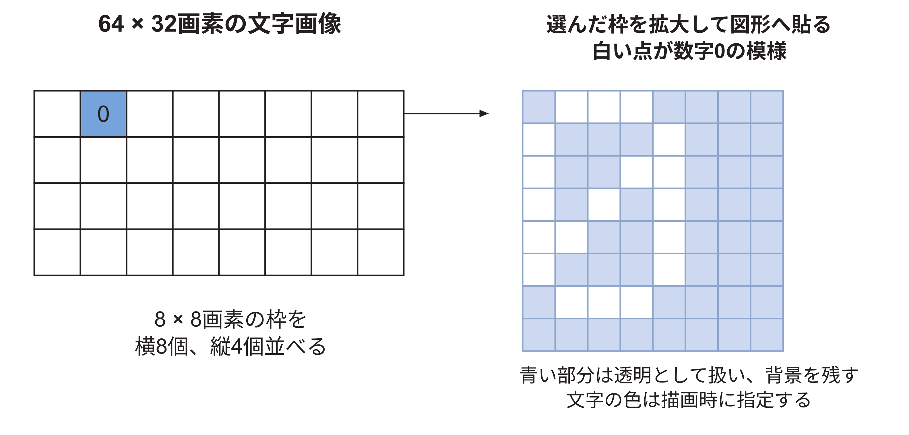
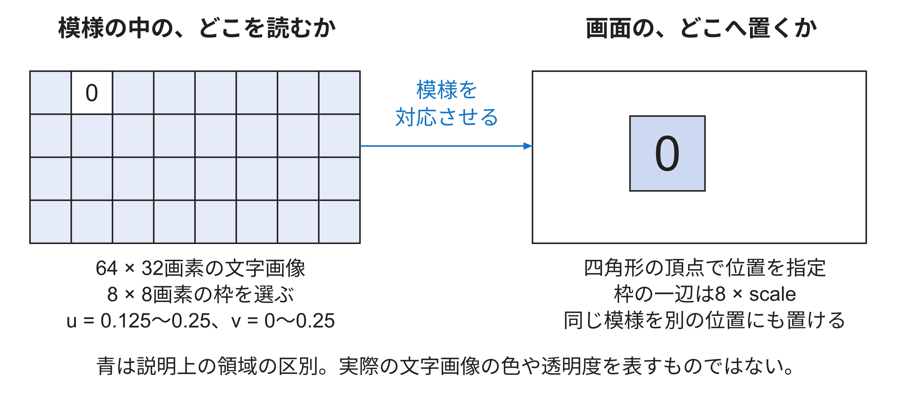

<!-- appendix-content:start -->

# 第52章 テクスチャの参照と画素の色の計算
<!-- appendix-content:end -->

[付録の総目次](../../技術付録.md) ｜ [論文本文](../../本文.md) ｜ [参考文献](../references.md)

[第IV部 RasterIXと描画システム](README.md)

ファイルパスの表記は、[資料フォルダー](../../README.md)を基準とする。

## このページの目次

- [52.1 textureとは何を保存するものか](#s_t_1)
- [52.2 textureがhardwareへ届くまで](#s_t_2)
- [52.3 page方式を使う理由](#s_t_3)
- [52.4 一つのTMUの内部順序](#s_t_4)
- [52.5 なぜ四texelを同時に読むか](#s_t_5)
- [52.6 `TextureBuffer`のmemory構成](#s_t_6)
- [52.7 wrapとclamp](#s_t_7)
- [52.8 mipmapとLOD](#s_t_8)
- [52.9 `TexEnv`が色を組み合わせる](#s_t_9)
- [52.10 一つのTMUを使う本構成](#s_t_10)
- [52.11 fogの位置](#s_t_11)
- [52.12 TMU無効時のbypass](#s_t_12)
- [52.13 RGB565とtexture format](#s_t_13)
- [52.14 texture異常の見分け方](#s_t_14)
- [52.15 texture変更の検証順](#s_t_15)
- [52.16 文字の模様を画像として持つ](#s_app_52_16)
  - [文字の模様を選んで貼るまでの数値例](#h2580)

<!-- appendix-content:start -->

## 52.1 textureとは何を保存するものか

テクスチャは、図形の表面へ対応付ける画像である。画像の一要素を画素と区別してtexelと呼ぶ。画素は画面上の位置、texelはテクスチャ画像内の位置である。一つの画素を決めるとき、テクスチャ座標`s,t`から一つまたは周囲のtexelを読み、その色を頂点色などと組み合わせる。

文字もテクスチャで描ける。一文字分のbitmapをテクスチャへ置き、文字を表示する長方形に貼る。複数文字を一枚のテクスチャ atlasへ並べ、各文字の`s,t`範囲だけを選ぶ方法も一般的である。本研究の文字描画でテクスチャを使うことは、三次元表示を意味しない。

## 52.2 textureがhardwareへ届くまで

テクスチャの元画像はCPU側でformat変換され、テクスチャ メモリ managerがdevice メモリ上のpageを割り当てる。`DeviceDataUploader`は`OP_STORE`によりテクスチャ dataをDDR3へ置く。描画時、テクスチャ stream commandは使用するpage 番地の列をハードウェアへ伝える。

`PagedMemoryReader`はpage 番地に従ってAXI readを発行し、現在使うテクスチャを`TextureBuffer`へ読み込む。`TextureBuffer`はTMUごとに一つあり、一つのテクスチャ全体を保持する設計である。公式説明では代表的に256×256×16 bitで128 KiBとなる。[RasterIX](../references.md#ref_rasterix)

| 段階 | 保存場所 | 内容 |
|---|---|---|
| 元画像 | CPU メモリ／SD card | PNGなどから得た画素 |
| device テクスチャ メモリ | DDR3 | page単位で配置したテクスチャ data |
| TextureBuffer | FPGA内部メモリ | 現在TMUがsampleするテクスチャ |
| filter出力 | パイプライン レジスタ | 一画素候補分のテクスチャ色 |

## 52.3 page方式を使う理由

テクスチャを連続する大領域だけで管理すると、異なる大きさの追加・削除で空き領域が断片化しやすい。page方式では、一定sizeのpageを複数割り当て、テクスチャ commandがpage 番地を列挙する。ハードウェアは必要なpageを順に読む。

page size、最大テクスチャ size、page数はC++設定とハードウェア構成の両方に関係する。`RenderConfigs.hpp`は、最大テクスチャのbyte数とmipmap分を考慮して必要page数を計算する。本研究のCMake設定は`NUMBER_OF_TEXTURE_PAGES=4096`、`NUMBER_OF_TEXTURES=256`であるが、これは同時に4096枚のテクスチャを内部保持する意味ではない。 更新版E6では、1ページ当たりのバイト数を2,048へそろえた。このページサイズと、確保するページの個数4096は別の設定である。

## 52.4 一つのTMUの内部順序

`TextureMappingUnit.v`は、概ね次の四段を持つ。

1. `LodCalculator`がmipmap levelを選ぶ。
2. `TextureSampler`が周囲の四texelを読む。
3. `TextureFilter`が必要なら四色を混ぜる。
4. `TexEnv`がテクスチャ色と前段色などを組み合わせる。

公式コメントの代表的なパイプライン depthは、LOD 1 周期、sample 5 周期、filter 4 周期、TexEnv 4 周期で、合計14 周期である。機能を無効にした場合のgenerateやbypassにより実効経路は変わる。

## 52.5 なぜ四texelを同時に読むか

線形filterでは、座標を囲む左上、右上、左下、右下の四texelを使う。整数部が左上texelの場所を、小数部が横・縦の混合割合を決める。

テクスチャ座標がちょうどtexel中心なら一色の影響が大きい。二texelの中間なら両方をほぼ半分ずつ混ぜる。最近傍filterでは小数部に応じて一色を選ぶ。線形filterは滑らかになるが、乗算・加算と複数read portが必要になる。

## 52.6 `TextureBuffer`のmemory構成

一周期に四texelを得るには、一portの単純RAMを四回読むだけでは毎周期のthroughputを保てない。`TextureBuffer`と下位RAMは、bankingまたは複数のメモリ配置を使い、2×2のtexel quadをまとめて取り出せるようにする。具体的な番地 bitとbank選択は`TextureBuffer.v`、`MipmapOptimizedRam.v`、`TextureSampler.v`で追う。

変更時には、論理上のテクスチャ 番地と、各BRAM bankの番地を分ける。偶数・奇数のs,tによるbank選択を誤ると、縞模様や2画素周期の入れ替わりが生じる。

## 52.7 wrapとclamp

テクスチャ座標が範囲外へ出たとき、端のtexelに固定するclampと、反対側へ繰り返すrepeatがある。テクスチャ widthとheightは2の冪として設定され、maskや上位bitを使った番地生成を簡単にする。

四texel samplingでは、右端または下端で隣のtexelを読む場合もwrap／clampを適用する必要がある。中心座標だけを範囲内へ直し、隣接番地をそのまま増やすと、端で別行や別メモリ領域を読む。

## 52.8 mipmapとLOD

mipmapは、元テクスチャを段階的に縮小した画像群である。画面上でテクスチャが小さく見えるとき、元の高解像度から少数sampleを選ぶとaliasingが出る。LODは、どの縮小levelを使うかを決める値である。

RasterIXの`LodCalculator`は、現在のテクスチャ座標と画面上で一画素ずらした位置の座標差から変化量を推定する。mipmap機能を無効にした構成では、この計算をbypassできる。二次元の等倍spriteではlevel 0だけで足りる場合が多いが、拡大縮小を行うならfilterとLODの見た目を確認する。

## 52.9 `TexEnv`が色を組み合わせる

sampleしたテクスチャ色をそのまま出すとは限らない。`TexEnv`は、テクスチャ色、頂点から補間したprimary color、前のTMUの色、constant colorをソースとして、replace、modulate、addなどの演算を行う。

例えば白い文字glyphのalphaをテクスチャに持ち、頂点色を赤にすると、テクスチャ alphaで形を決め、RGBは赤にできる。逆にテクスチャ RGBをそのままreplaceすれば、元画像の色を使う。

## 52.10 一つのTMUを使う本構成

Wally側のinstanceは`TMU_COUNT=1`である。`PixelPipeline`はTMU0を通り、二個目のTMU経路は構成に応じて生成されないかbypassされる。C++側も同じ`RIX_CORE_TMU_COUNT=1`でbuildする必要がある。

ハードウェアだけ2、ソフトウェアだけ1にすると、descriptor語数、レジスタ、テクスチャ状態の解釈がずれる。TMU数は性能・資源だけでなく、ソフトウェア／ハードウェア ABIに関わる構成値である。

## 52.11 fogの位置

`PixelPipeline`はTMUの後にfogを適用する。fogはdepthまたはdistanceに応じ、現在色とfog colorを混ぜる。二次元ゲームでは通常無効にするが、パイプライン上のbypass条件と遅延には関係する。

fog LUTは専用stream commandで更新される。単なる一個のレジスタではなく、複数entryのtableであるため、command parserがfog用streamへpayloadを振り分ける。

## 52.12 TMU無効時のbypass

公式設計ではTMUが無効なら、計算したテクスチャ色ではなく前段の色を転送する。これは「黒を出す」動作ではない。テクスチャを使わない一様色の長方形は、補間された頂点色がそのままfogまたはper-fragment段へ進む。

無効機能のbypassにも、valid、last、keep、座標、indexを同じ遅延で渡す必要がある。data colorだけをbypassし、controlが別の遅延になると画素がずれる。

## 52.13 RGB565とtexture format

外部color bufferはRGB565を使う。テクスチャ側は設定した画素 formatに応じてRGBやalphaを展開し、内部のsubpixel幅へ変換する。RGB565は赤5 bit、緑6 bit、青5 bitで、alphaを持たない。

| component | bit数 | 段階数 |
|---|---:|---:|
| red | 5 | 32 |
| green | 6 | 64 |
| blue | 5 | 32 |

薄いgradientでは色段差が見える可能性がある。テクスチャ sampleの誤りと最終RGB565量子化を分けるため、単色pattern、原色、段階gradientを使う。

## 52.14 texture異常の見分け方

| 見え方 | 候補 | 小さな試験 |
|---|---|---|
| 2画素周期の色交換 | bank／近傍番地 | 2×2で四色が異なるテクスチャ |
| 端だけ別の色 | wrap／clamp | 端を目立つ色にしたテクスチャ |
| 全体が一色 | TMU無効、page未読込、TexEnv | 4×4 checkerboard |
| 拡大時だけ崩れる | fractional座標、filter | 2倍拡大した格子 |
| 縮小時だけちらつく | LOD／mipmap | 段階別に色を変えたmipmap |
| 色は正しくalphaだけ無効 | format／TexEnv／blend | 透明・半透明・不透明の三領域 |

## 52.15 texture変更の検証順

テクスチャ formatを追加する場合、最初からゲームを動かさない。次の順で範囲を広げる。

1. C++で既知の数画素を正しいpacked値へ変換する試験。
2. `TextureSampler`へ小さなRAM内容と整数座標を与えるRTL試験。
3. 小数座標で最近傍と線形filterを比較する試験。
4. wrap／clampの四辺と四隅を試す。
5. TexEnvをreplaceに固定して色だけ確認する。
6. blendとalphaを有効にする。
7. 実機で拡大画像と1:1画像を比較する。

複数機能を同時に有効にすると、誤りがsample、filter、TexEnv、blendのどこか分からなくなる。

## 52.16 文字の模様を画像として持つ

本ゲームの文字は、小さな画像の模様を四角形に貼って描く。図形へ貼る模様の画像をテクスチャと呼ぶ。文字ごとに輪郭を新しく計算するのではなく、「Aの模様」「0の模様」などを一枚の画像に並べておく。

実装では64×32画素の画像を作り、その中に8×8画素の枠を横8個、縦4個並べる。一つの枠の中に、5×7の点で文字を表す。点がある場所は不透明、ない場所は透明にする。最大32枠あり、本ゲームで必要な文字だけを登録する。

例えば数字0を描くときは、0の模様を置いた枠を選び、その範囲を画面上の四角形へ対応付ける。拡大率2なら、8×8の枠を16×16の四角形へ貼る。模様の外側の透明部分では背景が残る。文字の色は、同じ白い模様に指定色を組み合わせて変える。

createFont関数のpixelsはCPU側で作る画像データである。glTexImage2Dでライブラリへ渡し、その後の描画で利用できるようにする。文字ごとに毎回この画像全体を作り直しているわけではない。

図52.2は、createFontで作る文字画像の配置を説明する。左の青い枠は、数字0が入る枠を示す。

枠一つは8×8画素、その中で文字の模様に使うのは5×7画素である。右は数字0の枠を拡大した図で、白いマスだけが不透明になっている。青いマスは透明部分を図で見えるように塗ったもので、青色が画面へ描かれるわけではない。文字を置く四角形にこの模様を対応させ、透明部分には背景を残す。模様の行ごとの値はBreakout.hppのglyph関数で14、17、19、21、25、17、14と定義されている。

### 文字の模様を選んで貼るまでの数値例

数字0は、文字画像の二番目の枠にある。枠番号は0から始めるので、番号1である。横に8枠あり、一枠の幅が8画素なので、番号1の枠は画像の左から8画素進んだ場所にある。縦方向は最初の行なので0画素である。

この枠を選ぶとき、横位置を画像全体の幅64で割った8/64=0.125、枠の横幅を8/64=0.125、縦幅を8/32=0.25として渡す。u、vはこの模様側の位置を表す。x、yは画面に置く四角形の位置を表す。模様側の場所と、画面側の場所にそれぞれ二つの座標がある。

図52.3の左は元の文字画像、右はゲーム画面である。左の枠を選び、右の四角形へ貼る。例えばscale=2なら、元の8×8画素の枠を16×16画素の大きさにする。本ゲームの拡大・縮小の指定はGL_NEARESTであり、近くの模様の画素を選ぶ方式を使う。

元の文字画像では文字の点を白、それ以外を透明にしている。文字色を変えるときは、その白い模様に指定色を反映する。透明な点では背景を残す。従って、「文字の周りも白い四角で塗りつぶす」動作とは違う。図中で透明部分を青く塗っている箇所があっても、それは紙の上で区別するための色である。
<!-- appendix-content:end -->

---

[前：第51章 描画回路の画素列挙と属性の補間](rasterizer-interpolation.md) ｜ [次：第53章 画素候補の採否と色の混合](fragment-tests-blending.md)
