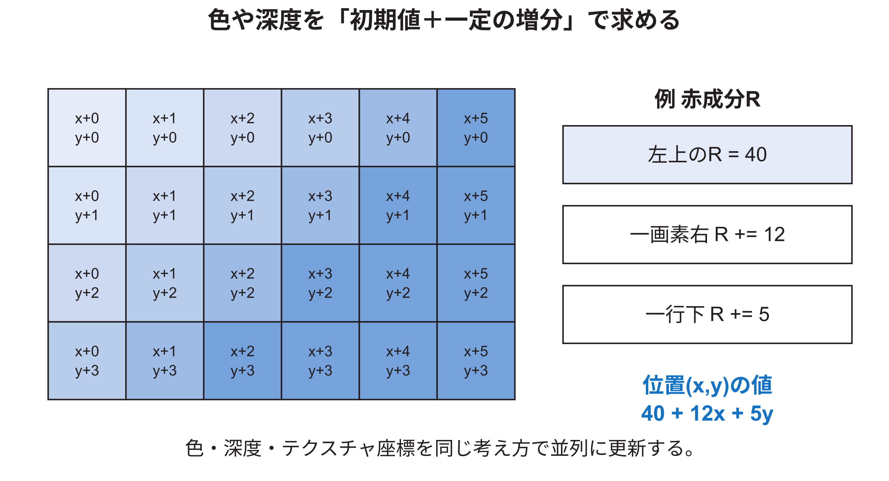

<!-- appendix-content:start -->
<a id="ch_q"></a>
# 第49章 CPU側で三角形記述子を作る
<!-- appendix-content:end -->

[付録の総目次](../../技術付録.md) ｜ [論文本文](../../本文.md) ｜ [参考文献](../references.md)

[第IV部 RasterIXと描画システム](README.md)

ファイルパスの表記は、[資料フォルダー](../../README.md)を基準とする。

## このページの目次

- [49.1 CPU側処理を理解する理由](#s_q_1)
- [49.2 OpenGLのstate machineとして読む](#s_q_2)
- [49.3 `RenderObj`が配列の読み方を保存する](#s_q_3)
- [49.4 頂点一個に付随する値](#s_q_4)
- [49.5 座標が通る空間](#s_q_5)
- [49.6 primitive assemblyを詳しく読む](#s_q_6)
- [49.7 画素中心と固定小数点座標](#s_q_7)
- [49.8 辺関数の意味](#s_q_8)
- [49.9 一画素ごとに掛け算し直さない](#s_q_9)
- [49.10 bounding boxの役割](#s_q_10)
- [49.11 barycentric weightと属性補間](#s_q_11)
- [49.12 texture座標とperspective correctionの準備](#s_q_12)
- [49.13 浮動小数点から固定小数点への変換](#s_q_13)
- [49.14 画面を帯に分けるときの記述子調整](#s_q_14)
- [49.15 display listを二組持つ理由](#s_q_15)
- [49.16 CPU側で異常を切り分ける方法](#s_q_16)
- [49.17 記述子dumpを照合するときの手順](#s_q_17)

<!-- appendix-content:start -->
<a id="s_q_1"></a>
## 49.1 CPU側処理を理解する理由

RasterIXのRTLだけを読んでも、入力される数値がなぜその値なのかは分からない。辺関数の初期値、色の増分、テクスチャの`s,t,q`は、CPU側のC++が頂点から計算している。RTLの挙動を変更するには、どこまでが事前計算で、どこからがハードウェア計算かを理解する必要がある。

本設定では、C++側の主な流れは次である。

```text
OpenGL風API
  → VertexQueue
  → RenderObj
  → VertexPipeline
  → PrimitiveAssembler
  → 頂点変換・clipping・viewport
  → Rasterizer.cpp
  → TriangleStreamCmd
  → DisplayList
```

<a id="s_q_2"></a>
## 49.2 OpenGLのstate machineとして読む

OpenGL風APIは、各関数が独立した完全な命令ではなく、「現在の状態」を更新しながら頂点へ関連付けるstate machineである。現在色、現在のテクスチャ座標、行列、blend設定などが保持され、後の描画に使われる。

例えば次の二つは結果が異なる。

```cpp
glColor3f(1, 0, 0);
glVertex2f(0, 0);
glColor3f(0, 0, 1);
glVertex2f(100, 0);
```

最初の頂点は赤、次の頂点は青を持つ。三角形の第三頂点を緑にすれば、内部の画素候補は三頂点の色を補間したgradientになる。「色の関数を呼んだ場所に色が描かれる」のではなく、その後に追加する頂点の属性が変わる。

<a id="s_q_3"></a>
## 49.3 `RenderObj`が配列の読み方を保存する

`RenderObj`は、頂点値だけでなく、配列が有効か、要素数、型、stride、ポインタ、indexの有無、描画modeを持つ。strideは、一頂点分進むと次の同種属性まで何byte移動するかを表す。0なら実装が要素sizeから連続配置として扱う。

この抽象化により、`glBegin`／`glEnd`で作った内部配列と、client vertex arrayから渡した配列を同じ`VertexPipeline::drawObj`へ流せる。VBOを使う場合も、最終的にこの実装がどこから頂点をfetchし、CPU上の変換をどこまで残すかを確認しなければ性能を判断できない。

<a id="s_q_4"></a>
## 49.4 頂点一個に付随する値

`VertexPipeline::fetch`は、position、normal、color、point size、各TMUのテクスチャ coordinateを一つの`VertexParameter`へまとめる。positionだけを処理しているわけではない。

| 属性 | 代表的な成分 | 二次元長方形での例 |
|---|---|---|
| position | x, y, z, w | xとyを変え、zとwは一定 |
| color | r, g, b, a | 四頂点を同じ赤 |
| normal | x, y, z | lighting無効なら結果へ影響しない |
| テクスチャ | s, t, r, q | テクスチャなしならTMU無効 |
| point size | 大きさ | QUADSでは未使用 |

無効な機能の属性も型には存在するが、実行時のfeature enableにより後段でbypassできる。型に存在することと、回路がそのframeで有効に使うことを分ける。

<a id="s_q_5"></a>
## 49.5 座標が通る空間

頂点位置は、一般に次の空間を順に通る。

| 空間 | 主な変換 | 何を表すか |
|---|---|---|
| object | model座標 | 部品自身の基準位置 |
| eye | model-view | cameraから見た位置 |
| clip | projection | 視野範囲と同次座標 |
| normalized device | wで除算 | おおむね−1から1の範囲 |
| window | viewport | 画面上のx、y、depth |

二次元ゲームでは、object座標を画面画素に近い値として使い、正投影でwindow座標へ対応させられる。しかしclippingは依然必要である。画面外へはみ出した長方形をそのまま巨大なbounding boxとしてRasterizerへ渡すと、範囲外番地を作る危険がある。頂点パイプラインは、視野内に残る部分を作ってから画面座標へ移す。

<a id="s_q_6"></a>
## 49.6 primitive assemblyを詳しく読む

`PrimitiveAssemblerCalc`は、queueへ入った頂点を、三角形、線、点へ組み立てる。`TRIANGLES`は三頂点ごと、`TRIANGLE_STRIP`は新しい一頂点ごと、`TRIANGLE_FAN`は最初の頂点を共有して三角形を作る。`QUADS`は四頂点ごとに二三角形を作る。

`TRIANGLE_STRIP`で偶数・奇数ごとに頂点順を入れ替えるのは、表裏を決めるwindingの向きをそろえるためである。辺関数の符号は頂点順に依存する。本実装は最終的にareaの符号を正規化するが、primitive組立て側も一貫した順を保つ。

<a id="s_q_7"></a>
## 49.7 画素中心と固定小数点座標

CPU側`Rasterizer.cpp`は、画面座標を小数部5 bitの固定小数点へ変換する。1画素は32という整数差で表され、0.5画素は16で表される。ただし、「各画素の中心へ常に0.5を足して辺関数を評価する」という実装ではない。辺関数の開始点は整数画素座標`(bbStartX×32, bbStartY×32)`であり、0.5画素の定数16は主にbounding boxの整数化へ使われる。Breakout側は別に`glTranslatef(-0.5, 0.5, 0)`を適用し、アプリケーション上の半画素中心とRasterIXの整数sample格子を合わせている。

固定小数点は、「小数が使えない」という意味ではない。整数の下位bitを小数部と決める表現である。例えば小数部5 bitなら次となる。

| 実数 | 保存整数 | 解釈 |
|---:|---:|---|
| 0.0 | 0 | 0÷32 |
| 0.5 | 16 | 16÷32 |
| 1.0 | 32 | 32÷32 |
| 3.25 | 104 | 104÷32 |

この形式により、RTLは多くの位置計算を整数加算として実装できる。浮動小数点からの変換式は、実装上`static_cast<int32_t>(value×32+0.5)`である。C++の整数変換は0方向へ切り捨てるため、正数の四捨五入と同じ規則を負数へ対称に適用したものではない。例えば`-1.0→-31`、`-0.5→-15`、`-1/32→0`となる。[技術付録56.7節](coordinates-edge-equations.md#s_x_7)で、この非対称性と影響範囲を表にする。

<a id="s_q_8"></a>
## 49.8 辺関数の意味

二点AとBが作る向き付きの辺に対し、点Pがどちら側にあるかを次で調べる。

```text
E(A,B,P) = (Px − Ax)(By − Ay) − (Py − Ay)(Bx − Ax)
```

三角形の三辺についてEを求め、頂点順に合わせて符号を正規化すると、三つが0以上の点を内側として扱える。E=0は辺上である。実装では三辺の値を`w0,w1,w2`と呼ぶ。

三角形の向きを逆にすると、すべての符号が逆になる。CPU側は三頂点からareaを求め、その符号に応じて`sign`を選び、areaと各辺関数を同じ向きへそろえる。areaが0なら三点が一直線上などの退化三角形なので描画しない。

<a id="s_q_9"></a>
## 49.9 一画素ごとに掛け算し直さない

辺関数はxとyに関する一次式である。Pを一画素右へ動かしたときの変化量は常に同じで、次の行へ動かしたときの変化量も常に同じになる。CPU側は三辺について`wXInc`と`wYInc`を一度計算する。RTLは開始位置の`wInit`へ増分を加える。

```text
w(x + 1, y) = w(x, y) + wXInc
w(x, y + 1) = w(x, y) + wYInc
```

これが、CPU側で辺関数を事前計算する主な理由である。RTLに三頂点を渡して毎画素の乗算をさせるより、加算器で一画素ずつ進めやすい。

<a id="s_q_10"></a>
## 49.10 bounding boxの役割

三角形が画面全体を覆わない場合、全画素で辺関数を試す必要はない。三頂点の最小x、最大x、最小y、最大yから外接する長方形を作り、その範囲だけを走査する。これがbounding boxである。

bounding box内にも三角形外の画素はあるため、範囲を作るだけで塗る画素が確定するわけではない。各位置で三辺の判定を行う。CPU側の`Rasterizer.cpp`は、scissorと全く重ならない三角形を早期に捨てるが、`TriangleDesc`へ既に保存したbounding boxをscissor範囲へ書き換えない。画素単位の半開区間`start <= p < end`による除外は、後段のRTL `FramebufferScissor.v`が行う。したがって、「CPU側が記述子のbounding boxをscissorへ切り詰める」という説明は正しくない。

<a id="s_q_11"></a>
## 49.11 barycentric weightと属性補間

三辺の辺関数を三角形areaで割ると、各頂点の影響割合として使える。ここでは`λ0, λ1, λ2`と書く。三つの和は概ね1になる。各頂点の赤成分を`R0,R1,R2`とすると、点Pの赤は次で求められる。

```text
R(P) = λ0 R0 + λ1 R1 + λ2 R2
```

色だけでなく、depthやテクスチャ用の値も同じ考え方で補間する。CPU側はbounding box開始位置における値と、x・y方向の増分を作る。図49.1は、値を毎画素の増分で更新する考えを示す。



四頂点が同じ赤の長方形では、三角形内の三頂点色も同じなので、色のX増分とY増分は0になる。異なる色ならgradientになる。

<a id="s_q_12"></a>
## 49.12 texture座標とperspective correctionの準備

画面上でsとtをそのまま線形補間すると、遠近のある面でテクスチャが不自然に歪む。perspective divide後の頂点第四成分を`r_i=1/w_clip,i`、同次テクスチャ座標を`(s_i,t_i,q_i)`、画面上のbarycentric weightを`λ_i`と書く。CPU側は各頂点で`(s_i r_i, t_i r_i, q_i r_i)`を作り、RTLはそれぞれを線形補間する。画素候補で使う座標は次である。

```text
s_fragment = Σ(λ_i s_i r_i) / Σ(λ_i q_i r_i)
t_fragment = Σ(λ_i t_i r_i) / Σ(λ_i q_i r_i)
```

`glTexCoord2f`では`q_i=1`なので、標準的なperspective-correct interpolationになる。RTLの`q`はテクスチャ座標の第四成分とclip-space wの両方を含む値であり、単に頂点のwそのものではない。

二次元正投影で各頂点の`r_i`と`q_i`が同じなら、分子と分母の共通倍率が消え、結果はsとtの通常の線形補間になる。しかし同じ汎用回路を通るため、固定小数点変換や逆数パイプラインは構成上残る。固定小数点経路ではCPU側が三頂点の`r_i`ベクトルをEuclidean normで正規化するが、その共通倍率も上式の分子と分母で相殺される。

<a id="s_q_13"></a>
## 49.13 浮動小数点から固定小数点への変換

CPU側の`TriangleDesc`は浮動小数点成分を持つ形があり、Wally構成のハードウェアは固定小数点補間器を使う。`TriangleStreamF2XConverter`は、streamされた値をハードウェアの形式へ変換する。代表的な形式は次である。

| 値 | 入力形式 | 意味 |
|---|---|---|
| テクスチャ s,t,q | S3.28 | 符号1、整数部3相当、小数部28 |
| depth z,w | S1.30 | 小数精度を多く持つ |
| color r,g,b,a | S7.24 | 補間中の範囲に余裕を持つ |

表記中のSはsignedを表す。本章では、例えばS3.28を「符号1 bit、整数3 bit、小数28 bit、合計32 bit」と読む。このとき範囲は`-8`から`8−2^-28`、刻みは`2^-28`である。S1.30は`-2`から`2−2^-30`、S7.24は`-128`から`128−2^-24`となる。

`TriangleStreamF2XConverter.v`はテクスチャ、color、depthについてそれぞれoffset `-28`、`-24`、`-30`を`FloatToInt.v`へ渡す。変換器は最初に捨てるbitが1なら絶対値へ1を足し、その後に負号を適用する。これはties-to-evenではない。表現範囲を越えた場合は飽和せず0を出す。固定小数点化後の属性更新も32 bitであり、加算overflowを検出して飽和する回路はない。正しい結果には、入力と増分が範囲内に収まるという前提が必要である。

さらに、右shift量が0のとき、公式ソースは存在しない`shiftSize-1`番bitを丸めbitとして読む。未変更RTLの4値simulationでは不定値が現れたが、Nexys Videoと同じArtix-7へVivado 2025.2で合成した後のshift 0代表値は期待値と一致した。これとは別に、非常に小さい正規化floatでは真のshift量が5 bitへ切り詰められ、仮数bitを誤って丸めbitにする。正負の例は合成後にも±1となった。Breakout相当の単色四角形と文字の代表descriptorはこの極小値域へ入らなかった。式、入力下限、case、再実行手順は[技術付録57.3節](fixed-point-color-math.md#s_y_3)と[技術付録58.7節](mathematical-verification.md#s_z_7)に示す。

正規化有限値の不偏指数を`e`、出力の小数bit数を`F`、`p=e+F`と置くと、全24 bit仮数に対してソース算術を形式確認できた範囲は`-8<=p<=22`と`24<=p<=30`である。`p=23`は上記のshift 0境界、`p<-8`は極小値alias、`p>=31`は0を返すoverflow経路になる。この区分は「固定小数点形式の最大・最小だけを守れば十分」という意味ではなく、変換器固有の入力契約も必要であることを示す。

<a id="s_q_14"></a>
## 49.14 画面を帯に分けるときの記述子調整

RasterIX_IFは、画面の一部の帯だけを内部Framebufferへ描く。三角形が現在の帯と重ならなければ、その帯のdisplay listへ入れない。上の帯から続く三角形なら、帯の開始行まで進んだ分だけ`wInit`、color、depth、テクスチャの開始値をY増分で更新する。

`Rasterizer::increment`は、この調整を行う。例えば三角形のbounding boxがy=70から140までで、現在の帯がy=96から191なら、26行分のY増分を開始値へ加える。これにより、内部Framebufferの先頭行から描き始めても、画面全体でy=96の属性値になる。

<a id="s_q_15"></a>
## 49.15 display listを二組持つ理由

Threaded構成では、CPU側が次のdisplay listを作る間に、前のdisplay listを転送・実行できるよう、各帯について二組のbufferを使う。これは画面のfront bufferとback bufferとは別である。display list bufferは命令列を保存し、color bufferは完成画素を保存する。

一組目と二組目の意味は、同じ帯の命令列を交互に作るためであり、帯が十本あるという意味ではない。五帯×二組に転送用領域を加えた構成は[技術付録第43章](configuration-calculations.md#ch_h)と[本文第9章](../../本文.md#ch_9)で説明した。

<a id="s_q_16"></a>
## 49.16 CPU側で異常を切り分ける方法

RTLへ送る前の`TriangleDescX`を記録できれば、画像異常をCPU側とRTL側へ分けやすい。

| 観察値 | 正常条件の例 | 異常なら疑う場所 |
|---|---|---|
| bounding box | 画面変換後の三頂点を囲む候補範囲（scissorによる画素maskの前） | viewport、clipping、固定小数点化 |
| area | 0でない | 頂点重複、頂点順、変換 |
| w初期値・増分 | 画素移動で一貫して変化 | エッジ function計算 |
| 一様色の増分 | おおむね0 | color配列、補間準備 |
| 一定q | 二次元正投影なら頂点間で同じ | projection、wの扱い |
| command size | 構成の構造体sizeと一致 | pack、TMU_COUNT、コンパイラ ABI |

同じ記述子をソフトウェア rasterizerとRTL simulationへ入力し、両者の画素集合を比較すると、境界規則の差を検出できる。

<a id="s_q_17"></a>
## 49.17 記述子dumpを照合するときの手順

CPU側の記述子を保存するだけでは、まだ「正しい数値か」を判断できない。まず一様色でテクスチャを使わない小さな三角形を一つだけ送り、C++が生成した各fieldを、送信した32 bit語と対応付ける。次にRTL simulationの`CommandParser`が同じ語を同じレジスタへ格納したかを見る。この二段階で一致すれば、CPU側の構造体からstream、streamからRTL レジスタまでのbit配置が一致したと判断できる。

確認順序は次のとおりである。

1. `TriangleDescX`の各field名、bit幅、符号の有無を表にする。
2. C++側でfieldの値と、送信直前の32 bit語列を16進数で記録する。
3. RTL側で、各handshake時の`data`、語番号、格納先レジスタを記録する。
4. 一つのfieldが複数語にまたがる場合は、上位・下位の順序を確認する。
5. signed値は16進数だけでなく、符号拡張後の十進値でも比較する。
6. 一致後にだけ、複数TMU、テクスチャ、gradientなどfield数の多い入力へ広げる。

この照合で、C++側の`sizeof`が合うことだけを根拠にしない。構造体padding、TMU数、パラメータで無効になったfield、Verilog側のslice位置のいずれかが違っていても、全体sizeが偶然一致する可能性がある。field単位の既知値を使うと、語順の入替えも見つけられる。
<!-- appendix-content:end -->

---

[前：第48章 三種類の命令とビットの配置](command-bit-layout.md) ｜ [次：第50章 RTL全体の制御と停止を読む](rtl-control-stalls.md)
