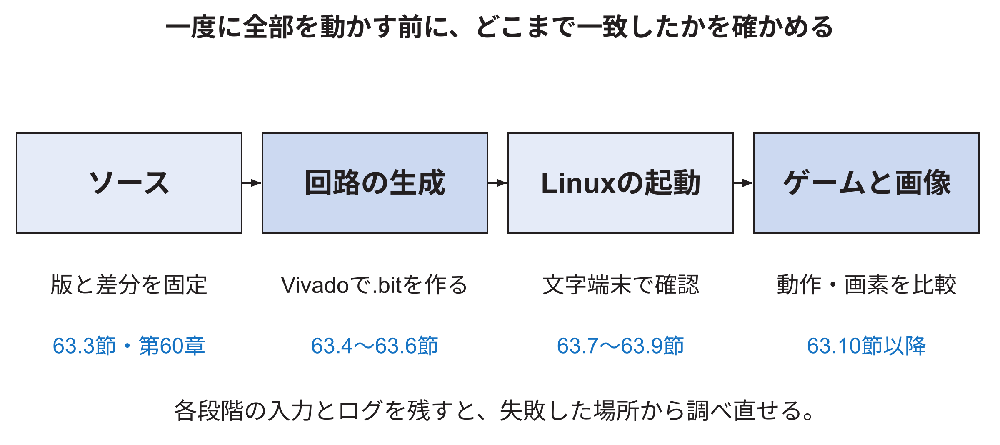
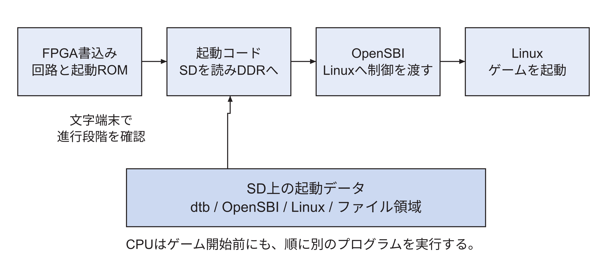
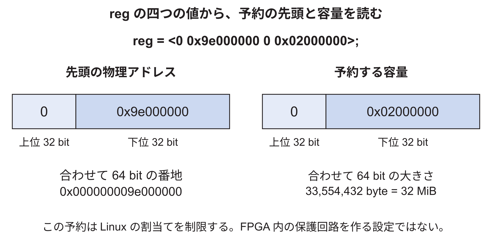

<!-- appendix-content:start -->
<a id="ch_m"></a>
# 付録M 同じゲーム機を作り直す手順
<!-- appendix-content:end -->

[付録の総目次](../../技術付録.md) ｜ [論文本文](../../本文.md) ｜ [参考文献](../references.md)

[第V部 Nexys Videoへの統合、実験、再現](README.md)

ファイルパスの表記は、[資料フォルダー](../../README.md)を基準とする。

## このページの目次

- [M.1 再現の二つの進め方](#s_m_1)
- [M.2 必要な機器と道具](#s_m_2)
- [M.3 固定したソースを取得する](#s_m_3)
- [M.4 開発用の道具を準備する](#s_m_4)
- [M.5 FPGAの回路を生成する](#s_m_5)
- [M.6 実装レポートを保存する](#s_m_6)
- [M.7 Linuxとデバイスツリーを用意する](#s_m_7)
- [M.8 SDカードへ起動データを入れる](#s_m_8)
- [M.9 FPGAを書き込み、文字端末で起動を見る](#s_m_9)
- [M.10 ゲームをクロスコンパイルする](#s_m_10)
- [M.11 実機でゲームを動かす](#s_m_11)
- [M.12 正しさの確認を段階的に行う](#s_m_12)
- [M.13 性能比較をやり直すときの順番](#s_m_13)
- [M.14 動かないとき、どこへ戻るか](#s_m_14)
  - [ログが出た場所から、動いている部分を一つずつ確定する](#h2339)
- [M.15 FPGAの書き込みからゲーム開始までの起動経路](#s_m_15)
- [M.16 デバイスツリーの四つの数字を読む](#s_m_16)
- [M.17 エラーを一つの部品へ絞っていく実例](#s_m_17)

<!-- appendix-content:start -->
ここからは、これまで説明した接続を同じ版のソースから生成し、実機で確認する順序を示す。コマンドの前に実行場所を確認し、後に何が出来たかを確認する。開発用Ubuntuでの成功、FPGAの設定成功、Wally上のLinux起動、ゲームの画像表示は、それぞれ別の段階である。前段が出来たことを確かめてから次へ進む。

<a id="s_m_1"></a>
## M.1 再現の二つの進め方

完成した構成を動かす場合は、本章の手順で固定した版を取得し、回路とソフトウェアを生成する。変更そのものを理解して再実装する場合は、[付録A](appendix-a.md#ch_a)と付属の「NexysVideo対応を変更前から再現する.md」を使う。後者は、対応前の版から12ファイルを順に変更する演習である。

完成形のクローンだけでは、どこを設計したかは分かりにくい。一方、最初から全差分を手で書くと、動作する基準を持てない。まず完成形のソースと生成物を確認し、その後、別の作業場所で変更を再現すると、誤った箇所を比べやすい。

以下のコマンドは、これから読者が再実行するための手順である。原稿作成時にFPGAを書き換えたりSDカードへ書き込んだりした、という記録ではない。保存済みの実機結果は[第13章](../../本文.md#ch_13)に区別して示した。


図M.1は、再現作業を進める順序と、この章の該当節を対応させた案内である。



まず同じソースを用意し、次に回路を作る。Linuxの文字出力を確かめてから、ゲームの実行と画像の確認へ進む。各段階の名前と節番号を読めば、色がなくても順番を追える。途中で止まった場合は、その段階に入るファイル、設定、ログを前の段階と比べる。

<a id="s_m_2"></a>
## M.2 必要な機器と道具

| 用意するもの | 用途 | 確認する点 |
|---|---|---|
| Nexys Videoと12 V電源 | 回路を動かす | 基板の型名と電源仕様 |
| USB PROGへの接続 | FPGAへ回路設定を送る | J12側であること |
| USB UARTへの接続 | 実機Linuxの文字端末 | J13側であること |
| microSDとカードリーダー | 起動データとゲームを保存 | 保存済みデータの扱い |
| 映像を受ける機器とケーブル | HDMI OUTからの映像確認 | 640×480のDVI映像を受けられるか |
| Ubuntuの開発環境 | ソース取得とビルド | 十分な空き容量と必要な権限 |
| Vivado | FPGAの生成と書き込み | 対象Artix-7と基板定義 |
| RISC-V用ツール群 | 起動コードとLinuxアプリの生成 | bare-metal用とLinux用の区別 |

本研究の生成記録にはVivado 2025.2を用いている。別版を用いるとIPの版や配置配線結果が変わる可能性がある。生成前にvivado -versionを保存する。USB共有やSDWire3は特定の作業環境を遠隔操作するための補助であり、ゲーム機の構成に必須ではない。

<a id="s_m_3"></a>
## M.3 固定したソースを取得する

実行場所は開発用Ubuntuである。新しい空のディレクトリへ取得し、現在使っている開発フォルダを上書きしない。次のwally-reproduceは、この説明で新しく作る作業用フォルダ名である。

```bash
mkdir -p "$HOME/projects"
cd "$HOME/projects"
git clone --recurse-submodules \
  https://github.com/SoshiroFujimori/wally-game-console.git \
  wally-reproduce
cd wally-reproduce
git checkout d3e181ac434a01a1f174549b5fbc7ee03a8875b4
git submodule update --init --recursive
```

cloneは親リポジトリを取得する。checkoutは本稿の版へ合わせる。submodule updateは、親が指定するRasterIXなどの版を取得する。初回のcloneが将来のmainを取っていても、checkout後のsubmodule updateで本稿の指定へそろえる。

次に版を確認する。長いハッシュ値は、その版を特定する識別子である。出力が違う場合は、そのまま「同じ構成」として先へ進まない。

```bash
git rev-parse HEAD
git -C addins/rasterix rev-parse HEAD
git status --short
git submodule status --recursive
```

最初の二行の期待値は8.1節の二つのハッシュである。git status --shortが何も出さなければ、追跡対象ファイルに変更がない。サブモジュールに先頭の+や-がある場合は、指定版との差や未初期化を調べる。

<a id="s_m_4"></a>
## M.4 開発用の道具を準備する

WALLYは、このリポジトリの場所を示す既存の環境変数である。独自の変数名へ置き換える必要はない。リポジトリの直下で次のように設定する。

```bash
export WALLY="$PWD"
```

まだWally用のツール群がない新規環境では、固定版のREADMEに従い、必要なパッケージとツール群を準備する。利用者権限でツールを入れる場合、既存手順は次の形である。

```bash
sudo "$WALLY/bin/wally-package-install.sh"
"$WALLY/bin/wally-tool-chain-install.sh"
source "$WALLY/setup.sh"
```

最初の行はUbuntuのパッケージを追加する操作である。二行目はコンパイラ、エミュレータ、Buildrootなどを生成する。時間と数十GBの空き領域を使うため、既存のツール群がある環境で無条件にやり直す手順ではない。三行目は、その端末で必要なパスや変数を設定する。[Console26](../references.md#ref_console26)

この導入スクリプトが取得する外部プロジェクトには、ブランチ名による指定もある。親リポジトリの版を固定しただけで、後日生成される全ツールが同一になるとは限らない。再現記録には、Vivado、各コンパイラ、Buildrootのコミット、Linux設定を残す。保存済み数値との完全な再現性を論じるときは、ソースだけでなく道具の版も対象になる。

```bash
command -v vivado
riscv64-unknown-elf-gcc --version
command -v dtc
printf '%s\n' "$WALLY" "$RISCV"
```

ここでunknown-elfは主に起動用のプログラムなどに使う道具である。後でLinux上のゲームを作るときは、別のriscv64-buildroot-linux-gnu-g++を指定する。名前が似ていても、実行環境が違う。

<a id="s_m_5"></a>
## M.5 FPGAの回路を生成する

Vivadoのsettings64.shを、そのインストール場所から読み込む。保存した環境の例は次の通りである。別のパソコンではインストール先を実際の場所へ合わせる。

```bash
source "$HOME/AMD/2025.2/Vivado/settings64.sh"
cd "$WALLY/fpga/generator"
make nexysvideo-rasterix
```

nexysvideo-rasterixは、Nexys VideoとRasterIXを有効にする生成対象である。描画なしの基板対応だけを確認する場合はmake nexysvideoを使う。生成されるIPのフォルダは共有されるため、同じ作業場所で別の基板設定から切り替える場合は、既存READMEのcleanIPの説明も確認する。新規の再現用クローンでは、他の作業の生成物を消す必要はない。

生成の途中には、構成設定の展開、起動コードの生成、IP生成、合成、配置配線、bitstream生成がある。最後に文字端末がVivadoの入力待ちになる場合もある。単に処理が止まったように見えるだけで失敗と決めず、ログとrunの状態を確認する。

成功の判断は、.bitファイルが存在することだけでは足りない。wally.log内のERROR、配置配線の終了状態、reports以下の時間解析を確認する。生成途中の古い.bitを、今回成功したものと取り違えないよう、生成時刻とハッシュを記録する。

<a id="s_m_6"></a>
## M.6 実装レポートを保存する

VivadoでWallyFPGA.xprを開き、配置配線結果impl_1を開いた状態で、次のようなレポートを作る。report_timing_summaryは時間条件、report_utilizationは資源使用量、report_drcは設計規則の指摘を保存する。

```tcl
open_run impl_1
report_clocks -file reproduced-clocks.rpt
report_timing_summary -file reproduced-timing.rpt
report_utilization -hierarchical -file reproduced-use.rpt
report_drc -file reproduced-drc.rpt
report_cdc -file reproduced-cdc.rpt
```

CPU20 MHz、描画側100 MHz、画素25.2 MHzなど、意図したクロックが認識されているかを見る。時間余裕が負であれば、その生成物を成功扱いにしない。元のレポートと値が少し違う場合は、ツール版や生成条件を比較する。元の+0.170 nsを、再生成していない結果の欄へ写してはならない。

<a id="s_m_7"></a>
## M.7 Linuxとデバイスツリーを用意する

Wallyの導入手順でBuildrootが準備できたら、そのoutput/imagesにLinuxのImage、fw_jump.binなどがあるか確認する。新しくLinuxを生成する必要がある場合はlinux/README.mdに従う。既存のlinux/Makefileの既定処理には掃除や移動も含まれるため、既に使用しているBuildrootを無条件に上書きする操作として使わない。

RasterIX付き構成では、wally-nexysvideo-rasterix.dtsを使う。描画なし用のdtsでは画像領域の予約が一致しない。次は作業用ディレクトリへdtbを生成する例である。

```bash
mkdir -p "$HOME/wally-reproduce-output"
cd "$HOME/wally-reproduce-output"
dtc -I dts -O dtb \
  -i "$WALLY/linux/devicetree" \
  -o wally-nexysvideo-rasterix.dtb \
  "$WALLY/linux/devicetree/wally-nexysvideo-rasterix.dts"
```

dtsは人が読む設定、dtbは起動時に渡すバイナリ形式である。生成したdtbを逆変換して、メモリ容量とreserved-memoryを確認できる。32 MiBの予約領域が0x9e000000から始まること、CPU等のクロック値が20,000,000であることを、元のdtsと照らす。

<a id="s_m_8"></a>
## M.8 SDカードへ起動データを入れる

SDカードへの書き込みは、そのカードの内容を置き換える操作である。まずカードを挿す前後でlsblkを読み、容量と機種名で対象を特定する。本稿では、特定の/dev/sdbなどを正解として固定しない。パソコンによって番号が変わるためである。

```bash
lsblk -o NAME,SIZE,MODEL,TRAN,MOUNTPOINTS
```

対象カードが分かったら、必要な既存データを保存し、そのカード上のファイルシステムをアンマウントする。linux/sdcard/flash-sd.shへ、Buildrootの場所、生成したdtb、カード全体のデバイスを渡す。次は置き換える項目を示した書式であり、山括弧のまま実行するコマンドではない。

```text
sudo "$WALLY/linux/sdcard/flash-sd.sh" \
  -b <Buildrootの場所> \
  -d <wally-nexysvideo-rasterix.dtbの場所> <カード全体>
```

書き込み完了後に同期と取り外しを行い、Nexys VideoのmicroSDスロットへ入れる。操作補助としてSDWire3を使う場合も、共有先の切り替えは実験環境の手順であり、回路ソースへ専用処理を追加する理由にはならない。

<a id="s_m_9"></a>
## M.9 FPGAを書き込み、文字端末で起動を見る

基板を指定の電源で動かし、JP4はJTAG設定、VADJは標準の1.2 Vとする。USB PROGはJ12、UARTは別のJ13である。VivadoのHardware Managerで対象を開き、今回生成した.bitを指定してFPGAへ書き込む。[NexysVideo](../references.md#ref_nexysvideo)[Console26](../references.md#ref_console26)

文字端末は115200 bpsで接続する。Ubuntu側でUARTの実デバイス名を確認してから使う。次の/dev/ttyUSB_UARTは、実際に検出した名前へ置き換えるための表記である。

```text
picocom -b 115200 /dev/ttyUSB_UART
```

CPU RESETを押すと、CPU側が再起動する。FPGA設定を消す操作とは区別する。端末に起動ログが出てLinuxのプロンプトへ到達するか確認する。何も出なければ、まず端子の取り違え、デバイス名、通信速度、書き込んだbitstreamを確認する。いきなり描画ライブラリを変更する段階ではない。

<a id="s_m_10"></a>
## M.10 ゲームをクロスコンパイルする

実行場所を開発用Ubuntuへ戻す。Buildrootのhost/binをPATHへ加える。次の例はRISCV配下の標準的な場所を使うため、実際の導入場所が異なる場合は合わせる。

```bash
export PATH="$RISCV/buildroot/output/host/bin:$PATH"
cd "$HOME/wally-reproduce-output"
cmake -S "$WALLY/examples/rasterix" -B rasterix-build \
  -DCMAKE_SYSTEM_NAME=Linux \
  -DCMAKE_SYSTEM_PROCESSOR=riscv64 \
  -DCMAKE_C_COMPILER=riscv64-buildroot-linux-gnu-gcc \
  -DCMAKE_CXX_COMPILER=riscv64-buildroot-linux-gnu-g++ \
  -DCMAKE_BUILD_TYPE=Release
cmake --build rasterix-build -j
file rasterix-build/rasterix-breakout
```

fileの結果がRISC-V向けELFになっていることを確認する。x86-64などと出た場合は、開発用パソコン向けに作っている。成功した実行ファイルはSDカードの実機から読める領域へコピーし、開発側と実機側でSHA-256を照合する。

ファイルの置き場所とマウント先はカードの構成に依存する。起動用の生データ領域へ、通常ファイルを直接書き込んではならない。実験で使用するフォルダをファイルシステム上に作り、そこへ実行ファイルと記録を置く。

<a id="s_m_11"></a>
## M.11 実機でゲームを動かす

実行場所はWally上のLinuxである。/dev/memを使える権限で、実行ファイルを置いたフォルダへ移る。まず識別値の不一致やタイムアウトが出ないかを見ながら、時間を区切って実行する。

```bash
./rasterix-breakout --demo --seconds 80
```

--demoは自動操作、--seconds 80は約80秒で終了する指定である。終了時にはscore、lives、frames、ticks、elapsedを含む行が出る。保存した基準実行では400点、残機3でクリアした。ただし、処理時間や完了数まで一文字単位で一致することを期待しない。

手動操作では引数を付けずに実行し、Aで左、Dで右、Sで停止、Spaceで開始、Rで再開始、Qで終了を使う。移動は押した方向へ継続する方式であり、キーを離した瞬間を受け取る方式ではない。Wiiコントローラーをつないだ試験としては扱わない。

<a id="s_m_12"></a>
## M.12 正しさの確認を段階的に行う

最初に文字端末の起動を確認し、次に描画回路の識別値、単色画像、ゲームの順に進める。単色で色がおかしい場合は、ゲームの当たり判定より先に、画素形式とアドレスを調べる。最終画像を読み戻して期待値と比べ、さらに映像として表示されることを確かめる。

専用の試験コードは、製品リポジトリの通常ソースへ混ぜず、付属の再現資料/試験と測定へ置く。APBの最小試験を再実行するスクリプトと、過去の測定ソース、設定、集計対象ファイルを添えた。試験のREADMEには、何を検査し、どこまでを合格と扱うかを記す。

<a id="s_m_13"></a>
## M.13 性能比較をやり直すときの順番

まず、測定プログラムの版と出力回路の構成を決める。次に、比較する描き方、場面、入力、準備30画面、測定180画面、反復三回を保存する。試行順も実行前に決め、途中で都合の良い試行だけを選び直さない。

各試行から、時間、命令量、状態列、最終画像を保存する。方式間で状態が同じか、最終画像が同じかを調べてから、時間を比較する。速くても画像が間違っている場合は、性能改善の成功として扱わない。三試行ごとの代表値とばらつきを求め、図表には出力回路の条件も書く。

今回付属させたE4の記録には、実験用HDMI構成の結果が含まれる。標準DVI構成で新たに比較する場合は、新しい実験番号を付け、同じ手順でも別の構成の結果として保存する。元のJSONやCSVへ新しい値を上書きしない。

<a id="s_m_14"></a>
## M.14 動かないとき、どこへ戻るか

| 症状 | 最初に確認するもの | 次に読む説明 |
|---|---|---|
| Vivadoが対象を見つけない | USB PROG、電源、JTAG設定 | [M.9](#s_m_9)節、基板資料 |
| UARTに何も出ない | UART用USB、速度、bitstream | 6章、[M.9](#s_m_9)節 |
| Linux起動で止まる | SDの起動データ、DTB、DDR3 | [6.6](../../本文.md#s_6_6)〜[6.7](../../本文.md#s_6_7)節、[M.7](#s_m_7)節 |
| 識別値が違う | RasterIX付き回路か、MMIO番地 | [7.1](../../本文.md#s_7_1)節、[7.5](../../本文.md#s_7_5)節 |
| 命令転送が止まる | FIFO、リセット、応答経路 | [7.3](../../本文.md#s_7_3)〜[7.4](../../本文.md#s_7_4)節、[8.5](../../本文.md#s_8_5)節 |
| 画像は正しいが映らない | 表示の設定、映像形式、受信側 | [10.5](../../本文.md#s_10_5)〜[10.7](../../本文.md#s_10_7)節 |
| 起動し直すと古い絵が出る | 内部領域と二枚の初期化 | [10.4](../../本文.md#s_10_4)節、[11.8](../../本文.md#s_11_8)節 |
| 部分描画だけ残像が出る | 二枚分の履歴、重なる物体 | [11.5](../../本文.md#s_11_5)〜[11.6](../../本文.md#s_11_6)節 |

症状だけから原因を断定するのではなく、表の確認で、どの段階まで正しいかを絞る。例えば映らない場合でも、画像を読み戻せれば「図形を描く段階までは動いた」と分かる。修正対象を小さくしてから変更する。

<a id="h2339"></a>
### ログが出た場所から、動いている部分を一つずつ確定する

Vivadoで.bitを生成できた時点では、まだボード上でゲームが動いたとは言えない。そのファイルをFPGAへ書き込み、CPUが起動し、UARTから文字が届けば、少なくとも起動処理と文字の送信経路が進んだことが分かる。さらにLinuxのプロンプトまで来れば、Linuxが動き、端末から操作を受けられる段階にある。

ゲームを実行して識別レジスタを読めたら、CPUから描画回路の操作口への往復を確認できる。画像メモリを読み戻して期待する色が得られたら、描画命令からメモリへの保存を確認できる。映像として出たことは、その後に表示と映像経路で確認する。どこまで成功したかを分ければ、映像が出ないという一つの症状でも、先に調べる範囲を絞れる。

新しく作った実行ファイルを開発用Ubuntuで見つけても、実機のLinuxが同じファイルを使っているとは限らない。起動に使うSDカード上のコピー、実機側の実行パス、ファイルのハッシュを照合する。同様にFPGAへ書いた.bitも、今回生成したファイルと同じかを確認する。これは、古い生成物を動かしてからソースを直し続ける取り違えを防ぐためである。

<a id="s_m_15"></a>
## M.15 FPGAの書き込みからゲーム開始までの起動経路

「SDカードのゲームをCPUが実行する」を実装に結び付けるには、その前に何を実行しているかを見る必要がある。FPGAへbitstreamを書き込むと、CPU、メモリ制御回路、周辺回路と、起動用ROMの内容が用意される。CPUは最初からLinuxを実行できるわけではなく、まず小さな起動プログラムを実行する。

本リポジトリの`fpga/zsbl`がその起動コードである。`boot.c`はUARTを初期化し、SDカードを初期化して、`gpt_load_partitions`を呼ぶ。`gpt.c`はSD上の区画表を読み、デバイスツリー、OpenSBI、Linuxカーネルを、それぞれ指定したDDR3上の場所へコピーする。[Harris26](../references.md#ref_harris26)[Console26](../references.md#ref_console26)



OpenSBIは、RISC-Vの特権機能をLinuxへ提供するファームウェアである。Linuxはデバイスツリーを読み、この機械にあるメモリや周辺機器の配置を知る。その後、Linuxの環境からゲームの実行ファイルを起動する。ゲームの命令は必要に応じてメモリへ読み込まれ、CPUが実行する。「CPUがSD端子へ直接つながり、その場の命令を一語ずつ読む」という接続ではない。

| 段階 | 読むファイルまたは記述 | 確認すること |
|---|---|---|
| 起動ROMを作る | fpga/zsbl/Makefileとbios.S | 対象クロック、メモリ範囲、入口 |
| SDから読む | boot.c、gpt.c、sd.c | SD初期化、区画、コピー先 |
| Linuxへ機械情報を渡す | wally-nexysvideo-rasterix.dts | クロック、メモリ、予約領域 |
| Linuxアプリを作る | examples/rasterix/CMakeLists.txt | RISC-V Linux向けコンパイラ |
| 描画回路へ送る | WallyBusConnector.hpp | MMIOの基点とID |

起動しないときは、この順序のどこまで進んだかをUARTの表示で判断する。SDの読み出し中に止まる状態と、Linuxは起動するがRasterIXのIDが合わない状態では、調べる場所が違う。前者は起動経路、後者は描画用I/Oの構成を先に確認する。

<a id="s_m_16"></a>
## M.16 デバイスツリーの四つの数字を読む

RasterIXの予約領域の記述には、次の行がある。

```dts
reg = <0 0x9e000000 0 0x02000000>;
no-map;
```

この場所では、アドレスとサイズをそれぞれ二つの32 bitの値で表す。最初の二つが64 bitのアドレス、後ろの二つが64 bitのサイズである。上位がいずれも0なので、開始アドレスは0x9e000000、サイズは0x02000000、すなわち32 MiBになる。「四つの別々のメモリ」を表しているのではない。[Console26](../references.md#ref_console26)

`reserved-memory`は、Linuxが通常のメモリ割り当てでこの領域を他の用途へ渡さないための記述である。`no-map`も指定している。しかし、この記述はFPGAにメモリ保護回路を追加するものではない。RasterIXへ誤ったアドレスを与えたときに、自動で予約範囲内へ丸めてくれるわけではない。

描画レジスタ側の`reg = <0 0x10080000 0 0x100>;`は、開始0x10080000、長さ256 byteを意味する。ソフトウェアのmmapはページ単位のため4096 byteを指定しているが、それによって4096 byteすべてにレジスタが増えるわけではない。この二つの長さの違いを区別する。

図M.3では、四つの数値を左の二個と右の二個に分けて読む。この構成はアドレスにも容量にも32 bitの値を二個ずつ使うため、先頭の0は不要な飾りではなく上位32 bitを表す。



左の組は予約する先頭、右の組は予約する大きさである。右の0x02000000を十進数へ直すと33,554,432 byte、すなわち32 MiBになる。先頭番地と終端番地を二組で書いているわけではない。


<a id="s_m_17"></a>
## M.17 エラーを一つの部品へ絞っていく実例

例えば`RasterIX register ID does not match`が出た場合、最初に描画の頂点座標を直しても解決につながりにくい。まだ「この番地に期待する周辺回路がいるか」の確認で失敗しているためである。RasterIXを有効にしたbitstreamか、派生構成のEXT_IO_SUPPORTEDが1か、外部APBの基点がソフトウェアと一致するかを順に確認する。

一方、IDは合うが`RasterIX display swap timeout`が出る場合は、命令の受理だけでなく表示完了の経路を見る。CPUのFIFO書き込みが進むか、描画器が切り替えを要求するか、表示側が新アドレスから読むか、FrameCountが増えるかを分ける。回路中の信号を見る場合はシミュレーションやILAなどが必要であり、文字端末の出力だけですべての内部状態を断定しない。

| 観察した症状 | 最初に比較するもの | この段階で結論にしないこと |
|---|---|---|
| UARTに何も出ない | J12/J13、通信速度、reset、bitstream | GPUが遅いからだという推測 |
| IDが違う | FPGA構成、APBアドレス、IDレジスタ | OpenGLの図形指定の誤り |
| 描画の途中で停止 | FIFOの受理、応答待ち、共有DDR経路 | 容量不足とだけ決めること |
| 完了回数は増えるが映らない | 表示回路、出力時刻、映像受信条件 | 外部表示まで正常という判断 |
| 動くが以前の画像が残る | 二枚の履歴、初期化、完了待ち | 処理速度だけの問題 |

この表は診断の出発点であり、症状と原因を一対一に固定するものではない。一つ確認できたら、その観察で除外できた候補を減らし、次の経路へ進む。同じエラーのまま無関係な設定を多数変えると、何が効いたか分からなくなる。
<!-- appendix-content:end -->

---

[前：付録L 設計ファイルと開発手順](appendix-l.md) ｜ [次：第29章 接続方式を取り替えて評価する](chapter-29.md)
