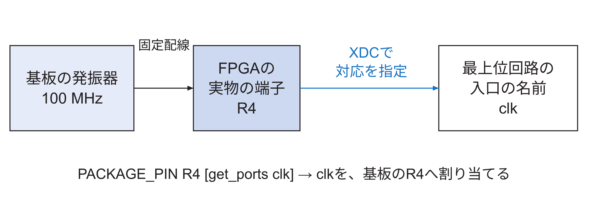
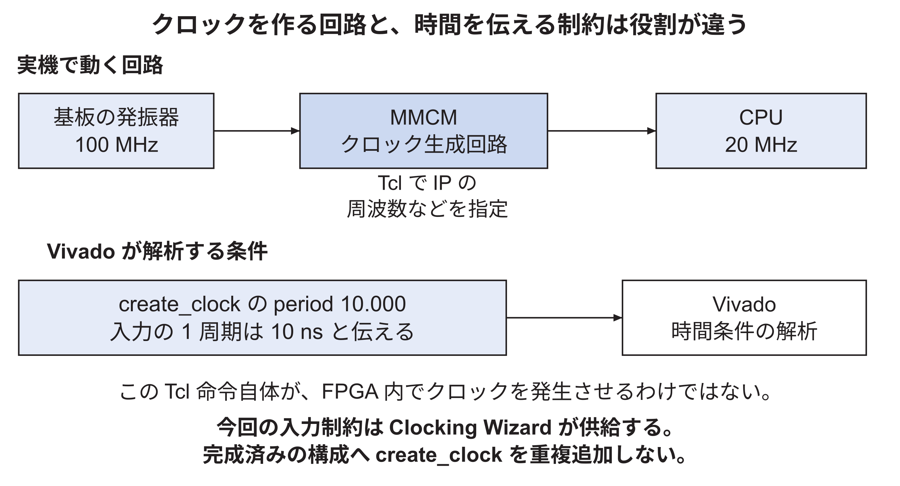
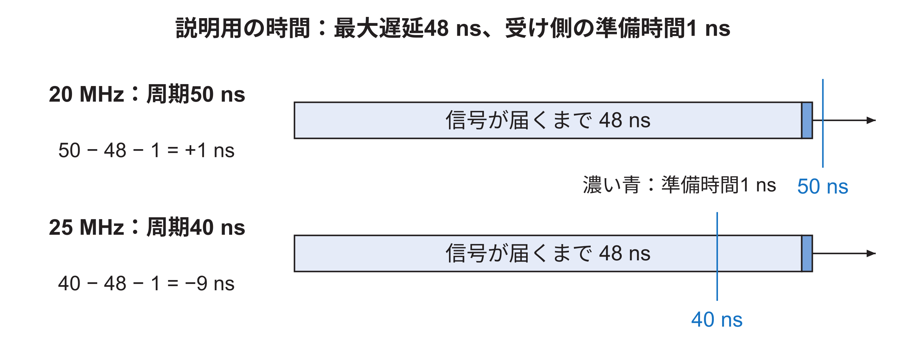
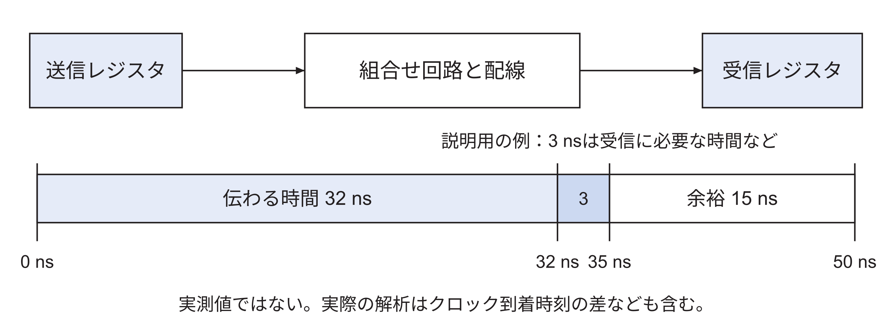
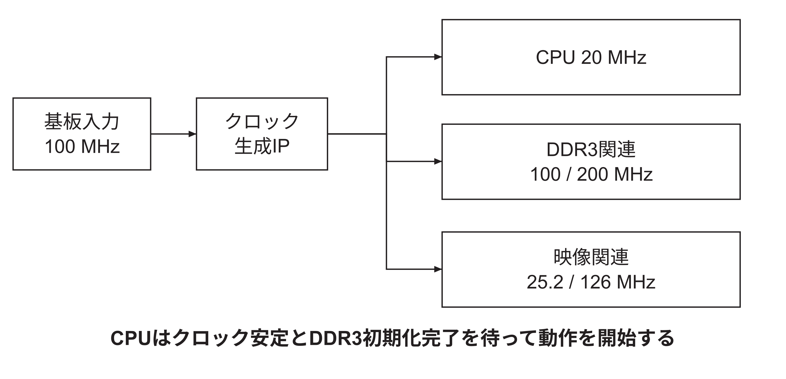
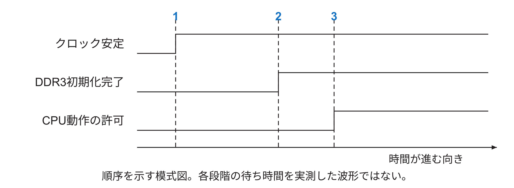
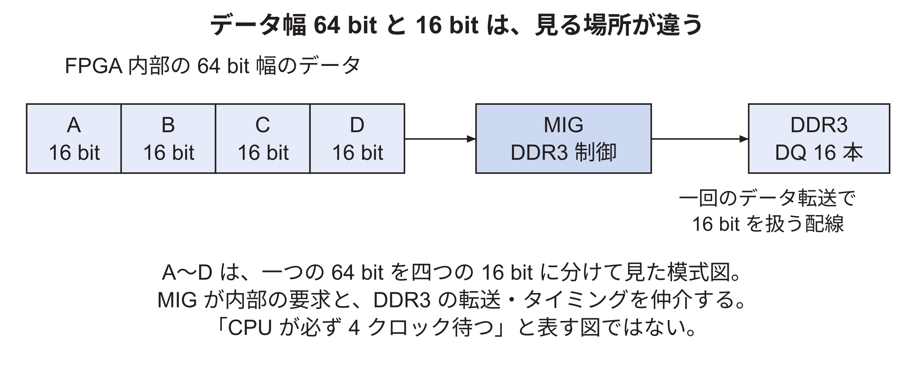
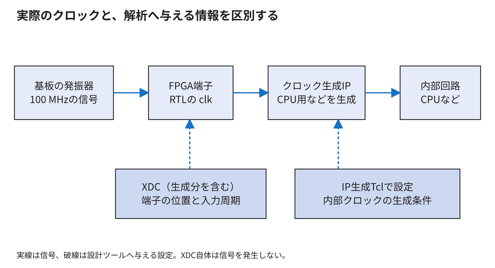

<!-- appendix-content:start -->
<a id="ch_g_board_reproduction"></a>
# 第59章 Nexys Video対応とRasterIX接続をファイルから再現する
<!-- appendix-content:end -->

[付録の総目次](../../技術付録.md) ｜ [論文本文](../../本文.md) ｜ [参考文献](../references.md)

[第V部 Nexys Videoへの統合と実験と再現](README.md)

ファイルパスの表記は、[資料フォルダー](../../README.md)を基準とする。

## このページの目次

- [59.1 再現には三つの意味がある](#s_g_board_reproduction_1)
- [59.2 版を固定する理由](#s_g_board_reproduction_2)
- [59.3 FPGAボードの仕様が設計入力になる](#s_g_board_reproduction_3)
- [59.4 ピンの設定には三つの一致が必要](#s_g_board_reproduction_4)
- [59.5 クロック生成と解析条件を対応付ける](#s_g_board_reproduction_5)
  - [create_clockを実際にどこへ置いたか](#h2811)
- [59.6 なぜCPUは20 MHzなのか](#s_app_59_6)
  - [回路が収まる条件と時間に間に合う条件](#h2818)
  - [レジスタ間の経路へ時間の計算を当てはめる](#h2823)
- [59.7 リセットを解除する順番](#s_app_59_7)
  - [信号の0と1を実際の接続コードで確かめる](#h2835)
  - [リセットでそろえるのは、処理を始める状態である](#h2843)
- [59.8 DDR3対応ではメモリ容量だけでは足りない](#s_g_board_reproduction_6)
  - [外部の16本と内部の64 bitが一致しなくてもよい理由](#h2853)
- [59.9 メモリ範囲を計算する](#s_app_59_9)
  - [末尾の番地を求めるときに1を引く理由](#h2864)
- [59.10 対応したファイルを責務で分類する](#s_g_board_reproduction_7)
- [59.11 RasterIXを加えるときに増える接続](#s_g_board_reproduction_8)
- [59.12 固定版を調べるための読取りコマンド](#s_g_board_reproduction_9)
- [59.13 ビルド成功の次に何を見るか](#s_g_board_reproduction_10)
- [59.14 実験道具と製品の回路を分ける](#s_g_board_reproduction_11)
- [59.15 自分で変更するときの終了条件](#s_g_board_reproduction_12)
- [59.16 配線を作る記述と時間を伝える記述を分ける](#s_app_59_13)

<!-- appendix-content:start -->
設計の説明を、自分で何を書くかへ結び付ける章である。新しい一式を無条件に実行する手順ではなく、既存の実装演習とソースを使い、変更の理由、書く場所、答え合わせを対応付ける。SDカード書込みやFPGAの再設定は、この章を読むだけでは実行しない。

<a id="s_g_board_reproduction_1"></a>
## 59.1 再現には三つの意味がある

完成したソースを取得してビルドすること、変更前から同じ設計を実装し直すこと、同じ実験条件で同じ観測を得ることは、それぞれ違う再現である。最初の目的ならビルド手順が入口になる。設計を理解したいなら、変更前後と変更理由が必要になる。性能の結果を再現したいなら、ソース以外の実行条件も必要になる。

本資料では、[12ファイルを作り直す演習](../../再現資料/ボード対応/NexysVideo対応を変更前から再現する.md)、[接続ソース](../../再現資料/接続ソース)、[E6の実験記録](../../再現資料/実験記録/E6/README.md)を使い分ける。

<a id="s_g_board_reproduction_2"></a>
## 59.2 版を固定する理由

回路とソフトウェアの片側だけを最新にすると、以前の説明と合わなくなる場合がある。例えばテクスチャを何byteずつ扱うかという設定が違えば、同じデータでも別の位置へ進むことがある。

| 対象 | 識別する版 |
|---|---|
| Nexys Video対応の変更前 | `2345ec2ad68d9a9073b2dfec0929ce87c90cb0ce` |
| Nexys Video対応の完成形 | `f0764f003f7c55197882bc1b2f90c84132395472` |
| 公開研究リポジトリのconsole参照先 | `261832d48832dd6e26c4971ab8893ce61200688b` |
| その参照先の公式RasterIX | `9269a01c9bd4c3342bfa70ef8e3cdd751c15c6d0` |
| 基礎説明で参照する旧版 | `cdf907bc1752b0f300e4fc70b9a51b2bae983b7f` |
| 旧版に対応する公式RasterIX | `9fdcf97a31b2e4247594e06d605871980cd5e9e1` |
| E6で取り込んだ公式Wally | `2064ca2bb8a88e3e3ec43753be93d00bef49345b` |
| E6の公式RasterIX | `9269a01c9bd4c3342bfa70ef8e3cdd751c15c6d0` |

E6の通常版は公開コミット`261832d4`から取得できる。実験時には未コミットだったため、当時の親コミットと差分も保存している。両方の取得方法で通常版のソースが一致することを[照合記録](../../../../publication/console-source.json)で確認できる。比較用回路や計測カウンタは、この通常版とは別に適用する。

<a id="s_g_board_reproduction_3"></a>
## 59.3 FPGAボードの仕様が設計入力になる

基板にはFPGA以外に、発振器、DDR3、SDカードスロット、USB関連回路、映像端子などがある。FPGA内部の回路を自由に設計できても、基板上の部品と配線をソフトウェアだけで変更できるわけではない。

Nexys Videoの搭載メモリは512 MiBで、今回のCPU動作周波数は20 MHzである。前者は基板に搭載された容量、後者はこの設計で選んだ条件であり、同じ種類の決定ではない。基板資料は[Digilent Reference Manual](https://digilent.com/reference/_media/reference/programmable-logic/nexys-video/nexys-video_rm.pdf)、実際に採った値とファイルは上記の実装演習で対応付ける。

同じFPGAメーカーの基板でも、FPGAの型番、DDR3の容量、端子の配線、入力クロックは一致するとは限らない。既存の別基板向け設定を名前だけ変えて使うと、実物と違う端子を操作したり、メモリの存在しない範囲へアクセスしたりする。

例えば、回路中の「LEDを点灯する」という出力をどのFPGA端子へ出すかは、基板の銅配線に従って決める。一方、CPUを何MHzで動かすかは、回路の時間条件を満たすよう設計側で選ぶ。前者は実物に合わせる設定、後者は実物の上で成立するかを検査する設定である。ボード対応にはこの両方がある。

本研究では、第一に使用するFPGAの型番、第二に外部端子、第三にクロックとリセット、第四にDDR3とLinuxから見えるメモリ範囲を合わせた。基板の事実はDigilentの資料[NexysVideo](../references.md#ref_nexysvideo)で確認し、Wallyでの記述方法は既存ボードのファイルに合わせた。

| 決めること | 本構成での値 | 主な記述場所 |
|---|---|---|
| FPGA型番 | xc7a200tsbg484-1 | fpga/generator/Makefile |
| 基板から入るクロック | 100 MHz | mmcm-nexysvideo.tclと基板配線 |
| CPUのクロック | 20 MHz | Makefile、mmcm-nexysvideo.tcl |
| FPGA内部のDDR3接続側のクロック | 100 MHz | DDR3生成設定、MIGのui_clk出力 |
| DDR3の基準クロック | 200 MHz | mmcm-nexysvideo.tcl |
| DDR3容量 | 512 MiB | derivlist.txt、MIG設定、デバイスツリー |
| 外部端子 | 基板の配線に対応する端子 | constraints-nexysvideo.xdc |

次の節からは、表の設定を「どれも数値を書き換える作業」とまとめず、何に作用するかを分けて追う。端子設定は信号の出口を決め、クロック生成設定は保存時点の間隔を作り、メモリ設定は接続する部品と使用できる番地を決める。同じ512 MiBという容量でも、DDR3制御回路へ知らせる目的と、Linuxへ知らせる目的は異なる。前者は実物を読み書きするため、後者はOSが存在する範囲だけを使うためである。

<a id="s_g_board_reproduction_4"></a>
## 59.4 ピンの設定には三つの一致が必要

まず基板の回路図で、目的の信号がFPGAのどの端子へつながるかを調べる。次にトップモジュールのどのport名をその端子へ出すか決める。最後に、そのportへXDCでPACKAGE_PINとIOSTANDARDなどを指定する。

信号名が似ていても、端子位置や電圧を確認せずに別ボードからコピーしない。本構成の[constraints-nexysvideo.xdc](https://github.com/SoshiroFujimori/wally-game-console/blob/cdf907bc1752b0f300e4fc70b9a51b2bae983b7f/fpga/constraints/constraints-nexysvideo.xdc)では、端子に応じて異なるI/O規格を使っている。すべてをLVCMOS33に統一する設計ではない。

XDCの電圧名を書き換えるだけで、基板のI/Oバンクへの給電電圧が自動的に変わるわけではない。物理的な給電と端子の許容範囲を合わせる。

この節で指定するのは、FPGA内の信号をチップのどの端子につなぐかである。基板の配線は既に決まっている。例えば、基板上の発振器がつながっている端子を、設計中のclk入力へ対応させる。ここを間違えると、HDLに正しい回路を書いても、その回路へ基板のクロックが届かない。

基板の発振器からFPGAのR4端子までは、製造時に銅の配線が作られている。R4はチップの端子位置を識別する名前である。一方、clkは設計者が最上位回路の入口に付けた信号名である。回路ソースにclkと書くだけでは実物の端子は決まらないため、この二つをXDCという制約ファイルで対応させる。

その対応を書く場所は`fpga/constraints/constraints-nexysvideo.xdc`である。次の二行は、clkをR4へ割り当て、その端子をLVCMOS33という電気規格で使う指定である。

```tcl
set_property PACKAGE_PIN R4 [get_ports clk]
set_property IOSTANDARD LVCMOS33 [get_ports clk]
```

`get_ports clk`は最上位回路のclkを指定する。`PACKAGE_PIN R4`は対応する実物の端子を、`IOSTANDARD LVCMOS33`はその端子の電気的な信号規格を指定する。図59.1のように、製造済みの基板配線へ自分の回路の入口を合わせる操作であり、基板上に新しい銅の線を作る操作ではない。別の基板で発振器の接続先が違えば、端子の指定も変える。



論理の0と1は実物では電圧で表されるため、端子番号だけでなく電気規格も相手の回路と合わせる。UART、SDカード、スイッチ、LEDも同様に割り当てるが、Nexys VideoではLEDとスイッチの端子群で規格が異なる。clkと同じLVCMOS33を全端子へ一括指定してはいけない。正確な一覧は再現資料のXDCで確認できる。

制約を書いた後は、Nexys Video用の生成手順がそのXDCを読み込むことも確かめる。[技術付録第61章](nexys-video-files.md#ch_e)では、ファイルへ書く制約と、生成手順への読込先の追加を続けて追う。

本実装のLEDであるLD0〜LD7はGPIOの出力に接続し、ソフトウェアがGPIOへ書いた値に応じて点灯する。クロックの安定やDDR3の初期化状態は、[59.7節](#s_app_59_7)で説明する内部信号で確認する。

<a id="s_g_board_reproduction_5"></a>
## 59.5 クロック生成と解析条件を対応付ける

MHzは、一秒間のクロックの繰返し回数を百万回単位で表す。基板の100 MHzをCPUへそのまま入れると、CPUのレジスタには10 nsごとに保存の時刻が来る。CPUを20 MHzで動かす場合は、その間隔を50 nsにする。nsは一秒の十億分の一である。このため、入力のクロックから別の周波数のクロックを作る回路を使う。以下では、その回路を用意する設定と、信号の時間を解析するための設定を分けて説明する。

100 MHzは1秒に1億回の周期であり、一周期は10 nsである。CPU用の20 MHzは1秒に2千万回なので、周期は1÷20,000,000秒=50 nsになる。CPUの各回路は、その周期の中で次の記憶素子へ渡す値を計算する。

本実装ではClocking Wizardという生成機能を使い、入力100 MHzからCPU用20 MHzなどのクロックを作る。設定を書く場所は`fpga/generator/mmcm-nexysvideo.tcl`であり、指定した周波数に従ってMMCMを含む回路が生成される。MMCMは、FPGAに内蔵されたクロックの生成・調整用の部品である。

信号名も区別する。Clocking Wizardが作るCPU用の出力がCPUCLKである。DDR3制御回路へ入れるDDRSysCLKやDDRRefCLKも用意するが、FPGA内部のメモリ接続とRasterIXに使うDDRCLKは、MIGが生成する回路のui_clkという出力から受け取る。MIGは、DDR3を読み書きする制御回路を生成する機能である。DDRCLKの100 MHzはDDR3の外部データ転送回数そのものを表す値ではなく、FPGA内でMIGと要求・応答をやり取りする側のクロックである。[Console26](../references.md#ref_console26)

これに対して、次の命令は回路を作らず、時間解析の条件をVivadoへ知らせる。

```tcl
create_clock -period 10.000 -name BoardClock [get_ports clk]
```

意味は「clkには周期10 nsのクロックが入るので、その条件で信号が間に合うか調べる」である。[Vivado25](../references.md#ref_vivado25) 手動で定義する構成なら、生成手順から読み込む`fpga/constraints/constraints-nexysvideo.xdc`などのXDCへ書く。ただし、本構成ではClocking Wizardが入力クロックの制約を供給するため、上の例を追加しない。Nexys Video用XDCにもその旨のコメントがある。[Console26](../references.md#ref_console26)

生成後は`report_clocks`で、IPが供給する制約も含め、Vivadoが認識したクロックを確認する。XDC一枚にcreate_clockが見当たらないだけで未設定とは判断できない。逆に解析の周期だけを50 nsへ変えても、実物の発振器やMMCMの出力は20 MHzにはならない。クロックを作る設定と、そのクロックを前提に解析する設定を一致させる必要がある。

CPUの50 nsの間に、描画回路側100 MHzの10 nsは五周期入る。ただし一周期で行う仕事は回路ごとに違うため、この比だけから描画性能が5倍とは言えない。

図59.2では、上段を実機の信号、下段を設計ツールへ伝える情報として分けた。上段の矢印にはクロック信号が流れ、下段の矢印には解析条件を与えるという関係を表した。



CPUを20 MHzにするには、上段のMMCMの出力をその周波数になるように構成する。下段で入力周期を10 nsと知らせるだけでは、20 MHzのクロックは作られない。本図のcreate_clockは命令の意味を説明するものであり、本構成へそのまま追加する手順ではない。

<a id="h2811"></a>
### create_clockを実際にどこへ置いたか

一般に基準クロックの条件をXDCへ書くが、本固定版の基板XDCには、100 MHzの一次クロック制約をClocking Wizardが供給する旨のコメントがある。従って、説明用の`create_clock`を見たからといって、同じ端子へ重複して追加するわけではない。

クロック生成Tcl、生成IPが持つ制約、基板XDC、最終のクロック報告を順に見る。[実装演習9.2節](../../再現資料/ボード対応/NexysVideo対応を変更前から再現する.md#g09-02)は、まさにこのファイルの所在を追うための節である。

<a id="s_app_59_6"></a>
## 59.6 なぜCPUは20 MHzなのか

20 MHzは、本構成の接続を成立させ、Linuxとゲームを確認するために採用した実装設定である。Nexys VideoのFPGAが必ず20 MHzまでしか動かないという意味でも、このCPUの最適な設定を探し切ったという意味でもない。

FPGAの論理部品が多いことと、同じ回路が速く動くことは別である。周波数を上げられるかは、演算の段数、回路の配置、配線距離、FPGAの速度等級などに依存する。部品数に余裕があっても、ある一つの長い信号経路が周期内に間に合わなければ、周波数を上げられない。

CPU周波数を変える実験をするなら、クロック生成だけでなく、UARTや起動コードなど周波数を前提にした設定もそろえ、再び配置配線と実機確認を行う。本研究の保存済み比較ではCPUを20 MHzに固定しており、周波数の違いとソフトウェア改善の違いを混ぜていない。

<a id="h2818"></a>
### 回路が収まる条件と時間に間に合う条件

説明用に、あるレジスタから次のレジスタへ値を送るまでの計算と配線に48 nsかかり、受け取り前に1 nsの準備時間を確保したいとする。周期50 nsなら、50−48−1=1 nsの余裕がある。周期40 nsに変えると40−48−1=−9 nsで、次の合図に間に合わない。この数値は時間余裕の考え方を示す仮の値である。



レジスタが値を取り込むには、クロックの立ち上がりより少し前までに入力の値が決まり、その後も短い時間は変わらない必要がある。立ち上がり前に確保する時間をセットアップ時間、立ち上がり後に保つ時間をホールド時間と呼ぶ。図59.3が扱うのは前者である。後者については、取り込んだ直後に次の値が届いてしまわないかを別に調べる。実際の解析では、クロックが各レジスタへ届く時刻の違いや不確かさも含め、両方の条件を確認する。

LUTやBRAMが余っていることは、置ける部品が残っているという意味である。それだけでは、長い配線や計算が一周期に収まるとは分からない。[本文第12章](../../本文.md#ch_12)で資源使用率と時間余裕の両方を示すのは、別々の条件を見ているからである。

<a id="h2823"></a>
### レジスタ間の経路へ時間の計算を当てはめる

時間解析で確認するのは、あるクロックの立ち上がりで送り出した値が、受け側のレジスタに必要な時刻までに届くかである。単純な同一クロックの例で、周期50 ns、組合せ回路と配線の合計が32 ns、受け側の準備時間などが3 nsなら、概算の余裕は15 nsになる。この数値は説明用であり、実機レポートの値ではない。実際の解析には、クロックが各レジスタへ届く時刻の差なども含まれる。



図59.4で回路を追加すると、組合せ回路や配線の時間が増えることがある。同じArtix-7でも、配置場所や混雑、使う回路が違えば、この時間は同じにならない。したがって、CPU20 MHzは「Artix-7の最高速度」という値ではなく、本構成で配置配線結果を確認した動作条件である。

<a id="s_app_59_7"></a>
## 59.7 リセットを解除する順番

リセットは、回路が記憶している状態を決められた初期値へ戻す操作である。CPUを動かし始めるには、クロックが安定し、命令やデータを置くDDR3が読み書きできる必要がある。そこで、基板のリセットボタンを離しただけではCPUをすぐに動かさず、クロックの安定とDDR3の初期化完了を確認してからリセットを解除する。

fpga/src/fpgaTopNexysVideo.svでは、クロックの安定をClockLocked、DDR3の初期化完了をDDRCalibCompleteで受け取る。CPU向けリセット回路とDDR3側のリセット回路を、それぞれのクロックで動かす。これにより、停止を解除するタイミングを各回路のクロックに合わせる。

ボタンや外部信号は、内部クロックと同時に変化するとは限らない。レジスタが取り込む瞬間に入力が変わると、出力が0か1へ落ち着くまでに通常より長い時間がかかる場合がある。そこで、最初に取り込んだ結果をすぐに広く使わず、後段のレジスタを通して使う同期回路を設ける。リセットの解除も、対象となる回路のクロックに合わせて伝える。この問題とクロック間の受け渡しは[本文6.4](../../本文.md#s_6_4)節で詳しく説明する。



図59.6は、起動条件が順にそろう様子を表す。線の低い部分を「まだ満たさない」、高い部分を「満たした」と読む。



まずクロックの安定を確認し、次にDDR3の初期化完了を確認する。その両方がそろってからCPUが動作できる。図はこの順序を示すもので、線の長さから実際の起動時間を求めることはできない。具体的な信号名やリセット条件は、クロック生成IPと最上位回路で確かめる。

<a id="h2835"></a>
### 信号の0と1を実際の接続コードで確かめる

同じ「リセット」という名前でも、1の間に初期化する入力と、0の間に初期化する入力がある。信号名の末尾の`n`は、通常、0で有効になることを表す。本実装の`CPUReset`は1で有効、`CPUResetn`は0で有効である。これらを取り違えると、CPUが常に初期化されたままになるか、必要な初期化が行われなくなる。

`fpgaTopNexysVideo.sv`のCPU用リセット回路では、外部ボタンが押されている、DDR側がリセット中、クロックが安定していない、のいずれかでリセットを要求する。さらに`dcm_locked`へDDR初期化完了を渡し、DDR3の準備ができるまでCPUの開始を待たせる。次はその接続の一部である。[Console26](../references.md#ref_console26)

```systemverilog
.slowest_sync_clk(CPUCLK),
.ext_reset_in(~resetn | DDRSyncReset | ~ClockLocked),
.aux_reset_in(1'b0), .mb_debug_sys_rst(1'b0),
.dcm_locked(DDRCalibComplete),
```

`~`は0と1の反転、`|`はどれか一つが1なら1になる演算である。例えばボタンを離して`resetn=1`になっても、`ClockLocked=0`なら`~ClockLocked=1`なのでリセット要求は残る。この論理により、「ボタンを離した時刻」と「CPUが動き始める時刻」が必ずしも一致しなくなる。

| resetn | ClockLocked | DDRCalibComplete | この例でのCPUの扱い |
|---:|---:|---:|---|
| 0 | 任意 | 任意 | 外部リセットを要求する |
| 1 | 0 | 任意 | クロック安定を待つ |
| 1 | 1 | 0 | DDR3初期化完了を待つ |
| 1 | 1 | 1 | DDRSyncResetも0なら、CPUCLKに合わせて解除へ進む |

最後の行でも、その瞬間に全出力が変わるという意味ではない。使用するリセットIPが、対象クロックに合わせて解除する。CPU用にはCPUCLK、DDR側用にはDDRCLK、表示用にはPixelCLKを指定する。別のクロックの途中で解除すると、その領域のレジスタがそろって通常動作へ戻るという前提を満たしにくくなるためである。

リセットとクロックの役割、制御状態の初期化と画像を消す処理の違いは、[技術付録45.2節](../04-rasterix/design-change-reasoning.md#s_j_2)で具体的に分けて説明する。

<a id="h2843"></a>
### リセットでそろえるのは、処理を始める状態である

例えばCPUがDDR3の準備より先にプログラムを読み始めると、読みたい内容がまだ返せない。このため「クロックが安定した」「DDR3が使える」という条件を確認してから、CPUが通常の動作を始められるようにする。リセットは、各回路を初期状態へ戻し、その状態から動き始める時点を制御するために使う。

ただし、CPUのリセットと、すべての画像メモリを背景色で塗る処理は同じではない。プログラムを終了・再起動する場合も、FPGA全体を設定し直したとは限らない。第10・11章で行う画像の初期化は、ゲームが使う画素と履歴をそろえるための処理であり、ここで扱う回路の起動条件と分けて考える。

<a id="s_g_board_reproduction_6"></a>
## 59.8 DDR3対応ではメモリ容量だけでは足りない

MIGは、外部DDR3の型や配線、クロック、内部インターフェースなどに合う制御回路を生成する。メモリの512 MiBをCPUの設定へ書いただけでは、実際の端子から正しく読み書きできない。

設定ファイルからMIGを生成し、その内部側をCPUのバスへ、外部側をDDR3端子へ接続する。CPU側のバス形式とMIGの形式が違うなら変換する。クロックが違うなら、その間も扱う。起動時にはMIGの校正完了などの条件を使う。

この経路のFIFOはメモリ取引のクロック変換に関係する。RasterIX命令FIFOと同じくクロック境界を扱うという共通点はあるが、運ぶものは番地、書込みデータ、応答などであり、命令ストリーム一方向とは契約が違う。

DDR3は、単純な配列のように一つのアドレスだけを渡せば読み書きできる端子構成ではない。初期化、行と列の選択、読み書きのタイミングなどを扱う制御回路が必要になる。本実装では、VivadoのMIGという既存機能でその制御回路を生成する。

fpga/generator/xlnx_ddr3-nexysvideo-mig.prjは、使用メモリと基板配線に関する設定を保持する。fpga/generator/ddr3-nexysvideo.tclは、その設定を使ってIPを生成する。prjの端子一覧を、別のボードのものへ置き換えてはならない。FPGAとDDR3の間の配線は、実物の基板上で固定されているからである。

本接続では、DDR3の外部データ線は16本である。一方、CPUからメモリ制御側へ渡す内部のデータ経路は64 bit幅である。「DDR3が16 bit幅なのにCPUは64 bit」は矛盾ではない。制御回路が外部メモリの転送をまとめ、内部の幅に合わせて受け渡す。

<a id="h2853"></a>
### 外部の16本と内部の64 bitが一致しなくてもよい理由

データ幅は、一度の受け渡しで並べるbit数を表す。64 bitの値を運ぶ内部の端子には、データの位置が64個ある。基板上のDDR3とのデータ端子は16本なので、同じ64 bitをそのまま一回で並べて渡す幅ではない。制御回路が、DDR3の転送方式と速度に合わせてデータをまとめたり分けたりする。

説明用に64 bitを16 bitずつ四つに分けると、A、B、C、Dという四部分になる。これらを順に運べば、最終的に64 bit分の情報を渡せる。実際のDDR3にはクロックの両側を使う転送や、複数のデータをまとめる約束があるため、「CPUの四周期で必ず終わる」という意味ではない。幅が違うことと情報が欠けることを区別するための例である。

MIGはこの外部メモリ特有の制御を担当する。内部のAXI側は、読みたい番地や書く値を渡し、受け付けと返事を待つ。回路設計者がDDR3の各端子へゲームの画素を手作業で順番に出す必要はないが、MIGへ渡すメモリ型番、幅、配線、クロックの設定は実物に合わせる必要がある。

図59.7は、64 bitと16 bitの関係を、一つのデータを四つに分けた形で示す。左はFPGA内部のインタフェース、右は基板上のDDR3へつながるDQ端子である。



MIGは、内部から受けた要求をDDR3の規則に従う転送へ変換する。したがって、両側のデータ幅が同じである必要はない。A〜Dは幅を説明するための区切りであり、実機の転送順や一回の要求にかかるクロック数を測った結果ではない。

<a id="s_app_59_9"></a>
## 59.9 メモリ範囲を計算する

以下では、先頭に0xを付けた数を16進数で表す。Wallyから見たDDR3の先頭は0x80000000である。容量512 MiBは、512×1,048,576 = 536,870,912 byteであり、16進数では0x20000000 byteになる。したがって最後の1 byteのアドレスは、先頭に容量を加えて1を引いた0x9fffffffとなる。

config/derivlist.txtのfpganexysvideoでは、EXT_MEM_RANGEを0x1fffffffにする。ここでのRANGEは「byte数そのもの」ではなく、先頭から最後までの差である。そのため容量より1小さい値になる。別のファイルが容量を求めるときはRANGE + 1を使う。

Linuxへ渡すデバイスツリーにも、同じ512 MiBを記載する。デバイスツリーは、メモリの位置や容量、周辺機器など、使うハードウェアの構成をOSへ知らせるデータである。その元になるファイルがlinux/devicetree/wally-nexysvideo.dtsである。回路側だけ容量を増やしても、Linuxがその範囲を知らなければ利用しない。逆に、Linuxへ存在しない容量を知らせると、実際に使ったときに壊れる。

<a id="h2864"></a>
### 末尾の番地を求めるときに1を引く理由

小さな例で、先頭番地100に4 byteの記憶領域があるとする。使える番地は100、101、102、103の四つである。最後は100+4−1=103になる。100+4=104は、この領域の直後の番地である。

同じ数え方で、先頭0x80000000、容量0x20000000なら、最後は0x9fffffffになる。EXT_MEM_RANGEは先頭から最後までの差なので0x1fffffffとなる。ソフトウェアへ知らせる容量0x20000000と、RANGEの0x1fffffffは、異なる数え方で同じ範囲を表している。

ここを混同していると、ファイル間で値が一つ違うだけで誤りと判断したり、逆にすべて同じ値へ書き換えて壊したりする。値を比較するときは、その項目が「容量」「最後の番地」「先頭からの差」のどれを求めているかも読む。

<a id="s_g_board_reproduction_7"></a>
## 59.10 対応したファイルを責務で分類する

| 責務 | ファイルの例 | 変更後に確かめること |
|---|---|---|
| 構成値 | `config/derivlist.txt` | 容量と機能が生成設定へ反映される |
| IP生成 | `mmcm-nexysvideo.tcl`、`ddr3-nexysvideo.tcl` | 周波数、メモリ設定、端子が意図どおり |
| 回路の接続 | `fpgaTopNexysVideo.sv` | 入出力、幅、クロック、リセットが一致 |
| 物理と時間の条件 | `constraints-nexysvideo.xdc` | 未割当端子や未定義クロックがない |
| ビルドへの登録 | `Makefile`、`wally.tcl` | 新しいファイルが実際に選ばれる |
| OSへの構成通知 | `wally-nexysvideo.dts` | メモリと機器の情報が回路に合う |

各ファイルの変更前後は[演習の一覧](../../再現資料/ボード対応/NexysVideo対応を変更前から再現する.md#g00)から開ける。読み終えたら、同じ12ファイルの差分を自分の言葉で説明できるか確認する。

ボード対応のコミットf0764f003は、6ファイルの追加と6ファイルの変更からなる。新規ファイルには基板固有の配線と回路構成を置き、既存の生成手順にはNexys Videoを選ぶ分岐を加えた。これにより、Nexys Video固有の設定を、他のボードでも使う共通の生成手順から分けて管理する。

最初にMakefileでnexysvideoという生成対象を確認する。次にmmcmとddr3の生成設定を読む。その後、fpgaTopNexysVideo.svで生成した部品をどう接続するかを見る。最後にXDCとデバイスツリーを読み、外部の基板とソフトウェアへ同じ前提が渡っているか確かめる。

[技術付録第60章](change-history.md#ch_a)と付属の再現資料は、この順番で12ファイルの変更前、変更後、差分を対応付けた。完成した長いソースだけを読むのではなく、一つの変更によって何が変わるかを確認できる。

<a id="s_g_board_reproduction_8"></a>
## 59.11 RasterIXを加えるときに増える接続

基板対応の上へ、CPUからの命令・応答のAPB口、クロック境界、公式RasterIXの実体、DDR3への要求の仲介、表示回路、ソフトウェアの転送実装を追加する。

公式RasterIXの中身へローカルな修正を入れる代わりに、外側で信号と形式を合わせる。公式RTLの要求とWally側のバスの要求が同じではないため、その間の変換は必要になる。公式サブモジュールを追加したことだけで、端子が自動的につながるわけではない。

ソフトウェアでは、描画APIが使う接続インターフェースに合わせてWallyBusConnectorを実装する。回路のレジスタ表と、コードの添字、アクセス幅、待ち条件が一致するかを照合する。

<a id="s_g_board_reproduction_9"></a>
## 59.12 固定版を調べるための読取りコマンド

研究リポジトリのルートで実行する。

```sh
git status --short
git submodule status console
git -C console rev-parse HEAD
git -C console ls-tree HEAD addins/rasterix
```

一行目は保存していない変更があるか、二行目以降は参照している版を調べる。`console`を取得していない場合は、まずルートREADMEの取得手順を使う。これらのコマンドはFPGAへ書き込まない。

E6の通常版を使う場合は、上表の公開コミットを取得する。保存差分を検討する場合だけ、更新前の親コミットから別のコピーを用意する。公開コミットには同じ変更が含まれるため、保存差分を重ねて適用しない。

<a id="s_g_board_reproduction_10"></a>
## 59.13 ビルド成功の次に何を見るか

ビルドが終了したら、選択されたトップ、FPGA型番、使用した制約、IP設定、タイミング、資源、DRCなどを確認する。出力ファイルが存在することだけを成功条件にしない。

実機ではUART、メモリを使う起動、Linux、MMIOのID、単純な画像、画像比較、連続動作と、観測できる境界を増やす。途中で失敗したら、それ以前に確認した範囲を保って、失敗した境界を調べる。

<a id="s_g_board_reproduction_11"></a>
## 59.14 実験道具と製品の回路を分ける

SDWire3はSDカードをPC側とFPGA側へ切り替える実験道具である。映像取り込みや遠隔操作も、試験を繰り返すための環境である。これらに固有の操作を、ゲーム機を使うために必ず必要な実装として混ぜない。

このため、操作スクリプト、比較用RTL、カウンタ、記録は研究リポジトリへ置き、製品は最小限の接続と利用コードを保つ。両方の版を記録すれば、製品の変更と実験条件の変更を区別して検討できる。

<a id="s_g_board_reproduction_12"></a>
## 59.15 自分で変更するときの終了条件

たとえば新しいレジスタを追加するなら、番地、幅、初期値、読出し・書込みの効果、待ち、エラー、リセット時の扱いをまず書く。次にRTLとソフトウェアと説明を同じ契約へ合わせ、単体試験と全体の確認を行う。

「コードを足した」ではなく、「どの入力にどう応答するかを定め、実装し、期待と照合できた」が、再現できる設計の単位になる。検証の作り方は[検証の章](verification.md)、新しい入力機器の境界は[周辺機器の章](../03-linux/peripherals.md)へ進む。

<a id="s_app_59_13"></a>
## 59.16 配線を作る記述と時間を伝える記述を分ける

基板の発振器、FPGAの外部端子、最上位モジュールの入力、内部のクロック生成回路は、一本の経路としてつながる。その一方で、設計ツールにはその経路の時間条件も知らせなければならない。



`create_clock -period 10.000 -name BoardClock [get_ports clk]`は、入力クロックの周期を解析ツールへ伝えるXDCの書き方の例である。10 nsの周期は100 MHzに対応する。このコマンドが基板へ発振器を追加するわけではない。実物から来るクロックを解析するための情報である。本構成の`constraints-nexysvideo.xdc`は`clk`の端子位置などを指定し、入力周期の制約はClocking Wizardの生成物が提供する。従って、この例を既存のXDCへ重複して追記する手順ではない。

内部でCPU用のクロックを作る設定は、Clocking Wizardを生成するTcl側にある。ピン番号を指定するXDC、周期を伝えるXDC、クロック生成IPの設定、最上位RTLでの接続は、それぞれ異なる役割を持つ。さらにLinuxへ周波数を伝えるデバイスツリーは、ソフトウェア向けの説明である。どれか一つを書き換えれば残りが必ず一致するわけではない。
<!-- appendix-content:end -->

---

[前：第58章 数式とソースと試験を対応付けた検証記録](../04-rasterix/mathematical-verification.md) ｜ [次：第60章 変更を自分で再現するための案内](change-history.md)
