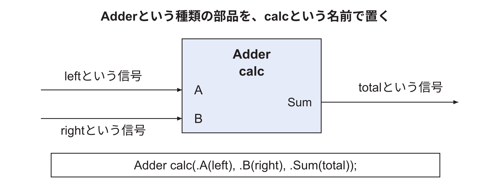
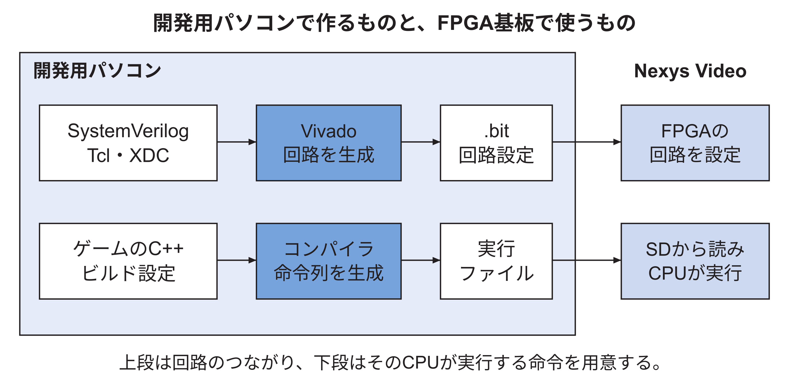
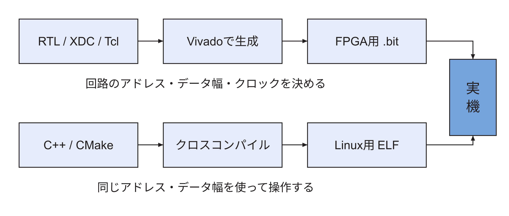
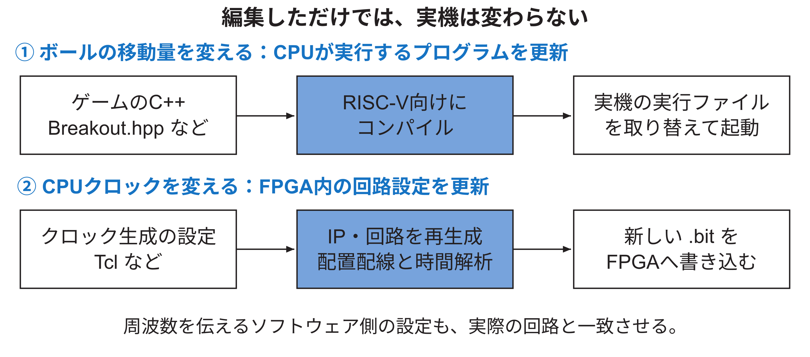

<!-- appendix-content:start -->
<a id="ch_l"></a>
# 第62章 設計ファイルと開発手順
<!-- appendix-content:end -->

[付録の総目次](../../技術付録.md) ｜ [論文本文](../../本文.md) ｜ [参考文献](../references.md)

[第V部 Nexys Videoへの統合と実験と再現](README.md)

ファイルパスの表記は、[資料フォルダー](../../README.md)を基準とする。

## このページの目次

- [62.1 開発用パソコンで行うこと](#s_l_1)
- [62.2 ファイルの種類](#s_l_2)
  - [ファイルと回路部品と信号の名前を区別する](#h2225)
- [62.3 回路をFPGAへ入れるまで](#s_l_3)
  - [同じビルドという言葉で二種類の生成を呼んでいる](#h2238)
- [62.4 Linuxとゲームを準備する](#s_l_4)
- [62.5 同じソースの版を使う](#s_l_5)
- [62.6 ソースを直したのに回路が変わらない理由](#s_l_6)
- [62.7 どのコードを自分が設計するのか](#s_l_7)
- [62.8 一つの変更を、編集から実機まで追う](#s_l_8)

<!-- appendix-content:start -->
<a id="s_l_1"></a>
## 62.1 開発用パソコンで行うこと

開発用パソコンでは、回路のソースを編集し、FPGAを設定するファイルを生成する。ゲームのソースも編集し、Wally上で動く実行ファイルを生成する。この二つは異なる生成物である。回路の設定ファイルはFPGAへ送り、ゲームの実行ファイルは実機が使うSDカードへ置く。

今回、開発環境にはWindowsとWSL上のUbuntuを使った。WSLはWindows上でLinux環境を利用するための仕組みである。一方、ゲーム実行中のLinuxは、FPGA内のWallyで動くLinuxである。開発用Ubuntuのターミナルと、実機へつないだ端末では、実行する場所が違う。本稿の作業手順には「開発用Ubuntu」「実機のLinux」などと実行場所を記す。

<a id="s_l_2"></a>
## 62.2 ファイルの種類

| 種類 | 例 | 何を記すか | 使用する道具 |
|---|---|---|---|
| 回路の記述 | .sv、.v | 信号、計算、記憶、部品同士の接続 | Vivado、回路シミュレータ |
| FPGA生成の手順 | .tcl | 部品の生成、ソースの読み込み、配置配線の指示 | Vivado |
| 制約 | .xdc | 外部端子の割り当て、電気規格、時間条件 | Vivado |
| メモリ制御の設定 | .prj | DDR3の種類、幅、配線など | MIGというIP生成機能 |
| Linuxへ渡す説明 | .dts | メモリ範囲、周辺機器の位置、クロック値 | dtc |
| ゲームのソース | .cpp、.hpp | 入力、規則、描画の呼び出し | C++コンパイラ |
| 生成対象の選択 | Makefile、CMakeLists.txt | どの設定とファイルを使って生成するか | make、CMake |

「この値を変える」ときは、どの種類の値なのかを先に決める。例えばCPUのクロックを実際に作る設定と、LinuxへCPUのクロックを知らせる設定は別のファイルにある。片方だけ変えると、実際の回路とソフトウェアが前提とする値がずれる。

<a id="h2225"></a>
### ファイルと回路部品と信号の名前を区別する

例えば`fpga/src/rasterix_apb.sv`は保存場所を含めたファイル名であり、その中の`module rasterix_apb`は回路部品の種類を定義する名前である。その種類の部品を別の回路の中へ一個置く記述を、インスタンス化と呼ぶ。置かれた一個には、識別するための名前も付く。

説明用の部品Adderを、一個calcという名前で置く例を考える。AdderにA、B、Sumという端子があるとき、`.A(left)`は「この部品のAという端子を、外側のleftという信号へつなぐ」と読む。端子名Aと接続する信号名leftが同じである必要はない。

```systemverilog
// Explanatory example, not the Wally top module.
Adder calc(.A(left), .B(right), .Sum(total));
```



図62.1の枠の内側にあるA、B、Sumが部品の端子名で、枠の外のleft、right、totalが接続先である。この記述を読むと、数百行の最上位回路も「どの部品のどの端子へ、何をつなぐか」の集まりとして分けられる。端子を列挙する順番は、部品を時間順に動かす順序ではない。

IPという言葉は、このように再利用できる回路部品を指す場合に使う。本稿のMIGやClocking WizardはVivadoで生成するIPである。IPの設定を変えるTcl、生成されたIP、IPをつなぐSystemVerilogを別々に確認する。

<a id="s_l_3"></a>
## 62.3 回路をFPGAへ入れるまで

回路のソースを、FPGAで使える論理部品の組合せへ変換する工程を合成と呼ぶ。次に、どの部品をFPGA内のどこへ置くかを決め、配線をつなぐ。これを配置配線と呼ぶ。最後に、その接続を設定するデータを生成する。このデータがビットストリームであり、通常は.bitという拡張子のファイルになる。

FPGAへビットストリームを書き込むと、その設定に従った回路が働く。回路を配置できても、必要な時間内に信号が届くとは限らない。そのため、配置配線後の時間解析も確認する。さらに、時間解析が成功しても、プログラムと回路の約束が一致しているかは別に確かめる。


図62.2では、設計ファイルから実機へ渡すまでを上下二段に分けた。



上段の.bitファイルは、FPGAの中にどの回路を作るかを指定する。下段の実行ファイルは、その回路の中のCPUが順に実行する命令を持つ。青い箱はファイルを変換する道具、白い箱は入出力のファイルを表す。C++をコンパイルしただけでは、FPGAの回路設定は変わらない。逆に、回路を設定しただけではゲームの命令列は用意できない。

<a id="h2238"></a>
### 同じビルドという言葉で二種類の生成を呼んでいる

ゲームのC++をコンパイルすると、Wallyが順に読み取る機械語命令ができる。CPUの配線はこの操作だけでは変わらない。回路のSystemVerilogをVivadoへ渡すと、FPGAの計算・記憶・配線を設定するデータができる。こちらはCPUや周辺回路そのものの構成を変える。

例えばボールの移動量を変えたい場合は、通常はゲームのソースを変更して実行ファイルを作り直す。一方、命令FIFOの容量を変えたい場合は回路の生成設定を変え、合成と配置配線を行い、FPGAへ新しいbitstreamを設定する。さらに、ソフトウェア側が容量に依存していればその設定もそろえる。

ソフトウェアだけ直したのに古い実行ファイルをSDカードから起動すると、修正は実機へ届かない。同じように回路ソースを直しただけでFPGAを書き換えなければ、動いている回路は以前のままである。再現手順でファイルのハッシュを照合するのは、編集したものと実行しているものを結び付けるためである。

<a id="s_l_4"></a>
## 62.4 Linuxとゲームを準備する

Linuxを起動するには、OS本体、起動時に使うプログラム、ファイル群、実機の構成を説明するデータが必要になる。本研究ではWallyが用意するBuildrootの設定を利用した。Buildrootは、小さなLinuxシステムと、そのCPU向けの開発道具を生成する仕組みである。

ゲームを開発用パソコンでコンパイルするときも、実行先はWallyである。そのため、パソコン用のコンパイラではなく、RISC-V Linux向けのコンパイラを指定する。別の機械向けに実行ファイルを作ることをクロスコンパイルと呼ぶ。ビルドに成功したら、ファイルなどで実行ファイルの対象がRISC-Vであることを確認する。

<a id="s_l_5"></a>
## 62.5 同じソースの版を使う

ソース管理のGitでは、ある時点の変更をコミットとして記録する。コミットには識別番号があり、その番号を指定すれば、後で更新が入っても同じ版を取得できる。初期版の再現演習はd3e181ac434a01a1f174549b5fbc7ee03a8875b4を基準とする[Console26](../references.md#ref_console26)。接続比較版E6は、[技術付録71.2節](fifo-comparison.md#s_29_2)に示す公開コミットを取得する。

サブモジュールは、別のリポジトリを特定の版で組み込む仕組みである。今回、addins/rasterixには公式RasterIXの9fdcf97a31b2e4247594e06d605871980cd5e9e1を固定した。親のリポジトリを取得しただけで中身がそろっていない場合があるので、サブモジュールも取得する。[論文本文第14章](../../本文.md#ch_14)でそのコマンドを示す。

版をそろえる理由は、同じファイル名でも中身が違えば、接続条件や実行結果が変わり得るからである。再現では、版番号、設定、生成したファイル、実行した入力を一緒に記録する。画像が似ていることだけで、同じ条件を使ったと判断しない。


<a id="s_l_6"></a>
## 62.6 ソースを直したのに回路が変わらない理由

FPGAでは、画面上でソースを書き換えただけでは、基板の回路は変わらない。例えば、CPUのクロックを作るTclの数値を変えても、そのTclからIPを再生成し、回路全体を配置配線し、新しいbitstreamを書き込むまで、基板は以前の回路のまま動く。この途中にある「生成されたファイル」を把握することが、再現作業の出発点になる。

本構成では、編集する設定、生成された設定、実機へ渡すデータを分けて考える。`config/derivlist.txt`は人が編集する派生構成の記述であり、生成後の`config.vh`はその結果である。`fpga/generator/axiscdc.tcl`はFIFOの生成条件であり、`.xci`はVivadoが保存するIPの構成である。最終的な`.bit`はFPGAへ渡す回路設定であり、C++の実行ファイルとは別のものになる。[Console26](../references.md#ref_console26)



図62.3の上下二本の経路は、回路とアプリケーションを表す。上の経路だけを更新しても、アプリケーションが古いアドレスへ書き込めば動かない。下の経路だけを更新しても、FPGA内のレジスタ配置は変わらない。両経路が合流する場所が、実機上のバス接続である。

| 変更したもの | 作り直すもの | 実機で取り替えるもの |
|---|---|---|
| RTL、XDC、IP生成条件 | FPGA全体の生成物 | bitstream |
| C++、描画ライブラリのコンパイル設定 | ゲーム実行ファイル | SD上などの実行ファイル |
| デバイスツリーの予約領域 | dtb | SDの起動用dtb |
| CPUクロックと起動コードの定数 | IP、回路、起動コード、関連するdtb | bitstreamとdtbなど |

ここで、`CopiedFiles_do_not_add_to_repo`というフォルダ名にも意味がある。元ソースからビルドのためにコピーしたファイルを置く場所なので、そこだけ直しても、次の生成で元の内容へ戻り得る。変更を残す場所は元ソースであり、コピー先は生成結果を確認する場所である。修正が反映されない場合は、まず「編集した元ファイルが、今回の生成で読まれたか」を調べる。

<a id="s_l_7"></a>
## 62.7 どのコードを自分が設計するのか

同じゲーム機を作れるという目標は、CPU、DDR3制御回路、描画器をすべて一から作ることとは異なる。本研究でも、それらの既存部品を利用した。その上で設計者が決めるのは、部品に渡すクロック、使うアドレス、命令の受け渡し方法、メモリの分け方、画面切り替えの完了条件である。

既存部品を使う場合でも、入口と出口の約束を説明する必要がある。例えば「命令を渡せる」という説明を具体化すると、32 bitのデータを渡すこと、最後の語に印を付けること、受け側が止まった間は同じデータを保つことになる。この約束を回路とソフトウェアの両方で満たすのが、接続を設計する仕事である。[論文本文第7章](../../本文.md#ch_7)と[技術付録第42章](../04-rasterix/rasterix-integration.md#ch_g)では、この約束からコードを組み立てる。

<a id="s_l_8"></a>
## 62.8 一つの変更を、編集から実機まで追う

「ボールを速くする」と「CPUのクロックを速くする」は、画面ではどちらも動きに関係しそうに見える。しかし、変える物が違う。ボールの移動量はゲームの計算で使う数であり、CPUクロックは回路を動かす信号である。最初に、どちらを変えたいかを決める。

ボールの移動量なら、まずBreakout.hppのゲーム規則を調べる。変更したC++をRISC-V用コンパイラで実行ファイルへ変換し、実機側のファイルと取り替えて起動する。FPGA内のCPUや描画回路は、同じ回路を使い続けられる。コンパイルするパソコンと、生成したファイルを実行するWallyは別のCPUなので、コンパイラの対象もRISC-Vにする。

CPUクロックなら、まずクロック生成用のTclと、それを使う回路を調べる。IPを再生成し、全回路の合成と配置配線を行い、時間条件を確認してから新しい.bitをFPGAへ渡す。CPUの周波数をソフトウェアへ伝える定数やデバイスツリーも一致させる必要がある。C++をコンパイルし直すだけでは、このクロック信号は変わらない。



図62.4の上段と下段で、最後に取り替える物を確認する。上段はCPUが読むプログラム、下段はFPGAの回路設定である。実機が変わらないときは、最後の受け渡しまで進めたかを調べる。この図は変更の種類を示す例であり、周波数を上げても必ず動くという実験結果ではない。
<!-- appendix-content:end -->

---

[前：第61章 Nexys Video対応をファイルごとに組み立てる](nexys-video-files.md) ｜ [次：第63章 同じゲーム機を作り直す手順](console-reproduction.md)
