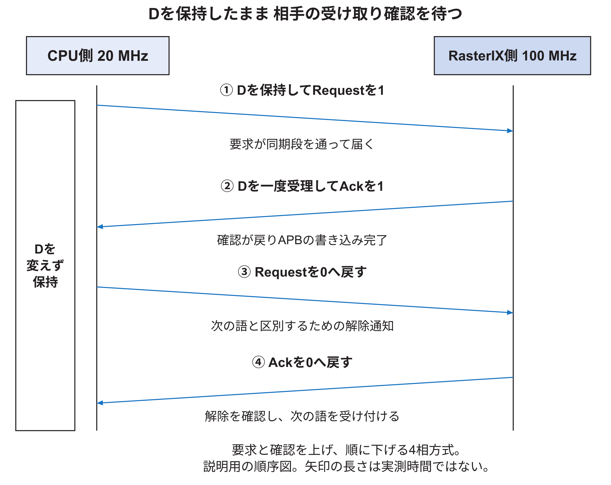
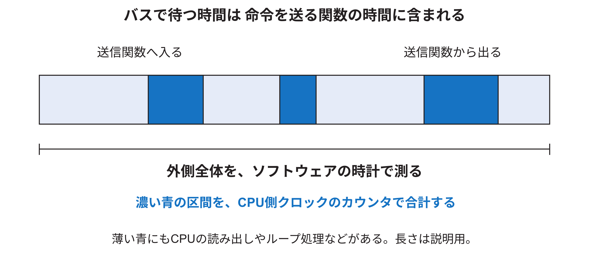
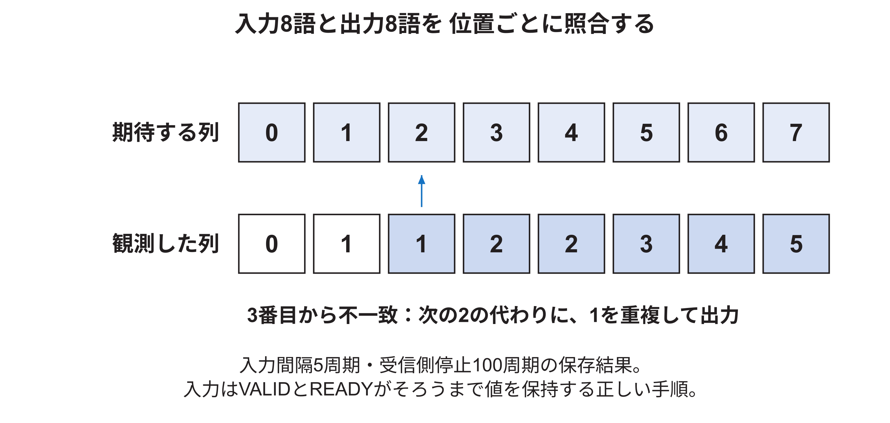
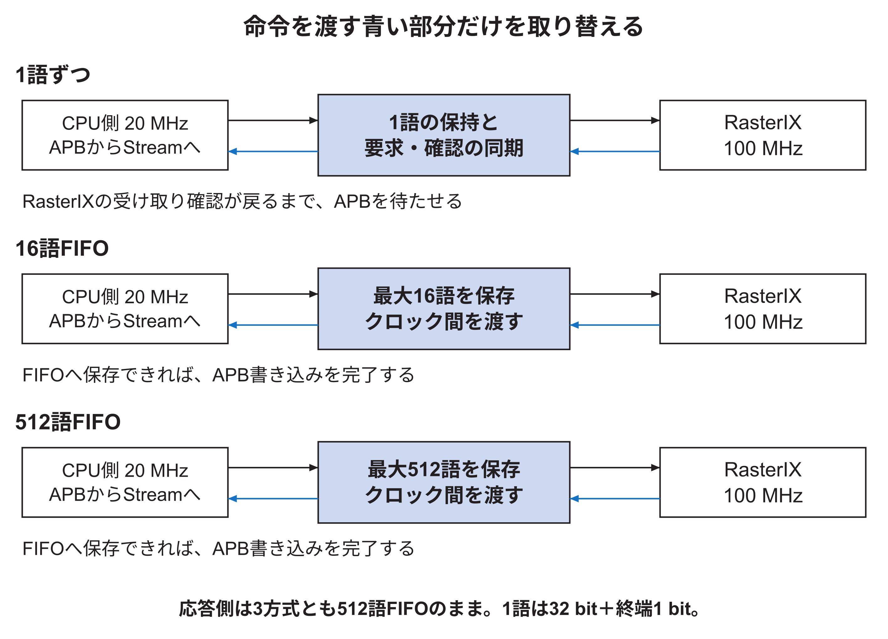
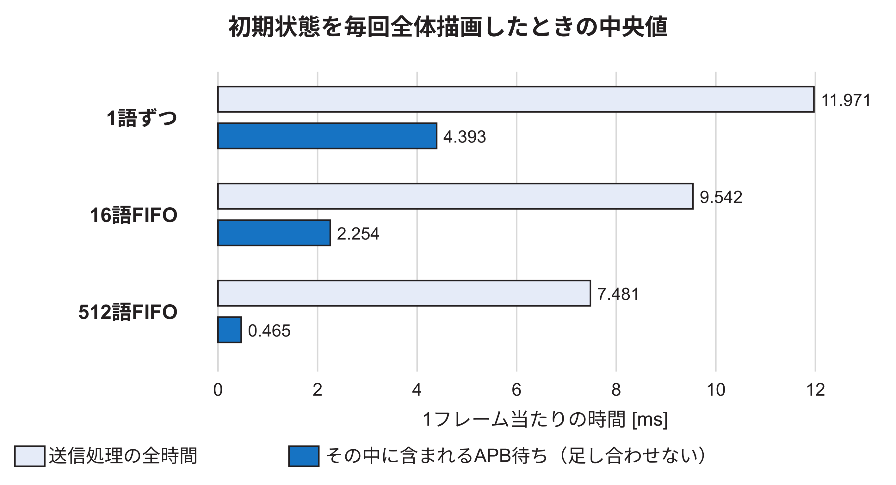
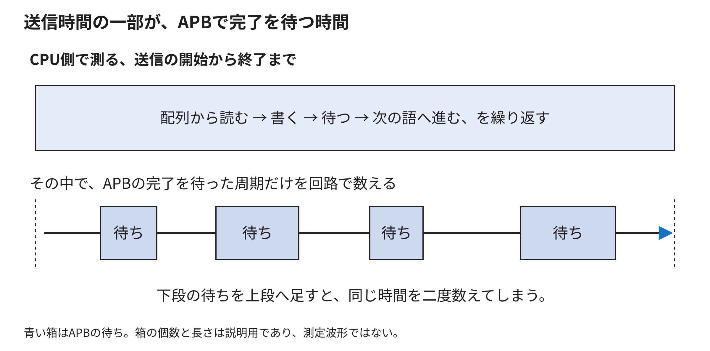
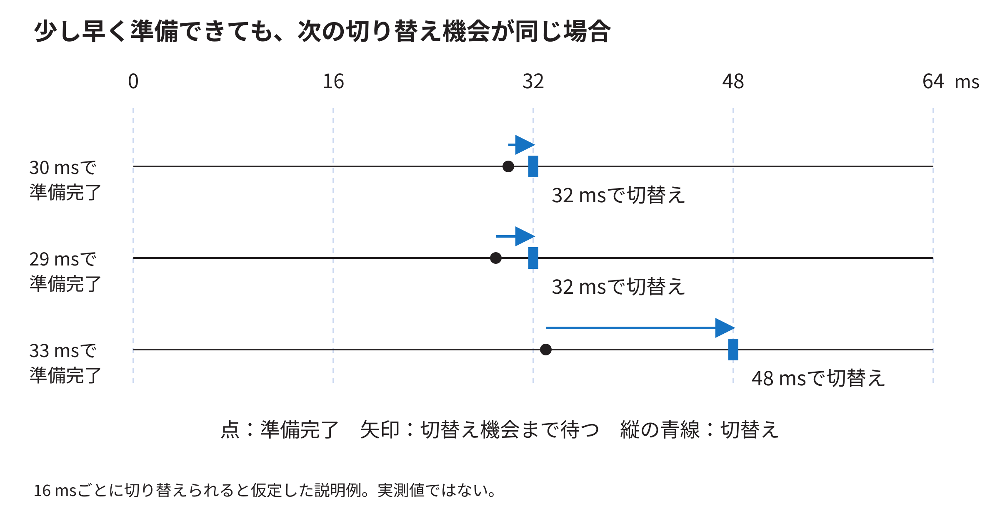

<!-- appendix-content:start -->
<a id="ch_29"></a>
# 第71章 接続方式を取り替えて評価する
<!-- appendix-content:end -->

[付録の総目次](../../技術付録.md) ｜ [論文本文](../../本文.md) ｜ [参考文献](../references.md)

[第V部 Nexys Videoへの統合と実験と再現](README.md)

ファイルパスの表記は、[資料フォルダー](../../README.md)を基準とする。

## このページの目次

- [71.1 問いと比較の範囲を決める](#s_29_1)
- [71.2 ソースの版と実験記録を対応付ける](#s_29_2)
- [71.3 三方式の受け取り条件を読む](#s_29_3)
- [71.4 1語を渡す四つの通知を順番に追う](#s_29_4)
- [71.5 データ保持とクロック制約とリセット](#s_29_5)
- [71.6 APBの待ち時間を回路で数える](#s_29_6)
- [71.7 ソフトウェアで測る時間との関係](#s_29_7)
- [71.8 同じ条件を繰り返す具体的な手順](#s_29_8)
- [71.9 正解画像と動画は別々に確認する](#s_29_9)
- [71.10 主比較の全条件を読む](#s_29_10)
- [71.11 再書き込み後の結果と表示周期](#s_29_11)
- [71.12 ページサイズの不一致をどう切り分けたか](#s_29_12)
- [71.13 命令解析回路の重複を単体で再現する](#s_29_13)
  - [入力が見えていることと、受け取ったことを分ける](#h3816)
- [71.14 FPGAなしで単体再現試験を動かす](#s_29_14)
- [71.15 通常版の再生成と実機確認を結ぶ](#s_29_15)
- [71.16 保存した数値を再集計する](#s_29_16)
- [71.17 E6の通常版ソースをそろえる](#s_29_17)
- [71.18 実験から説明できることをまとめる](#s_29_18)
- [71.19 命令接続方式の比較方法](#s_app_71_19)
- [71.20 同じゲーム状態と命令量で比較する](#s_app_71_20)
- [71.21 CPUの送信待ちはどれだけ減ったか](#s_app_71_21)
  - [約89%の短縮は、どの時間についての割合か](#h3873)
- [71.22 回路の費用と採用判断](#s_app_71_22)
- [71.23 FPGA再設定とLinux再起動後の比較](#s_app_71_23)
  - [処理が少し短くなっても、切り替え時刻が同じ場合がある](#h3890)
- [71.24 計測回路を除いた構成の実装と継続動作](#s_app_71_24)

<!-- appendix-content:start -->
この章は、2026年10月8日のFIFO比較実験[E6](../references.md#ref_e6)を、回路、測定プログラム、実機ログへ対応付ける。接続の信号と試験条件から結果の表を読み、同じ条件の比較を組み立てられることを目標とする。従来のE1〜E5とは使用したソースの版が異なる。数値が新しいという理由で、以前の測定条件まで新しい版へ置き換えない。

<a id="s_29_1"></a>
## 71.1 問いと比較の範囲を決める

実験の問いは「複数の語を先に預かる接続にすると、CPUの待ち、ゲームの画面更新、回路資源がどう変わるか」である。APBを待たせれば停止に対応できることと、FIFOによって待ちを減らせることを区別する。FIFOがなければ接続不可能だと証明するための実験ではない。

置き換えたのはCPUからRasterIXへ命令を渡す部分である。CPUは20 MHz、RasterIXは100 MHzのままとし、APBレジスタの番地、32ビットの命令データ、終端情報、RasterIX本体、DDR3、表示回路、ゲーム画面640×480を共通にした。RasterIXからCPUへ返る応答用FIFOも512語のままである。

二つのクロックは同じ基準クロックに由来する。ただし、接続方式は立ち上がりの特定の位相関係に依存しないものを比較した。「周波数が違うから物理的に無関係な時計である」「非同期FIFOだけが使える」という前提は置かない。

比較した1語方式は4相ハンドシェイクである。通知を反転させる2相方式、複数語のまとめ転送、DMA、位相関係を保証した同期変換は比較していない。今回の表は、実装した三方式の結果であり、存在するすべての接続方式の順位ではない。

<a id="s_29_2"></a>
## 71.2 ソースの版と実験記録を対応付ける

本文と付録の基礎説明・再現演習は、従来の固定版を出発点としている。E6の通常版は次の公開コミットから取得できる。実験時の親HEADと差分も保存しており、公開コミットと当時の実装を照合できる。

| 区別する版 | E6で固定した識別子 |
|---|---|
| E6通常版の公開コミット | 261832d48832dd6e26c4971ab8893ce61200688b |
| 実験時の更新前の親HEAD | cdf907bc1752b0f300e4fc70b9a51b2bae983b7f |
| 取り込んだ公式Wally | 2064ca2bb8a88e3e3ec43753be93d00bef49345b |
| 公式RasterIX | 9269a01c9bd4c3342bfa70ef8e3cdd751c15c6d0 |

通常版は、公式Wallyの変更と公式RasterIXの参照先の更新に加え、Wally側のテクスチャページサイズ指定、文字画像の説明コメント、Vivadoの生成設定を含む。公式RasterIXのファイル自体は変更していない。公開コミットの995ファイルと11サブモジュールは、実機試験用の生成時に保存した`fresh-product-source.json`と一致する。

実験時の記録では未コミットだったため、`source-update/product-from-cdf907bc.patch`と`source-update/manifest.json`を保存している。この差分を更新前の親HEADに適用しても、同じ通常版を再現できる。公開コミットには同じ差分が含まれるため、両方を重ねて適用しない。

実験資料は、同梱の`再現資料/実験記録/E6`に整理した。元の実験ルートはUbuntuの`/path/to/research/experiments/fifo-study-20261008`であり、生成プロジェクトや大きなビットストリーム、生ログの原本もそこに保存している。同梱版には、本文の数値を再集計する記録、必要な回路・測定ソース、通常版の差分、単体再現試験を収録した。

| 同梱E6内の場所 | 調べられる内容 |
|---|---|
| report/results/runs.csv | 主比較90回の集計値 |
| board-v2内の三方式 | フレーム別CSV、試行条件、UART出力 |
| board-reconfiguration | 再書き込み後の18回の記録 |
| scripts/command_mailbox.sv | 1語ずつ渡す回路 |
| variants内の各方式 | 接続先と計測カウンタを含む回路ソース |
| measurement-source | 測定プログラムと正解画像の生成 |
| payload-v2/manifest.json | 実行ファイルのハッシュ |
| fresh-product/qualification | 通常版の生成・タイミング・実機検査の要約 |
| report/results/video | 更新版の実機動画とフレーム検査結果 |
| report/results/command-parser-reproducer.zip | FPGAなしで命令解析の問題を追試する一式 |

試験用カウンタ、接続候補、計測・SDカード操作・映像取得のスクリプトは、製品リポジトリへ入れていない。実験のための変更と、ゲーム機を使うための変更を混ぜないためである。

<a id="s_29_3"></a>
## 71.3 三方式の受け取り条件を読む

通常版の`rasterix_apb.sv`は、命令への書き込み中、`CmdReady`をAPBの完了条件へ返す。この外側の関係を保ち、`CmdReady`が何を意味するかを接続モジュール側で変えた。

| 接続 | CmdReadyが1になる条件 | APB完了時点で分かること |
|---|---|---|
| 1語方式 | RasterIX側の受け取り確認が戻った | その語はRasterIXへ渡った |
| 16語FIFO | FIFO入口が保存できる | その語はFIFOへ入った |
| 512語FIFO | FIFO入口が保存できる | その語はFIFOへ入った |

どの方式でも「一語が渡った」と「一枚の画像を描き終えた」は違う。1語方式が待つのは、その語を命令入力が受け取ったという確認であり、ゲーム画面全体の描画完了ではない。FIFO方式では、その語がRasterIXへ届くより前にAPB書き込みを完了できる。

16語FIFO版は、命令側だけを新しい`axiscommand`というIP実体に交換した。応答側は既存の`axiscdc`を使う。両方向の容量を一緒に変えると、どちらの変更で差が出たか分からなくなるからである。

<a id="s_29_4"></a>
## 71.4 1語を渡す四つの通知を順番に追う

説明用の一語Dを渡す。回路に出てくる`SourceData`と`DestData`は、同じ一語を安全に渡すための両側の保持レジスタである。二語を同時に別々の命令として受け付ける待ち行列ではない。

1段階目では、CPU側の`SIDLE`状態が有効なDを見つけ、32ビットの値と終端1ビットを`SourceData`へ写す。同時に`Request`を1にする。この段階ではAPBをまだ完了させない。送り手は有効信号とDを保持している。

2段階目では、要求が二段の同期レジスタを通ってRasterIX側へ届く。`DIDLE`状態は安定している`SourceData`を`DestData`へ写し、`DVALID`へ進む。ここで命令出力のVALIDが1になり、RasterIXのREADYを待つ。

3段階目では、RasterIX側のクロック立ち上がりでVALIDとREADYがともに1になり、Dが一回渡る。受け側は`Ack`を1にして`DCLEAR`へ進み、同じDを再度渡さない。AckがCPU側の二段の同期レジスタを通ると、`SACK`状態で`CmdReady`が1になる。ここでAPBの書き込みを完了し、Requestを0にする。

4段階目では、Requestが0へ戻ったことを受け側が確認し、Ackも0へ戻す。CPU側はその0が戻るまで`SCLEAR`で待ち、次の語を取り込める`SIDLE`へ戻る。Requestを上げる、Ackを上げる、Requestを下げる、Ackを下げる、という四つの段階があるため4相と呼ぶ。



図71.1は、上から下へ時間が進む順序図である。左の縦長の箱は、接続回路内に取り込んだDを変えずに保持する区間を示す。青い矢印は通知が相手へ届く向きであり、長さは実測時間ではない。RasterIXがDを受け取った後にも、通知がCPUへ戻る待ちがある。

この追加の往復があるため、1語方式のAPB待ちをすべてRasterIXの描画の遅さと呼んではいけない。命令入力がすぐ受け取れる場面でも、接続方式そのものの往復時間は発生する。

<a id="s_29_5"></a>
## 71.5 データ保持とクロック制約とリセット

要求とAckは、それぞれ受け側に二段の同期レジスタを置いた。データの33ビットすべてへ独立の同期レジスタを置いて値をそろえたわけではない。SourceDataを保持したまま、そのデータが利用できることを要求信号で知らせる。

保存した`command_mailbox.xdc`では、要求、Ack、SourceDataからDestDataへの経路に10 nsのデータパス上限を指定した。これは相手へ伝わる要求を待つ間にデータが到着できるよう、実装時にも遅延を評価するための制約である。単に「二段同期を置いたから全ビットが安全」とする説明では不十分であり、保持期間、通知経路、実装後の遅延を組み合わせて確認する。

リセットは両側のリセット要求をまとめて受け、解除は各クロック側で同期した。途中にリセットが入った場合、受け渡し中の語を保存し続ける契約にはしていない。シミュレーションの照合でも、リセット前に残った語をリセット後へ必ず引き継ぐという期待を置かない。

接続単体では、複数のクロック比、受け取り停止、停止解除、リセットを与えて、受け取った語の順序と内容を照合した。実際に生成したAMD FIFOを含む試験も別に行った。論理シミュレーションはアナログ的なメタステーブル状態の発生確率を直接測るものではない。CDCの構造確認、IPの制約、配置配線後のタイミング確認を合わせて扱う。

<a id="s_29_6"></a>
## 71.6 APBの待ち時間を回路で数える

CPUが命令を送る関数の実行時間だけでは、CPUが計算していた時間と、バスが待たされた時間を分けられない。そこで、比較用の三回路に同じ計測カウンタを追加した。CPU側20 MHzのクロックで数える。

```systemverilog
if (CommandWrite && CmdReady)
  StudyWords <= StudyWords + 1'b1;
if (CommandWrite && !CmdReady)
  StudyWaits <= StudyWaits + 1'b1;
```

`CommandWrite`には、APBの選択、アクセス段階、書き込み、語幅と番地の条件が含まれる。従って、APBが準備段階にいる時間や、別の周辺機器を操作している時間までStudyWaitsへ入るわけではない。1回目の式は受け取った語数、2回目は待ちのクロック周期数であり、単位が違う。

| 実験用レジスタのオフセット | 内容 | 読み方 |
|---|---|---|
| 0x1c | StudyWords | 受理した32ビット語の数 |
| 0x20 | StudyWaits | 命令書き込みを待たせた周期数 |
| 0x24 | StudyLongest | 最も長く連続した待ちの周期数 |
| 0x28 | StudyCycles | 計測カウンタの動作周期数 |
| 0x2c | 実験識別値 | どの比較回路を書いたかを識別 |
| 0x7cへ書き込み | カウンタ初期化 | 慣らし運転後に測定を始める |

20 MHzでは1秒に20,000,000周期ある。待ちをC周期、測ったフレームをN枚とすれば、1枚当たりの待ち時間は、C÷20,000÷Nミリ秒となる。例えばCが3,600,000、Nが180なら、1枚当たり1 msである。この例のCは式を理解するための説明値であり、今回の実測値ではない。

カウンタは32ビットである。動作周期数は約214.75秒で一周するため、任意の長時間実行の値をそのまま差し引いてよいわけではない。今回の比較は一回180フレームで、測定区間ごとに初期化した。5分連続動作の確認には、これらのカウンタを使った待ち時間の集計を流用していない。

これらは製品の標準レジスタではない。通常版は実験識別値を返さず、測定プログラムもカウンタが使えないことを出力する。製品のレジスタ表へ、実験専用オフセットを追加して説明しない。

<a id="s_29_7"></a>
## 71.7 ソフトウェアで測る時間との関係

測定プログラムは、ゲーム状態の更新、APIによる命令準備、命令を送る処理、画面切り替えの待ちを記録する。関数の中から別の関数を呼ぶため、外側の時間には内側の時間が含まれる。例えば命令送信の時間は、呼び出し元の画面更新処理の時間にも含まれ得る。



図71.2の外側は、CPUが命令を順に送る関数に入ってから出るまでである。その途中でAPBが何度か止まり、濃い青の待ち区間が現れる。回路のカウンタはこの濃い青の時間を集める。外側と内側を足して全時間としない。

集計では、`write_ns`から命令送信の平均時間を求め、StudyWaitsからAPB待ちの平均時間を求めた。どちらも同じ測定フレーム区間に対応させる。回路カウンタの周期数は20 MHzを使って換算し、ソフトウェアの経過時間はLinuxの時計を使う。ナノ秒の単位で保存した値でも、1 nsの精度で現象を測ったという意味ではない。

APB待ちの原因を、描画の計算、メモリ転送、表示の同期待ちへ完全に分類したわけではない。また、FIFOの全占有量の時系列は記録していない。測ったのは、CPUの命令書き込みが入口の受取可によって止められた期間である。

<a id="s_29_8"></a>
## 71.8 同じ条件を繰り返す具体的な手順

ゲーム開始状態を0、1,800、3,600ステップに固定した。各状態について、full、grouped、retainedの三描画方式を使う。それぞれ30フレームを先に動かした後、180フレームを測る。同じ実行ファイルの引数で切り替え、描画方式ごとにコンパイラや最適化設定を変えない。

各回路の同じ起動中に3回ずつ繰り返した。描画方式の順序を回ごとに回転させ、常に同じ方式だけが最初になることを避けた。ただし、独立した3回の電源投入ではない。再起動に関する補助比較は[71.11節](#s_29_11)のように別に記録した。

以下はLinuxが起動したFPGA側で、測定用実行ファイルを準備した後に使った一例である。PC側のUbuntuでこのRISC-V実行ファイルを直接起動するコマンドではない。

```bash
/tmp/fifo-bench --frames 180 --warmup 30 \
  --retained --wait spin --state-frame 0 \
  --csv /tmp/fifo-case.csv --dump /tmp/fifo-check.rgb565
```

引数の`--retained`を外すと全体描画、`--grouped`にすると呼び出しを統合した描画になる。`--state-frame`が開始状態である。`--dump`を付けた試行では最終画像を読み出し、正解画像と全画素比較する。初回の27条件でこの検査を実施した。

各フレームの状態ハッシュ列、命令のバイト数、表示完了カウンタの連番を検査した。同じ描き方と開始状態なら、三接続で命令量も一致した。転送語数×4とバイト数の一致は、一語4バイトの転送が計数上対応した確認になる。一方、語数だけが一致しても、内容の取り違えまで否定できないため、画像比較と接続単体の順序検査も行う。

<a id="s_29_9"></a>
## 71.9 正解画像と動画は別々に確認する

正解画像は、測定終了時のゲーム状態からソフトウェア側で作った。FPGAの画像をそのまま複製して正解としたのではない。読み出したRGB565画像は640×480で307,200画素あり、すべての画素を比較した。画面ハッシュは保存・照合にも使うが、不一致0の判定は全画素比較の結果である。

主比較90回のうち、全画素検査をしたのはゲームの各接続・状態・描画方式の初回27条件である。残りの繰り返しや再送試験まで、全中間画面を比較したとはしない。追加の再書き込み比較で6画面、通常版の新規生成後に4画面を検査したが、これらも主比較とは分けて保存する。

メモリ上の画像が正しくても、映像送信やキャプチャが正しいとは限らない。そのため、通常版の動作中に別途録画した。30.017秒の動画を全復号し、全1,801フレームで壁とボールを検出した。連続する1,800組のうち1,749組で、検出したボール位置が0.9画素以上動いた。これは動きが継続することの検査であり、圧縮された動画全画素が正解と完全一致するという検査ではない。

録画時はキャプチャの横長画像を4:3へ整えた。元画像640×480を1440×1080として置き、1920×1080の左右に240画素ずつ黒い余白を残した。回路の描画座標を変えて見た目を合わせたのではない。自動プレイであり、Wiiコントローラーの試験でもない。

<a id="s_29_10"></a>
## 71.10 主比較の全条件を読む

下表は画面切り替え完了回数を測定時間で割り、3回の中央値を取った値である。各方式は同じゲーム状態を描く。動画ファイルが毎秒何枚を保存したか、という値ではない。

| 開始ステップ | 描画方式 | 1語ずつ | 16語FIFO | 512語FIFO |
|---|---|---:|---:|---:|
| 0 | 全体 | 11.964 | 13.982 | 14.628 |
| 0 | 呼び出し統合 | 14.953 | 14.953 | 14.953 |
| 0 | 変更領域 | 57.579 | 58.202 | 58.202 |
| 1800 | 全体 | 14.953 | 14.953 | 14.954 |
| 1800 | 呼び出し統合 | 19.611 | 19.647 | 19.648 |
| 1800 | 変更領域 | 58.202 | 58.241 | 58.521 |
| 3600 | 全体 | 19.864 | 19.902 | 19.938 |
| 3600 | 呼び出し統合 | 19.938 | 19.938 | 22.907 |
| 3600 | 変更領域 | 59.488 | 59.161 | 59.819 |

同じ開始状態でも、描く図形を減らすと命令量が減り、接続で待つ時間の影響も小さくなる。特に変更領域描画は表示周期に近く、FIFO容量の差がゲーム全体の更新回数に大きく表れなかった。表のわずかな差だけから、どの条件でも同じ順位になるとは結論しない。

用意済み命令列を繰り返す試験では、1語ずつ47.849、16語FIFO58.518、512語FIFO58.837回/秒であった。この試験は命令の生成処理を省いている。通常のゲームもこの回数で同じ処理をできる、と読み替えない。

<a id="s_29_11"></a>
## 71.11 再書き込み後の結果と表示周期

512語、1語ずつ、16語の順でFPGAを書き込み直し、Linuxを起動し直した。同じ実行ファイルのハッシュを確認した後、開始状態0の全体描画と変更領域描画を各3回実行した。合計18回、3,240フレームである。

| 全体描画の追加比較 | 1語ずつ | 16語FIFO | 512語FIFO |
|---|---:|---:|---:|
| APB待ちの中央値 [ms/枚] | 4.387 | 2.267 | 0.469 |
| 送信処理の中央値 [ms/枚] | 11.931 | 9.564 | 7.419 |
| 切り替え完了回数の中央値 [回/秒] | 11.963 | 13.424 | 14.628 |

主比較の値と混ぜて再集計せず、追加の一組として保存した。送信待ちがFIFOで減る傾向は再現した。一方、16語FIFOの切り替え完了回数は主比較より低く、追加3回の中でも13.03〜13.87回/秒に変動した。

公式DVI回路の設定名には60 Hzが使われているが、確認したカウンタは横0〜800、縦0〜525まで進む。0を含むため、各方向は801周期と526行になる。画素クロック25.2 MHzで割ると、801×526÷25,200,000秒、すなわち約16.7193 ms、約59.811 Hzである。640×480の可視画素数だけを掛けて周期を求めてはいけない。

16語FIFOのログでは、更新間隔が表示4周期か5周期かの比率が試行ごとに変わった。送信時間が同じ程度でも、次の切り替え時刻に間に合わなければ、さらに1周期待つ場合がある。どの割り込みやキャッシュ状態がこの差を作ったかまでは、この記録では分解していない。

測定ログの`late_60hz`は厳密な1/60秒を基準にした項目である。標準DVI回路の約16.7193 msに追従している更新も、16.6667 msより長いため「遅れ」に数えてしまう。E6の結論にはこの件数を使用しない。ゲーム状態の60 Hz刻み、表示回路の約59.811 Hz、録画形式の60枚/秒は別の値である。

<a id="s_29_12"></a>
## 71.12 ページサイズの不一致をどう切り分けたか

更新後のソースをそのまま組み合わせた最初の試行では、文字を描いた画面の519画素が正解と違った。回路はテクスチャを2,048バイトのページとして扱い、ソフトウェアの既定値は4,096バイトだった。

ページは、画像全体を何バイトずつの単位として番地を伝えるか、という区切りである。例えば64×32画素を1画素2バイトで持つ文字画像は4,096バイトになる。2,048バイトのページなら2ページである。4,096バイトのページなら1ページである。画像の大きさが同じでも、ページ数と次の番地の意味が変わる。

Wally側の`examples/rasterix/CMakeLists.txt`へ次の値を設定した。

```cmake
set(RIX_CORE_TEXTURE_PAGE_SIZE 2048 CACHE STRING
    "Texture page bytes")
```

このコード例は設定の意味を短く示したものであり、周囲のCMakeコードを省略している。正確な差分はE6の`source-update/product-from-cdf907bc.patch`で確認する。同じ16語FIFOのビットストリームに対し、設定をそろえた実行ファイルでは全307,200画素が一致した。画像が違っていた修正前の性能値は主比較から除外した。

以前のCMakeキャッシュが残ると、ソースの既定値を変えても古い値が使われる場合がある。新しいビルドディレクトリを使うか、設定時に`-DRIX_CORE_TEXTURE_PAGE_SIZE=2048`を明示する。旧版を再現する演習へ、今回の値だけを無条件に移植しない。対応する回路のページサイズと組にして確認する。

<a id="s_29_13"></a>
## 71.13 命令解析回路の重複を単体で再現する

ページサイズをそろえた後にも、大きいテクスチャで画像不一致が残った。32×32は2,048バイトで1ページ、64×64は8,192バイトで4ページ、256×256は131,072バイトで64ページになる。ここでは1画素2バイト、ミップマップを使わない試験画像として数えている。

1語方式と16語FIFOでは64×64で2,048画素、256×256で31,744画素の不一致を確認した。512語FIFOでは最初の3回は全サイズが一致したが、4回目の256×256で9,216画素が一致しなかった。成功例だけを選んで512語FIFOなら正常と判断してはいけない。

原因を絞るため、公式の`CommandParser.v`だけをVerilatorで動かした。Wally、APB、外部FIFO、DDR3、画素処理は含めない。テクスチャページ番地を8個渡し、入力の間隔を0、5、20、100周期、受け取り側の停止を0、100、500周期に変え、4×3の12条件で調べた。

入力は、一度VALIDを1にした後、READYと同時に1になって受け渡しが成立するまでデータを変えない。間隔とは、前の語の受け渡しが成立してから、次の語を有効にするまでの待ちである。受け取られる前にVALIDを下げて入力を失わせる試験ではない。

<a id="h3816"></a>
### 入力が見えていることと、受け取ったことを分ける

[8.16節](../01-hdl-fpga/cdc-protocols.md#s_app_8_16)の規則では、Validが1でもReadyが0なら、受け渡しは成立しない。送信側は同じ値を保って待つ。従って命令解析回路も、その待っている値を「新しい入力が来た」として繰り返し処理してはいけない。次の語へ進んでよいのは、受け取りが成立したときである。

命令解析の単体試験は、このような入力の間隔と受け側の停止を作り、ページ番号などが一度ずつ渡るかを調べた。FIFOの容量比較とは異なり、ここでの変更は、入力の受け取りを数える条件である。FIFOを大きくすると相手へ値が到着する間隔は変わり得るが、命令解析の条件そのものを直したことにはならない。このため、ある容量で画像が一致しても、その容量だけで不具合を解決したとは結論しない。

| ページ番号の列 | 観測値 |
|---|---|
| 入力した8語 | 0, 1, 2, 3, 4, 5, 6, 7 |
| 正しく出力されるべき8語 | 0, 1, 2, 3, 4, 5, 6, 7 |
| 間隔5周期、停止100周期の公式版 | 0, 1, 1, 2, 2, 3, 4, 5 |

入力に間隔があり、かつ出力側も停止する6条件で失敗した。回路内には、入力側の受け渡しがまだ成立していないのに、一時レジスタへ語を取り込んだり、処理する個数を進めたりする箇所があった。



図71.3の上段は渡るはずの番号、下段は実際に出てきた番号である。下段では、期待した番号と違う欄に色を付けた。左から3番目は2になるはずだが、1がもう一度出てきている。これは図解のための想像の列ではなく、保存した単体試験の列である。

入力の受け渡し成立を条件にする修正候補を、実験用コピーだけに適用すると、同じ12条件を通過した。修正候補は原因の説明を検査するためのもので、全命令の網羅検証を済ませた正式な修正ではない。公式サブモジュールには適用していない。実機のDMA入力で修正の有無を比較した結果は[72.18節](command-dma-comparison.md#s_30_18)に示す。そこで画像が一致した条件と、本節のAPB送信で生じた間欠的な不一致は区別する。

更新前後の`CommandParser.v`はファイル内容が同じだった。この問題を公式更新で初めて入った不具合と説明しない。実機で見たページの繰り返しは単体試験と整合するが、実機の全不一致の原因をこれだけで確定したとはしない。

<a id="s_29_14"></a>
## 71.14 FPGAなしで単体再現試験を動かす

`report/results/command-parser-reproducer.zip`を空のフォルダーへ展開する。Python 3、C++コンパイラ、make、Verilatorが使えるLinux環境で、展開先へ移動して次を実行する。本研究ではVerilator 5.026で実行を確認した。

```bash
python3 reproduce.py
```

実行は、公式版と診断用修正候補を別々に生成し、同じ12条件を与える。期待する観察結果は、公式版が12条件中6条件で不一致、修正候補が12条件を通過することである。公式版の不一致は、この再現試験が探している現象であり、再現用スクリプトが失敗して何も測れなかったこととは区別する。

全体スクリプトの終了コード0は、「期待した公式版の失敗と修正候補の通過を再現した」という意味である。「公式版の全試験が通った」という意味ではない。出力されたJSONと各条件のページ列を確認する。スクリプトは公開リポジトリを書き換えず、展開先のコピーを使う。

<a id="s_29_15"></a>
## 71.15 通常版の再生成と実機確認を結ぶ

比較回路には計測カウンタがあるため、それだけが動いても、通常のゲーム機構成の確認は完了しない。カウンタを含まない通常版を、製品ソースの新しいコピーから作った。生成済みIPを持ち込まず、通常のmake入口でIP生成、合成、配置配線、ビットストリーム生成まで実行した。

生成条件は、合成のretiming、配置のWLDrivenBlockPlacement、物理最適化のAggressiveExplore、配線のExplore、配線後の物理最適化のAggressiveExploreである。CPU20 MHz、RasterIX100 MHz、画素クロック25.2 MHzは維持した。これらはVivadoの実装方法の指定であり、回路の動作仕様を変更するパラメータではない。

最小setup余裕+0.018 ns、hold余裕+0.014 nsでタイミング条件を満たした。余裕は小さいため、周波数をそのまま上げられるという根拠にはしない。内部の未制約端点、配線エラー、DRCエラーは0。CDCの警告は内容を確認したが、警告ゼロとは記録していない。

通常版では300.011秒間に17,853回の画面更新処理を完了し、終了後の描画プログラム再起動でも全画素が一致した。その後、IPから作り直した新規ファイルを読み、日時などのヘッダーを除いた設定データ全5,703,276バイトが先の検査済み回路と完全一致することを確認した。新規ファイルでもLinux起動、実行ファイルのハッシュ、4条件の全画素一致を確認した。

したがって、5分間試験の記録を新規生成版へ対応付ける根拠は、「似たソースだった」ことではなく、設定データそのものの一致である。新規ファイルで5分間を再実行したと記録することはしない。75.003秒の別実行から取得した30秒動画は、新規ファイルを書いた後の追加の証拠である。

<a id="s_29_16"></a>
## 71.16 保存した数値を再集計する

E6の`report/results/runs.csv`は、90回それぞれの結果を1行にした表である。列`transfer_ms`が1枚当たりの送信時間、`apb_wait_ms_frame`がその中のAPB待ち、`completed_swaps_s`が切り替え完了回数/秒である。`pixel_check`は、その試行で最終画面を全画素比較したかを示す。

以下はE6のフォルダーをカレントディレクトリにし、Python 3で実行する再集計例である。FPGAへのアクセスやSDカードの書き換えは行わない。

```python
import csv
from statistics import median

with open('report/results/runs.csv', encoding='utf-8') as f:
    rows = list(csv.DictReader(f))
assert len(rows) == 90
for variant in ('mailbox', 'fifo16', 'fifo512'):
    selected = [r for r in rows if r['variant'] == variant
                and r['state'] == '0' and r['style'] == 'full']
    assert len(selected) == 3
    values = [float(r['apb_wait_ms_frame']) for r in selected]
    print(variant, f'{median(values):.3f} ms/frame')
```

期待する表示は、順に4.393、2.254、0.465 ms/frameである。さらにフレーム別CSVを調べる場合は、`scripts/analyze-v2.py`の語数、状態ハッシュ列、表示連番の照合を読む。保存した原本スクリプトには実験ルートの絶対パスがあるため、別の場所で使う際は、入出力先をそのコピーの配置に合わせる。元の実験記録を出力先として上書きしない。

<a id="s_29_17"></a>
## 71.17 E6の通常版ソースをそろえる

[技術付録第63章](console-reproduction.md#ch_m)は初期版を再現する手順として残した。E6を追試する場合は、別の作業ディレクトリへ通常版の公開コミットを取得する。次の手順ではソースだけを用意し、FPGAやSDカードへは書き込まない。

```bash
git clone --no-recurse-submodules \
  https://github.com/SoshiroFujimori/wally-game-console.git \
  wally-e6-reproduction
cd wally-e6-reproduction
git checkout --detach 261832d48832dd6e26c4971ab8893ce61200688b
git submodule update --init --recursive
git -C addins/rasterix rev-parse HEAD
```

RasterIXのHEADが[71.2節](#s_29_2)の値と一致することを確認する。`fresh-product-source.json`には通常版を生成した際の995ファイルのハッシュと11サブモジュールの参照先を保存した。研究リポジトリの`publication/console-source.json`には、公開コミットとの照合結果を記録している。

通常版の回路生成、Linuxの起動、SDカードの準備は[技術付録第63章](console-reproduction.md#ch_m)の各段階を使い、ソースの版とページサイズは本章へ合わせる。比較用の1語回路や16語FIFO、計測カウンタは、その通常版とは別の実験用コピーに追加する。保存した`prepare-variants.py`は変更箇所を示すが、作業ディレクトリと生成済みIPに関する前提を持つため、無条件に一行で全環境を用意するインストーラではない。

<a id="s_29_18"></a>
## 71.18 実験から説明できることをまとめる

質問が「FIFOが必須なのか」なら、今回の1語方式でも動いたため、必須とは言わない。質問が「なぜ今は512語を使うのか」なら、比較した三方式ではCPUの送信待ちが最も短く、BRAM 1個という小さな容量負担で使えたから、と説明できる。

質問が「512語が最適なのか」なら、16語と512語と1語方式までの比較なので、必要最小容量は未確定である。質問が「20 MHzのCPUでも待つのか」なら、命令書き込みを待たせた周期を実機で数えたため、待つ場面は確認できた。ただし、その原因を描画演算だけへ帰属してはいけない。

質問が「描画は全部正しいのか」なら、検査したブロック崩しの最終画面は一致し、通常版の映像も取得できた一方、大きいテクスチャには未解決の不一致がある、と答える。正しさが確認できた範囲と、次に調べる対象を同時に示すことが、この実験を別の設計へ利用する人に必要な情報である。

<a id="s_app_71_19"></a>
## 71.19 命令接続方式の比較方法

命令接続方式の比較実験[E6](../references.md#ref_e6)では、一語ごとに受取確認を待つ方式と、FIFOへ複数語を預ける方式を比較した。評価するのは、同じ命令列を渡す際のCPUの待ち時間と、その接続に必要なFPGA資源である。どの方式でも語の順序と個数を保ち、同じゲーム画像を作れることを前提として検査する。

比較したのは次の三方式である。CPUの20 MHz、RasterIXの100 MHz、ゲーム画面の640×480は変えない。CPUからRasterIXへ向かう命令の接続だけを変更し、逆向きの応答FIFOは512語のままとした。

| 命令の接続方式 | CPUの書き込みが完了する条件 | その方式の考え方 |
|---|---|---|
| 1語ずつ渡す | RasterIXが受け取り、その通知がCPU側へ戻った | 現在の1語を保持し、次の語は待たせる |
| 16語FIFO | FIFOの入口へ1語を保存できた | 少量を先に預かる |
| 512語FIFO | FIFOの入口へ1語を保存できた | 最大512語を先に預かる |

1語ずつの方式も、異なるクロックを安全にまたぐ回路を持つ。データを保持し、要求を送り、受け取り確認を待つ。信号線を直接つないだだけの方式ではない。また、保持中の1語はあるが、後続の語をためる待ち行列はない。この方式を本実験での「FIFOなし」とする。



図71.4では、青い部分だけを取り替えた。黒い矢印は命令データ、青い戻り矢印は受け取れることや受け取り完了の通知を表す。FIFOでは、入口に保存できればCPUが次へ進める。1語ずつの方式では、RasterIX側の受け取り確認がCPU側へ戻るまで待つ。この違いがCPUの待ち時間へどう影響するかを測る。

一語方式には、要求と確認を順に上げて下げる4相ハンドシェイクを用いた。通知を反転させる方式など、別の一語転送方式は比較していない。したがって、得られる性能差はここで実装した三方式の間の差である。

<a id="s_app_71_20"></a>
## 71.20 同じゲーム状態と命令量で比較する

三方式はすべて、[71.2節](#s_29_2)の固定版と標準DVI出力を用いる。CPUとRasterIXのソース、クロック、ゲームプログラムを共通にし、命令接続の違いを評価する。

同じ実行ファイルを三つの回路で動かし、開始状態を初期状態、1,800ステップ後、3,600ステップ後に固定した。[71.20〜71.23節](#s_app_71_20)では、保存したE6のうち毎回画面全体を描く条件をまとめて読む。30フレームの慣らし運転の後に180フレームを測り、各条件を3回ずつ繰り返す。待ち方は連続確認にそろえた。

この条件は3接続方式×3開始状態×3回の27試行、4,860フレームである。同じ開始状態なら、接続方式を変えても状態列と各フレームの転送バイト数が一致した。回路で数えた転送語数の4倍も、ソフトウェアの転送バイト数と一致した。一語が32 bit、すなわち4 byteであることに対応する。

画面の確認は各接続方式・開始状態の初回、計9条件の最後の画像で行った。各画像の307,200画素すべてを、ゲーム状態から別に用意した期待画像と比較し、すべて一致した。4,860枚すべての画像を読み出したという意味ではない。E6の全条件は[71.10節](#s_29_10)、再集計手順は[71.16節](#s_29_16)に示す。

<a id="s_app_71_21"></a>
## 71.21 CPUの送信待ちはどれだけ減ったか

初期状態から毎回全体を描いたときの結果を示す。各値は、一回180フレームの平均を求めた後、3回の中央値を取ったものである。

| 1フレーム当たりの時間 | 1語ずつ | 16語FIFO | 512語FIFO |
|---|---:|---:|---:|
| 命令の送信処理全体 | 11.971 ms | 9.542 ms | 7.481 ms |
| その中に含まれるAPB待ち | 4.393 ms | 2.254 ms | 0.465 ms |

命令の送信処理には、CPUがメモリ上の命令を読み、命令用レジスタへ順番に書く処理が含まれる。APB待ちは、その書き込み中に「まだ完了できない」と返されたクロック周期だけを数えた時間である。

CPU側のクロックは20 MHzなので、一周期は50 nsである。計測回路で待ち周期をN回と数えたら、N×50 nsがAPB待ち時間になる。一方、送信処理全体には、次の語をメモリから読む処理、ループの判定、待ち以外のバス転送も含まれる。FIFOで短くできる待ちだけを知るため、送信全体とは別にこの周期数を数えた。

したがって、11.971 msと4.393 msを足してはいけない。4.393 msは11.971 msの中に含まれる。



図71.5の淡い青は送信処理全体、濃い青はその中のAPB待ちである。二つの棒を上下に分け、同じ目盛りで表示した。1語ずつの方式から512語FIFOへ変えると、APB待ちは約89%減った。計算は、短くなった時間を元の待ち時間で割る。すなわち、(4.393−0.465)÷4.393×100で約89%となる。

この結果から、20 MHzのWallyでも、接続先の都合で送信が待たされる場面があると分かる。ただし、1語ずつの方式には、要求と確認がクロック間を往復する時間も含まれる。待ち時間のすべてをRasterIXの描画計算時間と解釈することはできない。

同じ条件の画面切り替え完了回数は、1語ずつで11.964回/秒、16語FIFOで13.982回/秒、512語FIFOで14.628回/秒であった。送信待ちの約89%減少は、ゲーム全体が約89%速くなることを意味しない。命令を作る処理と、描画や表示切り替えの完了待ちも残るためである。

<a id="h3873"></a>
### 約89%の短縮は、どの時間についての割合か

初期状態の全体描画では、1語方式のAPB待ち4.393 msに対して、512語FIFOの待ちは0.465 msである。差は3.928 msなので、4.393 msを基準にした減少率は3.928÷4.393×100で約89.4%となる。分母は一画面の全時間ではなく、1語方式で生じていたAPBの待ち時間である。

送信全体は11.971 msから7.481 msへ変わった。その差は4.490 msであり、送信全体に対する短縮は約37.5%となる。さらに、送信の前には描画命令を作る処理があり、送信の後には描画や表示切り替えの完了待ちがある。同じ実験から計算する割合でも、何を分母にするかで意味が違う。FIFOの効果は、まずAPB待ちと送信時間の短縮として確認し、ゲーム全体の更新回数は別に表で確認する。

図71.6は、二つの時間を別々の測定対象として示す。棒は範囲の関係を示し、長さは実測値の比にしていない。



上段はCPUが送信関数を実行する区間、下段の青い部分はその間に数えたAPBの待ちである。青い待ちを減らしても、配列の読出しやループ処理まで自動的に消えるわけではない。数値上の差をすべて一つのCPU処理へ割り当てるのではなく、二種類の計測結果として読む。

<a id="s_app_71_22"></a>
## 71.22 回路の費用と採用判断

次は、命令を渡す接続モジュールだけの配置・配線後の使用量である。CPU、描画本体、計測用カウンタを含むシステム全体の使用量ではない。

| 接続方式 | LUT | レジスタ | 18 Kbit BRAM |
|---|---:|---:|---:|
| 1語ずつ | 15 | 80 | 0 |
| 16語FIFO | 85 | 178 | 0 |
| 512語FIFO | 96 | 165 | 1 |

16語FIFOは一部をLUTメモリとして作り、512語FIFOは専用のBRAMを使う。このため、保存容量が大きい512語FIFOの方がレジスタ数は少ない。LUT、レジスタ、BRAMをそれぞれ分けて読む必要がある。

512語FIFOが使う18 Kbit BRAM 1個は、このFPGAのBRAM総容量の約0.14%に当たる。比較した三方式の中でCPUの送信待ちが最も短く、この基板でのBRAMの負担も小さいことから、本構成には512語FIFOが適すると判断した。一方、LUTとレジスタを最も少なく使うのは一語方式であり、回路量を優先する場合には利点がある。

一語方式でもブロック崩しが動いたことから、複数語のFIFOは接続の成立に不可欠ではない。採用の根拠は、本条件で得られた送信待ち時間と資源使用量の関係である。32語、64語、128語などは試していないため、512語が必要最小容量や全候補中の最適容量であるかは未評価である。

<a id="s_app_71_23"></a>
## 71.23 FPGA再設定とLinux再起動後の比較

[71.20〜71.21節](#s_app_71_20)の三回の反復は、各回路を設定した後の同じLinux起動中に行った。起動状態を変えても送信待ちの傾向が再現するかを調べるため、512語、一語、16語の順でFPGAを再設定し、Linuxを再起動した。本章で扱う初期状態の全体描画は各方式3回、計9試行・1,620フレームである。回路の再設定とOSの再起動であり、基板の電源投入の反復ではない。

全体描画のAPB待ちは、1語ずつで4.387 ms、16語FIFOで2.267 ms、512語FIFOで0.469 msとなり、[71.21節](#s_app_71_21)と同じ傾向だった。再起動後もゲーム状態、転送量、画面切り替え連番を照合した。各接続方式の初回、計3枚の最後の画像で全307,200画素が一致した。再起動前の27試行と再起動後の9試行は、それぞれ別に集計した。保存した試験条件全体は[技術付録第71章](#ch_29)に示す。

ただし、16語FIFOの全体描画は、再起動後の3回で13.03〜13.87回/秒に変動した。送信時間は近い値でも、表示の4周期分で更新できた回数と、5周期分かかった回数の割合が変わっていた。接続比較版の標準DVI回路の表示周期は約16.719 msなので、4周期は約66.9 ms、5周期は約83.6 msである。切り替えに間に合うかどうかで、送信時間の小さな差が更新間隔の1周期分に表れる場合がある。

どの割り込みやキャッシュの状態がこの変動を起こしたかまでは特定していない。3回の最小値・最大値は、測った範囲でのばらつきを示す値であり、統計的な信頼区間ではない。小さな更新回数の差を普遍的な優劣として扱わず、再現した送信待ちの減少と資源量を採用判断の主な根拠とする。

<a id="h3890"></a>
### 処理が少し短くなっても、切り替え時刻が同じ場合がある

表示の切り替えに決まった機会があると、計算時間の差がそのまま更新回数の差にはならない。仕組みを説明するため、16 msごと、すなわち時刻16、32、48、64 msに切り替えられる単純なモデルを考える。画像の準備が30 msで終わっても29 msで終わっても、次の機会は32 msである。一方、33 msで終わる場合は32 msに間に合わず、次の48 msまで待つ。



図71.7の点は準備が終わる時刻、青い矢印は次の切り替え機会までの待ちを示す。16 msという間隔は説明用であり、実機の周期は本節で示した約16.719 msである。また、本図は全試行の内部時刻を測定して再現した図ではない。[71.23節](#s_app_71_23)で見られた周期数の違いを読む助けにはなるが、待ちが変動した原因がOSなのか、メモリなのかまで確定するものではない。

<a id="s_app_71_24"></a>
## 71.24 計測回路を除いた構成の実装と継続動作

再生成した通常回路で照合した四条件は、`qualification.json`の`whole_frame_checks`に次のように保存されている。開始状態と描画方法をともに指定した確認であり、状態だけを変更した比較ではない。

| 記録のラベル | 開始状態 | 描画方法 | 各条件の最後の画像 |
|---|---:|---|---|
| s0-full | 0 | full | 307,200画素すべて一致 |
| s1800-grouped | 1,800 | grouped | 307,200画素すべて一致 |
| s3600-retained | 3,600 | retained | 307,200画素すべて一致 |
| post-sequence | 0 | retained | 再起動後も307,200画素すべて一致 |

full、grouped、retainedの描画方法の違いは第33・66章に示す。いずれも180フレーム実行後の画像である。5分間の自動プレイと30秒間の映像は、これらの画素照合とは別のゲーム実行の記録である。


接続方式の比較には、転送語数や待ち周期を数える計測回路を組み込んだ。本節では、それを含まないゲーム機の構成を「通常版」と呼び、生成から起動、画像、継続動作までを確認する。ソースには接続比較版、命令接続には512語FIFO、映像出力には標準DVI回路を用いる。

比較実験では、[43.7節](../04-rasterix/configuration-calculations.md#s_app_43_7)で説明した回路とソフトウェアの設定をそろえた。テクスチャページサイズは両側で2,048 byteとし、Wally側のCMake設定に`RIX_CORE_TEXTURE_PAGE_SIZE=2048`を指定した。各接続方式の比較には、この同じ設定から作成した一つの実行ファイルを用いた。

通常版は、生成済みIPを使い回さず、`make nexysvideo-rasterix`でIP生成から配置配線まで実行した。使用したクロック周波数で、配置・配線後のタイミング条件を満たすことを確認した。

| 通常版の確認項目 | 接続比較版での結果 |
|---|---:|
| 最小setup余裕 | +0.018 ns |
| 最小hold余裕 | +0.014 ns |
| LUT | 67,166 / 134,600（49.90%） |
| レジスタ | 50,890 / 269,200（18.90%） |
| Block RAM | 215 / 365（58.90%） |
| DSP | 61 / 740（8.24%） |

表は、接続比較版を用いた通常版のシステム全体の値である。[65.18節](verification.md#s_app_65_18)は基準版を対象としており、ソースが異なる。配線エラー、DRCエラー、内部の未制約端点は0だった。CDC解析には警告が残り、既存のMIGリセット回路や、通知によって値を安定させる接続などとして内容を確認した。この結果は、与えた制約と確認対象の経路についての評価であり、あらゆる入力や動作条件の安全性を証明するものではない。

通常版ではLinuxが起動し、検査した画像が期待値と一致した。300.011秒間の自動プレイでは17,853回の画面更新処理を完了した。この連続動作には通常のゲーム実装を使っており、前節までの全体描画による性能比較とは実行条件が異なる。この回数からFIFOだけの効果を求めることはしない。ゲーム実装と起動条件は[技術付録第33章](../03-linux/game-loop.md#ch_26)・[第71章](#ch_29)に示す。また、同じソースから回路を再生成し、生成日時などのヘッダーを除く設定データ5,703,276 byteが、連続試験で使ったものと完全に一致することを確認した。再生成したファイルをFPGAへ設定した後も、保存した3条件、および描画プログラムを再起動した1条件で、各画像の全307,200画素が一致した。回路生成の再現性と、各実機試験に用いた回路の同一性をこの照合で確認した。


映像についても、別途75.003秒間の実行中から30秒間を保存し、動画の全1,801フレームを復号した。全フレームでゲーム画面の壁とボールを検出し、継続するボールの移動を確認した。図71.8はその15秒時点である。動画の記録形式が毎秒60枚であることは、ゲームの更新回数を測った値ではない。
<!-- appendix-content:end -->

---

[前：第70章 対象版・出典・説明の根拠](sources.md) ｜ [次：第72章 メモリから描画命令を読む方式を検証する](command-dma-comparison.md)
