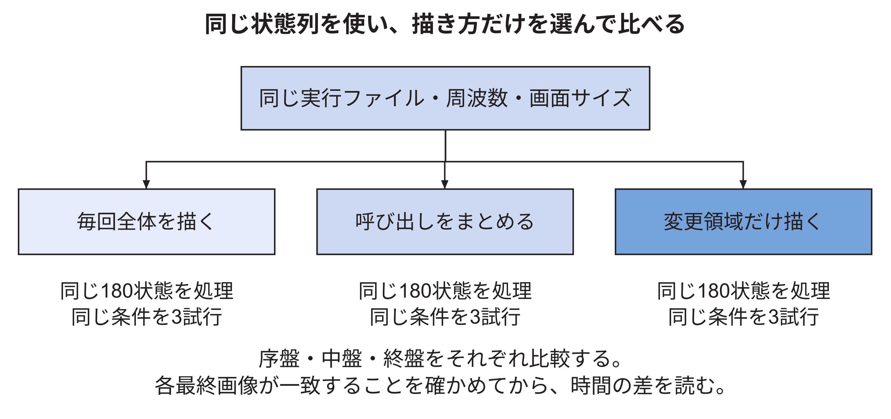
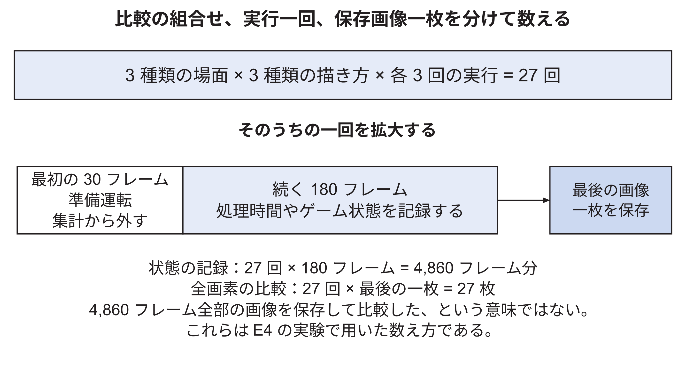
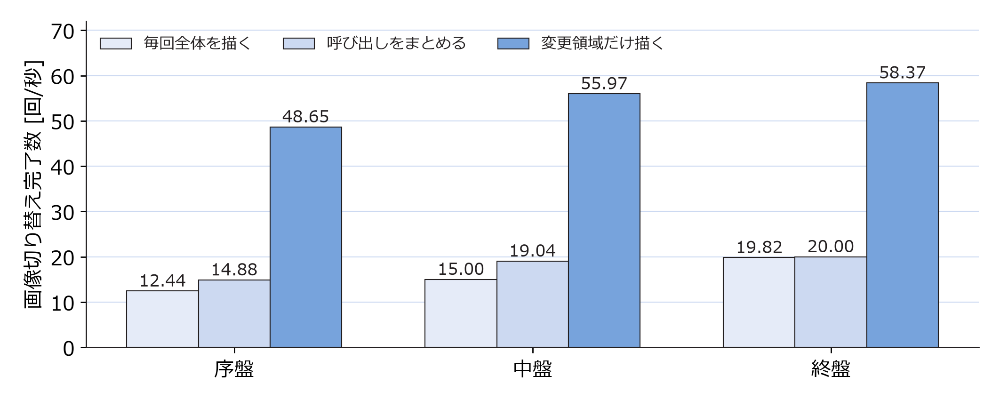
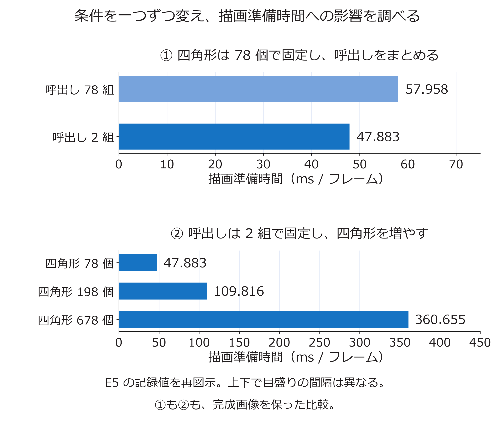

<!-- appendix-content:start -->
<a id="ch_g_measurement"></a>
# 第66章 測定した時間から性能と設計の判断へ進む
<!-- appendix-content:end -->

[付録の総目次](../../技術付録.md) ｜ [論文本文](../../本文.md) ｜ [参考文献](../references.md)

[第V部 Nexys Videoへの統合と実験と再現](README.md)

ファイルパスの表記は、[資料フォルダー](../../README.md)を基準とする。

## このページの目次

- [66.1 1フレームという言葉を定義する](#s_g_measurement_1)
- [66.2 1回の処理を仕事の区間に分ける](#s_g_measurement_2)
- [66.3 重なった時間を足してはいけない](#s_g_measurement_3)
- [66.4 回路の周期数をミリ秒へ直す](#s_g_measurement_4)
- [66.5 時計の単位と測定の精度](#s_g_measurement_5)
- [66.6 比較でそろえるものには理由がある](#s_g_measurement_6)
- [66.7 同じ実行ファイルから方式を選ぶ理由](#s_g_measurement_7)
- [66.8 90回と16,200フレームを区別する](#s_g_measurement_8)
- [66.9 中央値を求める手順](#s_g_measurement_9)
- [66.10 保存済みデータを自分で再集計する](#s_g_measurement_10)
- [66.11 FIFOの効果と画面更新の効果](#s_g_measurement_11)
- [66.12 上限を考えるための簡単な計算](#s_g_measurement_12)
- [66.13 ボトルネックを言葉だけで決めない](#s_g_measurement_13)
- [66.14 正しい結果かを性能と一緒に確かめる](#s_g_measurement_14)
- [66.15 重なる二つの処理時間を数値で確かめる](#s_app_66_15)
- [66.16 比較条件をそろえる理由](#s_app_66_16)
- [66.17 繰り返し、中央値、ばらつき](#s_app_66_17)
- [66.18 標準DVI構成でのゲームの継続動作](#s_app_66_18)
- [66.19 同じ状態列で描き方を比べる](#s_app_66_19)
  - [結果の一行から何が分かるかを順に読む](#h3291)
- [66.20 どの処理が重いかをさらに調べる](#s_app_66_20)
- [66.21 待ち方を変えた結果](#s_app_66_21)
- [66.22 描画準備の改善と、命令接続に残る送信待ち](#s_app_66_22)

<!-- appendix-content:start -->
測定の目的は、数字を増やすことではなく「何を変えると、何の仕事が、どれくらい変わるか」を確かめることである。ここでは、既存のE6データを小さな計算へ分解する。説明用に作った数値例は実測値と区別して示す。

<a id="s_g_measurement_1"></a>
## 66.1 1フレームという言葉を定義する

ゲーム状態を一回更新すること、画像を一回作ること、表示画像を一回切り替えること、映像信号が画面一枚分進むことは違う。どれを数えたかを最初に決める。

E6の性能表は表示切替の完了回数を経過時間で割った値を扱う。録画した異なる画面の枚数を数えた値ではない。1秒間に何回という単位が同じでも、測定対象が違えば比較する意味も変わる。

<a id="s_g_measurement_2"></a>
## 66.2 1回の処理を仕事の区間に分ける

ゲームの状態更新、描画命令の準備、命令の転送、表示切替の完了待ちを考える。開始と終了のどこで時計を読むかをコードへ対応付ける。

例えば転送関数の中でCPUがRAMを読み、APBへ書き、その途中でAPBが待たされるなら、転送関数の経過時間にはAPB待ちが含まれる。「CPUの準備時間」「GPUの計算時間」という名前を付けただけで、物理的に完全分離して測れているわけではない。


<a id="s_g_measurement_3"></a>
## 66.3 重なった時間を足してはいけない

E6の初期状態・全体描画・512語FIFOでは、送信処理全体の中央値が7.481 ms/frame、その中のAPB待ちが0.465 ms/frameだった。合計を7.946 ms/frameとするのは、同じ待ちを二度数えてしまう。

差の7.016 ms/frameも、ただちに純粋な計算時間とは呼べない。関数にはループ、load/store、その他の待ちや計測処理が含まれ得る。また、別々に中央値を取った値の差は、各試行の差の中央値と一般には同じでない。ここでは区間の包含関係を理解するために引算を示した。[元の表](../../再現資料/実験記録/E6/report/結果と判断.md)

<a id="s_g_measurement_4"></a>
## 66.4 回路の周期数をミリ秒へ直す

CPU側が20 MHzなら、1周期は50 nsである。APB待ちをW周期数え、180フレーム分の合計だったとする。

```text
1フレーム当たりの待ち時間[ms]
  = W ÷ 20,000,000 × 1000 ÷ 180
```

説明用にW=360,000なら、合計18 ms、1フレーム当たり0.1 msになる。回路カウンタは時計の読み取り時刻の差より細かく条件を絞れるが、何を数える論理にしたかが重要である。

本実験の待ちカウンタは、命令書込みのアクセス段階でreadyが0の周期を数える。準備段階、別の周辺機器へのアクセス、命令作成中の全時間は含めない。

<a id="s_g_measurement_5"></a>
## 66.5 時計の単位と測定の精度

ナノ秒という単位で値を表示しても、実際に1 nsの差を正しく測れるとは限らない。時計の刻み、読取り処理の時間、OSによる実行の中断などが関係する。

短過ぎる処理なら、同じ処理を複数回行った合計を測る方法がある。ただし、繰返しによってキャッシュが温まるなど条件が変わる。どの条件の費用を知りたいかを決めてから測る。

計測処理そのものが動作を変えるため、ログを大量に出す版と通常版の速度を無条件で同一視しない。今回は保存された計測用コードとカウンタの条件を結果と組にして残す。

<a id="s_g_measurement_6"></a>
## 66.6 比較でそろえるものには理由がある

FIFO容量の効果を知りたいなら、CPUの周波数やゲーム場面も同時に変えると、差の原因を分けにくい。同じ開始状態、同じ入力列、同じ描画方式、同じ実行ファイルなどをそろえる。

これは「絶対に一つの数値しか変えてはいけない」という形式的な規則ではない。FIFOを変えれば配置や配線も変わり得る。どの差を意図し、どの共通条件を確認したかを記録し、残る違いも含めて実装方式として評価する。

<a id="s_g_measurement_7"></a>
## 66.7 同じ実行ファイルから方式を選ぶ理由

方式ごとに別ビルドすると、コンパイラ設定やライブラリ版まで違っていたという混乱が起こり得る。同じ実行ファイルの引数で描画方式を選べば、そうした差を減らせる。

それでも実行する分岐、コードの位置、キャッシュの使い方などは変わり得る。従って、測っているのはその方式として実装したプログラムの差である。「図形一個の純粋な物理コスト」だけを抽出したとは限らない。

<a id="s_g_measurement_8"></a>
## 66.8 90回と16,200フレームを区別する

E6は、3接続×3開始状態×3描画方式×3繰返しで81回。生成済み命令の再送を各接続3回ずつ行って9回。合わせて90回である。各回で180フレームを記録したので16,200フレームになる。

16,200フレームが、16,200回の独立した電源投入を意味するわけではない。同じ起動内の連続するフレームは、場面やキャッシュなどを共有する。繰返しの単位を説明しないと、結果の安定性を過大に見せてしまう。

再書込み後の18回の補助比較は別に保存されている。これも物理的な電源の入切を繰り返した試験とは区別している。

<a id="s_g_measurement_9"></a>
## 66.9 中央値を求める手順

三回の結果が4.2、4.4、4.9 msなら、小さい順の真ん中4.4 msが中央値である。平均は4.5 msになる。どちらも意味があるが、違う値なので表で明示する。

三回の最小値と最大値を棒の両端へ描いた図は、その三回の広がりを示す。母集団の信頼区間を自動的に表すわけではない。小さい差を見て統計的な優劣を断定するには、そのための試行設計と分析がさらに必要になる。

<a id="s_g_measurement_10"></a>
## 66.10 保存済みデータを自分で再集計する

研究リポジトリのルートで次を実行すると、ハードウェアを操作せずに、E6の主比較の待ち時間を再計算できる。

```sh
cd docs/thesis/再現資料/実験記録/E6
python3 recalculate_wait.py
```

期待する表示は`mailbox 4.393`、`fifo16 2.254`、`fifo512 0.465 ms/frame`である。スクリプトは`report/results/runs.csv`の90行から、初期状態、全体描画、各方式の三回を選ぶ。全条件をごちゃ混ぜにした中央値ではない。

<a id="s_g_measurement_11"></a>
## 66.11 FIFOの効果と画面更新の効果

APB待ちだけを比較すると、一語方式から512語FIFOで約89.4%減っている。計算は`(4.393-0.465)/4.393`である。これは送信待ちの減少率であり、ゲーム全体が約9倍速いという意味ではない。

同じ条件の表示切替は約11.96から14.63回/秒へ増えた。変更領域描画では約58〜60回/秒で、方式間の差は小さい。別の仕事や表示周期が残るため、一部が速くなっても全体が同じ割合で速くなるとは限らない。

<a id="s_g_measurement_12"></a>
## 66.12 上限を考えるための簡単な計算

説明用に、全時間の40%を占める部分を完全に0へできたとしても、残り60%は残る。全体の最大の速度向上は`1/0.6 ≈ 1.67倍`である。これはAmdahlの法則として知られる考え方の簡単な形である。

現実には処理の重なりや待ちの変化があり、表の一項目を機械的に0にして予測すれば十分というわけではない。それでも「一部の高速化率」と「全体の高速化率」を分けるために役立つ。

表示切替が周期的な境界で行われる場合、少し早く終わっても同じ境界まで待つことがある。逆に、境界へ間に合うかどうかの差で更新回数が段階的に変わる場合もある。

<a id="s_g_measurement_13"></a>
## 66.13 ボトルネックを言葉だけで決めない

長い区間を見つけるのは出発点である。その区間の何を変えれば短くなるかを確かめると、改善可能な処理へ近づく。命令作成の回数を減らす、描く範囲を減らす、接続を変えるなど、問いに合う比較を行う。

実験E6のカウンタは「APBが命令書込みを待たせた時間」を示すが、各停止を描画計算、メモリ競合、表示同期へ完全に分類するものではない。分かっていない内訳を、数値の精密さで埋めたことにはしない。

<a id="s_g_measurement_14"></a>
## 66.14 正しい結果かを性能と一緒に確かめる

処理を省けば速くなるが、ボールや文字が消えたら同じゲーム画面を作った比較にならない。E6では各条件の画面比較、転送語数、ゲーム状態の列などを対応付けた。

実装の採用理由は「この条件で正しい画像が得られ、待ちが減り、資源とタイミングも許容された」と説明する。それを「全条件で最善」と拡大しない。残る不一致と未検証の条件は、同じ結果の一部として保持する。

<a id="s_app_66_15"></a>
## 66.15 重なる二つの処理時間を数値で確かめる

CPUが0 msから5 msまで命令を送ったとする。描画回路は最初の語が届いた2 msから処理を始め、8 msで終わる。この数値は計算用の例であり、本研究の測定値ではない。


CPUの送信区間は5 ms、描画回路の動作区間は6 msである。しかし0 msから8 msまでの全体を、5+6=11 msと数えることはできない。2〜5 msの3 msを両方に含めているためである。CPUから見れば、送信後に残る完了待ちは5〜8 msの3 msとなる。

同じ記録でも「送信5 msと、その後の待ち3 ms」なら、重ならない二つの区間として8 msを説明できる。「回路は6 ms動いた」という観察も正しいが、同じ足し算には使えない。実験の表を読むときは、区間の名前だけでなく、開始と終了に使った出来事を確認する。

接続を高速化して送信終了が早まると、その後の完了待ちが長く見える場合がある。全体の完了時刻が早まっているなら、待ちだけが増えたことを性能悪化と判断しない。

<a id="s_app_66_16"></a>
## 66.16 比較条件をそろえる理由

描き方を変えた効果を知るために、まず比較するゲーム状態を同じにする。例えば一方には「ブロックが40個残る場面」、もう一方には「2個しか残らない場面」を渡すと、描き方だけでなくゲームの場面まで違う。そこで両方へ、同じ40個のブロック、同じボール位置、同じ得点を渡し、完成させる画像をそろえる。

そろえるのは、画面に存在する物体と、その位置・色である。実際に描き直す物体の数まで同じにするわけではない。全体描画は変わらない物体も毎回描くが、部分描画は前に保存した画素を再利用できる。例えば40個のうち2個だけを描き直しても、残る38個が正しい画素として保存され、完成画像が同じなら、意図した仕事量の削減である。この削減も含めて描き方の違いを比較する。

時間に合わせて自由にゲームを進めるだけでは、速い方式は途中の画像を多く描き、遅い方式は途中を飛ばす。そこで方式比較用のプログラムでは、描くゲーム状態の順番を固定し、同じ180状態を各方式へ与えた。速い方式は、同じ順番を描き終えるまでの時間が短くなる。通常のゲームが動くかを調べる約80秒の試験とは、目的も進め方も違う。

描画方式の比較実験E4では、さらにCPU周波数、解像度、映像出力構成、入力、準備回数、測定回数をそろえた。描き方は同じ実行ファイルへ`--grouped`などの引数を渡して選ぶ。別々に生成したプログラムを使い、片方だけコンパイラの設定が違っていたという条件を避けやすくするためである。

比べたい変更そのものまで同じにするわけではない。呼び出しをまとめれば、実行するCPU命令の順序や回数が変わり、キャッシュの使われ方も変わる。この変化は、その実装方式を選んだ効果に含む。一方、片方だけ解像度を下げるなど、調べたい変更と無関係な違いは入れない。



方式が違っても同じ180状態を順に描き、最後の画像が一致することを確認する。序盤、中盤、終盤の各場面で、それぞれ三回ずつ測る。ボールの位置や残るブロックまで違う実行を比べると、描き方の効果と場面の違いを区別しにくくなる。共通の入力条件を先に決めるのは、このためである。

<a id="s_app_66_17"></a>
## 66.17 繰り返し、中央値、ばらつき

ここでは描画方式の比較実験E4を例に、実行回数の数え方と結果のまとめ方を説明する。一回の試行では、準備用の30画面を処理してから、測定対象の180画面を続けて処理する。準備の30画面は、起動直後だけの状態を比較から外すために置く。180画面分の時間と状態を記録して、一回の試行の結果を求める。

同じ条件でも、OSの他の処理や待ちの入り方によって結果が多少変わる。そのため、プログラムを実行する試行を三回繰り返す。例えば毎秒の処理回数が12.1、12.4、12.3だったら、小さい順は12.1、12.3、12.4であり、中央の12.3を中央値と呼ぶ。最小12.1と最大12.4も残せば、三回がどれだけ違ったかを確認できる。

平均と95百分位は、また別の問いに使う。一画面の処理時間を平均すると、全体として一画面にどれだけ時間を使ったかを読める。95百分位は、処理時間を短い順へ並べたとき、おおむね95%がその値以下になる位置の値であり、ときどき遅くなる側を調べる指標になる。平均だけが小さくても、一部で長く待つ現象は残り得る。

同じ試行内の180画面は前の処理結果を引き継ぐ。例えば一度読んだデータがキャッシュに残り、部分描画では前に描いた画像も次の処理へ影響する。そのため、180画面をそれぞれ独立に起動し直した180回の実験と数えない。本研究では三試行を反復の単位として結果をまとめた。

描画方式の比較実験[E4](../references.md#ref_e4)の27試行は、三場面×三方式×三回である。一試行180状態なので、27×180=4,860状態の記録になる。この数は「4,860枚の実機画面をすべて全画素比較した」という意味ではない。状態列の一致と、各試行の最後の画像の全画素一致を分けて確認している。

図66.4は、E4の試験を外側の組合せと、実行一回の内側に分けて示す。まず上段の掛け算で27回の実行を数え、次に下段で一回から何を記録したかを見る。



時間や状態の記録を4,860フレーム分持つことと、4,860枚の画像を全画素比較することは異なる。本実験の全画素比較は各実行の最後の一枚について行ったため27枚である。この図の回数を、別条件で行ったE5などへそのまま当てはめない。

例えば部分描画は、描画先に正しい以前の画像があることを利用する。起動直後でその画像がまだない一枚と、何枚か描いた後の一枚をそのまま比べると、描き方の違いに加えて初期化の仕事まで違ってしまう。準備用の30画面を置くのは、指定した比較を通常の繰返し処理の条件で始めるためである。起動の正しさを調べる試験では、これとは別に最初の画像も確認する。

また、一回の試行で得た180個の時間を平均することと、試行を三回やり直すことは目的が異なる。前者はその実行中の一画面当たりの負担をまとめ、後者は同じ手順をやり直したときの結果の揺れを見る。試行数、処理した画面数、全画素比較した画像数を分けて記録するのは、この三つが違う確認だからである。

<a id="s_app_66_18"></a>
## 66.18 標準DVI構成でのゲームの継続動作

基準版の標準DVI構成で、描画と完了待ちの処理を段階的に変更した四種類の実装を、それぞれ約80秒自動操作した。すべて400点、残機3でクリアし、最終画像の不一致は0画素であった。[E2](../references.md#ref_e2)

| 段階 | 切り替え完了数 | 状態更新数 | 実行時間 | 最終画素不一致 |
|---|---:|---:|---:|---:|
| 全体を毎回描く | 1,293 | 4,798 | 80.020 s | 0 |
| 呼び出しをまとめる | 1,432 | 4,798 | 80.020 s | 0 |
| 変更領域だけ描く | 3,956 | 4,799 | 80.000 s | 0 |
| 完了を連続して確認する | 4,654 | 4,799 | 80.002 s | 0 |

この試験は、実時間に合わせてゲームを進める通常のプログラムを使う。状態更新数が近く、描画完了数が異なるのは、時間の進み方をそろえながら、描けた画像の数が増えたためである。ただし、各方式が描いた全中間状態の列まで同じではない。方式の性能を厳密に比べるための試験は、次節で別に示す。

三つの改善を組み合わせた実装では、4,654 ÷ 80.002 = 約58.17回/秒で、回路の切り替え完了を確認した。これは画面上の異なる画像を光学的に数えたFPSではない。約94.97秒の録画も全フレームを復号し、エラー0を確認した。複数の時間帯でボールが移動し、ゲームが見えている5,389録画フレームで左右の壁を検出した。全中間画像の全画素一致を検査したという意味ではない。[E2](../references.md#ref_e2)

<a id="s_app_66_19"></a>
## 66.19 同じ状態列で描き方を比べる

E4では、同じゲーム状態を一画面ずつ進める測定専用プログラムを用いた。準備30画面の後に180画面を測定し、序盤・中盤・終盤の三場面、三方式、各三回で、合計27試行を行った。待ち方はすべてsleepに固定した。

次の表は、一秒間に画面切り替えの完了を何回確認できたかを示す。値が大きいほど、同じ状態列を短い時間で描き終えたことになる。「序盤」は、三つの描画方式へ同じ序盤の状態列を与えた行である。左右の方式を比べるときに、途中でブロック数などの入力条件を変えてはいない。

| 場面 | 全体描画 | 呼び出し統合 | 変更領域の描画 |
|---|---:|---:|---:|
| 序盤 | 12.44回/秒 | 14.88回/秒 | 48.65回/秒 |
| 中盤 | 15.00回/秒 | 19.04回/秒 | 55.97回/秒 |
| 終盤 | 19.82回/秒 | 20.00回/秒 | 58.37回/秒 |

値は各条件三試行の中央値であり、切り替え完了数を経過時間で割ったものである。序盤では、全体描画から変更領域の描画へ変えることで、描画準備が53.57 msから6.57 msへ、命令量が一画面当たり30,912 byteから3,558 byteへ減った。27試行で得た合計4,860件の状態記録を照合し、同じ場面を与えた方式間で状態列の一致を確認した。さらに、各試行の最後の画像、計27枚について307,200画素すべての一致を確認した。4,860枚すべての画像を全画素比較したという意味ではない。[E4](../references.md#ref_e4)



<a id="h3291"></a>
### 結果の一行から何が分かるかを順に読む

序盤の行では、全体描画が12.44回/秒、変更領域の描画が48.65回/秒である。比は48.65÷12.44で約3.91となる。この条件では、切り替え完了の平均的な速さが約3.91倍になったと読める。CPUの動作周波数を約3.91倍にしたという意味ではない。

同じ行の準備時間は53.57 msから6.57 msへ減った。差は47.00 msで、元の準備時間に対して約87.7%の減少である。命令量も30,912 byteから3,558 byteへ減った。図形を準備する仕事と、送る量が減ったことが、速くなった仕組みの説明になる。

この比較では、同じゲーム状態を描き、最後の画像が一致することを確認した。従って、ボールの計算を飛ばしてゲームの内容を省いた結果と区別できる。一方、数値は実験用HDMI構成で測ったものである。標準DVI構成の動作確認には、その構成で別に実行した[66.18節](#s_app_66_18)の記録を使う。

<a id="s_app_66_20"></a>
## 66.20 どの処理が重いかをさらに調べる

区間ごとの測定からCPU側の描画準備が長いと分かったため、E5では準備する仕事を変えて原因を絞った。まず同じ静止画像の78個の四角形について、画像と命令量をそろえ、呼び出しを78回から二回へまとめた。準備時間は57.958 msから47.883 msへ減った。差の57.958−47.883=10.075 msは、呼び出しをまとめる変更で減らせた負担である。[E5](../references.md#ref_e5)

それでも47.883 msが残った。次は呼び出しを二回に固定し、各ブロックの四角形を4個または16個の小さな四角形へ分けた。同じ範囲を同じ色で埋めるため、完成画像は変わらないが、ライブラリへ渡す図形数は増える。78個では47.883 ms、198個では109.816 ms、678個では360.655 msとなった。回数を固定しても時間が増えるため、図形に伴う頂点や命令の処理も改善対象になる。この結果は、部分描画によって準備する図形自体を減らす方針を支持する。

二つの比較は、改善できる仕事として「呼び出しの繰り返し」と「図形の準備量」を絞り込んだものである。

例えば、呼び出しをまとめても四角形が78個のままなら、それぞれの頂点を扱い、必要な帯へ命令を用意する仕事は残る。部分描画は、前の色を使える図形をそもそも描画一覧から省くため、その残った仕事にも作用する。二つの改善を組み合わせる理由はここにある。

各CPU命令やキャッシュミスに何nsかかったかまでは分解していない。得られたのは、同じCPUと描画回路を使いながら、呼び出しと図形の数を減らすことで準備時間を短縮できるという結果である。

図66.6は、E5の保存済みの数値を二つのグラフに分けて表したものである。上は図形数を固定して呼出しのまとまりを変え、下は呼出しのまとまりを固定して図形数を変える。棒が短いほど、一フレームの描画準備にかかった時間が短い。[E5](../references.md#ref_e5)



上では57.958−47.883で10.075 ms短くなった。一方、下では二組にまとめても、四角形が増えると準備時間が増える。この二つから、呼出しのまとめ方と、準備する図形の量の両方が改善対象になると分かる。上下は横軸の上限が違うため、棒の長さだけを上下で比べず、数値と目盛りを読む。回路内の個々の処理時間を直接測った図ではない。

<a id="s_app_66_21"></a>
## 66.21 待ち方を変えた結果

描き方を部分描画に固定し、sleepを使う場合と連続して確認する場合を比較した。序盤・中盤・終盤の3場面について、待ち方2通りを各3回測ったため、合計18試行である。序盤の完了数は47.62回/秒から58.07回/秒へ増え、遅い側の処理時間を表す95百分位は31.93 msから16.74 msへ減った。[E4](../references.md#ref_e4)

一方、CPU使用率はsleep側の約85〜87%に対して、連続確認側は約99%になった。この使用率には起動処理も含まれる。結果は「待ち方を変えると次の仕事を早く開始できる」という効果と、そのためにCPUを使い続けるという性質を示す。

<a id="s_app_66_22"></a>
## 66.22 描画準備の改善と、命令接続に残る送信待ち

[66.18〜66.21節](#s_app_66_18)では、同じゲームを実行しながら描画負担を減らせることを確認した。呼び出しの統合と部分描画は、CPUが準備する仕事と命令量を減らす。完了の連続確認は、回路の完了に気付くまでの遅れを減らす。ただし、後者にはCPUを使い続ける負担がある。

これらの改善後も、CPUからRasterIXへ描画命令を送る処理は残る。[本文第6章](../../本文.md#ch_6)で示した接続方式によって、この送信時にCPUを待たせる条件が変わる。接続回路を取り替える比較は[第71章](fifo-comparison.md#ch_29)に示す。その比較ではソフトウェアの描画方式をそろえ、待ち時間と必要な回路量を調べる。
<!-- appendix-content:end -->

---

[前：第65章 正しさの条件から試験と不具合の切り分けを作る](verification.md) ｜ [次：第67章 発表の前に、理由を含めて答える練習](design-questions.md)
