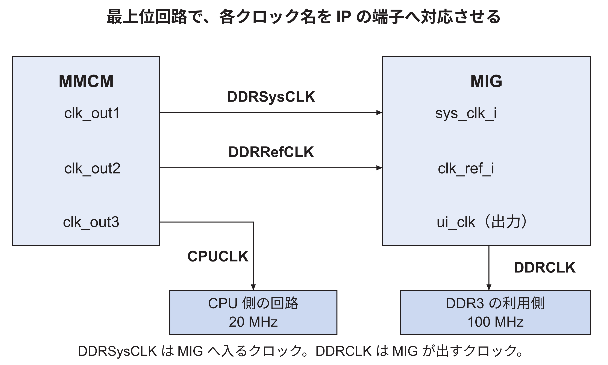

<!-- appendix-content:start -->
<a id="ch_e"></a>
# 第61章 Nexys Video対応をファイルごとに組み立てる
<!-- appendix-content:end -->

[付録の総目次](../../技術付録.md) ｜ [論文本文](../../本文.md) ｜ [参考文献](../references.md)

[第V部 Nexys Videoへの統合と実験と再現](README.md)

ファイルパスの表記は、[資料フォルダー](../../README.md)を基準とする。

## このページの目次

- [61.1 この演習で作る段階と、ファイルの開き方](#s_e_1)
- [61.2 CPUへ512 MiBの範囲を知らせる](#s_e_2)
- [61.3 実物のDDR3に合うMIG設定を用意する](#s_e_3)
- [61.4 DDR3制御回路を生成する手順を書く](#s_e_4)
- [61.5 必要な三つのクロックを作る](#s_e_5)
- [61.6 AHBとAXIの受け渡し条件を合わせる](#s_e_6)
- [61.7 20 MHzと100 MHzの間をつなぐ](#s_e_7)
- [61.8 最上位回路で部品を配線する](#s_e_8)
- [61.9 XDCで基板の端子と時間条件を指定する](#s_e_9)
- [61.10 Linuxへ実機の構成を伝える](#s_e_10)
- [61.11 makeの入口とVivadoの読込先を追加する](#s_e_11)
- [61.12 READMEと答え合わせまでを含める](#s_e_12)

<!-- appendix-content:start -->
<a id="s_e_1"></a>
## 61.1 この演習で作る段階と、ファイルの開き方

この章は、WallyだけをNexys Videoへ載せる最初の変更を扱う。出発点は2345ec2ad、答え合わせの対象はf0764f003である。RasterIXを追加した後の完成版へ、以下の変更をさらに加える演習ではない。先にこの段階を分けると、「基板を動かすための変更」と「画像を描くための変更」を混同しなくなる。

ファイル名の先頭にあるfpga/やconfig/は、リポジトリ直下から見たフォルダ名である。例えばfpga/generator/Makefileを開くとは、リポジトリのfpgaフォルダ、その中のgeneratorフォルダ、その中のMakefileを開くことである。Vivadoが後で作るIPフォルダ内のコピーを直接直すと、次の生成で消えることがある。ここでは、生成の入力となるファイルを扱う。

付属する再現資料/ボード対応/変更前と変更後を並べて開く。既存ファイルの編集は両者を比べ、新規ファイルは変更後を参考に作る。さらに詳しい全行の説明は、同じフォルダのNexysVideo対応を変更前から再現する.mdにある。論文では変更理由と接続を順に理解し、その教材では実際の全コードと答え合わせする。

以下のコードは、対象ファイル中の要点を抜き出したものである。断片だけをファイル全体として保存してはいけない。説明用に省いた接続は、付属する変更後の全ファイルで確認する。自分で作業する場合は[論文本文第13章](../../本文.md#ch_13)と同じく、元の作業場所を残した演習用クローンを使う。

<a id="s_e_2"></a>
## 61.2 CPUへ512 MiBの範囲を知らせる

編集するのはconfig/derivlist.txtである。ここにfpganexysvideoという設定を、既存のfpga設定から派生させて追加する。「派生」とは、共通する設定を引き継ぎ、違う値だけを指定することである。CPUの命令セットなどを一から書き直す必要はない。

```text
deriv fpganexysvideo fpga
EXT_MEM_RANGE 64'h1FFFFFFF
```

64'hは、続く値を64 bit幅の16進数として読む記法である。1FFFFFFFは容量そのものではなく、開始番地から最後のbyteまでの差である。先頭を0番と数えるため、容量は1を足した0x20000000 byte、すなわち512 MiBになる。外部メモリの開始番地0x80000000を足すと、最後の番地は0x9fffffffである。

この値を使って、CPUのアドレス判定回路が外部メモリ宛てかを判断する。CPUが0xa0000000へアクセスしたときまで、この512 MiBのメモリへ通してよいわけではない。[第59章](board-reproduction.md#ch_g_board_reproduction)の範囲の計算と対応させ、生成された構成のEXT_MEM_RANGEが一致することを確認する。

<a id="s_e_3"></a>
## 61.3 実物のDDR3に合うMIG設定を用意する

追加するのはfpga/generator/xlnx_ddr3-nexysvideo-mig.prjである。MIGは、FPGAとDDR3の間の細かい信号制御を作るためのIPである。基板メーカーのNexys Video用mig.prjを元にすることで、DDR3の種類とピンのつながりを引き継ぐ。

引き継いだ設定のうち、FPGA内部のCPU側との接続に関係する値を変更した。外へ出るDDR3のデータ線は16本のままである。一方、内部のAXIは一回に64 bitを運ぶ設定にする。MIGが内部の転送と外部メモリの転送を対応付ける。64 bitへ設定することは、基板の配線を64本へ増やすことではない。

| 設定項目 | 今回の値 | 何と一致させるか |
|---|---|---|
| C0_S_AXI_DATA_WIDTH | 64 | CPU側のAXIデータ幅 |
| C0_S_AXI_ID_WIDTH | 4 | 接続したAXIの識別番号の幅 |
| C0_S_AXI_SUPPORTS_NARROW_BURST | 1 | 幅の狭いアクセスも受け付ける条件 |
| C0_C_RD_WR_ARB_ALGORITHM | ROUND_ROBIN | 読み書き要求の選び方 |
| ModuleName | ddr3 | 最上位回路から呼ぶモジュール名 |
| SystemClock | No Buffer | MMCMの内部出力から受け取る構成 |
| UIExtraClocks | 0 | 追加クロック出力を使わない構成 |

例えばCPUが1 byteだけを書きたい場合でも、64 bitの線全体を一つの値として上書きするとは限らない。どのbyteを有効にするかを示す信号と転送サイズで、書き換える範囲を伝える。幅の狭い転送に対応させる設定は、このようなアクセスを接続先が扱えるようにするためである。

MIGのsys_clk_iを基板のR4へ直接割り当てる設定は外す。今回R4のクロックを最初に受けるのはClocking Wizardであり、その出力をMIGへ渡すからである。電気的な出力強度の指定も含む全9項目の差は、mig-setting-differences.jsonに残してある。出力強度の違いを性能改善の成果とは扱っていない。

<a id="s_e_4"></a>
## 61.4 DDR3制御回路を生成する手順を書く

追加するのはfpga/generator/ddr3-nexysvideo.tclである。prjが「どの構成にするか」という設定なのに対し、Tclは「Vivadoへ何をさせるか」という手順である。create_ipでmig_7seriesを作り、CONFIG.XML_INPUT_FILEに前節のprjを渡し、generate_targetなどで必要な生成物を用意する。

作る部品の名前はddr3でそろえる。設定ファイルではddr3、最上位では別の名前という状態になると、部品を接続できない。後のwally.tclが読むddr3.xciも、この生成結果である。xciはIPの設定をVivadoが管理するファイルであり、CPUが実行するプログラムではない。

この段階の確認は、指定したFPGA部品でMIGが生成され、AXIが64 bit、アドレスが29 bitとなることである。29 bitで表せるbyte位置は0から2の29乗−1までで、512 MiBと一致する。実機のDDR3初期化完了は、生成成功とは別に、FPGAを書き込んだ後で確認する。

<a id="s_e_5"></a>
## 61.5 必要な三つのクロックを作る

追加するのはfpga/generator/mmcm-nexysvideo.tclである。基板から来る100 MHzを受けて、MIG入力用100 MHz、基準用200 MHz、CPU用20 MHzを作る。主要な設定値は次のとおりである。

```tcl
CONFIG.PRIM_IN_FREQ {100}
CONFIG.NUM_OUT_CLKS {3}
CONFIG.CLKOUT1_REQUESTED_OUT_FREQ {100}
CONFIG.CLKOUT2_REQUESTED_OUT_FREQ {200}
CONFIG.CLKOUT3_REQUESTED_OUT_FREQ $SYSTEMCLOCK_MHz
```

これはset_propertyへ渡す設定項目の抜粋である。$SYSTEMCLOCK_MHzは、Makefileから渡したSYSTEMCLOCKを1,000,000で割って求める。20,000,000 Hzが20 MHzになる。CPU用の値だけ違う場所に20と直接書くより、同じ入力値から生成すると設定の不一致を防ぎやすい。

Clocking Wizardはクロック生成回路を作り、XDCのcreate_clockは解析用の時間条件を伝える。この二つは別の仕事である。今回の構成ではClocking Wizard側が基板入力の主クロック制約を供給するため、同じ入力に別名のcreate_clockを追加しない。手動でクロックを定義する構成とは、ここが異なる。

<a id="s_e_6"></a>
## 61.6 AHBとAXIの受け渡し条件を合わせる

編集するのはfpga/generator/ahbaxibridge.tclである。Wallyの外部メモリ側はAHB、MIG側はAXIなので、既存のAHBからAXIへの変換IPを使う。データや番地だけでなく、「いま要求している」「受け取れる」「応答に問題があった」といった条件も変換する。

Nexys Videoのボード名に一致する場合に、CONFIG.C_M_AXI_SUPPORTS_NARROW_BURSTを1にする。MIG側だけ幅の狭い転送を有効にしても、手前の変換部が対応していなければ、CPUから最後まで条件がつながらないためである。他のボードの設定を一律に変更しないよう、ボード名の分岐を使う。

確認では、CPU側のアドレスとサイズを変えたときに、対応するAXIのアドレス、転送サイズ、byteの有効信号になるかを見る。値を一回読めたことと、1、2、4、8 byteなどのアクセスを正しく扱えることは別である。実装コードを読む際も、データ線だけでなくHSIZEやWSTRBなどの制御信号まで追う。

<a id="s_e_7"></a>
## 61.7 20 MHzと100 MHzの間をつなぐ

編集するのはfpga/generator/clkconverter.tclである。S側をCPU側、M側をDDR3側として、Nexys Videoの場合はS側をSYSTEMCLOCK、M側を100,000,000 Hzと設定する。このSとMは接続部の向きを示す名前であり、プログラムを順番に実行する二つの段階という意味ではない。

CPUの一周期は50 ns、DDR3側の回路の一周期は10 nsである。CPU側で変わる複数の信号を、DDR3側が別々の途中時刻で読み取ると、一つの要求が崩れる可能性がある。クロック変換IPに要求と応答を預け、両側で正しく受け渡す。[論文本文第6章](../../本文.md#ch_6)のCDCと同じ問題を、AXI全体について扱う。

確認するのは、周波数の数字だけではない。最上位回路でS側へCPUCLK、M側へDDRCLKを実際につないでいるか、それぞれのリセットを接続しているかを見る。設定ファイルの数値と、RTLの配線の両方が一致して初めて、意図した回路になる。

<a id="s_e_8"></a>
## 61.8 最上位回路で部品を配線する

追加するのはfpga/src/fpgaTopNexysVideo.svである。モジュールの端子宣言は、この回路と基板との接点を表す。内部ではWally、クロック生成、リセット制御、AHBからAXIへの変換、クロック変換、DDR3制御の実体を置く。[技術付録62.2節](design-files-workflow.md#s_l_2)の「モジュールは部品の種類、インスタンスは置いた実体」という読み方を使う。

次は、全体にある多数の端子から、クロックのつながりだけを抜き出した読み方である。ピリオドの後は部品側の端子名、括弧内はそこへ接続する信号名である。

```systemverilog
.clk_out1(DDRSysCLK), .clk_out2(DDRRefCLK),
.clk_out3(CPUCLK)

.sys_clk_i(DDRSysCLK), .clk_ref_i(DDRRefCLK),
.ui_clk(DDRCLK)
```

上の二行はClocking Wizardの出力、下の二行はMIGの入力と出力である。DDRCLKは、DDRSysCLKと同じ信号名へ置き換えてよい線ではない。MIGが出すユーザー回路用クロックを、DDR3側のAXIに使うという接続を表している。

リセットでは、ClockLockedがクロックの安定、DDRCalibCompleteがDDR3初期化の完了を伝える。CPUを先に動かしてDDR3を読ませると、まだデータを正しく受け取れない。そのためCPU用のリセット回路は、DDR3が準備できるまでCPUを開始させない。解除の時刻はCPUCLKに合わせる。DDR3側のAXIの解除はDDRCLKに合わせる。

AXIには、書く番地、書くデータ、書き込みの応答、読む番地、読み出しデータの五つの経路がある。すべてを「バス」という一本の線で考えてしまうと、返事の配線を見落とす。付属教材ではAW、W、B、AR、Rという信号名の先頭で分け、各経路を端から端まで並べている。

メモリへの読み出しを一回追う。CPUの0x80000010という物理番地が外部メモリとして選択され、AHBからAXIへ渡り、クロック変換を通る。MIGへはアドレスの下位29 bitが渡るため、メモリ内部の位置は0x00000010になる。これは0x80000000から16 byte先を指す。戻るデータはMIG、クロック変換、AHBへの変換を通ってCPUへ戻る。

上位bitを落としてもよいのは、先に外部メモリ範囲を選別しているからである。任意の番地から上位bitを捨ててよいわけではない。この前提を含めて、61.2の範囲設定と最上位の[28:0]という指定を一緒に読む。

図61.1は、fpgaTopNexysVideo.svの接続を読むため、MMCMとMIGの端子名をそのまま残したものである。端子から出る矢印をたどると、コード中で同じ信号名を渡している相手が見つかる。



特に、MIGのsys_clk_iへ入るDDRSysCLKと、MIGのui_clkから出るDDRCLKを取り違えない。CPUCLKとDDRCLKは別の利用側のクロックなので、その間の要求を渡すにはクロック変換回路が必要になる。この図はクロックの配線に絞っており、リセットやメモリ要求の線は省いている。

<a id="s_e_9"></a>
## 61.9 XDCで基板の端子と時間条件を指定する

追加するのはfpga/constraints/constraints-nexysvideo.xdcである。例えば基板の発振器につながるR4を、最上位のclkへ割り当てる。次の二行は、「clkという端子をR4に置き、その端子を3.3 VのLVCMOSとして扱う」という意味になる。

```tcl
set_property PACKAGE_PIN R4 [get_ports clk]
set_property IOSTANDARD LVCMOS33 [get_ports clk]
```

get_ports clkは、設計の中からclkという外部端子を選ぶ命令である。PACKAGE_PINは物理的な端子位置、IOSTANDARDは電気的な規格を指定する。名前だけ合っていても別の位置へ割り当てれば発振器とつながらない。位置だけ合っていても電気規格が違えば正しい接続とはいえない。

スイッチ用のGPIはVADJの既定値1.2 Vに合わせてLVCMOS12、LED用のGPOはLVCMOS25、resetnはLVCMOS15である。端子群によって異なるため、clkのLVCMOS33をすべての端子へコピーしてはいけない。DDR3の端子と専用の時間条件はMIGの設定から供給する。担当するファイルを分け、同じ条件を重複して指定しない。

さらに、外部信号が来る時刻や、外へ出すまでに使える時間を記す。SDカード用SPIでは、CPUの周期50 nsのうち、出力とカード側の応答に時間を割り当てた条件を使う。これはカードがどんなに遅くてもよいという指定ではない。選んだカードがその条件で動くことも確認する必要がある。

<a id="s_e_10"></a>
## 61.10 Linuxへ実機の構成を伝える

追加するのはlinux/devicetree/wally-nexysvideo.dtsである。Linuxは、FPGA内部で何MHzのクロックを作ったかや、基板に何byteのメモリが付いているかを、この文章を読まずに自動で全て知るわけではない。起動時にデバイスツリーを渡して知らせる。

```text
memory@80000000 {
  device_type = "memory";
  reg = <0x00 0x80000000 0x00 0x20000000>;
};
```

このregでは、最初の二つが開始番地、次の二つが容量である。各組の先頭の0は上位32 bitで、後ろが下位32 bitになる。開始0x80000000、容量0x20000000 byteと読む。61.2のEXT_MEM_RANGEとは異なり、ここは「容量−1」ではなく容量を書く。

CPU、時刻計数の基準、UARTにも、回路に合う20,000,000 Hzを指定する。例えばUARTが実際と異なる周波数を前提にすると、文字を送る間隔が合わず、受信側で文字化けする可能性がある。DTSを直しただけでは回路の周波数は変わらない。回路の設定と、それをソフトウェアへ知らせる情報をそろえる作業である。

この初期段階には画像用の予約領域はない。RasterIXを追加した最終版では、[論文本文9.8節](../../本文.md#s_9_8)のとおり、Linuxと画像用の領域をさらに分ける。初期版と最終版のDTSを混ぜて使わない。

<a id="s_e_11"></a>
## 61.11 makeの入口とVivadoの読込先を追加する

編集するのはfpga/generator/Makefileとfpga/generator/wally.tclである。Makefileにはnexysvideoという入口を加える。利用者がmake nexysvideoと指定したときに、次の値が生成手順へ渡るようにする。

```make
nexysvideo: export XILINX_PART := xc7a200tsbg484-1
nexysvideo: export XILINX_BOARD := digilentinc.com:nexys_video:part0:1.2
nexysvideo: export board := nexysvideo
nexysvideo: export SYSTEMCLOCK := 20000000
nexysvideo: export MAXSDCCLOCK := 5000000
```

型番にはFPGAの種類だけでなく、パッケージと速度等級も含まれる。違う部品を指定して配置した結果を、実物へそのまま使うことはできない。MAXSDCCLOCKは起動コードで使う上限である。Linux側のSD設定は別なので、両者の値が違う場合に、同じ処理の設定が矛盾していると即断しない。

Makefileの依存関係では、クロック、DDR3、リセット、変換IPなどを先に生成し、それから全体を生成する。wally.tclではboardがnexysvideoの場合に、fpgaTopNexysVideo.sv、DDR3とMMCMのIP、constraints-nexysvideo.xdcを選ぶ。新しいRTLを保存しただけでは、自動で生成対象へ入らないため、この読込先も必要である。

ほかに、出力先のsimフォルダ作成と、このボード向けの配置配線後の物理最適化を有効にした。最初のボード構成では回路内のロジックアナライザーを追加していない。全変更は11-wally.tcl.patchで確認できる。現在の完成版には描画回路用の追加読込もあるため、初期の変更を学ぶときはこの差分を読む。

<a id="s_e_12"></a>
## 61.12 READMEと答え合わせまでを含める

最後にfpga/README.mdへ、Nexys Videoの生成対象と起動条件を書く。READMEは回路を動かすコードではないが、利用者が正しいボード名、SDカード、端末条件を選ぶために必要になる。専用の別説明書を増やす代わりに、ほかのボードと同じ入口へ情報を足す。

ここまでで、61.2の1ファイル、61.3〜61.10の8ファイル、61.11の2ファイル、READMEの1ファイル、合計12ファイルになる。61.3の設定は新規追加、61.6の共通スクリプトは既存編集というように、新規と変更を区別して数える。

答え合わせは三段階に分ける。まずソースを対象コミットと比較し、意図した12ファイルになったことを確かめる。次にVivadoで生成し、端子、クロック、配置配線、時間条件のレポートを見る。最後に実機で起動、メモリ、文字入出力を確かめる。ソースの一致だけで実機動作の確認を省かない。
<!-- appendix-content:end -->

---

[前：第60章 変更を自分で再現するための案内](change-history.md) ｜ [次：第62章 設計ファイルと開発手順](design-files-workflow.md)
