<!-- appendix-content:start -->
<a id="ch_operation_verification"></a>
# 第73章 動作確認の記録をゲーム機の回路から読み解く
<!-- appendix-content:end -->

[付録の総目次](../../技術付録.md) ｜ [論文本文](../../本文.md) ｜ [参考文献](../references.md)

[第V部 Nexys Videoへの統合と実験と再現](README.md)

ファイルパスの表記は、[資料フォルダー](../../README.md)を基準とする。

## このページの目次

- [73.1 画面が映ることと処理が進むことを別々に確認する](#s_operation_verification_1)
- [73.2 完了した回数は何を数えているか](#s_operation_verification_2)
- [73.3 表示する画像の番地を渡す](#s_operation_verification_3)
- [73.4 メモリへの依頼と返事を区別して完了を決める](#s_operation_verification_4)
- [73.5 短い完了信号を別のクロックへ直接渡さない理由](#s_operation_verification_5)
- [73.6 同期レジスタの中を一周期ずつ追う](#s_operation_verification_6)
- [73.7 回数を増やす回路は加算器と選択器とレジスタからなる](#s_operation_verification_7)
- [73.8 CPUはMMIOで回数を読む](#s_operation_verification_8)
- [73.9 プログラムは一回の描画の前後で回数を比べる](#s_operation_verification_9)
- [73.10 約5分という時間をどこで決めるか](#s_operation_verification_10)
- [73.11 途中で進まなくなった場合をどう検出するか](#s_operation_verification_11)
- [73.12 保存された300.011秒の記録を読む](#s_operation_verification_12)
- [73.13 30秒の映像は別の実行で確認した](#s_operation_verification_13)
- [73.14 実装のどこを読めば図と対応するか](#s_operation_verification_14)
- [73.15 図を使って動作確認を説明する](#s_operation_verification_15)

<!-- appendix-content:start -->
「約5分動かした」という記録を理解するには、時間を測るプログラムと、そのプログラムが待っている回路の動作を結び付ける必要がある。本章では、ゲーム機全体の図から始め、表示切り替えの検出、クロックをまたぐ通知、回数を記憶する回路、CPUの読出しへと拡大する。その後、保存された実行結果と映像を読む。

対象は、実験E6の通常版に対応する製品コミット`261832d48832dd6e26c4971ab8893ce61200688b`である。別の版を調べる際は、同名の変数でも意味や更新条件が同じか確認する。図中の回数100、101や画像名A、Bは仕組みを説明する例であり、実験開始時の実測値ではない。

最初に、約5分の試験で繰り返した動作を一回だけ考える。CPUが次のゲーム画面を描くよう依頼する。表示する画像の切り替えが所定の段階まで進むと、回路が完了を知らせる。CPUはその知らせを読んでから、その回の処理を終える。この繰返しを約5分続け、最後に何回終わったかを出力した。したがって、単に5分待って数字を表示するプログラムではない。

理解の中心になるのは、「回路のどの動作を完了と呼ぶか」と「CPUがその完了をどう知るか」である。[73.1〜73.4節](#s_operation_verification_1)では画像とメモリの動作を追う。[73.5〜73.8節](#s_operation_verification_5)では、その動作をCPUに伝える配線とレジスタを追う。[73.9〜73.13節](#s_operation_verification_9)で、これらをゲームプログラムと保存した結果へ結び付ける。各節で同じ一回の切り替えを追うため、別々の機能の紹介として読む必要はない。

<a id="s_operation_verification_1"></a>
## 73.1 画面が映ることと処理が進むことを別々に確認する

ゲーム機には、ゲームを進めるCPU、図形を画像へ変える描画回路、画像を映像信号として送り続ける表示回路がある。画像はDDR3メモリに保存する。CPUは描画命令を送り、描画回路は画素の色を書き、表示回路はその色を読む。DDR3を使う要求はメモリ接続回路に集まり、DDR3コントローラがチップ外のメモリを操作する。

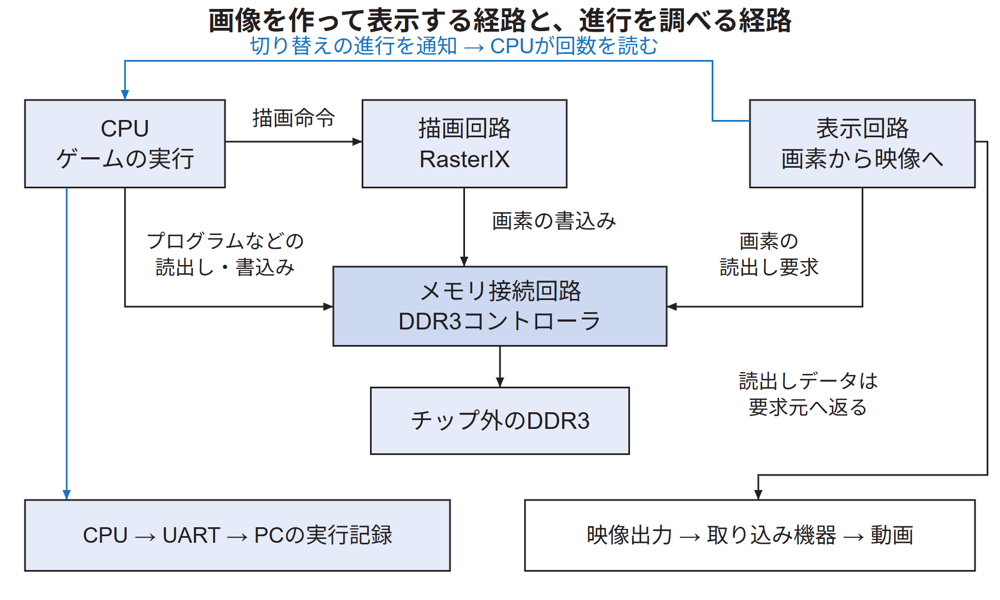

図73.1の上段はゲーム画像を作って送る経路、下段は動作を調べる経路である。青い線は表示の進行をCPUへ返す通知であり、画素の色を運ぶ線とは役割が違う。配線一本一本ではなく、関連する要求と応答をまとめたブロック図として読む。

CPUも論理回路だが、この図ではプログラムの命令を実行する部分として区別している。CPUはC++から作られた機械語の命令を順番に実行する。一方、表示回路はCPUが一画素ずつ命令しなくても、設定された番地から画素を読み、映像信号を送り続ける。CPUの処理と表示回路の処理は、同じFPGA内で並行して進む。

例えばボールを右へ動かすとき、CPUはまずゲーム内のボール位置を変える。しかし、位置を表す変数を書き換えただけではDDR3の画像は変わらない。次に描画処理を行い、新しい位置にボールを描いた画素をメモリへ用意する。それでも表示回路が以前の画像を読んでいる間は、以前のボール位置が映る。表示回路が新しい画像を読む段階まで進んで、初めて新しい画像が映像の出力元になる。この最後の段階に関係する通知を、本章では詳しく調べる。

確認方法の一つは、HDMI OUT端子につないだ映像取り込み機器で画面を録画することである。これにより、実際に外へ出た映像にボールや壁があるか、ボールの位置が時間とともに変わるかを調べられる。

もう一つは、CPUが回路の状態を読み、完了した処理の回数と経過時間を文字として出力することである。文字はUARTというシリアル通信回路を通って開発用PCへ届く。ここでは映像の色を調べるのではなく、プログラムがどこまで処理を進め、どのように終了したかを調べる。

この二つを使う理由を、停止した場合で考える。CPUが新しい画像を作らなくなっても、表示回路が以前の画像を繰り返し読めば画面は映り続ける。したがって、一枚の画像が映ることだけではゲーム処理の進行は分からない。反対に、CPUが正常終了の文字を出しても、ケーブルの先で正しい映像を受信できたかは文字だけでは分からない。回路の進行と外部映像をそれぞれ観察し、各記録が示す範囲を対応付ける。

<a id="s_operation_verification_2"></a>
## 73.2 完了した回数は何を数えているか

本章で追うのは、表示する画像の保存場所を切り替えた回数である。画像Aを表示している間に別の場所へ画像Bを用意し、次にBを表示するよう依頼する。CPUは、その依頼に対する回路内の完了通知を待つ。

AとBは、小さなレジスタ二個の名前ではない。DDR3の中に確保した、画面一枚分の画素を保存できる領域二つを指す。例えば、Aにはボールが左にある画像、Bには少し右へ動いた画像を置く。各領域には多数の画素があり、一つの画素の色もメモリに数値として保存される。

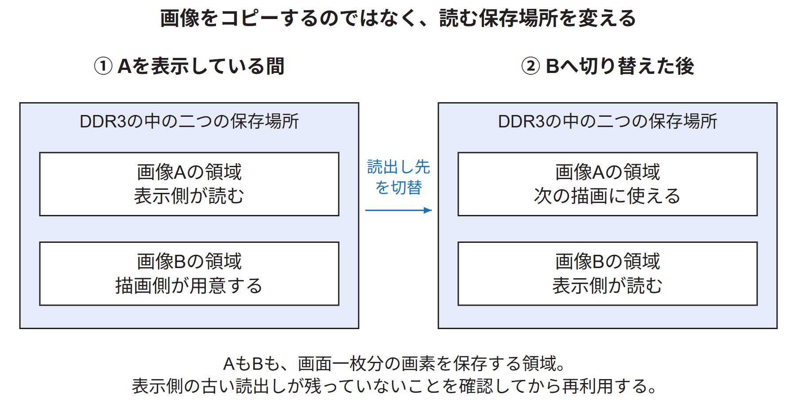

図73.2の最初では、表示回路がAを読む間に、描画回路がBを用意する。次に表示側がBを読むようになれば、それまで読んでいたAを次の描画に使える。このように、同じ二つの保存場所の役割を交互に入れ替える。画像データ全体をAからBへコピーすることを「切り替え」と呼んでいるのではない。表示回路に渡す読出し先の番地を変える。

では、Bの番地を渡した直後に、Aを上書きしてよいだろうか。表示側がまだAの一部をメモリから読もうとしているなら、その部分を上書きすると異なる時点の画像が混ざるおそれがある。そこで、切り替えを依頼したという事実だけでなく、古い画像のメモリ読出しがどこまで進んだかを確認する。すでに表示回路内へ読み込んだ画素と、これからDDR3へ読みに行く画素も区別する。DDR3のAを再利用するときに問題になるのは、これからAを読む要求が残っている場合である。

ここで「完了」には、設計で決めた具体的な条件がある。単に切り替え命令を受け取っただけでは完了にしない。表示回路が新しい画像Bの先頭から読出し要求を出し、その最初の要求までに待つ必要があるメモリ応答が返ったことを確認する。詳しい条件は[73.4節](#s_operation_verification_4)で追う。

| 数えたいもの | 数が増えるきっかけ | 同じ数字とは限らないもの |
|---|---|---|
| 回路の`FrameCount` | CPU側へ表示切り替え完了が届く | 映像信号の繰返し回数 |
| プログラムの`frames` | 一回の描画・完了待ち・エラー確認から戻る | 異なる見た目の画像の枚数 |
| プログラムの`ticks` | ゲーム状態を更新する関数を呼ぶ | 描画処理を呼んだ回数 |
| 録画ファイルのフレーム数 | 取り込み側が画像を記録する | ゲーム機が作った新画像の数 |

例えばクリア後に同じ画面を描いても、切り替え処理が完了すれば`frames`は増える。また、表示回路が同じ画像を繰り返し送れば、ゲーム側の新しい切り替えがなくても録画の画像枚数は増え得る。これらを区別してから、記録の値を読む。

ここからは、回路の回数が100、プログラムの測定回数が0の状態から、一回だけ切り替える例を使う。切り替えが完了すると回路は101を保存する。CPUが100から101への変化を確認して処理を終えると、プログラムは0から1へ増やす。どちらも「回数」だが、100と0という出発点が違う。同じ変数を二つの名前で呼んでいるわけではない。

<a id="s_operation_verification_3"></a>
## 73.3 表示する画像の番地を渡す

画像はメモリ上の多数の画素からなる。切り替えの依頼で渡すのは、その画像の先頭の番地である。番地をBと書くと、「Bから順番に画素を読んで表示する」という指定になる。CPUからの描画命令を処理したRasterIXは、`Swap`と`FbAddr`で切り替えを要求する。接続回路は`FbAddr`を`RequestAddr`へ保存し、要求を表す`Request`を1にする。

信号名の役割を分けると追いやすい。`FbAddr`は「どこから読むか」を表す複数bitの番地、`Swap`は「切り替えてほしい」を表す1 bitの要求である。番地の配線だけを置いても、いつ新しい番地を採用すべきか分からない。そのため、番地と、それを使うよう求める信号を組み合わせる。

`RequestAddr`は番地を保持するレジスタである。ここでいうレジスタは、クロックの立ち上がりで数値を取り込み、その後も同じ数値を出力し続ける回路を指す。C++の関数が番地を引数として呼ばれるのではなく、番地を表す配線と、それを保存する回路がFPGA内にある。表示側が読んでいる途中に番地が変わらないよう、この依頼に使う番地を保存しておく。

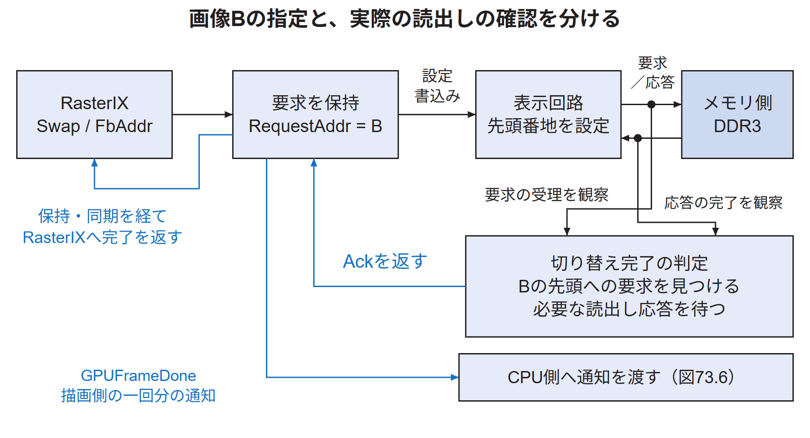

表示側が依頼を認識すると、番地を`PendingAddr`へ取り込み、表示回路の設定レジスタへ書く。その後、表示回路の実際のメモリアクセスを観察する。番地を書いただけでは、まだ以前の画像Aを読む要求や、その返事が残っている可能性があるからである。

図73.3の返事`Ack`は、新しい画像の最初の読出しまでが完了したと接続回路が判断したことを伝える。外部モニターから送られる返事ではない。表示側から戻った`Ack`を描画側が認識すると、一回分の完了を`GPUFrameDone`で通知する。

例えば`Request=1`の間、同じ依頼を何十回も送っているわけではない。「この一件を依頼しており、まだ取り下げていない」という状態を保っている。受け手は一度その依頼を取り込むと、読出しの確認が終わるまで次の依頼を受け付ける状態へ戻らない。完了時は`Ack=1`を保ち、送り手が依頼を取り下げたことを確認して`Ack=0`へ戻す。両方が0に戻ると、次の一件を識別できる。

実装にはRasterIXへ返す`Swapped`という信号もある。これは、切り替えを要求していない間などにも1になるため、「1の周期を数えれば完了回数になる」という信号ではない。回数を増やすためには、返事を受け取ったときだけ一周期1になる`GPUFrameDone`を別に作る。切り替え処理の状態を伝える信号と、一件の完了を数えるための信号を区別している。

要求と返事には、それぞれ別のクロックへ渡す処理がある。番地は要求中に保持し、要求を1にする、返事を待つ、要求を0に戻す、返事も0に戻るのを待つ、という順序を守る。同じ1を何度も新しい依頼と誤認しないためである。状態遷移と番地の保持は[技術付録40.20節](../04-rasterix/framebuffer-display.md#s_app_40_20)で詳しく説明する。

<a id="s_operation_verification_4"></a>
## 73.4 メモリへの依頼と返事を区別して完了を決める

表示回路とメモリ接続回路の間にはAXIの読出しインターフェースがある。表示回路が番地を出しても、相手が受け取ったとは限らない。また、相手が番地を受け取っても、その場で画素の色が返るとは限らない。この二段階を別々の信号で判断する。

CPUがメモリを読む場合と同じように、表示回路も「この番地からデータが欲しい」という要求を出す。DDR3コントローラへつながる回路が要求を受け取り、実際にデータを用意した後で返す。表示回路が番地を出す時点と、画素の色が返る時点の間には時間がある。以下の「要求」は番地を渡すこと、「応答」は読み出したデータが戻ることを指す。

| 信号 | この読出しでの意味 |
|---|---|
| `ARVALID` | 表示回路が有効な読出し番地を提示している |
| `ARREADY` | 接続先がその番地の要求を受け取れる |
| `ARADDR` | 読みたいデータの先頭番地 |
| `RVALID` | 接続先が有効な読出しデータを返している |
| `RREADY` | 表示回路がそのデータを受け取れる |
| `RLAST` | 今回の要求に対する最後のデータである |

`ARVALID`と`ARREADY`が両方1であるクロックの立ち上がりに、一件の要求が受理される。一件の要求で複数回に分けてデータを返す転送をバーストと呼ぶ。`RVALID`、`RREADY`、`RLAST`がすべて1の立ち上がりでは、そのバーストの最後のデータを受け取ったと判断する。

`VALID`だけが1でも転送は成立しない。例えば`ARVALID=1`、`ARREADY=0`なら、番地は提示しているが相手はまだ受け取れない。両方が1になった立ち上がりで受渡しが成立する。データの返事にも同じ考え方を使う。`RVALID=1`、`RREADY=1`なら、その周期に提示されたデータを受け取る。この受渡しの規則はAXIの仕様で定められている[ArmAXI20](../references.md#ref_armaxi20)。

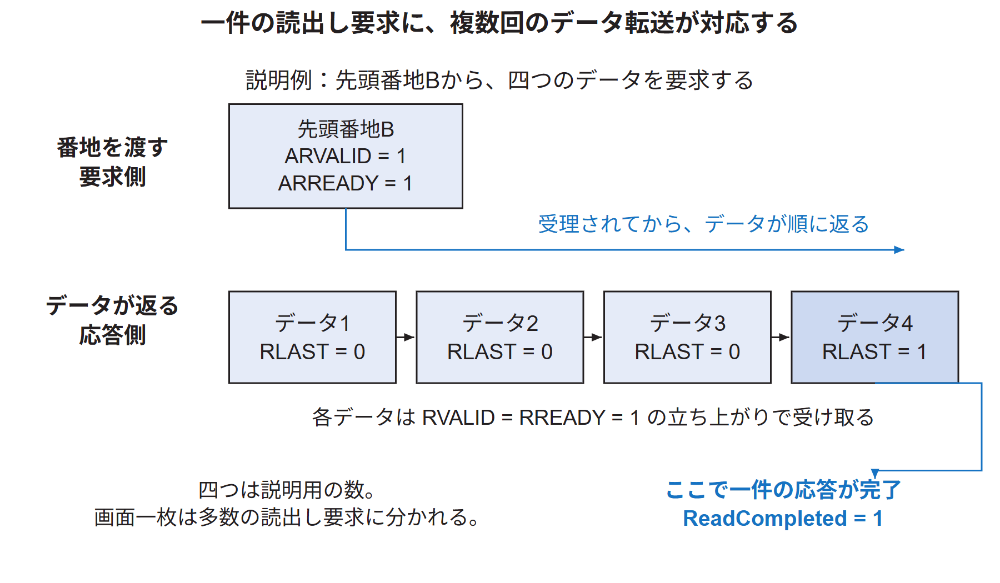

図73.4では、説明用に一件の要求へ四つのデータが返る例を描く。最初の三つも有効なデータだが、それだけではこの要求への返事が終わっていない。四つ目で`RLAST=1`になり、そのデータを受け取ったときに一件が完了する。四つという数は説明用で、実機のバースト長を示すものではない。また、一件のバーストで画面一枚すべてを読むわけでもない。表示回路は小分けの読出しを繰り返して画素を集める。

実装は、この二つを`ReadAccepted`と`ReadCompleted`にまとめている。

```systemverilog
assign ReadAccepted  = ARVALID & ARREADY;
assign ReadCompleted = RVALID & RREADY & RLAST;
```

`Outstanding`は、受理されたが最後のデータをまだ受け取っていない要求の件数である。新しい要求だけが受理されれば1増やし、最後のデータだけを受け取れば1減らす。両方が同時に起きれば、件数は変わらない。

例えば、まだ返事が来ていない要求が二件あるとする。新たに一件を受け付ければ、返事待ちは三件になる。その後、一件の最後のデータが届けば二件に戻る。この返事待ちの件数が`Outstanding`であり、画素数や残りの表示行数ではない。

次に、新画像Bの先頭番地への要求が受理された時点で、そこまでの未完了件数を`Remaining`へ保存する。例えば古い画像の要求A0、A1が残っていて、新しい要求B0を受理したなら、待つ対象はA0、A1、B0の三件になる。

| 出来事 | 待っている対象 | `Remaining` |
|---|---|---:|
| B0を受理した直後 | A0、A1、B0 | 3 |
| A0の最後のデータを受け取る | A1、B0 | 2 |
| A1の最後のデータを受け取る | B0 | 1 |
| B0の最後のデータを受け取る | なし | 0となり、`Ack`を1にする |

この表では要求と応答を別々の周期に置いた。B0を受理する周期にA0の最後のデータも返るなら、その瞬間に残るのは二件である。実装の`Outstanding + 1 - ReadCompleted`は、この同時発生を含めた計算である。判定に使う`Remaining == 1`は更新前の値なので、残り一件を受け取る周期に完了とする。

`Outstanding`と`Remaining`を別に持つ理由は、B0を受理した後も表示回路がB1、B2と次の読出しを依頼するためである。`Outstanding`はそれらも含む現在の返事待ち件数なので、B0が終わっても0とは限らない。これだけを使って「0になるまで待つ」と、新しい画像の後続の読出しまで待つことになる。

一方、`Remaining`は、B0を受け付けた時点で「ここまでの返事を待てばよい」と決めた件数である。B1を後から受け付けても増やさない。A0、A1、B0の順に返事が終わるたびに減らし、三件目が終われば、B0まで終わったと判断できる。例中のA0やB0という名前を回路が保存しているわけではない。応答の順序が保たれることを利用して、件数で境界を見つけている。

この数え方は、対象の表示回路が同じ読出しIDで要求を出し、その順序で応答を受け取る構成に基づく。IDは読出し要求を区別するための番号であり、対象の表示回路は`outport_arid_o = 4'd0`として同じ0を使う。同じIDの読出し応答の順序を保つ規則はAXIの仕様にある[ArmAXI20](../references.md#ref_armaxi20)。応答順序が異なる回路へそのまま流用する場合は、件数だけで対象を見分けられるかを改めて検討する。

ここで待ったのは新画像の最初のバーストまでであり、画像全体の全画素ではない。以降の読出しは表示回路が続ける。古い画像を再利用するうえで必要なメモリ読出しの境界を確認する仕組みであり、画面の最下段まで外部モニターに表示済みという通知ではない。

さらに、上の`ReadCompleted`の式は、返ってきた色が正しいかを比較する式ではない。AXIの応答状態`RRESP`が正常かどうかも、この式自体には含まれない。したがって、完了回数は所定の転送の進行を示す。画面の正しさは別の画像・映像の確認で調べる必要がある。[73.13節](#s_operation_verification_13)の映像確認は、この違いに対応する。

<a id="s_operation_verification_5"></a>
## 73.5 短い完了信号を別のクロックへ直接渡さない理由

描画側は100 MHz、CPU側は20 MHzで動く。100 MHzの一周期は10 ns、20 MHzの一周期は50 nsである。ここでnsは10億分の1秒を表す。回路のレジスタは、各クロックの指定された立ち上がりで入力を保存する。

クロックは0と1を周期的に繰り返す信号である。「立ち上がり」は0から1へ変わる瞬間を指す。入力がずっと監視され、その変化がすべて自動で記録されるのではない。例えばCPU側のレジスタが0 ns、50 ns、100 nsで入力を保存するなら、その間だけ現れて消えた値は保存されないことがある。ここでいうCPU側の保存動作は、CPUがC++の行を実行することとは別の、レジスタ回路の動作である。

描画側が完了を10 nsだけ1にしても、CPU側の二つの立ち上がりの間にその10 nsが入ると、CPUは前後とも0しか保存できない。例えばCPUの保存時刻が0 nsと50 nsで、完了信号が10〜20 nsの間だけ1なら、直接接続したCPU側レジスタには1が残らない。この時刻は問題を説明する例であり、実機の位相を測定した値ではない。

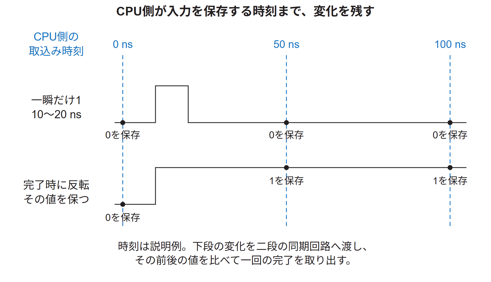

図73.5の上段では、CPU側が入力を取り込む二つの時刻の間に、通知が1になって0へ戻る。次に入力を取り込むときには0なので、通知があったか分からない。下段では、完了したときに値を反転し、反転後の値を保つ。次の取込み時刻にも変化が残っているため、CPU側へその変化を伝えられる。どちらも一回の完了を表すが、配線に残す情報の形を変えている。

対策として、描画側は完了のたびに`FrameToggle`を0から1、次は1から0へ反転する。新しい値は次の完了まで残る。CPU側は一瞬の1を探す代わりに、以前に保存した値と違うかを調べられる。

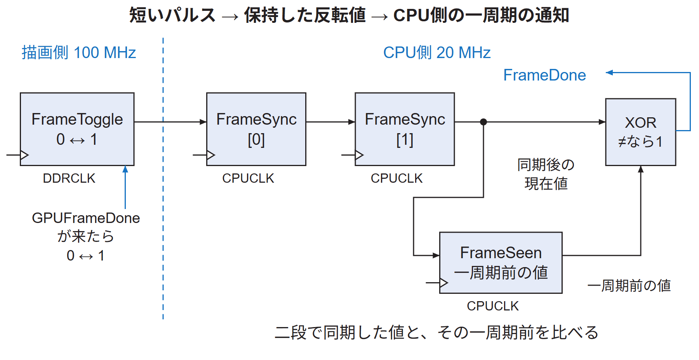

図73.6の`FrameSync[0]`と`FrameSync[1]`はCPUクロックで動く二段の同期レジスタである。クロックの境界に近い時刻で入力が変わると、最初のレジスタの出力がすぐ0か1に落ち着かない場合がある。後段まで時間を置いて取り込むことで、その不安定さが後続へ伝わる確率を減らす。これはメタステーブルへの対策であり、物理的な危険が数学的にゼロになるという意味ではない。

二段同期だけでは、一回の出来事を一周期の信号へ戻せない。同期後の値はしばらく1または0のままだからである。そこで、その一周期前の値を`FrameSeen`に保存し、現在の`FrameSync[1]`と比べる。二つの値が異なるときだけ1を出すXORが、CPU側の`FrameDone`を作る。0から1への変化も、1から0への変化も一回として検出する。

| 同期後の現在値 | 一周期前の値 | XORの出力 | 意味 |
|---:|---:|---:|---|
| 0 | 0 | 0 | 変化していない |
| 1 | 0 | 1 | 0から1へ変わった |
| 1 | 1 | 0 | 変化していない |
| 0 | 1 | 1 | 1から0へ変わった |

二回目の完了では`FrameToggle`は1から0へ戻る。この場合も「完了していない状態に戻った」と解釈せず、「前回と違う値に変わったので、もう一回完了した」と解釈する。反転後の値が0か1かではなく、前回と変わったかに意味を持たせている。

<a id="s_operation_verification_6"></a>
## 73.6 同期レジスタの中を一周期ずつ追う

説明用に、すべて0だった状態から`FrameToggle`が1になり、その値を保つ場合を考える。表はCPUクロックの立ち上がり直後の値である。入力が十分早く安定しており、表の第1回で同期の最初の段に1が入る例とする。

| CPUの立ち上がり | `FrameSync[0]` | `FrameSync[1]` | `FrameSeen` | 直後の`FrameDone` | `FrameCount` |
|---|---:|---:|---:|---:|---:|
| 変化を取り込む前 | 0 | 0 | 0 | 0 | 100 |
| 第1回 | 1 | 0 | 0 | 0 | 100 |
| 第2回 | 1 | 1 | 0 | 1 | 100 |
| 第3回 | 1 | 1 | 1 | 0 | 101 |
| 第4回 | 1 | 1 | 1 | 0 | 101 |

第2回の直後には1と0がXORへ入るので`FrameDone`が1になる。その信号が続いている間に第3回の立ち上がりが来ると、回数を覚えるレジスタが101を保存する。同じ立ち上がりで`FrameSeen`も1になるため、その直後に`FrameDone`は0へ戻る。

第1回では、描画側から届いた1を最初の段だけが取り込む。二段目が取り込むのは、その直前まで最初の段が保持していた0である。第2回では、最初の段がすでに1を保持しているため、二段目にも1が入る。しかし`FrameSeen`が取り込むのは、直前の二段目の0である。このため、第2回の直後だけ「現在の1」と「以前の0」がそろい、XORが1になる。

第3回の立ち上がり直前には、このXORの1が回数を増やす回路へ届いている。回数のレジスタはそれを受けて101を保存する。同時に`FrameSeen`も1を保存するので、立ち上がり後は1と1の比較となり、XORは0になる。一つの変化から一回だけ回数が増えるのは、この順序による。

SystemVerilogの`<=`による更新は、同じ立ち上がりの更新前の値を使って、それぞれのレジスタの次の値を決める。ファイルの上から順に更新し、新しい値が一瞬で全段を通り抜けるわけではない。この違いを表で示すため、`FrameDone`が1になる行と、回数が増える行を分けている。

次の記述は、CPU側にある三つの保存箇所の関係を、リセットを除いて一行ずつ書いた説明用の形である。実装の二段同期は連結記法で書かれているが、更新関係は同じである。

```systemverilog
always_ff @(posedge CPUCLK) begin
  FrameSync[0] <= FrameToggle;
  FrameSync[1] <= FrameSync[0];
  FrameSeen    <= FrameSync[1];
end
```

例えば「二行目だから一行目の計算後の1を使う」と読むと、表を再現できない。各行は、同じ立ち上がりの直前にあった右辺を、それぞれのレジスタが取り込むことを表す。C++で変数を上から順番に代入する説明とは区別する。

この通知方法は、CPU側が変化を見分ける前に描画側が二回反転すると、元の値に戻って二回分を見落とし得る。どんな速さの出来事でも数えられる回路ではない。対象ではソフトウェアが一回ずつ完了を待ち、表示切り替えの間隔もCPU周期より十分長い条件で使う。入力位相によって同期の遅延は変わり得るため、表の三周期を常に一定の伝達時間とはしない。

描画命令を運ぶ非同期FIFOは、別の経路にある。図73.6は一回の完了という情報を伝える回路であり、描画命令の32 bitの語を運ぶFIFOではない。

<a id="s_operation_verification_7"></a>
## 73.7 回数を増やす回路は加算器と選択器とレジスタからなる

CPU側の`FrameDone`を受け取るのは、`rasterix_apb.sv`内の`FrameCount`である。これは32 bitのレジスタで、値を保持する回路である。CPUの汎用レジスタ`x1`などとは別の場所にあり、DDR3に置いたC++の変数でもない。

32 bitとは、0か1を保持する場所を32個組み合わせて、一つの数値を保存することである。この回路の現在値が101なら、32本の出力線には101を表す2進数が現れる。CPUが読む瞬間だけ回数を計算しているのではなく、読み出されていない間も回路が現在値を保持している。

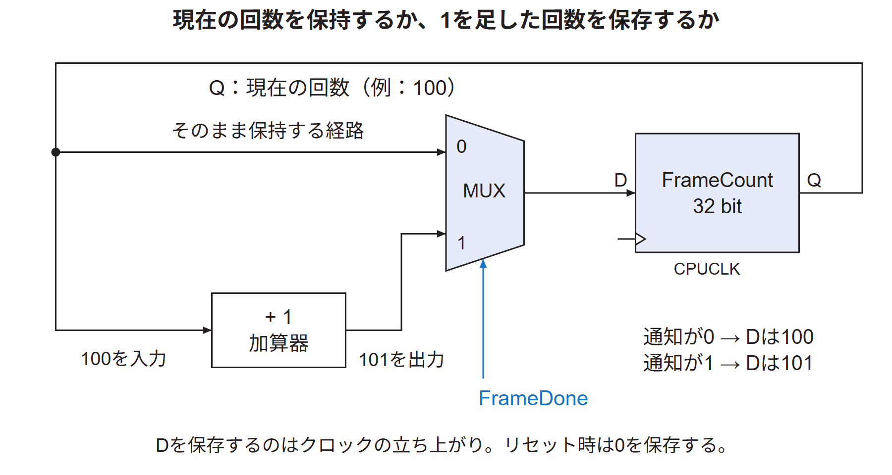

レジスタの出力Qが現在の回数で、入力Dが次の立ち上がりに保存する値である。図73.7では、現在の回数を二つの経路へ渡す。一方はそのまま、もう一方は加算器で1を足してから選択器へ入れる。選択器はMUXとも呼ばれ、制御入力`FrameDone`によって、どちらをDへ通すかを決める。

現在の回数が100で、完了通知が0なら、選択器は100を選ぶ。次のCPUクロックが来ても100を保存するため、数は変わらない。通知が1なら101を選び、その状態で立ち上がりが来たときに101を保存する。したがって、CPUクロックが毎秒2千万回動くことは、完了回数が毎秒2千万回増えることを意味しない。

加算器は現在値から101を計算するだけであり、自分で回数を記憶しない。値を保持するのはレジスタで、更新の時点を決めるのはクロックである。図はこの働きを理解するための論理的な等価回路であり、配置配線後に同じ形のMUXが一個だけ置かれると断定する図ではない。合成ツールはレジスタの有効化入力などを使って同じ動作を実装できる。

実装から回数の部分だけを抜き出すと次の記述になる。同じ処理では表示番地も保存するが、ここでは省略している。

```systemverilog
always_ff @(posedge PCLK)
  if (~PRESETn)
    FrameCount <= '0;
  else if (FrameDone)
    FrameCount <= FrameCount + 1'b1;
```

`PCLK`はこの接続ではCPUクロックである。リセット`PRESETn`が0なら、立ち上がりで回数を0にする。リセットでなく完了通知もないときは、それまでの値を保持する。図の通常動作にはリセットの選択を省略したが、実装にはこの優先条件がある。

この`always_ff`は、実行中のCPUが回すループではない。設計ツールが、クロック入力、リセット条件、加算する回路、値を保持する回路を実装するための記述である。FPGAへ実装した後は、CPUがこのSystemVerilogを読みながら動かす必要はない。CPUが別の計算をしていても、`FrameDone`が所定の立ち上がりで1なら、回路自身が回数を更新する。

CPUが回数を読むだけでは増えず、0にも戻らない。ゲームプログラムを終了して起動し直しても、回路にリセットをかけなければ前の値が残る。32 bitなので最大値の次は0に戻るが、後述の待ち処理は「前より大きいか」ではなく「前と違うか」で判断する。ただし、読出しの間に一周分の出来事が起きても確実に数えられるという保証ではない。

<a id="s_operation_verification_8"></a>
## 73.8 CPUはMMIOで回数を読む

CPUが`FrameCount`を読むには、専用の配線をCPUの計算器へ直接足す必要はない。周辺回路のレジスタにアドレスを割り当て、メモリの値を読む形でアクセスする。これがMMIOである。

通常のメモリ読出しでは、アドレスでDDR3の保存場所を選び、その中の値を受け取る。今回のMMIO読出しでは、アドレスで周辺回路を選び、その回路のレジスタが出している値を受け取る。CPUからはどちらもロード命令を使うが、バスの行き先が違う。`0x10080010`という番地に回数を保存したDDR3の領域がある、という意味ではない。

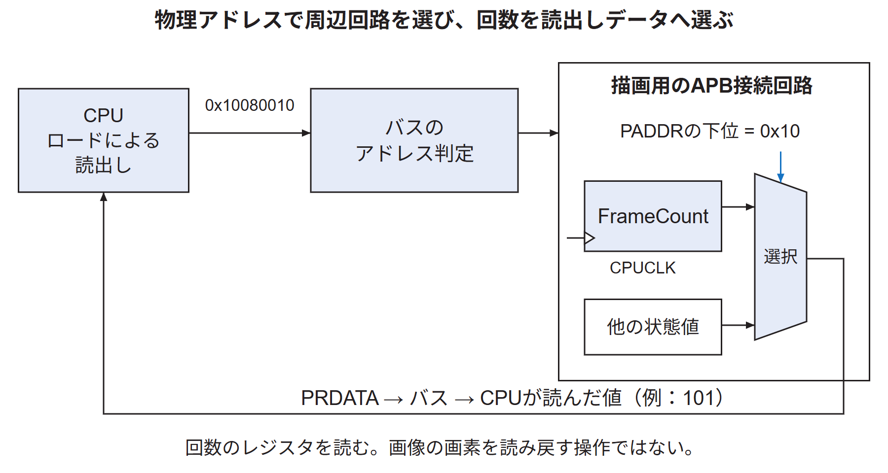

対象の描画用レジスタ群は物理アドレス`0x10080000`から始まる。`FrameCount`はその先頭から`0x10`、すなわち16 byte先なので、読出し先は`0x10080010`となる。バスのアドレス判定がこの周辺回路を選び、回路内では下位の`0x10`によって回数を読出しデータに選ぶ。

`rasterix_apb.sv`の`case (PADDR)`にある`8'h10: ReadData = FrameCount;`が、この選択に対応する。`PRDATA`はAPBの読出しデータ線で、選ばれた値をCPU側へ返す。他の番地なら識別値や状態、表示番地などを選ぶ。図73.8はこの選択の関係を示し、バス変換や仮想アドレス変換の内部は省略している。

実際のプログラムはLinux上で動き、`/dev/mem`と`mmap`により、この物理アドレスの範囲へアクセスするための仮想アドレスを得る。C++の`regs`はその対応先を指す32 bit単位のポインタである。そのため`regs[4]`は4 byte×4個、つまり先頭から16 byte先を読む。

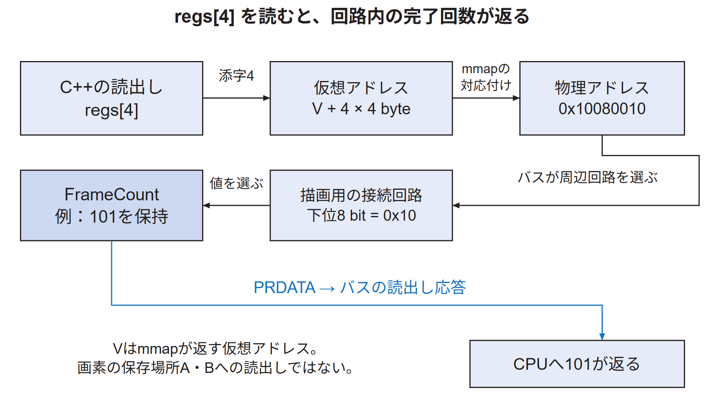

図73.9のVは、`mmap`がこの実行で返した仮想アドレスを表す記号であり、実際の数値を固定したものではない。`regs[0]`はV、`regs[1]`はV+4、`regs[4]`はV+16に対応する。プログラムがV+16を読むと、対応付けに従って物理アドレス`0x10080010`への読出しになる。

バスはアドレスの範囲から描画用の接続回路を選ぶ。その回路内では、先頭から何byte目かを表す下位8 bitを使い、`0x10`なら`FrameCount`を選択器から読出し線へ通す。例えばレジスタが101を保持していれば、101という32 bitの値がCPUへ戻る。この一連の読出しでは、画像の保存場所AやBの画素を読んでいない。

```cpp
uint32_t frameCount() const { return regs[4]; }
```

`regs`は`volatile uint32_t*`として宣言される。回路の値がCPUの通常の代入以外でも変わるため、読出しを以前の値の使い回しに置き換えないようコンパイラへ伝える。ただし、`volatile`という指定だけで、キャッシュの属性やすべてのハードウェア上の順序まで決まるわけではない。MMIOの対応付けと順序は[技術付録第31章](../03-linux/mmio-ordering.md#ch_24)でも扱う。

ここで起こるのは、周辺レジスタにある回数の読出しである。画像の全画素をCPUへ送ったり、HDMI端子の映像をCPUが解析したりしているわけではない。

<a id="s_operation_verification_9"></a>
## 73.9 プログラムは一回の描画の前後で回数を比べる

ゲームプログラムの`present`という処理は、現在のゲーム状態を描き、表示切り替えが進むまで待つ。対応する箇所を抜き出すと次の順序である。

```cpp
renderer.draw(breakout::scene(game));
const auto previous = bus.frameCount();
gl.swapDisplayList();
bus.waitForFrame(previous);
if (glGetError() != GL_NO_ERROR)
    throw std::runtime_error("OpenGL error");
```

`renderer.draw`は現在の物体の位置などから描画の処理を用意する。次に、その時点の回数を`previous`へ保存する。例えば100なら、その100を比較の基準にする。続く`swapDisplayList`で用意した命令リストの処理を進め、`waitForFrame`で回路の値が100のままかを繰り返し読む。

値が100なら、まだ新しい完了を確認していないので待つ。101など100と異なる値になれば、完了が届いたと判断して待ちを終える。その後にOpenGLのエラー状態を確認する。主ループでは、ここから正常に戻った後でソフトウェアの変数`frames`を1増やす。

回数を読むたびにCPUが「完了にしてよい」と回路へ許可を出すわけではない。回路は表示側の進行を検出して、自分で100を101へ更新する。CPUはその結果を繰り返し読んでいるだけである。このように値を繰り返し調べる方法をポーリングと呼ぶ。

例えば、CPUが100、100、100、101という順で読んだとする。最初の三回は比較に一致するのでループを続け、四回目で一致しないため待ちを終える。完了を示す短い信号がその間に消えていても、回路の回数101は保存されているので読める。CPUが20 MHzで動くことは、この読出しを毎秒2千万回行うという意味ではない。読出し、比較、分岐など複数の命令と、バスの転送に時間がかかる。

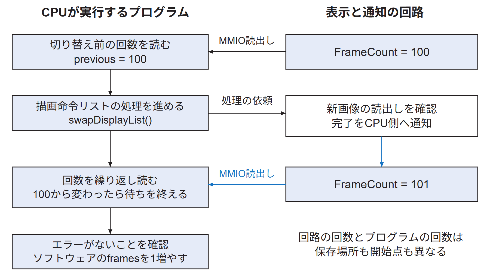

この二つの回数の保存場所と開始点を分ける。回路の`FrameCount`はFPGAのリセット後からの完了を記憶する。ソフトウェアの`frames`は、そのプログラムが測定対象の繰返しを始めた時点で0にする。さらに、測定前に四回の`present`を行うので、その分は`frames`には含めない。同じ回数になると仮定して読み替えてはいけない。

説明用の値で追うと、一回目は`previous=100`で依頼し、回路が101になった後に`frames=1`となる。二回目はその時点の101を`previous`へ保存し、102への変化を待って`frames=2`となる。`previous`を毎回読み直すため、回路の回数を測定開始時に0へ戻す必要はない。CPUが保持する比較用の値と、回路内で変わる現在値を比べ続ける。

`waitForFrame`は、回数の差が必ず1であるかまでは検査していない。「以前と異なる」という条件を使う。対象では一回ごとに待つ使い方に対応した完了確認であり、すべての通知の欠落や重複をこの関数だけで証明するものではない。

<a id="s_operation_verification_10"></a>
## 73.10 約5分という時間をどこで決めるか

300秒は、完了回数を一定数まで数えて作った時間ではない。ゲームプログラムが`std::chrono::steady_clock`で経過時間を調べ、300秒以上になったら主ループを終える。`steady_clock`は経過時間の計測に使う時計であり、ここで扱う回路の`FrameCount`とは別である。

ここまでの回路は「今の一回を終えて次へ進んでよいか」を知らせる。時計を使う部分は「試験全体をいつ終えるか」を決める。この二つの終了条件を別に考える。一回ごとの完了待ちをなくして時計だけ調べても、表示処理が進んだことは確認できない。反対に、完了した回数だけでは、その回数に何秒かかったか分からない。

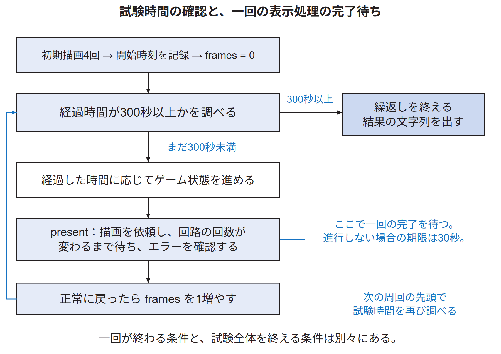

実際のループを時間と描画の関係に絞ると、次のようになる。入力や終了信号の処理、ゲーム状態の更新は文章の後半で補う。

```text
表示処理を4回行い、初期状態を整える
開始時刻を記録する
framesを0にする
繰り返す
    現在時刻から開始時刻を引く
    300秒以上なら繰返しを終える
    経過した時間に応じてゲーム状態を進める
    presentを呼び、描画と回路の完了確認を行う
    framesを1増やす
終了時の経過時間、frames、点数などを出力する
```

時間を調べるのは各周回の先頭である。例えば299.99秒で最後の処理を始め、処理後に300.01秒になった場合、次の先頭で終了を決める。したがって、結果が300.011秒のように300秒を少し超えることは、このループの構造と矛盾しない。

`ticks`は、経過時間に応じてゲーム状態を進める関数を呼んだ回数である。対象の実装は一秒当たり60回の進行を基準とし、描画に時間がかかった周回では状態更新を複数回行うことがある。短い周回では更新が0回のこともある。このため`frames`と`ticks`の値は必ずしも同じにならない。

60回/秒の状態更新は、一回分が約16.67 msという意味である。例えば前回から約33.4 msたまっていれば、状態更新を二回行ってから、その時点の状態を一回描く。まだ一回分の時間がたまっていなければ、状態更新を行わずに描く周回もある。時間の端数は次の周回へ持ち越す。したがって、描画一回につき必ずボールを一回動かす構造ではない。

ここでの60回/秒はゲーム状態を進める基準である。100 MHzや20 MHzという回路のクロック周波数、表示回路が映像を繰り返す周期、録画機器が画像を保存する周期とは、それぞれ別の意味を持つ。単位がすべて「一秒当たり」でも、何を一回と数えるかをそろえずに比較してはいけない。

<a id="s_operation_verification_11"></a>
## 73.11 途中で進まなくなった場合をどう検出するか

回数の変化を待つ`waitForFrame`には、30秒の期限がある。回路の値が変わらない間も時計を調べ、期限を超えれば`RasterIX display swap timeout`というエラーを出す。この例外を受けたプログラムは終了値1を返す。正常に最後まで進んだ場合の終了値は0である。

この30秒は一回の待ちに対する期限である。300秒の試験時間とは違う。正常な切り替えが何度も続けば、それぞれの待ちは回数の変化を見つけて終わる。ある一回だけいつまでも回数が変わらなければ、その一回で期限に達する。「一回が30秒未満なら快適に遊べる」と判定するための値でもない。これは進行しなくなったときに、待ちを無限に続けないための上限である。

ただし、この30秒の判定もCPU上のプログラムが実行する。CPU自体が停止した場合や、バスの読出しから戻れない場合には、時計を調べる行へ進めない可能性がある。専用の独立した監視回路が必ず30秒後に停止を発見する仕組みではない。

開発用PC側の保存スクリプトにも待ち時間を設ける。UARTでゲームを起動し、ゲーム終了後にシェルが出す一意な目印と終了値を待つ。300秒の試験では360秒の受信期限を使う。目印が返らなければ、終了確認に失敗したと判断できる。

この場合は、ゲーム機内のCPUとは別の、開発用PCの時計とプログラムが待ちを打ち切る。ゲーム機のCPUが止まっていてもPCは動けるため、ゲーム機から結果が返らないことを確認できる。つまり、一回の表示処理を待つゲーム内の期限と、試験全体の結果を待つPC側の期限を二段で設けている。これだけで、どの回路が原因で止まったかまでは特定できない。

終了値を含む目印は、単に起動コマンドが端末へ表示されたことと、実行が終わったことを見分けるために使う。保存スクリプトは、正常終了、結果行の存在、記録時間が300秒以上、完了数が0より大きいことを確認する。全区間の瞬間速度や、各一秒の停止時間を検査した条件ではない。

これらは保存済み試験の仕組みを説明したものである。付属する過去のスクリプトは実験機器や保存先の指定を含むため、現在の装置へそのまま実行するためのコマンドとは扱わない。再実行の前提は[技術付録第64章](repeating-experiments.md#ch_c)を参照する。

<a id="s_operation_verification_12"></a>
## 73.12 保存された300.011秒の記録を読む

E6の[通常版の集約結果](../../再現資料/実験記録/E6/board-fresh-product/result.json)には、次の終了行が保存されている。

```text
Game ended: score=400 lives=3 frames=17853 ticks=17999 elapsed=300.011 s
```

| 項目 | 記録値 | 読み取れる内容 |
|---|---:|---|
| `score` | 400 | 終了時の点数。対象のゲームでは全40ブロックのクリアに対応する |
| `lives` | 3 | 終了時に残った残機数 |
| `frames` | 17,853 | 測定中に`present`から正常に戻り、主ループが数えた回数 |
| `ticks` | 17,999 | 測定中にゲーム状態更新の関数を呼んだ回数 |
| `elapsed` | 300.011 s | 初期の四回の描画を終えてから測った実行時間 |

ゲームはクリア状態に入ると、自動操作では新しいゲームを始めない。状態更新の関数は呼ばれても、クリア状態なら再開始の入力を調べて戻る。表示処理はその後も続く。このため、記録全体を「ボールが5分間ずっと動き続けた」とは説明しない。クリアに至るゲーム処理と、その後を含めた描画・完了待ちの繰返しが対象である。

17,853を300.011で割ると約59.51回/秒になる。ただし、これはこの実行全体での処理完了回数の平均である。クリア後も含み、すべての周回に同じ描画負荷がかかるわけではない。毎秒59.51枚の異なる画像を映像から数えた値でも、最も重い場面で必ずこの速度が出るという値でもない。

結果ファイルの`continuous_scope`には、300秒の実行は先に検査した通常版で行い、新しく生成した`.bit`ファイルでは繰り返していないことが記される。新規ファイルの設定データ部分が以前のものとbyte単位で同一だったことを照合し、同じ回路設定に対する記録として対応付けた。新規ファイルを使った別の起動・画像試験と、300秒の継続記録は区別する。

集約結果にある`continuous_evidence`は当時の記録名であり、その名前の元ログがすべて公開フォルダーに収録されていることを意味しない。本章の終了行の根拠は、公開されている集約結果の`continuous_game`である。参照できる記録と、そこに記された過去の参照先を区別する。

この終了行から一回の成功を逆向きにたどると、まず主ループで`frames`が増えた。その前に`present`が正常に戻り、その中で`waitForFrame`が回路の回数の変化を確認した。回路の回数は、表示切り替えに伴う通知をCPU側へ渡したときに増える。この対応があるため、結果の17,853は単に空のループを17,853回回した数として扱わない。ただし、この行だけには各回の時刻や画素の色までは記録されていない。

<a id="s_operation_verification_13"></a>
## 73.13 30秒の映像は別の実行で確認した

映像確認には[保存した30秒の動画](../../再現資料/実験記録/E6/report/results/video/breakout-latest-30s.mp4)と[解析結果](../../再現資料/実験記録/E6/report/results/video/validation.json)がある。これは300秒の試験と同じ実行を丸ごと録画したものではない。別の75秒の自動操作から保存した区間である。

動画の長さは30.016667秒で、1,801枚の録画画像を復号した。各画像でゲーム領域の壁と白いボールを検出し、隣り合う画像のボール位置も比べた。1,800組の比較のうち、1,749組で論理画面の0.9画素以上の移動を検出した。移動がこのしきい値に届かない組が続いた最大数は1組、つまり2枚分だった。これは指定した検出方法による結果であり、全画素の正解画像との照合ではない。

加えて、録画開始から1、8、15、22、29秒付近の画像を目視した。ゲームの形や色、画面の配置は目視の対象となる。録画の設定が毎秒60枚であることだけを、ゲーム側が毎秒60枚の新しい画像を完成した証拠にはしない。

記録を説明するときは、「回路内の完了を伴う約5分の実行」と「別に取得した約30秒の映像」を分ける。二つを合わせることで、内部の進行だけ、または静止画の表示だけより広い範囲を確認できる。ただし、5分間の全映像を観察したことにはならない。

<a id="s_operation_verification_14"></a>
## 73.14 実装のどこを読めば図と対応するか

次のリンクは研究リポジトリの`console/`が指す固定版ソースを対象とする。GitHubで表示先がサブモジュールのため開けない場合は、[製品の対象コミット](https://github.com/SoshiroFujimori/wally-game-console/tree/261832d48832dd6e26c4971ab8893ce61200688b)から同じファイル名を探せる。

| 読みたい動作 | 対象ファイル | 探す名前 |
|---|---|---|
| 切り替え要求の保持と表示側の返事 | [rasterixdisplay.sv](https://github.com/SoshiroFujimori/wally-game-console/blob/261832d48832dd6e26c4971ab8893ce61200688b/fpga/src/rasterixdisplay.sv) | `RequestState`、`RequestAddr`、`Ack` |
| 読出し要求と応答の数え方 | [rasterixdisplay.sv](https://github.com/SoshiroFujimori/wally-game-console/blob/261832d48832dd6e26c4971ab8893ce61200688b/fpga/src/rasterixdisplay.sv) | `ReadAccepted`、`ReadCompleted`、`Outstanding`、`Remaining` |
| 完了をCPUクロックへ渡す回路 | [rasterix.sv](https://github.com/SoshiroFujimori/wally-game-console/blob/261832d48832dd6e26c4971ab8893ce61200688b/fpga/src/rasterix.sv) | `FrameToggle`、`FrameSync`、`FrameSeen` |
| 回数の保存と読出し値の選択 | [rasterix_apb.sv](https://github.com/SoshiroFujimori/wally-game-console/blob/261832d48832dd6e26c4971ab8893ce61200688b/fpga/src/rasterix_apb.sv) | `FrameCount`、`ReadData`、`PADDR` |
| CPUからのMMIO読出しと待ち | [WallyBusConnector.hpp](https://github.com/SoshiroFujimori/wally-game-console/blob/261832d48832dd6e26c4971ab8893ce61200688b/examples/rasterix/WallyBusConnector.hpp) | `regs[4]`、`frameCount`、`waitForFrame` |
| 初期描画と300秒の主ループ | [breakout.cpp](https://github.com/SoshiroFujimori/wally-game-console/blob/261832d48832dd6e26c4971ab8893ce61200688b/examples/rasterix/breakout.cpp) | `present`、`frames`、`ticks`、`elapsed` |
| クリア後の処理 | [Breakout.hpp](https://github.com/SoshiroFujimori/wally-game-console/blob/261832d48832dd6e26c4971ab8893ce61200688b/examples/rasterix/Breakout.hpp) | `Phase::Clear`、`step`、`automatic` |
| PCでの終了確認と保存条件 | [実験スクリプト](../../../../experiments/fifo-study-20261008/archive-scripts/product-continuous-resumed.py)と[UART受信](../../../../experiments/fifo-study-20261008/archive-scripts/uart.py) | `continuous`、終了目印、受信期限 |

`rasterixdisplay.sv`の出力ポート名`FrameDone`は、上位の`rasterix.sv`では`GPUFrameDone`という信号へ接続される。一方、`rasterix_apb.sv`の入力ポート名`FrameDone`には、CPU側で同期・変化検出した信号が入る。同じポート名でも回路の階層とクロックが違うため、図73.6では両者を区別している。

この完了通知とMMIOレジスタは、Wallyへ接続するために用意した側の実装である。公式RasterIXの内部に、同じ物理アドレスの`FrameCount`が初めからあるという意味ではない。

<a id="s_operation_verification_15"></a>
## 73.15 図を使って動作確認を説明する

説明では、まず図73.1で画像と通知の経路を示す。「描画回路がDDR3へ画像を書き、表示回路が読み出す。その切り替えの進行をCPUが回数として読めるようにした」と述べる。次に、完了の条件を問われたら図73.3と[73.4節](#s_operation_verification_4)へ進む。回数を作る論理回路を問われたら図73.6と図73.7、CPUが読む方法を問われたら図73.8を使う。

| 問い | 回答を作るための要点 |
|---|---|
| 映っているだけで動作確認になるか | 表示回路だけが同じ画像を送り続ける場合もあるため、ゲーム処理の進行と映像を別に見る |
| CPUが勝手に回数を増やしていないか | 回路の回数は完了信号で増える。ソフトウェアの回数は、その値の変化を待った後で増える |
| 完了はモニターから返るのか | 回路内で新画像の最初の読出しまでを確認する。外部モニターの受信完了ではない |
| なぜ回数を一つではなく二つ持つのか | 回路はリセット後の通知を保存し、プログラムはその実行での処理を数える。開始点も保存場所も異なる |
| 5分間ずっとボールが動いたのか | 継続記録はクリア後も含む。ボールの動きは別の30秒動画で確認した |
| この確認で何が言えるか | 対象版・対象プログラムで完了確認を伴う処理が繰り返され、別の映像ではゲーム領域とボールの移動が確認できた |

以上の説明は、保存した実行と、その対象ソースの対応に基づく。任意のゲーム、任意の表示機器、あらゆる停止条件まで検査済みとはしない。別の条件を調べる際にも、どこを観察した数なのかを先に決めれば、映像、通知、プログラムの記録を混同せずに評価できる。
<!-- appendix-content:end -->

---

[前：第72章 メモリから描画命令を読む方式を検証する](command-dma-comparison.md) ｜ [次：参考文献と実験記録](../references.md)
