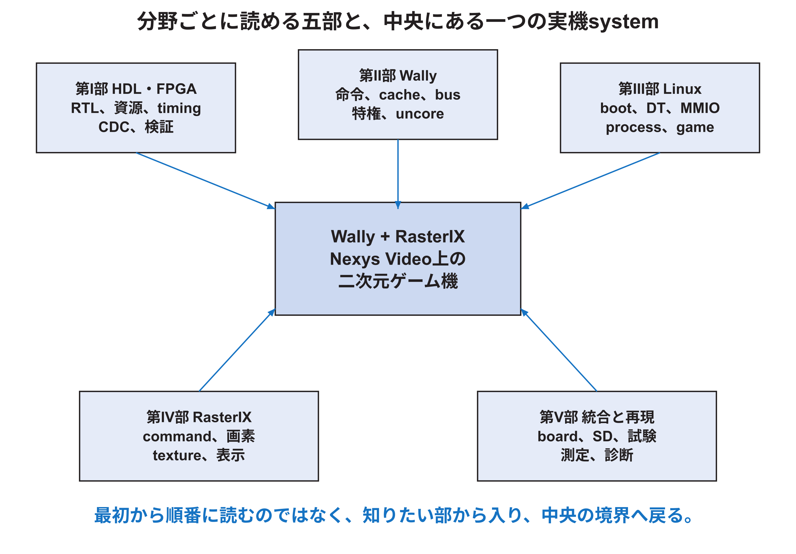

# 二次元ゲーム機の設計を再現するための技術付録

[資料全体の入口](README.md) ｜ [論文本文](本文.md) ｜ [Word版（全体）](技術付録.docx)

GitHubでは章ごとにページを分けている。説明・図・表・コードは省略していない。読みたい分野から章を選び、各ページの目次で節へ移動できる。

<!-- appendix-content:start -->
公開用資料では、個人情報を除去し、参照先を本研究リポジトリの配置へ対応付けた。`再現資料`はこの文書と同じフォルダーにある。`../../experiments`はリポジトリ直下の補足実験を指す。`RESEARCH_ROOT`は取得した研究リポジトリの絶対パスとして設定する。保存物の一覧と旧参照先の対応は[参照先の一覧](../references.md)にある。

## この付録の使い方

この技術付録は、同梱の本文「FPGAを用いた二次元ゲーム機の設計と実装」を読み、実装を自分で組み立て、設計変更の影響を調べるための詳説である。本文は研究の目的、接続の設計、動作確認、測定結果を扱う。こちらではファイル、信号、計算、試験手順を深く追う。両冊の図表は、各冊内の本文から参照する。

この冊子は学習順ではなく、知りたい分野へ直接移れる五部構成とした。[第I部](appendix/01-hdl-fpga/README.md#part_i)はHDLとFPGA、[第II部](appendix/02-wally/README.md#part_ii)はWally、[第III部](appendix/03-linux/README.md#part_iii)はLinuxとシステムソフトウェア、[第IV部](appendix/04-rasterix/README.md#part_iv)はRasterIX、[第V部](appendix/05-integration/README.md#part_v)はNexys Videoへの統合、実験、再現を扱う。各部では、用語の定義だけで終わらず、具体例、データまたは信号の流れ、固定版ソースの入口、確認方法、説明からは断定できない範囲まで示す。

ハードウェアは、SystemVerilogから推論される回路、LUT・FF・BRAM・DSP、組み合わせ経路、pipeline、clock、reset、CDC、bus、Wally内部、RasterIX内部、映像出力まで扱う。ソフトウェアは、cross compile、ELF、ZSBL、OpenSBI、Linux kernel、device tree、仮想memory、MMIO、C++の描画API、ゲームloop、診断方法まで扱う。hardwareとsoftwareを別々に覚えるだけでなく、C++の一回の書込みがCPU命令、cacheとbus、周辺register、command FIFO、描画pipeline、framebuffer、映像信号へ変わる境界を追えることを目標とする。

[付録A](appendix/05-integration/appendix-a.md#ch_a)〜Zの文字は既存の参照を壊さないために維持している。分野別に配置したため、冊子内ではアルファベット順に並ばない。例えばFIFOとclock境界は[第IV部](appendix/04-rasterix/README.md#part_iv)の[付録I](appendix/04-rasterix/appendix-i.md#ch_i)、Nexys Video対応の再現は[第V部](appendix/05-integration/README.md#part_v)の[付録A](appendix/05-integration/appendix-a.md#ch_a)にある。章番号は本技術付録内、単に「[第7章](本文.md#ch_7)」のように本文中で示す従来の表記は同梱の研究本文を指す。Word版の目次と内部リンクから移動できる。

固定版、実験条件、引用の意味は本文と共通である。従来の解説と再現演習は初期の固定版を対象とし、2026年10月8日の更新版とFIFO比較E6は、[第V部](appendix/05-integration/README.md#part_v)の[技術付録第29章](appendix/05-integration/chapter-29.md#ch_29)にまとめた。特に、FIFO比較が未実施だった時点の説明を更新し、ソースから分かることと実測したことを区別する。説明用の周期数や小さなFIFOと、実機で採用した値を区別する。試験計画と書いた部分は未実施であり、保存済みの測定結果へ加えない。将来のオンライン公開へ向け、図、資料、相対リンクを同じフォルダで扱える形にしている。

## 分野別案内

| 読みたい分野 | 入口 | 扱う範囲 |
|---|---|---|
| HDL・FPGA・デジタル回路 | [第I部](appendix/01-hdl-fpga/README.md#part_i) | RTL、合成資源、timing、実装flow、CDC、reset、検証 |
| Wally CPU・SoC | [第II部](appendix/02-wally/README.md#part_ii) | 構成parameter、pipeline、hazard、cache、MMU、特権、bus、変更方法 |
| Linux・ソフトウェア | [第III部](appendix/03-linux/README.md#part_iii) | Buildroot、boot、ELF、device tree、仮想memory、MMIO、ゲームprogram、診断 |
| RasterIX・画像生成 | [第IV部](appendix/04-rasterix/README.md#part_iv) | API、command、FIFO、頂点、rasterization、texture、depth、blend、framebuffer、表示 |
| 本研究の設計と再現 | [第V部](appendix/05-integration/README.md#part_v) | Nexys Video対応、接続差分、SD起動、実験、固定commit、実機確認 |
| FIFO比較と公式更新後の追試 | [技術付録第29章](appendix/05-integration/chapter-29.md#ch_29) | 1語方式、待ちの計数、画像照合、版の再現、命令解析の問題 |

一つの処理を端から端まで追いたい場合は、[第III部](appendix/03-linux/README.md#part_iii)のMMIO、[第II部](appendix/02-wally/README.md#part_ii)のmemoryとbus、[第IV部](appendix/04-rasterix/README.md#part_iv)の命令経路と表示、[第V部](appendix/05-integration/README.md#part_v)の固定版実装を対応付ける。最初から全冊を読む必要はない。分からない境界へ戻り、図、表、source path、確認commandを使って局所的に掘り下げる。
<!-- appendix-content:end -->

## 章別目次

### [第I部 HDLとFPGAによるデジタル回路設計](appendix/01-hdl-fpga/README.md)

- [第1章 Wally開発者が使う抽象化階層](appendix/01-hdl-fpga/chapter-01.md)
- [第2章 SystemVerilogから回路を読み取る](appendix/01-hdl-fpga/chapter-02.md)
- [第3章 資源効率を決めるRTL設計](appendix/01-hdl-fpga/chapter-03.md)
- [第4章 Timing closureとpipeline設計](appendix/01-hdl-fpga/chapter-04.md)
- [第5章 FPGAへ実装されるまで](appendix/01-hdl-fpga/chapter-05.md)
- [第6章 Clock domain crossingとreset設計](appendix/01-hdl-fpga/chapter-06.md)
- [第7章 検証を層に分ける](appendix/01-hdl-fpga/chapter-07.md)
- [第8章 Wally開発者の設計・実装規律](appendix/01-hdl-fpga/chapter-08.md)
- [付録K 回路とFPGAの基礎](appendix/01-hdl-fpga/appendix-k.md)

### [第II部 Wally CPUとSoCアーキテクチャ](appendix/02-wally/README.md)

- [第9章 Wallyの階層と構成を読む](appendix/02-wally/chapter-09.md)
- [第10章 命令pipelineとarchitectural state](appendix/02-wally/chapter-10.md)
- [第11章 Memory systemとon-chip bus](appendix/02-wally/chapter-11.md)
- [第12章 Wallyを変更する実践課題](appendix/02-wally/chapter-12.md)
- [第13章 Wallyの構成値が回路になるまで](appendix/02-wally/chapter-13.md)
- [第14章 IFUと命令取得を深く読む](appendix/02-wally/chapter-14.md)
- [第15章 IEUとpipeline hazardを深く読む](appendix/02-wally/chapter-15.md)
- [第16章 LSUとmemory hierarchyを深く読む](appendix/02-wally/chapter-16.md)
- [第17章 特権機構、trap、interruptを深く読む](appendix/02-wally/chapter-17.md)
- [第18章 EBU、uncore、周辺回路拡張を深く読む](appendix/02-wally/chapter-18.md)

### [第III部 Linuxとシステムソフトウェア](appendix/03-linux/README.md)

- [第19章 開発用PCからFPGA上のprocessまでを分ける](appendix/03-linux/chapter-19.md)
- [第20章 cross compile、ELF、ABIを深く理解する](appendix/03-linux/chapter-20.md)
- [第21章 SDカードからLinuxが起動するまで](appendix/03-linux/chapter-21.md)
- [第22章 Linuxのprocess、仮想memory、system call](appendix/03-linux/chapter-22.md)
- [第23章 device treeをhardwareとLinuxの契約として読む](appendix/03-linux/chapter-23.md)
- [第24章 MMIO、`mmap`、`volatile`、fenceを深く理解する](appendix/03-linux/chapter-24.md)
- [第25章 RasterIXのsoftware stackを深く追う](appendix/03-linux/chapter-25.md)
- [第26章 game loop、入力、時間、描画を深く理解する](appendix/03-linux/chapter-26.md)
- [第27章 softwareとhardwareを層ごとに診断する](appendix/03-linux/chapter-27.md)
- [第28章 hardware software協調で性能を測る](appendix/03-linux/chapter-28.md)

### [第IV部 RasterIXと描画システム](appendix/04-rasterix/README.md)

- [付録B 信号とコードを数値で追う](appendix/04-rasterix/appendix-b.md)
- [付録G RasterIXとの接続を自分で組み立てる](appendix/04-rasterix/appendix-g.md)
- [付録H 設定を変えるための計算と設計判断](appendix/04-rasterix/appendix-h.md)
- [付録I 命令の受け渡しとクロック境界を設計する](appendix/04-rasterix/appendix-i.md)
- [付録J 設計を変更できる理解へ進む](appendix/04-rasterix/appendix-j.md)
- [付録N RasterIXを開発者の視点で読むための地図](appendix/04-rasterix/appendix-n.md)
- [付録O 一つの二次元四角形を画素まで追う](appendix/04-rasterix/appendix-o.md)
- [付録P 三層の命令とbit配置を読む](appendix/04-rasterix/appendix-p.md)
- [付録Q CPU側で三角形記述子を作る](appendix/04-rasterix/appendix-q.md)
- [付録R RTL全体の制御と停止を読む](appendix/04-rasterix/appendix-r.md)
- [付録S hardware Rasterizerと属性補間](appendix/04-rasterix/appendix-s.md)
- [付録T textureとPixel Pipeline](appendix/04-rasterix/appendix-t.md)
- [付録U Per-Fragment Pipelineで最終色を決める](appendix/04-rasterix/appendix-u.md)
- [付録V 内部Framebuffer、DDR3、表示まで](appendix/04-rasterix/appendix-v.md)
- [付録W RasterIXを変更・検証できる開発手順](appendix/04-rasterix/appendix-w.md)
- [付録X 座標、境界、辺関数を数式と実装で一致させる](appendix/04-rasterix/appendix-x.md)
- [付録Y 固定小数点、補間、texture、混色の数値を追う](appendix/04-rasterix/appendix-y.md)
- [付録Z 数学、source、試験を結び付けた検証記録](appendix/04-rasterix/appendix-z.md)

### [第V部 Nexys Videoへの統合、実験、再現](appendix/05-integration/README.md)

- [付録A 変更を自分で再現するための案内](appendix/05-integration/appendix-a.md)
- [付録C 試験を再実行し、記録を読み直す](appendix/05-integration/appendix-c.md)
- [付録D 用語を図の中の役割で覚える](appendix/05-integration/appendix-d.md)
- [付録E Nexys Video対応をファイルごとに組み立てる](appendix/05-integration/appendix-e.md)
- [付録F 発表の前に、理由を含めて答える練習](appendix/05-integration/appendix-f.md)
- [付録L 設計ファイルと開発手順](appendix/05-integration/appendix-l.md)
- [付録M 同じゲーム機を作り直す手順](appendix/05-integration/appendix-m.md)
- [第29章 接続方式を取り替えて評価する](appendix/05-integration/chapter-29.md)
- [第30章 メモリから描画命令を読む方式を検証する](appendix/05-integration/chapter-30.md)

[参考文献と実験記録](appendix/references.md)
