# FPGAを用いた二次元ゲーム機の設計と実装

[資料全体の入口](README.md) ｜ [技術付録を開く](技術付録.md)

## ジャンプできる目次

- [要旨](#h0000)
- [読み進めるための案内](#h0005)
- [第1章 研究の目的と成果](#ch_1)
  - [1.1 製作したゲーム機](#s_1_1)
    - [パソコンとゲーム機を置き分けて考える](#h0019)
  - [1.2 公開されている設計を利用する理由](#s_1_2)
  - [1.3 本研究で解決する問題](#s_1_3)
  - [1.4 成果を利用できる人](#s_1_4)
  - [1.5 本稿で示す確認結果](#s_1_5)
    - [この研究で説明する問題と対処の対応](#h0041)
- [第2章 ボールが動くまでの処理](#ch_2)
  - [2.1 位置を数値として覚える](#s_2_1)
  - [2.2 入力とゲームの規則](#s_2_2)
  - [2.3 数値を画像に変える](#s_2_3)
  - [2.4 画像を画面へ出す](#s_2_4)
  - [2.5 同じ処理を繰り返す](#s_2_5)
  - [2.6 この研究で作った接続の位置](#s_2_6)
    - [同じボールに関係する三種類の数値](#h0091)
  - [2.7 ボールを一度動かす間に誰が何を変えるか](#s_2_7)
- [第3章 回路とFPGAの基礎](#ch_3)
  - [3.1 計算する回路と覚える回路](#s_3_1)
    - [ゲームの一回の計算と、回路の一周期の関係](#h0115)
  - [3.2 FPGAに回路を作る](#s_3_2)
  - [3.3 FPGAチップと基板を区別する](#s_3_3)
- [第4章 設計ファイルと開発手順](#ch_4)
  - [4.1 回路とプログラムで生成物が違う](#s_4_1)
    - [一か所を編集した後、何を作り直すか](#h0142)
  - [4.2 動作を確認した版をそろえる](#s_4_2)
- [第5章 ゲーム機全体の構成](#ch_5)
  - [5.1 既存の設計をどこから使うか](#s_5_1)
    - [使用する機器とクロックの条件](#h0159)
  - [5.2 CPU、描画回路、表示回路の役割](#s_5_2)
  - [5.3 メモリを共有するとは何か](#s_5_3)
    - [一本のバスという概要図から具体的な二つの道へ進む](#h0176)
    - [同じメモリを使えることと、同じ場所を自由に書けることは違う](#h0181)
  - [5.4 本研究で加えたもの](#s_5_4)
- [第6章 CPUから描画命令を渡す](#ch_6)
  - [6.1 メモリの番地を回路の操作に使う](#s_6_1)
  - [6.2 APBという接続の約束](#s_6_2)
    - [受け取れない一語をクロックごとに追う](#h0209)
  - [6.3 FIFOへの保存とAPB書き込みの完了](#s_6_3)
    - [FIFOに保存する構成と、受け取りまでAPBを待たせる構成](#h0218)
    - [まず一つの時計で動く普通のFIFOを考える](#h0228)
    - [満杯になったらCPUの一回の書き込みを完了させない](#h0234)
    - [APBとAXI4-Streamは接続する場所が違う](#h0237)
    - [一語Dの移動を最初から最後まで追う](#h0243)
    - [RasterIXが受け取れる時点をREADYで確認する](#h0248)
    - [待つ間は同じ語を保ち、一回だけ数える](#h0254)
  - [6.4 なぜ非同期FIFOなのか](#s_6_4)
    - [配線で直結するだけでは受渡し回数を決められない](#h0263)
    - [同期FIFOと非同期FIFOの違い](#h0266)
    - [データ本体を保存し、進んだ位置を相手へ知らせる](#h0271)
    - [値が変わる瞬間に取り込む問題もある](#h0277)
    - [命令FIFOと応答FIFOの実装](#h0282)
    - [非同期FIFO以外の接続も可能である](#h0286)
    - [受け渡しに用いる各機能の役割](#h0289)
  - [6.5 どの場所へ何を書けばよいか](#s_6_5)
  - [6.6 Linuxのプログラムから書き込む](#s_6_6)
    - [regsの添字を実際の操作番地へ戻す](#h0301)
  - [6.7 書き込みと描画と表示の完了を区別する](#s_6_7)
- [第7章 公式RasterIXを組み込む](#ch_7)
  - [7.1 サブモジュールで版を固定する](#s_7_1)
  - [7.2 描画途中の保存場所を持つ構成を使う](#s_7_2)
  - [7.3 回路とソフトウェアの設定を合わせる](#s_7_3)
  - [7.4 Wallyのバスを命令口へつなぐ](#s_7_4)
  - [7.5 CPUと描画と表示がDDR3を使う](#s_7_5)
  - [7.6 回路とソフトウェアを生成対象に加える](#s_7_6)
  - [7.7 CPUの命令ポートとGPUのメモリポートを混同しない](#s_7_7)
  - [7.8 元のRasterIXを書き換えずに組み込む境界](#s_7_8)
- [第8章 既存の描画機能をゲームから使う](#ch_8)
  - [8.1 図形の位置と色をライブラリへ渡す](#s_8_1)
  - [8.2 関数の呼び出しを描画命令へつなぐ](#s_8_2)
  - [8.3 ブロックと文字を同じ画面に描く](#s_8_3)
  - [8.4 動作確認に用いたゲームの条件](#s_8_4)
- [第9章 画像メモリと画面の切り替え](#ch_9)
  - [9.1 一画素の色を数値として保存する](#s_9_1)
  - [9.2 画像の位置をメモリの場所へ対応させる](#s_9_2)
  - [9.3 二枚の画像を使う理由](#s_9_3)
    - [フロントとバックは役割であり名前札を貼り替える](#h0389)
  - [9.4 内部作業領域は第三の役割を持つ](#s_9_4)
  - [9.5 切り替えの依頼と完了は違う](#s_9_5)
    - [なぜ「Aをもう読まない設定にした」だけでは足りないか](#h0404)
  - [9.6 切り替え完了をゲームへ知らせる](#s_9_6)
  - [9.7 HDMI端子へ映像を送る](#s_9_7)
  - [9.8 Linux用の領域と画像用の領域を分ける](#s_9_8)
- [第10章 ブロック崩しを動かすソフトウェア](#ch_10)
  - [10.1 ゲームの状態と描画を分ける](#s_10_1)
    - [UARTの文字をゲームの入力へ変える](#h0435)
  - [10.2 入力と自動操作](#s_10_2)
  - [10.3 状態の更新と画像の更新を分ける](#s_10_3)
  - [10.4 起動と再起動で確認すること](#s_10_4)
- [第11章 何を確かめるために実験するか](#ch_11)
  - [11.1 完成した画像だけでは分からないこと](#s_11_1)
  - [11.2 四つの確認を使い分ける](#s_11_2)
    - [実験の入口と観察する場所を先に決める](#h0463)
  - [11.3 命令を待たせる試験](#s_11_3)
  - [11.4 表示先を早く再利用しない試験](#s_11_4)
  - [11.5 正しい画像をどう決めるか](#s_11_5)
    - [画素を比べる試験で何を数えているか](#h0482)
  - [11.6 継続動作と映像を確認する](#s_11_6)
- [第12章 実機での動作確認と考察](#ch_12)
  - [12.1 確認に用いた構成](#s_12_1)
  - [12.2 命令接続と表示切り替えの確認](#s_12_2)
  - [12.3 FPGAへ実装できたことの確認](#s_12_3)
  - [12.4 ゲームの画像が指定どおりに作られたか](#s_12_4)
  - [12.5 自動操作による継続動作](#s_12_5)
  - [12.6 実際の映像の確認](#s_12_6)
  - [12.7 動作結果から示せること](#s_12_7)
- [第13章 再現作業の進め方](#ch_13)
  - [13.1 再現の段階を分ける](#s_13_1)
    - [どの段階まで再現できたかを記録する](#h0533)
  - [13.2 設計を自分で作り直す](#s_13_2)
- [第14章 設計の意味と残る課題](#ch_14)
  - [14.1 誰がどの部分を使えるか](#s_14_1)
  - [14.2 接続の条件と検証結果を示す意義](#s_14_2)
  - [14.3 CPUだけで描く案との違い](#s_14_3)
  - [14.4 FPGAを使う理由](#s_14_4)
  - [14.5 Wiiコントローラーを追加する場合](#s_14_5)
  - [14.6 利用できる条件を広げるための課題](#s_14_6)
- [第15章 結論](#ch_15)
  - [15.1 CPUと描画と表示を接続した](#s_15_1)
  - [15.2 ブロック崩しの動作を実機で確認した](#s_15_2)
  - [15.3 Wallyを拡張するための参照例を示した](#s_15_3)
- [参考文献と実験記録](#h0576)
  - [外部資料と公開ソース](#h0578)
  - [本研究で保存した実験記録](#h0587)


<a id="h0000"></a>
## 要旨

本研究の目的は、教科書RISC-V System-on-Chip Designで扱われるCPUであるWallyに描画・表示機能を加え、学習者が参照できるゲーム機の拡張例を示すことである。内部の回路構成を設定できるFPGAを用い、Nexys Video基板上にWallyと公開設計の描画回路RasterIXを実装した。公式RasterIXの内部は変更せず、その外側に命令の接続、画像を置くメモリの設定、表示画像を切り替える制御を用意した。

CPUで動くゲームプログラムは、RasterIX付属のOpenGL互換ライブラリへ図形の位置や色を渡す。ライブラリが作る描画命令を、CPU側のバスからRasterIXへ順序どおりに渡す接続を設計した。また、Linuxが使うメモリと画像用メモリを分け、表示中の画像とは別の場所へ描いた後、読み出しの完了を確認して画像の役割を交代させる構成とした。

回路シミュレーションでは、命令の受け取りやメモリからの応答が遅れる条件を与え、データの保持と画像切り替えの制御を確認した。実機では、640×480画素のブロック崩しを動かした。通常のゲーム構成について、画像確認用プログラムの三条件と、そのプログラムの再起動後の一条件で、それぞれ307,200画素が期待画像と一致した。5分間の自動プレイの実行記録と、別の実行で保存した30秒間の映像も確認した。動作確認には、描画処理を軽くする実装を含む完成版を使用した。本稿の評価対象は、その構成の接続と動作である。

接続の設計、ソース、設定、確認条件を対応付け、Wallyへ描画・表示機能を加えるための参照資料としてまとめた。専用コントローラーの接続と、映像の受信が安定しない条件の解明は今後の課題である。

<a id="h0005"></a>
## 読み進めるための案内

本稿は、WallyというCPUとRasterIXという描画回路をFPGAへ組み込み、二次元ゲームが動くまでを説明する。中心となるのは、「CPUがボールの次の位置を計算する」「描画回路がその位置の画像を作る」「表示回路がその画像を映像として送る」という流れである。[第2章](#ch_2)では、一個の白いボールを右へ動かす例から始める。

本稿では、この流れのために何を接続し、どのように動作を確かめたかを説明する。既存の描画ライブラリについては、渡す情報と得られる画像の関係を扱う。内部の計算、描画方法や接続方式の性能比較、ファイルごとの実装手順は、分野別の技術付録にまとめた。

本稿の「命令」には二種類ある。CPU命令は、Wallyがプログラムを実行するときの足し算や読み書きの指示である。描画命令は、そのCPUがRasterIXへ渡す図形や画像処理の指示である。また、ボールの位置、描画命令、画素の色は異なるデータであり、それぞれの保存場所を分けて説明する。

図中の青系の色は、注目する回路やデータを区別するために用いる。色と矢印の意味は各図の前後で説明する。小さなFIFOなどの数値例は仕組みの説明用であり、実測結果は[第12章](#ch_12)に使用した構成とともに示す。[Harris26](#ref_Harris26)などは外部資料、[E1](#ref_E1)などは保存した実験記録の参照記号である。

| 知りたいこと | 本文の入口 | 実装や原理をさらに調べる場所 |
|---|---|---|
| CPUが位置を変えると、なぜ画面が変わるか | [第2章](#ch_2) | [技術付録第37章](appendix/04-rasterix/walkthrough.md#ch_g_walkthrough) |
| FPGAの回路とゲームプログラムの違い | 第3・4章 | 技術付録第12・62章 |
| 全体の構成と、本研究で追加した部分 | 第5・7章 | 技術付録第42・60章 |
| CPUから描画命令を失わずに渡す仕組み | [第6章](#ch_6) | 技術付録第8・44章 |
| 既存のライブラリを使って図形を描く流れ | [第8章](#ch_8) | 技術付録第32・37〜43章 |
| 画像の保存場所と、表示画像の切り替え | [第9章](#ch_9) | 技術付録第40・45章 |
| ゲームプログラムと、その動作を確かめる方法 | 第10〜12章 | 技術付録第33・65章 |
| 同じ構成を取得して動かす手順 | [第13章](#ch_13) | [技術付録第63章](appendix/05-integration/console-reproduction.md#ch_m)、71.17節 |

技術付録には、本文の接続説明からさらに進んで調べられるよう、描画処理の効率化を第33・66章、命令接続の比較を[第71章](appendix/05-integration/fifo-comparison.md#ch_29)、DMAや内部メモリの比較を[第72章](appendix/05-integration/command-dma-comparison.md#ch_30)に収録した。Nexys Video対応のファイルごとの説明は第59〜61章、DVI映像の縦横比は40.12節から読める。調べたい分野を総目次から選べる構成としている。

<a id="ch_1"></a>
## 第1章 研究の目的と成果

<a id="s_1_1"></a>
### 1.1 製作したゲーム機

ここでいうゲーム機は、ゲームの計算と画像の生成をNexys Videoという基板上で行い、HDMI OUT端子から映像を出す装置である。FPGAの中にWallyというCPUとRasterIXの描画回路を作った。ゲームプログラムはWally上のLinuxで動く。WallyとRasterIXは、回路を作るための公開設計の名前である。Nexys Videoは、それらの回路を実装するFPGAが載った実物の基板の名前である。以下では、WallyのCPUが行う計算と、RasterIXの回路が行う描画を分けて説明する。

製作したのは、画面上の板を左右へ動かし、跳ね返したボールでブロックを消すゲーム機である。この板をパドルと呼ぶ。ボールの位置、ブロックの有無、得点などをプログラムが計算し、その結果を画像にする。計算しただけでは画面は変わらない。画像を作り、その画像を映像端子から送り出すまでの仕組みが必要になる。

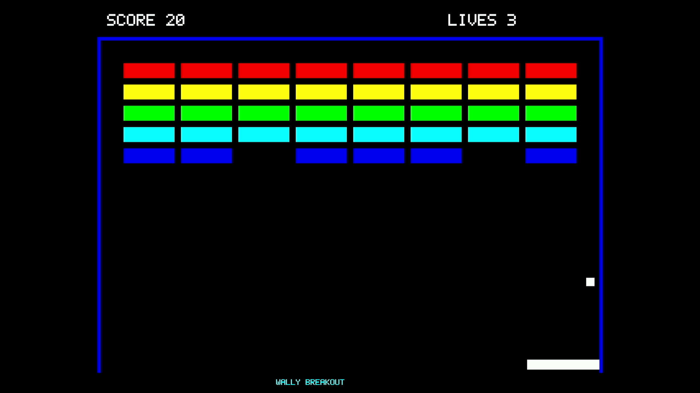

図1.1は保存した実機録画から取り出した画像である。ゲームを実行するCPUはFPGA内に作られている。開発用パソコンがゲームを代わりに計算しているわけではない。パソコンは、設計ファイルの編集、FPGAへの設定、実機の文字出力や映像の記録に使う。ゲームを動かす機械と、その機械を作るためのパソコンを分けて考える。

ゲームプログラムは、パソコンの端末から届く文字を入力として使う。また、一定の規則でパドルを動かす自動操作も備える。本稿で示す継続動作の試験には、同じ操作を繰り返せる自動操作を用いた。専用コントローラーWii Classic Controller Proの接続は今後の課題である。

<a id="h0019"></a>
#### パソコンとゲーム機を置き分けて考える

机の上に、開発用パソコン、Nexys Video、映像を受ける機器の三つがあると考える。プログラムを書くのはパソコンである。できたプログラムを実行するのは、Nexys VideoのFPGA内に作ったWallyである。映像を受ける機器は、届いた色の信号を画面にする。

USBケーブルにも別々の用途がある。USB PROG側はFPGAの回路設定を送る経路、USB UART側は起動メッセージやキー入力の文字をやり取りする経路である。ゲーム画面はHDMI OUT側から出る。USBで文字が届いても、映像用の配線が動いた証拠にはならない。

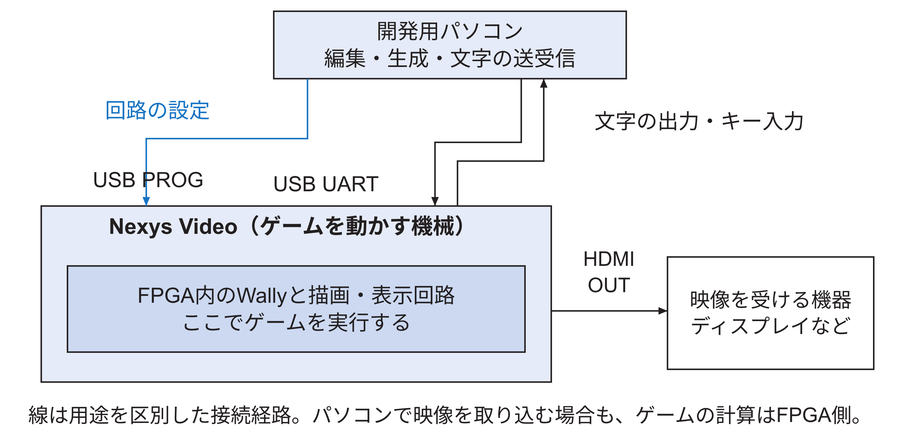

図1.2では、線に何を送るかを書いた。上のパソコンは回路の設定と文字の送受信を行い、下のFPGA内のCPUがゲームを実行する。映像をパソコンで取り込む場合でも、取り込み機器がゲームの位置計算を代わりに行うわけではない。

SDカードは、電源を切った後もプログラムなどを残しておく保存媒体として使う。実行中の位置や画像を頻繁に読み書きする場所は、基板上のDDR3メモリである。したがって、「SDカードにゲームを入れる」は、表示回路がSDカードから毎画素の色を直接読むという意味ではない。起動してプログラムを実行する経路と、実行中に画像を作って表示する経路を分けて追う。

<a id="s_1_2"></a>
### 1.2 公開されている設計を利用する理由

CPUには、すでに設計が公開されているWallyを使う。Wallyは、教科書RISC-V System-on-Chip Designで説明されるCPUと周辺回路の設計である[Harris26](#ref_Harris26)[Thompson25](#ref_Thompson25)[Wally](#ref_Wally)。以下では、この教科書をRVSOCと略す。教科書を読んだ人が、CPUの外へ機能を追加する例を追えるように、同じ基盤を用いる。

画像を作る部分にはRasterIXを使う[RasterIX](#ref_RasterIX)。RasterIXは、描画回路と、その回路へ命令を送るソフトウェアのソースコードを公開している。そのため、接続する信号やデータの形式を実装まで調べられる。利用には各部品のライセンスに従う。

公開部品がそろっても、そのまま二つを並べるだけでは動かない。例えば、CPUは「ある番号の場所へ数値を書く」という形で外部へ指示する。一方、描画回路は、順に並んだ描画用データを受け取る。両者が使う信号や手順をつなぐ部分が必要である。さらに、どのメモリに画像を置くか、表示をいつ切り替えるかも決める必要がある。

<a id="s_1_3"></a>
### 1.3 本研究で解決する問題

本研究で扱う接続には、命令を届けること、メモリを使い分けること、表示画像を切り替えることの三つの課題がある。以下では、Nexys Video上で動くWallyを基盤として、RasterIXを加える際の設計を説明する。

まず、CPUと描画回路の受け渡しを決める。描画回路が次のデータをまだ受け取れない場合には、受け取れるようになるまで、そのデータを保持する必要がある。また、CPUと描画回路は異なるクロックで動くため、CPUが一度送ったデータを、相手も一度だけ受け取るようにする。本研究では、先に受け取ったデータから送り出すFIFOを用い、両側のクロックで受け渡しを管理する既存IPを組み込む。ここでIPとは、部品として再利用できる回路設計のことである。

さらに、メモリの使い方と表示の切り替えを決める。Linuxがプログラム用に使っている場所へ画像を書けば、プログラムのデータを壊してしまう。表示回路が読んでいる最中の画像を書き換えると、新旧の画像が混ざることがある。こうした問題を避けるため、領域と利用時刻を管理する。

三つの課題は、直す対象も確かめ方も異なる。命令の接続では送った値と届いた値を照合し、メモリの管理ではOS用領域と画像用領域が重ならないことを確かめ、表示の切り替えでは古い画像への読み出しが残っていないかを調べる。後の章では、これらの条件を回路と設定へ対応付ける。

ここで述べた「データを壊す」「画像が混ざる」は、設計で防ぐ必要がある事態の説明である。すべてが実機で発生したという報告ではない。接続が正しく動くかを確かめた結果は、[第12章](#ch_12)で試験条件とともに示す。FIFOは採用した接続部品として説明し、あらゆる接続方法の中で最も速いと主張するものではない。

<a id="s_1_4"></a>
### 1.4 成果を利用できる人

想定する利用者は、RVSOCやWallyを学び、CPUへ別の回路を追加したい人である。本研究は、その人が見比べられる接続コード、設定値、動作の確認方法を提供する。例えば、画像処理以外の回路をつなぐ場合でも、相手が受け取れない間の待ち方や、Linuxと装置のメモリを分ける考え方を参照できる。

提供するのは、接続の実装と検証方法を調べられる設計資料である。授業での利用や学習時間の測定は行っていないため、教育上の効果の評価は今後の課題となる。

<a id="s_1_5"></a>
### 1.5 本稿で示す確認結果

本稿では、接続回路をコンピュータ上で模擬動作させる試験、FPGA内への配置、実機でのゲーム動作を順に扱う。接続回路の試験では、相手の応答を意図的に遅らせたときの振る舞いも調べる。実機では、ゲームの進行、メモリ内の画像、記録した映像を確かめる。

実機の動作確認には、描画処理を軽くする工夫を含む完成版のゲームを用いた。これは試験条件の一つである。本稿では、その構成で命令、画像、映像がつながって動くことを確かめる。個々の工夫が何倍の高速化になったかという比較は、技術付録第33・66章で扱う。

<a id="h0041"></a>
#### この研究で説明する問題と対処の対応

「つないだ」という結果の中には、異なる問題への対処が含まれる。例えば、CPUが書いた一つの値を描画回路が取りこぼす問題と、正しくできた画像を表示中に書き換える問題は、直す場所が違う。次の表を全体の案内として使う。

| 動かすために必要な条件 | 条件を満たさないと起こる例 | 本研究での対処 | 詳しく読む場所 |
|---|---|---|---|
| 命令を受け取るまで値を保つ | 図形を描く指示が抜ける | FIFOと書き込み待ちを接続する | [第6章](#ch_6) |
| Linux用データと画像の保存先を重ねない | Linuxのデータを画像で上書きする | 画像用に32 MiBを予約する | [5.3節](#s_5_3)、[9.8節](#s_9_8) |
| 古い画像を使い終えてから再利用する | 表示途中の色が新旧で混ざる | 読み出しの返事を待って完了を通知する | [9.5〜9.6節](#s_9_5) |

この表の対処を説明した後、実験で何を観察したかを示す。設計の意図と、実際に確かめられた範囲を対応させることで、別の回路へ応用するときにも、どの条件を確認すべきかが分かる。

例えば「命令を正しく渡せた」という主張なら、画面が出たという結果に加え、受け取りを遅らせても送った値・順序・個数が一致する記録を示す。「ブロック崩しの動作が続いた」という主張なら、ゲームを動かした時間、終了時の記録、保存した映像の範囲を示す。このように、作った物、確かめたい性質、その性質を見る試験を対応付けることが、本稿の設計説明と実験を結ぶ。

本稿で説明する成果は、Wallyの命令実行の仕組みを新しく発明したことでも、RasterIXの描画方式を一から考案したことでもない。両者をこの基板で使うために、間の接続、保存場所、完了の知らせ方を定め、実装し、確認したことである。以下では、まずゲームの一場面を追い、その場面を成立させるために必要だった接続へ説明を進める。

<a id="ch_2"></a>
## 第2章 ボールが動くまでの処理

画面上のボールが右へ動くとき、ゲーム機の中では何が変わるのだろうか。本章では、白い四角形を右へ3画素動かす一回の処理を追う。最初はボールだけを考え、ブロックや得点の処理は省く。以下の100、200、8という値は、処理を説明するために選んだ値である。

<a id="s_2_1"></a>
### 2.1 位置を数値として覚える

画面を方眼紙のようなマスの集まりとして考える。一つのマスに一つの色を付ける。このマスが画素である。本ゲームの画像は横640画素、縦480画素なので、横に640個の画素を並べた行が、上から下へ480行ある。

場所を指定するため、左端の列に0、その右に1、2、3と番号を付ける。上端の行にも0、その下に1、2、3と番号を付ける。横の番号をx、縦の番号をyと書く。(100, 200)は、横の番号が100、縦の番号が200の場所を表す。画面全体の番号は、横が0〜639、縦が0〜479となる。

ボールは、左上が(100, 200)、幅が8、高さが8の白い四角形とする。左上の場所だけ覚えておけば、幅と高さを使って残りの場所も求められる。ゲームプログラムは、この横位置100を、例えばballXという名前の変数に保存する。変数とは、プログラムが後で使う値に名前を付けたものである。メモリは、そのような値を保存しておく部品である。

CPUは、プログラムに書かれた計算や読み書きを実行する回路である。ここではWallyがそのCPUに当たる。右へ3画素進める処理では、CPUがballXの100を読み、3を足して103を求め、ballXへ保存し直す。

```text
変更前の位置  ballX = 100
右へ進む量    velocityX = 3
次の位置      ballX = ballX + velocityX
変更後の位置  ballX = 103
```

上の代入では、右辺を先に計算する。現在のballXが100なら、右辺は100+3である。その結果103を左辺のballXに保存する。等号の左右が同時に同じ値でなければならない、という数学の等式とは読み方が違う。

この時点で変わったのは、プログラムが覚えている横位置だけである。画面に出す色の並びは、まだ書き換えていない。次節以降で、この位置の値を使って画像を作る。

<a id="s_2_2"></a>
### 2.2 入力とゲームの規則

ブロック崩しでは、ボールの位置に加えて、パドルの位置、ボールが進む向き、残っているブロック、得点を覚える。これらの値をまとめてゲームの状態と呼ぶ。例えば「ボールの横位置は100、右向きに進む、あるブロックはまだ残っている」という情報が状態に当たる。

CPUは現在の状態とプレイヤーの入力を使って、次の状態を計算する。パドルを右へ動かす入力があれば、その位置を右へ進める。ボールと壁が重なる位置まで来たら、次に進む向きを反対にする。ブロックに当たったら、そのブロックを「残っていない」という状態にし、得点を増やす。この段階では、画像の色を決める前に、ゲームとして何が起きたかを計算している。

現在の実装では、パソコンの端末から受け取ったDを右移動、Aを左移動、Sを停止に対応させている。届いた文字によって移動方向を切り替える方式であり、Dキーから指を離したことは端末の一文字だけでは分からない。停止にはSを送る。実験では、パドルの動かし方を同じ条件にできる自動操作も用いた。専用のWiiコントローラーの接続は、まだ実装していない。

<a id="s_2_3"></a>
### 2.3 数値を画像に変える

画像を保存するメモリには、画素ごとの色が並ぶ。例えば横位置100のボールを表す画像では、横100〜107、縦200〜207の8×8個の画素が白い。周囲を黒くすれば、黒い背景の上に白い四角形が見える。横位置を103に変えた画像では、白くする範囲が横103〜110へ変わる。

ballXの103と、画像に保存する白色は、役割の違う値である。ballXを読むのはゲームを実行するCPUであり、その値を次の位置計算や描く場所の指定に使う。画像の色を読むのは後述の表示回路であり、読み取った順に外へ送る。表示回路はballXという変数を見に来ない。そのため、ballXを書き換える処理とは別に、画像の色を作り直す処理が必要になる。

図2.1は、ボールがある行を取り出した図である。上段では100〜107番のマスが白く、下段では103〜110番のマスが白い。横の番号が同じマス同士を比べると、100〜102は白から黒へ、108〜110は黒から白へ変わる。103〜107は白のままでよい。縦方向にも8行分、同じ変更が必要になる。

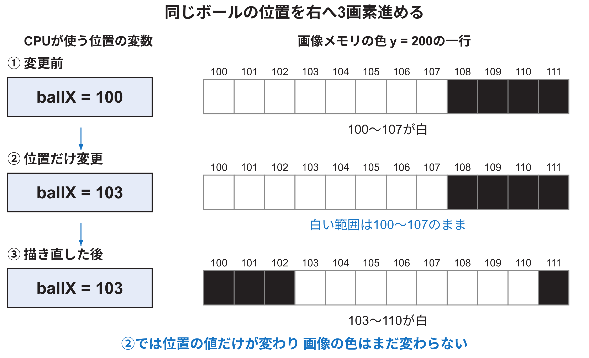

この画像を作るため、ゲームプログラムは「左上(103, 200)、幅8、高さ8、白」という図形の指定を用意する。描画ライブラリは、その指定を描画回路が実行できる数値列へ変換するプログラムである。ライブラリを実行するのも、ゲームの位置を計算するのと同じWallyのCPUである。

ここで作る数値列を描画命令と呼ぶ。描画命令には、回路に行わせる処理や、その処理で使うデータが含まれる。C++に書いた「四角形を描く」という関数名そのものが回路へ届くわけではない。ライブラリのプログラムが、回路の読み方に合う数値列を作る。その数値列をメモリに保存する場所がコマンドバッファである。ライブラリと接続処理の分担は[第8章](#ch_8)で扱う。

例えばCPUは、足し算のCPU命令を使って次の位置103を計算する。その後、別のCPU命令を実行して、位置103を使う描画命令の数値列をメモリへ書く。RasterIXが受け取るのは後者の数値列である。Wallyが実行した足し算の命令やC++のソースコードを、そのままRasterIXへ渡すのではない。

次にCPUは、コマンドバッファに保存した数値を順に読み、描画回路へつながる専用の入口へ書く。これが命令の送信である。本構成では、描画回路がCPU用のコマンドバッファを自動的に読みに来るのではなく、CPUが読み出して渡す。

命令を受け取った描画回路は、指定された図形に含まれる画素を求め、その色を作る。本構成のRasterIXは、まずFPGA内部の作業用メモリで画像の一部分を作り、その結果を基板上のDDR3メモリへ保存する。このDDR3にある完成画像を表示に使う。内部の作業用メモリの役割は[9.4節](#s_9_4)、使い回す手順は[技術付録43.8節](appendix/04-rasterix/configuration-calculations.md#s_app_43_8)で説明する。

ここまでに出た「位置を覚える」「命令を保存する」「画像を保存する」は、すべてメモリを使うが、保存する中身が違う。位置には103のような場所の値、命令には回路へ行わせる処理の値、画像には画素ごとの色の値が入る。これらを同じ一つの値だと考えると、CPUが位置を変更しただけで画面も変わるように見えてしまう。実際には、位置から図形を指定し、命令を送り、画素の色を作るところまで進む。

| 段階 | この例での内容 | 作業するもの |
|---|---|---|
| 位置の計算 | 100+3を計算し、ballXを103にする | WallyのCPU |
| 図形の指定 | (103, 200)に8×8の白い四角形を描くと指定する | 同じCPUがゲームを実行 |
| 命令の準備 | 図形の指定を回路向けの数値列にし、メモリへ保存する | 同じCPUがライブラリを実行 |
| 命令の送信 | 保存した数値列を読み、回路の入口へ書く | 同じCPUが送信処理を実行 |
| 画素の作成 | 指定範囲の色を作り、表示用の画像へ保存する | RasterIXの描画回路 |

新しい画像では、古い位置の白い画素も背景の黒へ戻す。新しい位置を白くするだけでは、以前のボールが残ってしまうためである。

<a id="s_2_4"></a>
### 2.4 画像を画面へ出す

DDR3に完成画像を保存したら、表示回路がその色を読み出す。左上の色から右へ進み、一行の終わりまで来たら次の行へ進む。この順に読んだ色を、映像の信号としてHDMI OUT端子から送り出す。受け取った表示機器は、その信号を画面の各位置の色に対応させる。

ここで表示回路に必要なのは、どこに画像があり、横と縦にいくつの画素が並ぶかである。ボールの速度やブロックの得点は必要ない。完成画像に白い四角形があれば、その場所を白く表示する。その四角形がボールなのか文字の一部なのかも判断しない。

画像をメモリに作る仕事を描画、画像を読み出して映像として送る仕事を表示と呼ぶ。ゲームが新しい画像を作らなくても、表示回路は同じ画像を繰り返し送る。このとき、画面には同じ位置のボールが映り続ける。静止画を映す場合にも、表示回路は動き続けている。

<a id="s_2_5"></a>
### 2.5 同じ処理を繰り返す

ゲームは、位置を一回変えて終わりではない。入力とゲームの状態から次の位置を求め、その状態の画像を作る処理を繰り返す。役割だけを取り出すと、次のように書ける。

```text
終了していない間、繰り返す
    入力を読む
    ボールやパドルの位置を計算する
    現在の状態を描くための指示を作る
    指示を描画回路へ送る
    次の画像への表示切り替えを待つ
```

一枚の画像や一回の画面更新をフレームと呼ぶ。ただし、位置を計算する回数と、新しい画像を作る回数は分けて考える必要がある。例えば、一秒間に60回位置を進めるゲームなら、一回の間隔は1÷60秒、約16.7ミリ秒である。ミリ秒は一秒の千分の一を表す。

画像一枚を作るのに約33ミリ秒かかる場合、その間に位置を進める時刻が約二回分来る。次に描く前に二回分の位置計算を進めれば、ボールが実際の一秒間に進む距離を保ちやすい。ただし表示される新しい位置は途中の一つを飛ばすので、見た目の動きは粗くなる。本ゲームでも、経過した時間に応じて必要な回数だけ状態を進める。

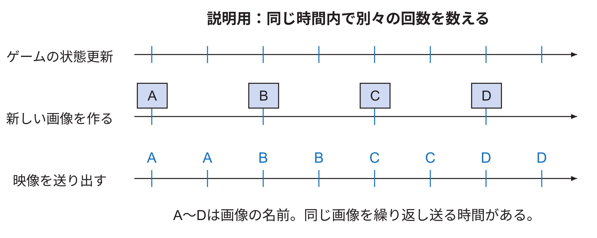

図2.2では、位置の計算が八回、新しい画像の作成が四回、画像の送信が八回ある。表示回路は、次の画像Bができるまで画像Aを二回送っている。同じ画像を二度送っても、画像の中のボールがさらに進むわけではない。この回数は仕組みを示す例であり、保存した実験の実測値ではない。

実験記録のticksは状態を進めた回数、framesはプログラムが描画と切り替えの処理を進めた回数を示す。録画ファイルの画像数は、さらに別に、取り込み側が記録した回数である。実行記録を読む際には、どの回数なのかを区別する。

<a id="s_2_6"></a>
### 2.6 この研究で作った接続の位置

ここまでの流れを既存の部品へ当てはめると、計算を実行する部分がWally、図形の命令を作るプログラムと画素を作る回路がRasterIXに含まれる部分である。RasterIXには、画像を外へ送る表示回路も含まれる。既存の設計を使いつつ、Wallyから命令を渡す接続、DDR3の使い方、表示画像を切り替える制御を本研究で組み合わせた。

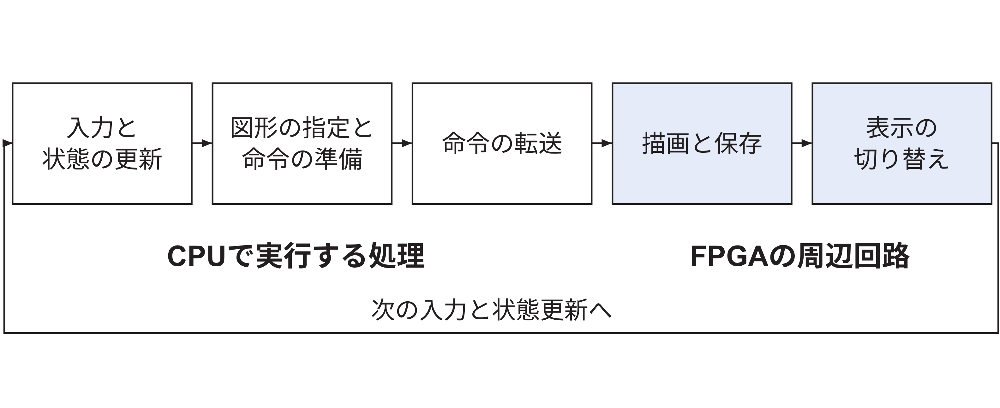

図2.3のソフトウェア側の各処理は、Wallyという一つのCPUがプログラムを実行して行う。描画ライブラリが別のCPUなのではない。図形を塗る回路へ命令を渡したところからは、CPU以外の回路も仕事を進める。以後は、この受け渡しをどのように作ったかを説明する。

CPUがライブラリを実行する間も、表示回路は現在の画像を送り続ける。また、CPUが後続の命令を送る間に、RasterIXが受け取った命令を処理する場合もある。これは一つのCPUが二つのプログラムを同時に実行するという説明ではない。FPGA内に、CPUと描画回路と表示回路が別の回路として存在するため、それぞれの状態を進められるという意味である。

<a id="h0091"></a>
#### 同じボールに関係する三種類の数値

「CPUも描画回路も数値を扱う」という点だけを見ると、何をどこへ送るのか分かりにくい。そこで、同じ白いボールについて、数値の意味を分ける。

| 数値の種類 | この例で表すこと | それを使う仕事 |
|---|---|---|
| ゲーム状態の数値 | 横位置が100から103になった | CPUが次の位置や衝突を計算する |
| 描画用の指定と命令 | 新しい位置へ幅8・高さ8の白い四角形を描くための情報 | CPUが回路用の命令列へ変換し、RasterIXへ渡す |
| 画像の画素値 | 画像の各場所が白か背景色か | 描画回路が保存し、表示回路が読み出す |

横位置103という整数を画像のメモリへ一つ書くだけでは、幅8のボールは現れない。どの画素を白にするかという仕事がまだ残っているからである。また、上表の「四角形を描く」は指定の意味を日本語で表したものであり、この文章やC++の関数名が配線を流れるわけではない。実際にはライブラリが、回路の理解する形式の数値列を作る。[第8章](#ch_8)では、ライブラリと接続処理がこの数値列をどう受け渡すかを説明する。

CPU命令は、これらの数値とはさらに役割が違う。CPU命令は、CPUに「足す」「メモリから読む」「メモリへ書く」といった操作をさせる。CPUはその命令を実行した結果として、ゲーム状態、描画命令、画像用の設定を用意する。プログラムを実行するための指示と、プログラムが作ったデータを区別すると、WallyとRasterIXの担当を追いやすくなる。

<a id="s_2_7"></a>
### 2.7 ボールを一度動かす間に誰が何を変えるか

位置の値と表示中の画像が別物であることを、時間の順にもう一度確かめる。表示用画像の保存場所は二つあり、AとBと呼ぶ。最初は、横位置100のボールが描かれたAを表示しているとする。次の画像は、表示していないBへ作る。

CPUがballXを103にした直後も、表示回路はAを読むため、画面のボールは横位置100にある。次に、CPUが命令を送り、RasterIXがBに横位置103のボールを描く。このときも、Aを読んでいる間は古い位置のままである。Bが完成した後、表示回路の読出し先をAからBへ切り替える。Bの色が画面へ届くと、初めて新しい位置のボールが見える。

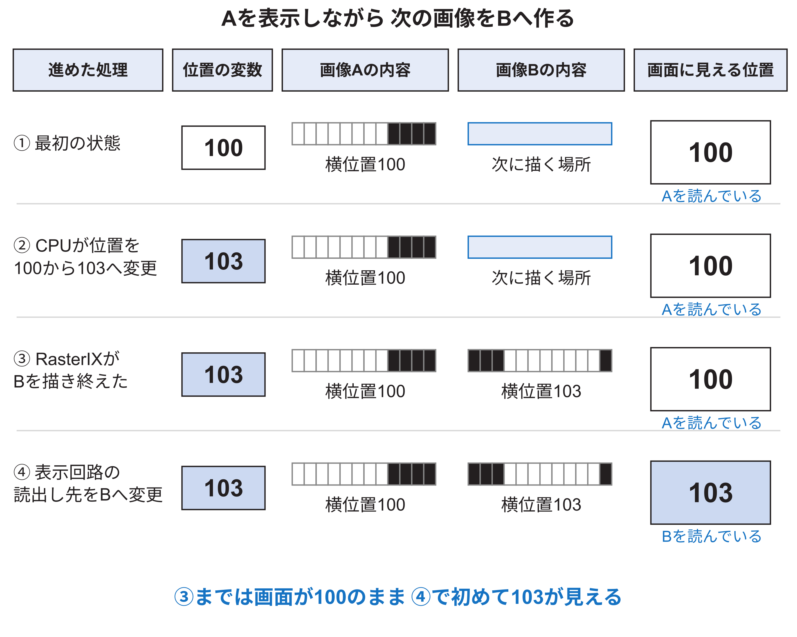

図2.4では、各段階のメモリの内容と、画面に出るボールの位置を横に並べた。画面が変わるのは最下段である。CPUが位置を変えた時点、Bを描き終えた時点、Bを表示した時点が違うことを、同じ列を上から下へ読んで確かめられる。

例えば、処理が終わるのを待っても、ballXが103なのに画面のボールが横位置100に残る場合を考える。Bの画素を読み戻して画像にし、そこでも白いボールが横位置100に描かれていれば、命令の準備・送信・描画を調べる。Bではボールが横位置103に描かれているのに、画面では100のままなら、表示回路がどちらの画像を読んでいるかを調べる。ここでの100と103は、画素に保存された色の値ではなく、ボールの横位置である。このように、途中のメモリも確かめると、画面だけを見ているときより調べる場所を絞れる。

表示中のAと、次に使うBを分ける理由と、安全に切り替える手順は[第9章](#ch_9)で扱う。

<a id="ch_3"></a>
## 第3章 回路とFPGAの基礎

[第2章](#ch_2)で示したCPU、描画回路、表示回路は、いずれも計算する部分と値を記憶する部分を組み合わせて作る。本章では、論理ゲートとレジスタから回路の動きを説明し、その回路をFPGAへ実装する方法につなげる。

<a id="s_3_1"></a>
### 3.1 計算する回路と覚える回路

論理ゲートは、入力の0と1から出力を決める。例えばANDゲートは、二つの入力が両方1のときだけ1を出す。こうしたゲートを組み合わせると、二つの数の足し算や、大小の比較を行う回路を作れる。この種類の回路では、入力の値を変えると、その変化がゲートを通った後で出力も変わる。現在の入力の組合せによって出力が決まるので、組合せ回路と呼ぶ。

0か1かを表す一つ分の情報をbit、八つ分をまとめてbyteと呼ぶ。したがって32 bitは4 byteである。後に出る「32 bitのデータを渡す」は、この32個の0と1を一まとまりとして渡すことを意味する。

ゲームを動かすには、計算結果を後まで覚えておくことも必要である。例えば横位置100に3を足して103を求めたら、次の計算ではその103を使いたい。入力が変わるたびに出力が変わるだけの回路では、前の結果を取り出せない。そこで、値を保持するレジスタを組み合わせる。

レジスタは、決められた時点の入力を取り込み、その値を次に取り込む時点まで出力に保つ。例えば32 bitのレジスタなら、32個の0と1を一組の値として保持する。この取り込み時刻を決める信号がクロックである。クロックは0と1を周期的に繰り返す。ここでは、0から1へ変わる瞬間を立ち上がりと呼び、その瞬間に値を取り込む回路を考える。

図3.1は、現在の値に1を足すカウンタの例である。現在のレジスタの値が3なら、足し算の回路の出力は4になる。まだクロックの立ち上がりが来ていなければ、レジスタが出している値は3のままである。次の立ち上がりで4を取り込むと、レジスタの出力が4になり、足し算の出力は次の5へ向かって変わる。


図3.1の下の表では、レジスタの出力が3、4、5と変わるのに対応して、足し算の出力が4、5、6と変わる。足し算の結果が先に用意され、次の立ち上がりで保存される、という順番を読む。

この一連の動作は、回路の部品を順番に作り直しているのではない。足し算の回路とレジスタはどちらも存在し、レジスタの出力を足し算へ、足し算の結果をレジスタの入力へ配線している。クロックによる保存を挟むことで、3、4、5と順に進められる。

CPUも、計算する回路と値を保存する回路を多数組み合わせて作る。プログラムに書かれた命令に応じて、使う計算や書き込む場所を切り替える。描画回路では、図形のどの位置を処理しているかなどをレジスタに覚え、次の画素を求める処理を進める。二進数からゲートを組み立てる説明は[技術付録12.1節](appendix/01-hdl-fpga/fpga-circuit-fundamentals.md#s_k_1)〜12.4に示す。

<a id="h0115"></a>
#### ゲームの一回の計算と、回路の一周期の関係

図3.1のカウンタは、毎周期「1を足して保存する」専用回路である。一方、ゲームの`ballX = ballX + velocityX`は、CPUがプログラムを実行して行う。CPUは、必要な値を用意し、加算を行い、結果を保存するための命令を実行する。コンパイラによって値がレジスタに置かれる場合もメモリに置かれる場合もあるため、このC++の一行が常に一個のCPU命令や一周期に対応するわけではない。

CPUの20 MHzは、回路の保存時点が1秒に2千万回あるという意味である。「1秒に2千万枚のゲーム画像を作る」という意味ではない。一枚の画像を作るまでには、位置の計算、図形の指定、命令の生成と送信など、多数の操作を行う。途中にはメモリや相手の回路を待つ周期もある。ゲームの更新速度は、この一連の処理をどれだけの時間で終えられるかで決まる。

<a id="s_3_2"></a>
### 3.2 FPGAに回路を作る

FPGAは、小さな論理回路、レジスタ、内部メモリと、それらを結ぶ配線を設定できるチップである。例えばFPGAの一部を足し算に使い、別の一部を値の保存に使い、両者を結ぶと、前節のカウンタを作れる。さらに多数の部品を組み合わせれば、CPUや描画回路を作れる。

FPGAの中で論理計算を担当する部品をLUT、複数の値をまとめて記憶する部品をBlock RAM（BRAM）と呼ぶ。本研究では、LUTやレジスタを使ってWallyなどの回路を作り、BRAMを描画途中の画素の保存などに使う。各部品をどれだけ使ったかは[第12章](#ch_12)の資源使用量で示す。

LUTは、入力の0と1の組合せごとに、出力をどうするか設定できる部品である。説明用に入力が二つなら、00、01、10、11の四通りがある。11のときだけ1、それ以外は0を出す設定にすれば、ANDと同じ論理になる。実際のFPGAでは、より多くの入力を持つLUTと配線を組み合わせて大きな回路を作る。[第12章](#ch_12)のLUT数は、このような論理の部品を何個使ったかを数えた値である。

回路はHDLという言語で記述する。本研究で使うSystemVerilogはHDLの一つである。HDLで部品の入出力、計算、保存の条件を記述し、Vivadoという開発ツールに、FPGA内のどの部品と配線を使うか決めさせる。その結果をFPGAへ設定すると、チップの中で記述した回路が働く。

FPGAへ回路を設定する作業と、CPUでゲームを実行する作業は、この順に分かれる。まずFPGAにWallyというCPUを作る。その後、そのWallyがゲームプログラムを読み、計算や読み書きの命令を実行する。ゲームのC++を直接FPGAの各ゲートへ一対一に置いているわけではない。

FPGAへ設定した後は、足し算の回路もレジスタも、その場所に存在し続ける。CPUが次の命令を実行するたびに、FPGAへ新しい回路設定を送り直す必要はない。CPUの制御回路が、既にある部品のどれを使うかを選ぶ。ゲームの処理が「順番に実行される」のは、このCPUの動作である。一方、HDLに書いた複数の回路は、配線でつながった部品として同時に存在する。

小さな状態を覚えるレジスタと、多数の値を置くBRAMも、用途を分けて考える。例えば「今は返事待ちか」という数bitの状態ならレジスタで保持できる。一方、何百語もの命令や、多数の画素を置くには、まとまった記憶容量が必要になる。BRAMはこのような保存に使う部品である。ただし小さい記憶領域をLUTで実現する場合もあるため、ソースに「配列」と書いてあるだけでBRAMを使うと決まるわけではない。[第12章](#ch_12)では、実際に生成された回路の使用量を調べる。

<a id="s_3_3"></a>
### 3.3 FPGAチップと基板を区別する

Nexys Videoは、FPGAチップと周辺部品を配線した基板の名前である。FPGAの外側に、DDR3メモリ、SDカードを差す場所、HDMI端子などがある。基板上の銅配線によって、これらの部品とFPGAの決められた端子がつながっている。


例えばDDR3を使うには、FPGA内部へDDR3制御回路を作り、その回路の信号を、基板上のDDR3へつながる端子に出す必要がある。HDLでDDR3Addrと名前を付けても、その名前だけでは、チップのどの端子から出すべきかVivadoには分からない。そこで端子番号の指定も与える。回路の入口と実物の配線を対応付ける指定である。

図3.2の大きな基板の枠、その内側のFPGAの枠、FPGAの外側に置いた部品を見分けると、設計を変えられる範囲も分かる。FPGA内の接続は設定し直せるが、基板上のDDR3の実容量や銅配線は、設定ファイルを書き換えただけでは変わらない。

<a id="ch_4"></a>
## 第4章 設計ファイルと開発手順

[第3章](#ch_3)の回路を実機へ組み込み、そこでゲームを実行するには、回路用とプログラム用の二種類のファイルを生成する必要がある。本章では、それぞれの生成手順と、実験結果に対応するソースの版の指定方法を説明する。

<a id="s_4_1"></a>
### 4.1 回路とプログラムで生成物が違う

例えばボールの色を白から赤へ変えたい場合、ゲームのC++を編集して新しい実行ファイルを作る。一方、CPUから描画回路へつなぐ配線を変えたい場合、回路のSystemVerilogを編集して新しいFPGA用設定を作る。どちらもパソコンでファイルを編集するが、変更を反映させる相手が違う。

回路を作るためにVivadoへ与えるのは、主に次の三種類のファイルである。SystemVerilogは回路の動作や接続を記述する。TclはVivadoへ作業を指示するスクリプトで、既存の回路部品を生成する操作などを書く。このように再利用する回路部品をIPと呼ぶ。XDCは、信号を出す端子や、クロックの周期などの条件を指定するファイルである。

Vivadoはこれらを読み、FPGAへ回路の構成を設定するbitstreamというファイルを生成する。ゲーム用C++は別のコンパイラで、Wally上のLinuxが実行する機械語のファイルへ変換する。設計やプログラムのソースから使えるファイルを生成する作業は、どちらもビルドと呼ぶ。

回路側のビルドは、主に合成、配置・配線、bitstream生成へ進む。合成では、HDLが表す計算と記憶を、FPGAで使う論理部品へ変換する。配置・配線では、各部品を置く場所と、それらを結ぶ配線を決める。ここまで決まると、信号がどれだけの時間で相手へ届くかを解析できる。bitstreamは、その配置と接続などをFPGAへ設定するためのデータである。

ゲーム側のビルドでは、コンパイラがC++をCPU命令へ変換し、必要なライブラリと組み合わせて実行ファイルを作る。本研究では開発用パソコンとWallyでCPUの種類が違うため、Wallyで実行するRISC-V用のプログラムを生成する。ソースの言語がC++で同じでも、パソコン用に作った実行ファイルをそのままWallyで実行できるとは限らない。


図4.1の上の経路では、Vivadoが回路の設計を読み、FPGAのどの部品と配線を使うかを決める。下の経路では、コンパイラがC++を、Wallyが実行できる機械語の命令へ変換する。回路を変えていなければ、ゲームの色を変えるたびにFPGA全体を作り直す必要はない。反対に、C++だけ作り直しても、FPGAに入っている配線や回路は変わらない。

回路のソースを変えた場合は、その変更を含むbitstreamを作ってFPGAへ設定しなければ実機は変わらない。ゲームを変えた場合は、新しい実行ファイルを実機側へ渡して起動する。古い生成物のままでは、ソースが正しくても変更後の試験にならない。

<a id="h0142"></a>
#### 一か所を編集した後、何を作り直すか

例えば「ボールを赤くする変更」と「命令を保存できる数を変える変更」は、どちらも画面の動作に関係する。しかし、反映する手順は次のように異なる。

| 変更の例 | 編集するもの | 作り直すもの | 実機へ反映する操作 |
|---|---|---|---|
| ボールを赤く描く | ゲームのC++ | RISC-V用実行ファイル | 新しい実行ファイルを実機で起動する |
| 命令FIFOの容量を変える | 回路生成用の設定 | FPGA用bitstream | 新しいbitstreamでFPGAを設定する |
| 描画用作業領域の容量を変える | 回路の容量と、それを使うソフトウェアの設定 | bitstreamと実行ファイルの両方 | 対応する二つをそろえて使う |

三行目では、回路だけ大きくしても、ソフトウェアが以前の容量を前提に処理すれば、大きくした領域を意図どおりには使わない。反対に、ソフトウェアだけが大きな領域を前提にすると、回路に入らない量を扱わせることになる。[7.3節](#s_7_3)では、実際に合わせる設定を示す。

<a id="s_4_2"></a>
### 4.2 動作を確認した版をそろえる

公開ソースは継続して変更されるため、同じ名前のWallyやRasterIXでも、取得した版によって設計が異なる。本稿では、接続を実装した時点の資料を「基準版」、その後に通常のゲーム構成を生成して継続動作を確認した資料を「動作確認版」と呼ぶ。二つの版の結果を混ぜず、試験ごとにどちらを使ったかを示す。

| 呼び方 | 使用したソース | 本文で扱う記録 |
|---|---|---|
| 基準版 | ゲーム機`d3e181ac`、公式RasterIX`9fdcf97a` | 接続回路の試験、起動・転送の確認[E1](#ref_E1) |
| 動作確認版 | ゲーム機`261832d4`、公式Wally`2064ca2b`、公式RasterIX`9269a01c` | 計測回路を含まない通常構成の生成、画像、継続動作、映像[E6](#ref_E6) |

表の英数字は、Gitでソースの版を識別するコミットIDの先頭8文字である。完全なIDと取得手順は、基準版については[技術付録第63章](appendix/05-integration/console-reproduction.md#ch_m)、動作確認版については71.17節に示す。ソースだけでなく、FPGAに設定したbitstreamと実行ファイルも記録へ対応付ける。

本文の基本的な接続説明は基準版を出発点とし、動作確認版に固有の設定は明記する。いずれの通常構成も、公式RasterIXの内部を変更せずに用いる。映像にはHDMI OUT端子から送る標準のDVI構成を使用する。端子と送信形式は[9.7節](#s_9_7)で説明する。

例えば、描画回路の容量を変えたソースを保存しても、FPGAに以前のbitstreamを設定したままなら、新しい容量での確認にはならない。版と生成物をそろえるのは、「何を動かした結果なのか」を後から特定するためである。

<a id="ch_5"></a>
## 第5章 ゲーム機全体の構成

<a id="s_5_1"></a>
### 5.1 既存の設計をどこから使うか

本研究ではCPUの命令実行回路を一から作り直すのではなく、公開されているWallyを使う。WallyにはCPUだけでなく、メモリや周辺回路につなぐための設計、FPGA向けの生成手順、Linuxを準備する設定がある。本構成では、この基盤で動くCPUへ、図形を描くRasterIXを追加する。[Harris26](#ref_Harris26)[Wally](#ref_Wally)[RasterIX](#ref_RasterIX)

WallyとRasterIXは別々の開発者による公開設計である。両方のソースを同じフォルダに置くだけでは、一つのゲーム機にはならない。Wallyが出す書き込みをRasterIXの受け取る命令へ渡し、両者が使うメモリの範囲を決め、完成画像を表示する必要がある。本研究で設計した接続は、この間をつなぐ部分である。

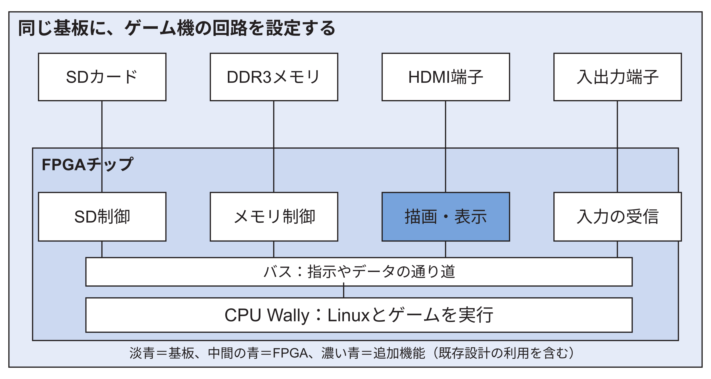

図5.1は、基板上の部品を[第3章](#ch_3)と同じ位置に置き、FPGAの中を実際の役割に対応する回路へ描き換えた概要図である。バスは、回路間で指示やデータを渡す通り道である。実装には命令用とメモリ用の異なる経路があるため、その詳細は図5.2で分けて示す。

ここでいうバスは一本の導線ではない。番地を示す線、値を示す線、読み書きの開始や完了を示す線などを、決められた手順で使う接続である。例えばCPUが「この番地へ7を書く」と要求し、相手が「7を受け取った」と返すまでが一回のやり取りになる。CPUと周辺回路でこの手順が一致して初めて、プログラムの書き込みを回路の操作にできる。

<a id="h0159"></a>
#### 使用する機器とクロックの条件

| 項目 | 本構成の条件 |
|---|---|
| FPGAボード | Nexys Video |
| 外部DDR3メモリ | 512 MiB |
| CPU側のクロック | 20 MHz |
| RasterIX側のクロック | 100 MHz |
| ゲーム画像 | 640×480画素、RGB565 |

CPUとRasterIXは異なるクロックで動く。この条件のもとで値と順序を保つ接続を、[第6章](#ch_6)で説明する。これらの値は本構成の条件であり、同じFPGAを使うすべての設計の性能を表すものではない。[NexysVideo](#ref_NexysVideo)[Console26](#ref_Console26)

<a id="s_5_2"></a>
### 5.2 CPU、描画回路、表示回路の役割

CPUが決めるのは、ゲームの次の状態である。ボールが壁に当たれば進行方向を変え、ブロックに当たればそのブロックを消す状態にし、得点を増やす。続いて、その状態を表す四角形と文字をライブラリへ渡す。このライブラリを実行して、回路向けの命令を作るのもCPUの仕事である。

描画回路は「ボールが壁に当たったか」を自分で判断しない。受け取った図形の位置と色に従って、画像の各点の色を求める。ゲーム側が誤った位置を指定すれば、描画回路が正しく動いていても、その誤った位置にボールが描かれる。ゲーム規則の正しさと、指定どおりに描く正しさを分ける理由はここにある。

表示回路は、出来上がった画像メモリから色を読み、映像端子へ送る。そこにある白い点がボールなのか文字なのかを区別する必要はない。画像メモリから読んだ色を、画面上の順序と映像の時間規則に従って送ることが仕事である。

描画と表示を分けて説明するのは、このように読むデータと仕事が違うからである。RasterIXに両方の回路が含まれていても、描画が済んだ画像を表示回路が読めなければ、画面へは出ない。反対に、新しい描画が止まっていても、表示回路は古い画像を送り続けられる。本研究では、この間の画像の保存と切り替えも接続した。

<a id="s_5_3"></a>
### 5.3 メモリを共有するとは何か

同じDDR3を使うという説明は、「すべてのデータを同じ番地へ入れる」という意味ではない。例えば、一冊のノートの前半を計算に、後半を画像の記録に使うように、一つの物理部品の中で使う範囲を分ける。以下では、この場所の分け方と、複数の回路から来る読み書きを取り次ぐ回路を区別する。

基板上のDDR3は、番地を指定して値を保存したり読み出したりできる大きなメモリで、容量は512 MiBである。MiBは1,048,576 byteを表す単位である。CPUはLinuxやゲームの命令とデータを置き、描画回路は表示用の画像と、図形へ貼る模様の画像（テクスチャ）を使い、表示回路は完成画像を読み出す。三つの回路が同じ物理部品を使うという意味で、「メモリを共有する」と呼ぶ。

ここでは二つの問題を別々に解く必要がある。一つ目は、同時に要求が来たとき、どの要求をメモリへ渡し、どの回路へ返事を戻すかである。これを受け持つ既存回路としてSmartConnectを使う。CPU、描画回路、表示回路がそれぞれ要求を出し、SmartConnectを通してDDR3制御回路へ届く。待たされた要求は、受け付けられるまで所定の信号を保持する。

二つ目は、同じ番地を二つの用途に使ってしまう問題である。例えば、Linuxがある番地に大事な管理データを置いた後、描画回路が同じ番地へ白色の画素を書けば、その管理データは壊れる。SmartConnectが二つの書き込みを順番に正しく届けても、この衝突は防げない。接続が正しいことと、使う場所が重ならないことは別だからである。

そこで、DDR3の末尾32 MiBを画像・テクスチャ用として確保し、Linuxが通常のメモリとして割り当てないように設定する。描画側も、その予約した範囲の中に画像を置く。「要求を取り次ぐ回路」と「使う番地の取り決め」の両方を用意して、同じDDR3を使えるようにした。

例えば、CPUが命令列を読む要求と、表示回路が画素を読む要求を同じ時刻に出しても、両方の値が同じ配線に混ざって返るわけではない。接続回路が要求を取り次ぎ、返ってきたデータを要求元へ渡す。一方、表示回路が誤ってCPUの命令列の番地を指定すれば、その番地の値を正しく読み出してしまう。接続回路は「ここは画素の保存場所のはずだ」という用途までは判断しない。このため、番地の設定も設計の一部となる。

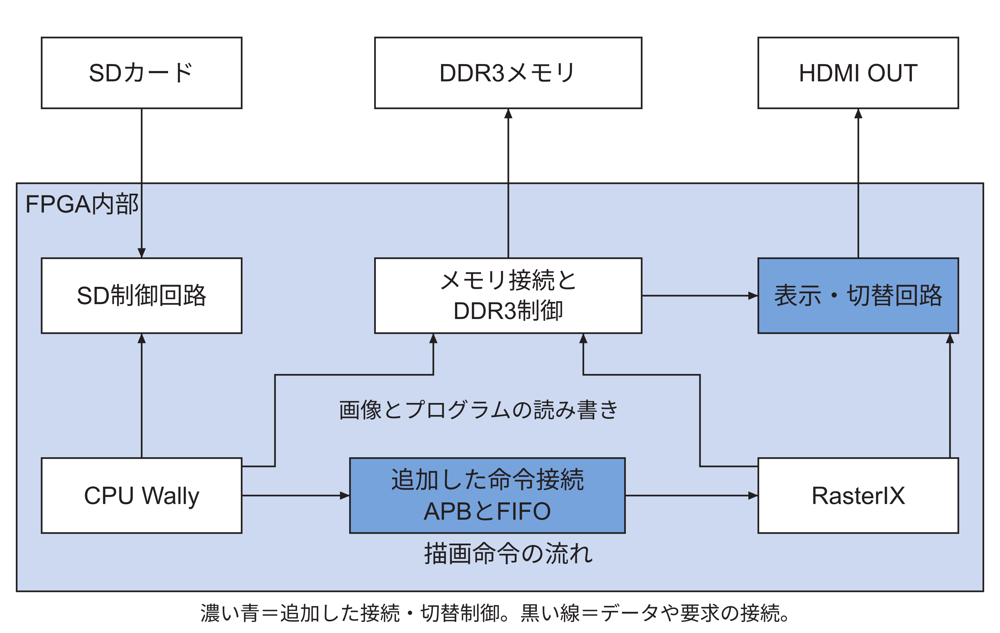

図5.2では、下側のCPUからAPB・FIFOを通ってRasterIXへ向かう接続が、描画を依頼する経路である。中央のメモリ接続網へ向かう接続は、プログラムや画像を読み書きする経路である。濃い青の箱は、本研究で追加した命令接続や表示切り替えの制御を含む部分を示す。黒い線は接続を表し、線の位置と箱の名前から経路を読み分ける。CPUから送る「ここに四角形を描くための命令」と、表示回路が読む「画素の色の並び」は別のデータである。APBとFIFOはこの命令接続に使う仕組みであり、[第6章](#ch_6)で動きを説明する。

<a id="h0176"></a>
#### 一本のバスという概要図から具体的な二つの道へ進む

CPUから「四角形を描くための命令」を送る道と、描画回路から「できた画素をメモリへ書く」道では、運ぶ内容も相手も違う。命令の道では、CPUの番地付き書き込みを、順序付きの32 bitデータ列へ直す。メモリの道では、CPU、描画回路、表示回路が、同じDDR3のどの場所を使うかを指定する。

APB、AXI、AXI4-Streamは、その道で使う約束の名前である。APBは周辺回路の番地を指定して操作するために使う。ここでAXIと呼ぶのは、DDR3へのアクセスで番地と読み書きのデータや返事を受け渡す方式である。AXI4-Streamは、命令FIFOのようにデータを順に渡す方式であり、その一語ごとにメモリ番地が付くわけではない。[第6章](#ch_6)では、この二つの経路のうち命令を渡す側を詳しく説明する。

| 接続の場所 | 運ぶ内容 | 使用する方式 |
|---|---|---|
| CPUの周辺アクセスから命令口 | 操作番地、書く値、完了の返事 | APB |
| 命令口からRasterIX | 32 bitの命令データ、最後かどうか | AXI4-Stream |
| 各回路からDDR3接続網 | メモリ番地、画素やプログラムのデータ | AXI |

これらをすべて「バス」と呼ぶこともあるが、別の約束を使う端子同士を名前だけ合わせても接続できない。どの約束からどの約束へ変換するかを決めることが、接続回路の設計である。WallyからAPBまでの既存の変換と、本研究で作ったAPBから命令列への変換を分けて読む。

<a id="h0181"></a>
#### 同じメモリを使えることと、同じ場所を自由に書けることは違う

説明用に、CPUがある番地Pへ得点の100を書いた直後、描画回路が同じ番地Pへ白色を表す値を書いたとする。両方の書き込みが一度ずつ正しく完了しても、最後に残るのは白色の値である。CPUがPを得点として読み直すと、100ではなく、その色の数値を得てしまう。この誤りは、書き込みを速くしても、順番を正確にしても解決しない。得点と画素の置き場所を分ける必要がある。

一方、CPUがP、描画回路が別の番地Qへ書くなら、両方の要求が同時に来ても、接続回路がそれぞれを受け付けて順に処理できる。ここでは場所の衝突はないが、同じメモリを使う分だけ相手の要求を待つ場合がある。本構成は、予約領域で前者の衝突を防ぎ、SmartConnectとDDR3制御回路で後者の要求を取り次ぐ。画像の二枚をいつ再利用するかは、さらに別の取り決めとして[第9章](#ch_9)で説明する。

<a id="s_5_4"></a>
### 5.4 本研究で加えたもの

| 対象 | 利用した既存部分 | 本研究で合わせた部分 |
|---|---|---|
| 描画 | 公式RasterIXの回路とライブラリ | CPUバスと命令端子の接続、共有メモリへの接続 |
| 画像の表示 | RasterIXに含まれるDVI表示回路 | 表示画像の切り替えと、その完了をCPUへ知らせる制御 |
| Linux上の利用 | Linux、Buildroot、既存の描画API | メモリ予約、命令を書き込む接続クラス、ゲームのビルド設定 |
| ゲームと確認 | RasterIXの描画機能 | 二次元ブロック崩し、状態・画像・映像の動作確認 |

表のBuildrootは、Linuxとそこで使うソフトウェアをまとめて生成するための仕組みである。本研究で合わせたのは、既存部品の仕様に合う接続と制御である。上の表では、利用した部分と作った部分を分けて示した。

<a id="ch_6"></a>
## 第6章 CPUから描画命令を渡す

本章で作るのは、CPUが書いた数値を、RasterIXへ順番に渡す接続である。入口ではCPUが番地と値を指定し、出口ではRasterIXが順に語を受け取る。その途中にFIFOを置く。CPUはFIFOへ預けられた時点で次の語へ進み、RasterIXは自分が受け取れる時点でFIFOから取り出す。

説明は、一語をどの番地へ書くか、受け取るまでどう待つか、途中に何語預かるか、二つのクロックをどうまたぐか、の順に進める。FIFOを使わず一語ずつ待つ接続も可能である。[6.4節](#s_6_4)では、この選択とクロックの条件を区別する。したがって、受け取りを待つ必要があるという事実だけを、FIFOが不可欠だという根拠にはしない。

<a id="s_6_1"></a>
### 6.1 メモリの番地を回路の操作に使う

[第2章](#ch_2)では、CPUが描画命令をメモリに保存した後、その命令を読み出して描画回路へ渡すと説明した。この章では、その「渡す」という操作を具体的に追う。最初に、保存した数値を普通のメモリから読む操作と、回路へ数値を渡す操作を区別する。

メモリには、どの場所を読むか、どの場所へ書くかを指定する番号がある。この番号を番地、またはアドレスと呼ぶ。CPUがメモリへ書き込むときは、書込み先の番地と、保存する値を別々に指定する。例えば「番地100へ値7を書け」という操作では、100が行き先、7が中身である。

本研究の接続では、特定の番地を指定した書き込みを、メモリへの保存の代わりに、描画回路へ渡す操作として扱う。CPUが出した番地を調べる回路によって、DDR3へ届ける要求と、周辺回路へ届ける要求を振り分ける。

CPUは、番地を調べる回路へ「これは画像の命令です」という文章を添えているわけではない。回路には「この番地範囲ならDDR3、この番地範囲なら周辺回路」という判定条件を設定してある。ソフトウェアが指定した番地に従って、同じ書き込みという操作が、異なる接続先へ届く。このように番地を使って回路を操作する方式が、メモリマップドI/O、略してMMIOである。

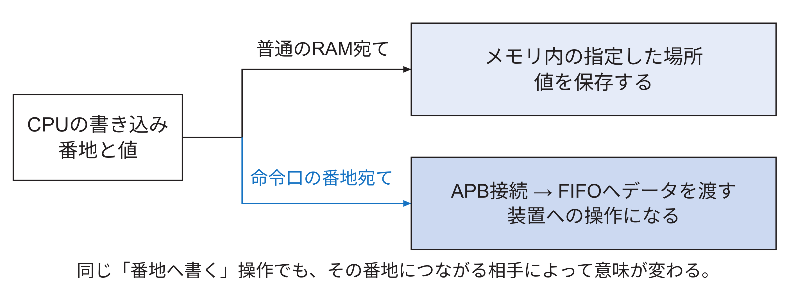

図6.1では、同じ場所へ7、その次に8を書いた場合を比べている。普通のメモリなら、その場所の中身が7から8へ置き換わる。本接続の命令口では、最初の7を回路へ渡し、次に8を渡す。同じ入口を繰り返し使って、数値の列を送れる。7と8は書込み方を示す説明値であり、実機に送って使える描画命令ではない。

本研究では、0x10080000から始まる256 byteの番地を、描画回路の操作に割り当てた。先頭の0xは、その後の値を16進数で表した印である。ここでは長い数字を暗記する必要はなく、同じ数値がソフトウェアの行き先と回路の判定条件の両方に現れることに注目する。

0x10080000は、命令の一部を入れる入口である。CPUはコマンドバッファから32 bit、つまり4 byteの値を読み、この入口へ書く。次も同じ入口へ次の4 byteを書く。この4 byte単位を、本章では一語と呼ぶ。一語が一つの四角形や一画面を丸ごと表すわけではない。描画命令の数値列を、一回に渡せる大きさへ区切った単位である。

通常の語を入れる入口のほかに、最後の語を入れる入口、状態を読む入口などもある。例えば0x1008000cを読むと、接続先を識別する値0x52495831が返る。この読出しを確かめると、CPUから操作が届いて返事が戻るところまでを確認できる。各入口の番地と役割を[6.5節](#s_6_5)にまとめる。

この操作範囲は、Wallyの設定でも通常のメモリとは区別する。CPUには、一度使ったメモリの値を近くの小さな記憶領域に残し、次のアクセスを速くするキャッシュがある。しかし装置の現在の状態を読みたい場合に、昔の値を返されては困る。また、命令口への書き込みは、値を手元へ保存するだけで終わらず、回路へ届ける必要がある。このため、外部I/Oとして扱う番地の範囲を設定する。

<a id="s_6_2"></a>
### 6.2 APBという接続の約束

CPUが番地と値を指定しても、回路同士は、そのC++の文章を読んで受け渡すわけではない。番地を表す電気信号、データを表す電気信号、書き込みを行うことを示す電気信号を、配線を通して送る。送り手と受け手の間で、各信号の意味と、いつ値を受け取るかをそろえる必要がある。

本接続のCPU側で使う約束がAPBである。例えばPADDRという信号のまとまりに番地を出し、PWDATAに書き込む値を出す。受け手はPREADYという信号で、その転送を完了してよいかを返す。PREADYが0なら待ち、1なら決められた条件で完了する。APBは一つの配線の名前ではなく、こうした信号の組と使い方の名前である。

WallyのCPUから出た要求は、既存のAHB–APBブリッジを通ってAPBの形になる。ブリッジとは、一方の方式の要求を受け、もう一方の方式で要求し直し、返事も元へ戻す回路である。本研究では、そのAPB側へrasterix_apbという回路を追加した。この追加回路が命令口への書き込みを受ける。

| 信号 | 誰が出すか | 何を示すか |
|---|---|---|
| PADDR | CPU側のブリッジ | 操作する番地 |
| PWDATA | CPU側のブリッジ | その番地へ書く値 |
| PWRITE | CPU側のブリッジ | 1なら書き込み、0なら読出し |
| PSEL | CPU側のブリッジ | この回路を操作の対象にしていること |
| PENABLE | CPU側のブリッジ | 準備の次のアクセス段階に入ったこと |
| PREADY | rasterix_apb | この転送を完了してよいこと |
| PRDATA | rasterix_apb | 読出し操作に対する返答の値 |

図6.2は、一語の書き込みを行う時間の流れである。最初に対象と値を用意する準備段階がある。次にアクセス段階へ入り、受け手のPREADYを確認する。PREADYが0なら、番地と値を変えずにアクセス段階を続ける。

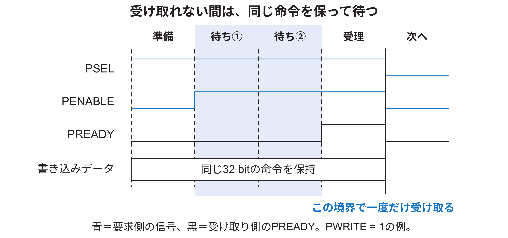

図の青い信号はCPU側、黒いPREADYは受け手が出す。時間は左から右へ進む。薄い背景の区間ではPREADYが0なので、送り手は同じ値を保つ。「受理」と示した区間の終わりのクロック立ち上がりで、PSEL、PENABLE、PREADYがすべて1となり、一回の転送が完了する。これはPWRITEが1の書き込みを説明する図である。

<a id="h0209"></a>
#### 受け取れない一語をクロックごとに追う

説明用の値0x11111111を一度だけ送りたい場合を考える。これは一語がいつ受け取られたかを見るための値であり、描画を実行する有効な命令として示すものではない。

| 段階 | PSEL | PENABLE | PREADY | 書き込み値 | この段階の終わり |
|---|---:|---:|---:|---|---|
| 準備 | 1 | 0 | この説明では不問 | 0x11111111 | 対象と値を用意する |
| アクセス1 | 1 | 1 | 0 | 0x11111111 | 未完了なので同じ値を保つ |
| アクセス2 | 1 | 1 | 0 | 0x11111111 | まだ同じ値を保つ |
| アクセス3 | 1 | 1 | 1 | 0x11111111 | 一度受け取り、転送が完了する |

同じ値が三つのアクセス期間に出ていても、書き込みが三回起きるわけではない。PREADYが0だった二回は未完了であり、三回目にだけ一度受け取る。信号の値が見えていることと、受け渡しが成立することを分けて数える。

追加回路は、次に説明するFIFOに一語を保存できるとき、PREADYを1にする。その状態のクロック立ち上がりで、FIFOへの保存とAPB書き込みの完了を同時に成立させる。保存できないのにPREADYを1にすると、CPU側は送れたつもりで次の語へ進んでしまう。反対にCPU側を待たせている間、同じ値を何度もFIFOへ入れると重複する。そのため、保存と書き込み完了を同じ一回として数える。

<a id="s_6_3"></a>
### 6.3 FIFOへの保存とAPB書き込みの完了

前節で説明したAPB書き込みの受け取り先には、描画命令を一時保存するFIFOを置く。FIFOはFirst In First Outの略で、先に受け取った語から順に送り出す回路である。CPU側はFIFOの入口へ語を書き、RasterIXは出口から語を受け取る。CPUから受け取る時点と、RasterIXへ渡す時点を分けられることが、この保存場所の役割である。

本構成では、FIFOが一語を保存した時点で、そのAPB書き込みを完了とする。RasterIXがすぐに受け取れなくても、FIFOに空きがあればCPUは次の語へ進める。満杯になった場合は、前節のPREADYを0にしてAPB書き込みを待たせる。したがって、FIFOを置いた構成でもAPBの待ち機能を利用する。

FIFOを置くと、RasterIXがまだ受け取っていない語を、接続回路の中へ預けられる。以下では、CPUがA、B、Cの三語を順に送りたい場面で、この違いを確かめる。A、B、Cは一語ずつを区別するための名前であり、有効な描画命令の具体値ではない。実機ではCPU側が20 MHz、RasterIX側が100 MHzで動くが、まずは両側が同じクロックで動く場合を比べる。これにより、クロックをまたぐ方法をまだ知らなくても、途中に保存場所を設けると何が変わるかを追える。実機のクロックへの対応は[6.4節](#s_6_4)で説明する。

<a id="h0218"></a>
#### FIFOに保存する構成と、受け取りまでAPBを待たせる構成

CPUが最初のAを書こうとした時点で、RasterIXはしばらく新しい語を受け取れないとする。ここで「受け取れない」とは、入口のREADYを0にしていることであり、RasterIXのクロックや内部処理全体が停止することではない。受け取りを待つ間に、CPUが次のBへ進めるかを、FIFOを置かない場合と置く場合で比べる。

FIFOを置かない接続では、Aの行き先はRasterIXである。接続回路は、RasterIXが受け取れない間はAPBのPREADYを0にし、CPU側のバス回路にAを保持させる。Aの書き込みが未完了なので、CPUの送信処理はBの書き込みへ進めない。RasterIXがAを受け取れるようになって初めて、Aの書き込みを完了する。その後でBを送る。この方法でも、Aを捨てずに待つことはできる。APB仕様は、PREADYを0にしてこのように転送を延長する手順を定めている。[ArmAPB23](#ref_ArmAPB23)

FIFOを置く接続では、CPUから見たAの行き先をFIFOの入口にする。FIFOに空きがあれば、RasterIXが受け取れない間でもAを保存できる。そこでAのAPB書き込みを完了し、CPUは次のBへ進む。空きが残っていれば、B、Cも順に保存できる。RasterIXが再び受け取れるようになったら、FIFOはA、B、Cの順に渡す。ただし、FIFOが満杯になれば、この接続でもAPB書き込みを待たせる。

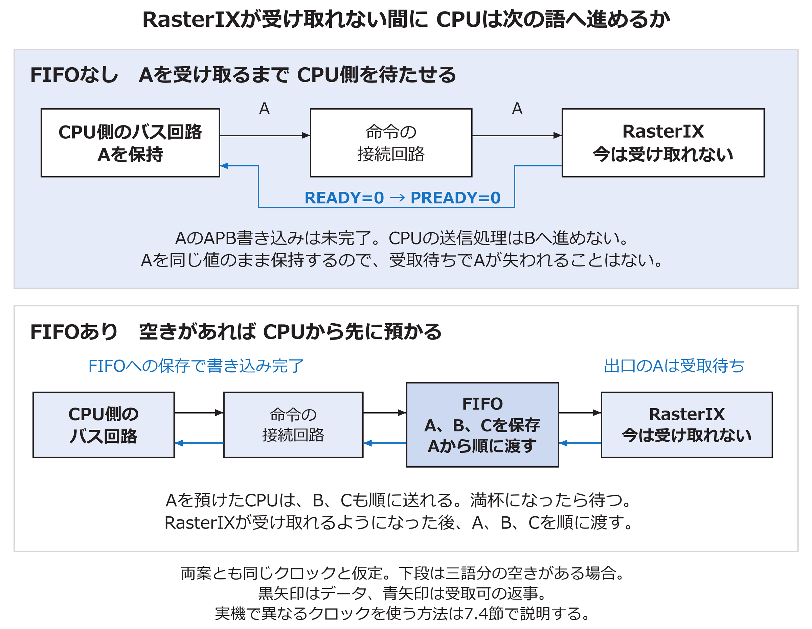

図6.3の上段では、AがRasterIXに届くまでCPU側の送信処理が待つ。下段では、AをFIFOに預けた後、CPU側はB、Cの送信へ進める。下段が示すのは、FIFOに三語分の空きがある場合である。FIFOを置いたからといって、RasterIXがAを実行する時刻そのものが早くなるとは限らない。

| 比較する構成 | RasterIXがAを受け取れない間 | AのAPB書き込みが完了する条件 |
|---|---|---|
| FIFOを置かない説明用の接続 | CPU側がAを保持し、Bの送信へは進まない | RasterIXがAを受け取る |
| FIFOを置く説明用の接続 | 空きがあればAを保存し、CPUはBへ進む | FIFOがAを保存する |

両方の接続で、受け取られる前のAを保持して失わないようにしている。違うのは、Aを保持する場所と、CPUがBへ進める時点である。APBで待たせる方法は、現在のAをCPU側に持たせ続ける。FIFOを置く方法は、Aを途中へ預かることで、RasterIXがAを受け取る前でもCPU側を次の書き込みへ進められる。このため、受け取り待ちに対応するだけならFIFOは必須ではないが、後続の語も預けたい場合にはFIFOの保存場所が役立つ。

以上は、保存場所の有無を説明するために同じクロックを仮定した例である。実機では、20 MHzのCPU側と100 MHzのRasterIX側との間で、同じ語を一度だけ渡す仕組みも必要になる。本研究では、保存とクロック間の受け渡しを行うAMDの非同期AXI4-Stream Data FIFOを使った。[AMD085](#ref_AMD085) APB側とRasterIX側で異なる接続方式をどうつなぐかは本節の後半で、二つのクロックをどう扱うかは[6.4節](#s_6_4)で説明する。本章では、この採用構成でいつ一語を受け取り、どこへ保存するかを説明する。

以下では、CPUからRasterIXへ向かう命令FIFOを追う。逆方向に結果を返す応答FIFOについては、[6.4節](#s_6_4)と[技術付録第31章](appendix/03-linux/mmio-ordering.md#ch_24)で説明する。

<a id="h0228"></a>
#### まず一つの時計で動く普通のFIFOを考える

保存した語をどの順番で取り出すかを、三語まで入る小さなFIFOで確かめる。ここでは入口と出口を一つのクロックで動かし、語の保存と取り出しだけを追う。実機の容量は512語であり、図6.4の三語は説明用である。

7、8、9の順に語を入れ、出口からはまだ一つも取り出していないとする。FIFOには7、8、9が残り、最初に取り出せるのは7である。次の10を入れようとしても、三語分が埋まっているので入れられない。入口は「今は受け取れない」と返し、送り手は10を持ったまま待つ。

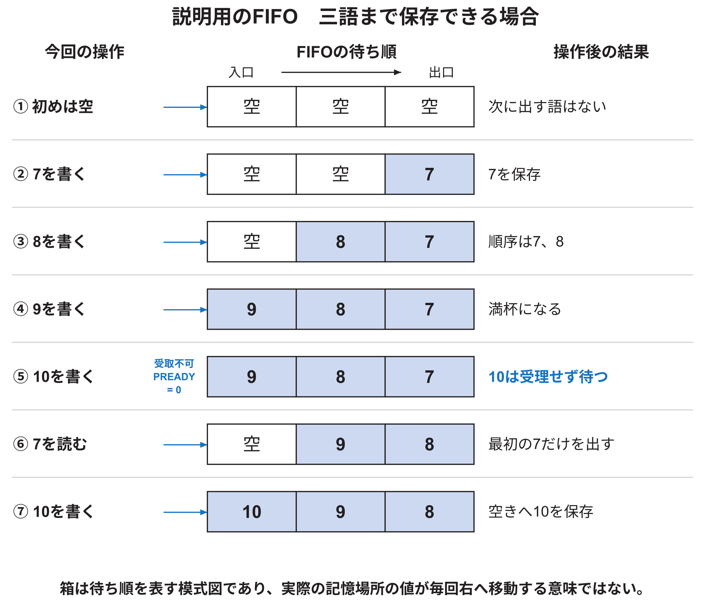

図6.4は、左から右へ語が進むように並べた待ち行列の模式図である。満杯のとき、10はFIFOの中へ入っていない。CPU側が10を保持している。7が取り出され、その空きが入口側へ伝わった後に、10を一度だけ受け取る。箱は待ち順を表し、実際のメモリ内で毎回すべての語が右へ移動することを意味しない。

実装では32 bitの語を512個保存する。データ部分は512×4 byte、すなわち2,048 byteであり、データ列の終端を示すTLASTという信号も各語と対応付けて保持する。512語は本構成で採用した容量である。容量を取り替えた比較記録は[技術付録第71章](appendix/05-integration/fifo-comparison.md#ch_29)に示す。

<a id="h0234"></a>
#### 満杯になったらCPUの一回の書き込みを完了させない

実際の接続では、FIFOの入口側がCPU側、出口側がRasterIX側につながる。RasterIXが一時的に語を受け取れなくても、FIFOに空きがあれば、CPU側は語を入れられる。FIFOの空きがなくなった時点で、CPU側も待つ。このため「RasterIXがREADYを0にした時刻」と「CPUのAPB書込みが待たされる時刻」は、FIFOに残る空きの分だけずれることがある。

追加回路rasterix_apbでは、APB書込み中のCmdValidをFIFO入口のVALIDへ、FIFO入口のCmdReadyをAPBのPREADYへ結び付ける。PREADYを0にすると、CPU側のブリッジは番地と値を保持し、そのAPB転送をまだ完了したことにしない。空きができ、CmdReadyとPREADYが1になったクロック立ち上がりに、FIFOへの受理とAPB書込みの完了を同じ一回として数える。

<a id="h0237"></a>
#### APBとAXI4-Streamは接続する場所が違う

CPU側では、番地を指定して命令口へ書き込むので、APBを使う。一方、FIFOからRasterIXへ渡すときは、順に並ぶ語を渡せばよく、一語ごとにMMIOの番地を付け直す必要はない。この側で公式RasterIXが使う方式がAXI4-Streamである。

AXI4-Streamでは、送り手が「このデータは有効」と示し、受け手が「受け取れる」と返す。両方が1であるクロック立ち上がりに、一語が渡る。有効をVALID、受取可をREADYと呼ぶ。READYが0の間、送り手はVALIDと現在の語を保つ。


図6.5を左から追うと、CPU側のAPB書き込みをrasterix_apbが受け、FIFOの入口へAXI4-Streamの語として渡し、FIFOの出口から公式RasterIXへ渡している。rasterix_apbが変えているのは受け渡しの方式であり、ソフトウェアが作った描画命令の内容そのものではない。

黒い矢印は語が進む向き、青い矢印は受け取れるかどうかの返答である。CPUへ返すPREADYはFIFO入口の空きに対応し、RasterIXから返るREADYはFIFO出口で現在の語を受け取れるかを示す。両方とも「進めてよい」という返事だが、別の境界にある別の信号である。

<a id="h0243"></a>
#### 一語Dの移動を最初から最後まで追う

図6.6では、説明用の一語DをCPUからRasterIXまで追う。Dは一つの32 bit値を表す名前であり、それだけで完成した図形を意味するものではない。

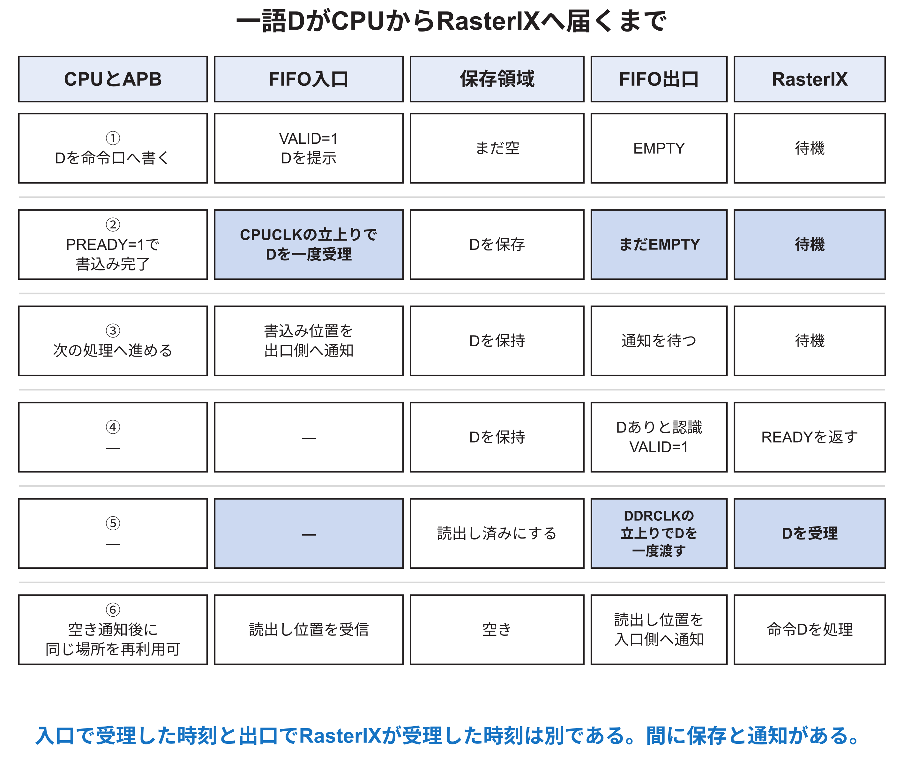

図6.6の②で、CPUCLKの立ち上がりにFIFO入口のVALIDとREADYがともに1になる。この一回でDが保存され、PREADYも1なのでCPUのAPB書込みが完了する。ここではまだRasterIXはDを受け取っていない。入口側が書込み位置を進め、その進み具合が出口側へ安全に伝わった後、出口側はDがあると認識する。

④ではFIFO出口がDとVALIDを提示する。⑤でRasterIXのREADYも1なら、DDRCLKの立ち上がりにRasterIXがDを一度受け取る。次に、出口側が読出し位置を進め、その情報が入口側へ戻る。入口側は、その場所が再利用できることを後から知る。このように、CPU側で書込みが完了する時刻と、RasterIX側が同じ語を受け取る時刻は一致しなくてよい。

<a id="h0248"></a>
#### RasterIXが受け取れる時点をREADYで確認する

RasterIXは、受け取った命令の種類と内部の処理状態に応じて、次の語を受け取れるかを決める。公式のCommandParser.vでは、リセット直後にREADYを0とし、フレームバッファ処理、ラスタライズ、テクスチャ処理などが所定の状態になったときに1とする。また、命令の種類によってWAIT_FOR_IDLEへ移る際にもREADYを0とする。[RasterIX](#ref_RasterIX)

そのため、CPUの周波数が描画回路より低くても、ある一語を書こうとする時点で受け取れるとは限らない。周波数はクロックの繰り返し回数であり、ある命令を処理して次の語を受け取れるまでの時間とは異なる。

例えば説明用に、100 MHzで動く回路が、次の語を受け取るまで内部で1,000周期を使う場面を考える。10 ns×1,000で10 μsになり、その間に20 MHz側の50 nsは200周期来る。これはRasterIXの実測周期数ではないが、受け側の一周期が短いだけでは、送り手の次の書き込みまでに必ず受け取り準備ができるとは言えないことを示す。実機で何周期待ったかは、[12.7節](#s_12_7)のAPB待ちの測定で判断する。

そこで送り手は、周波数の大小から受け取り可否を推測する代わりに、READYを確認して語を渡す。

本構成では、RasterIXが受け取るまでFIFOが出口の語を保持する。さらにFIFOが満杯になれば、CPU側もAPB書き込みを待つ。これにより、CPU側とRasterIX側のそれぞれで、受け取れる時点に一語ずつ転送する。

<a id="h0254"></a>
#### 待つ間は同じ語を保ち、一回だけ数える

送りたい語をDと書く。有効が1、受取可が0の間はDを保つ。受取可も1になった立ち上がりでDが一度渡り、その後に次の語を出せる。

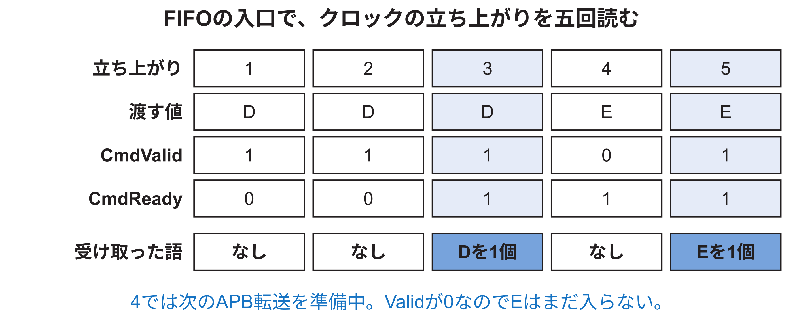

図6.7は、一語を何周期も保持しても、一回しか受け取らない場合を示す。立ち上がり1と2はVALID=1でもREADY=0なので受理はない。立ち上がり3で両方が1となり、Dを一個だけ受け取る。立ち上がり4では次のAPB転送を準備しておりVALID=0なので、READY=1でも語は増えない。信号が1だった期間の長さではなく、VALIDとREADYが同時に1だった立ち上がりを数える。

<a id="s_6_4"></a>
### 6.4 なぜ非同期FIFOなのか

命令FIFOの入口はCPU側のCPUCLK、出口はRasterIX側のDDRCLKで動く。DDRCLKという名前だが、本構成ではDDR3との接続だけでなくRasterIXもこのクロックを使う。CPUCLKは20 MHzなので50 nsごと、DDRCLKは100 MHzなので10 nsごとに立ち上がる。

CPU側は50 nsごとの立ち上がりで「一語を渡した」と数え、RasterIX側は10 nsごとの立ち上がりで「一語を受け取った」と数える。この二つを対応させる必要がある。本接続では、どちらの立ち上がりが相手のどの立ち上がりに重なるかという位置関係を使わず、各側で一語を受け渡す方法を選んだ。

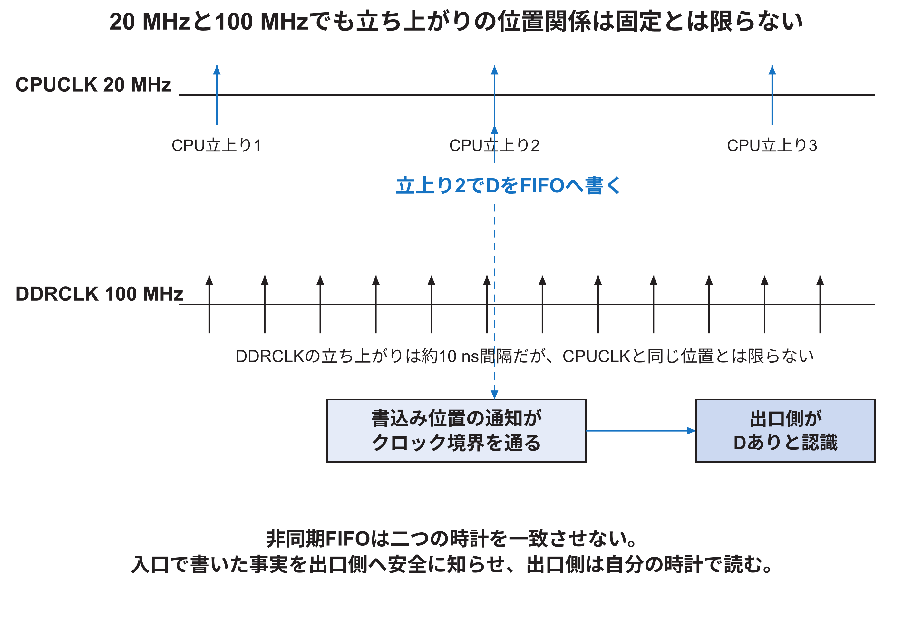

図6.8では、CPUCLKの一つの立ち上がりでDを書いた後、書込み済みであることがクロック境界を通ってDDRCLK側へ伝わる。DDRCLK側は、その通知を自分の立ち上がりで受け取った後にDを読める。非同期FIFOは二つの時計を同じ時刻へ合わせる装置ではない。各側が自分の時計で動いたまま、書込み済みと読出し済みの情報を相手側へ安全に知らせる。

<a id="h0263"></a>
#### 配線で直結するだけでは受渡し回数を決められない

CPU側がVALIDを50 nsだけ1に保つと、その間にDDRCLKの立ち上がりはおよそ五回来る。出口側がVALIDのレベルだけを見て毎回新しい語と数えれば、同じDを複数回受け取る。反対向きにDDRCLK側が10 nsだけ完了通知を出した場合、CPUCLK側の立ち上がりと立ち上がりの間に通知が始まり、終わる可能性がある。するとCPU側は通知を一度も観測できない。

両クロックは同じ基準クロックに由来するが、本接続は両側の立ち上がりの位置関係を利用せず、非同期の境界として扱う。位置関係を利用する接続では、クロック生成回路、配線遅延、リセット解除、時間制約を含めて受け渡し条件を保証する必要がある。周波数の比が整数であることだけでは、その条件は決まらない。[E6](#ref_E6)

<a id="h0266"></a>
#### 同期FIFOと非同期FIFOの違い

同期FIFOは、入口の書込みと出口の読出しを一つのクロックで管理する。入口と出口の回路も、その同じ立ち上がりを基準にVALIDとREADYを判定する。一つのクロック領域内なら、この方式でよい。

非同期FIFOは、入口の書込みを入口側のクロックで管理し、出口の読出しを出口側のクロックで管理する。本構成では、CPU側から受け取る一回はCPUCLKで決め、RasterIXへ渡す一回はDDRCLKで決める。


図6.9の左右で、語を保存するというFIFOの基本は同じである。違うのは、入口と出口の状態をどの時計で更新するかである。非同期FIFOでは、入口側だけで分かる書込み位置を出口側へ、出口側だけで分かる読出し位置を入口側へ伝える必要がある。

<a id="h0271"></a>
#### データ本体を保存し、進んだ位置を相手へ知らせる

一般的な非同期FIFOでは、データ本体を二つの側から使える記憶領域に置く。入口側は次に書く位置、出口側は次に読む位置をそれぞれ覚える。入口側が一語を書き終えると書込み位置を進め、その進み具合を出口側へ同期して知らせる。出口側は、書込み位置が先へ進んだことを知ると、新しく保存された語があると判断し、自分が覚えている読出し位置から読む。

反対向きには、出口側が読出し位置を入口側へ知らせる。入口側は、その通知を受けてから、読出し済みの場所を新しい語の保存に再利用する。

通知には時間がかかる。例えば入口へAを保存しても、その通知がまだ届かなければ、出口側は「まだ空」と判断して待つ。反対に、出口からAを取り出して空きができても、その通知がまだ届かなければ、入口側はその場所へ次の語を書かずに待つ。どちらも、相手の進み具合を確認できるまで操作を保留する。これにより、まだ保存されていない値を読んだり、まだ取り出していない値を上書きしたりすることを防ぐ。


図6.10は一般的な非同期FIFOの管理方法を示す模式図であり、採用したAMD IPの内部配線図ではない。データ本体は記憶領域に置き、書込み済み・読出し済みの位置を相手側へ伝える。この役割分担によって、一語を構成する複数のbitをまとまりとして扱う。

<a id="h0277"></a>
#### 値が変わる瞬間に取り込む問題もある

レジスタの入力は、クロック立ち上がりの直前と直後に一定時間安定している必要がある。別のクロック側で値が変わる瞬間と立ち上がりが重なると、0と1のどちらとして安定するかがすぐには決まらない場合がある。これをメタステーブル状態という。クロックをまたぐ管理情報は同期用レジスタを通し、この状態が後続回路へ広がる確率を十分小さくする。[AMD085](#ref_AMD085)

32本のデータ線をそれぞれ別々に同期するだけでも、一語を守れるとは限らない。二ビットで考えると、01から10へ変わる際、右のビットだけが先に新しい0として見えれば、受け手には途中の00が現れる。00は送りたかった旧値01でも新値10でもない。

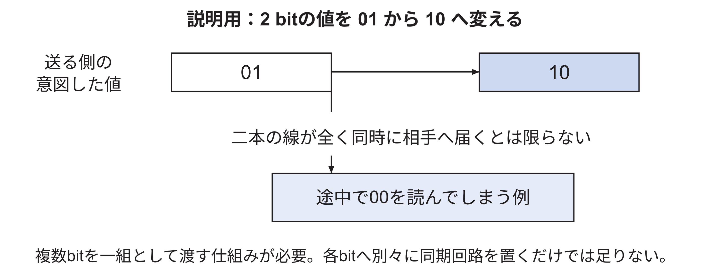

非同期FIFOは、データ本体を記憶領域へ保存し、その書込みが終わった位置を相手へ知らせることにより、一語を構成する各bitを別々の更新として扱わずに渡す。書込み位置や読出し位置を安全に知らせる一般的な方法は、[技術付録44.9節](appendix/04-rasterix/command-clock-boundary.md#s_i_9)〜44.11でさらに説明する。

<a id="h0282"></a>
#### 命令FIFOと応答FIFOの実装

本研究は非同期FIFOの内部を自作せず、AMDのAXI4-Stream Data FIFOを使った。axiscdc.tclのIS_ACLK_ASYNC=1が、入口と出口で別々のクロックを使う指定である。TDATA_NUM_BYTES=4なので一語は32 bit、FIFO_DEPTH=512なので512語、HAS_TLAST=1なので終端情報も運ぶ。

| FIFOの実体 | 語が進む向き | 入口クロック | 出口クロック | 用途 |
|---|---|---|---|---|
| commandfifo | CPUからRasterIX | CPUCLK | DDRCLK | 命令語とTLASTを送る |
| responsefifo | RasterIXからCPU | DDRCLK | CPUCLK | RasterIXの応答語をCPUへ戻す |

rasterix.svでは、commandfifoの入口にCmdValid、CmdReady、CmdLast、CmdDataを接続し、出口を公式RasterIXの命令端子へ接続する。responsefifoは反対向きに接続し、RasterIXから返った語をCPUが読むまで保持する。二つのFIFOは同じIP設定を使うが、データの方向と用途が異なる。

<a id="h0286"></a>
#### 非同期FIFO以外の接続も可能である

異なるクロック間で一語を渡すには、その語をレジスタへ保持し、要求と受取確認を両側へ伝える方法もある。確認が戻るまでCPUの書き込みを待たせれば、複数語を保存するFIFOを置かない接続も作れる。

本構成では、データを順番に保存することと、別々のクロックで受け渡すことを一つの既存IPで扱える非同期FIFOを使う。受け取り待ちに対応するためにFIFOしか使えない、という説明ではない。また、周波数が異なれば必ず非同期FIFOが必要になるわけでもない。採用した構成を確かめる試験は[第11章](#ch_11)、別方式との比較は[技術付録第71章](appendix/05-integration/fifo-comparison.md#ch_29)に示す。

<a id="h0289"></a>
#### 受け渡しに用いる各機能の役割

| 機能 | 受け持つこと | 本構成での実装 |
|---|---|---|
| APBの待ち | 現在の書き込みを未完了として、番地と値を保持させる | FIFOが受け取れない間はPREADYを0にする |
| FIFOの一時保存 | 語を順序どおりに預かり、後から送り出す | 命令用と応答用に各512語を確保する |
| クロック間の受け渡し | 各側のクロックで数える転送を、一語ずつ対応付ける | 非同期FIFOの書込み・読出し管理を使う |
| AXI4-Streamの転送規則 | 有効な語を受け取り可能な立ち上がりで一度渡す | FIFOの各側でVALIDとREADYを判定する |

APBの待ちとFIFOへの保存を組み合わせると、保存できる間はCPU側を進め、保存できなくなった時点で待たせられる。非同期FIFOはこの保存に加え、入口と出口が別々のクロックで動くための管理を行う。512語は本構成の設定値であり、他の容量に対する性能上の優位を本章の説明から導くものではない。

<a id="s_6_5"></a>
### 6.5 どの場所へ何を書けばよいか

次の表の番地は、先頭0x10080000からの差である。例えば0x0cは、実アドレスでは0x1008000cになる。アクセスは32 bit単位にそろえる。64 bitを一度に書くという使い方を前提にしていない。

| 差 | 操作 | 意味 |
|---|---|---|
| 0x00 | 書く | 送るデータ列の途中の32 bitデータを送る |
| 0x04 | 書く | 送るデータ列の最後の32 bitデータを送る |
| 0x08 | 読む | 送信可、応答あり、処理中などの状態を読む |
| 0x0c | 読む | 識別値0x52495831を読む |
| 0x10 | 読む | 表示切り替え完了の累積回数を読む |
| 0x14 | 読む | 完了した表示先アドレスを読む |
| 0x18 | 読む | RasterIXから返った32 bitデータを取り出す |

最後だけ0x04へ書くのは、値そのものとは別に「今回送るデータはここで終わる」と知らせるためである。ここでのデータ列は、接続用プログラムのwriteDataへ渡された範囲を指す。一画面分の描画がすべて完了したという通知ではない。FPGA側は番地の違いをTLASTという信号へ変換する。命令の値の一部を勝手に書き換えて終端にしているわけではない。

このような操作口も装置のレジスタと呼ぶが、すべてが「書いた値をそのまま保存して、後で読める場所」ではない。例えば0x00への書き込みはFIFOへ一語を渡す操作であり、0x18からの読み出しは応答を一語取り出す操作である。0x10のように、回路が保持している回数を読む場所もある。番地ごとに意味を確認する必要がある。

<a id="s_6_6"></a>
### 6.6 Linuxのプログラムから書き込む

examples/rasterix/WallyBusConnector.hppが、RasterIXのライブラリとこの接続回路の間をつなぐ。起動時に/dev/memを開き、0x10080000の範囲をプログラムから操作できるように対応付ける。識別値を確認し、想定した回路がある場合だけ処理を続ける。

ライブラリがCPUのメモリに用意した32 bitデータの配列から、指定された範囲を順に読み出す。そして最後以外の要素を通常の命令口へ、最後の要素を終端用の命令口へ書く。この書き込みに対して、回路側のFIFOが満杯なら[6.2〜6.3節](#s_6_2)で説明した待ちが働く。アプリケーションが独自に満杯のたびに命令を捨てて再送する設計ではない。

レジスタを操作するコードにはvolatileとfenceを使う。前者がコンパイラの省略を、後者がCPUのアクセス順序を扱う理由は[技術付録第31章](appendix/03-linux/mmio-ordering.md#ch_24)で、転送と描画の完了の違いは[6.7節](#s_6_7)で説明する。

<a id="h0301"></a>
#### regsの添字を実際の操作番地へ戻す

ソースのregsは、`volatile uint32_t*`という型で扱う。uint32_t一個は32 bit、すなわち4 byteである。この型の一つ隣へ進む操作は、番地を1ではなく4だけ進める。したがって、regs[0]は先頭、regs[1]は先頭+4、regs[3]は先頭+12である。

| C++での表記 | 先頭からの差 | 回路から見た操作番地 | 使い方 |
|---|---:|---|---|
| regs[0] | 0 byte | 0x10080000 | 途中の命令語を書く |
| regs[1] | 4 byte | 0x10080004 | 最後の命令語を書く |
| regs[3] | 12 byte | 0x1008000c | 識別値を読む |
| regs[4] | 16 byte | 0x10080010 | 完了回数を読む |
| regs[6] | 24 byte | 0x10080018 | 応答の一語を読む |

Linuxのプログラムからは、通常、そのまま物理番地を指すポインタを作るだけでは装置を操作できない。mmapは、装置の物理番地の範囲を、そのプログラムが使うアドレスへ対応付けるために使う。返されたポインタの数値と0x10080000が同じとは限らないが、対応付けを通った先の装置は同じである。

ここでは回路の操作範囲が256 byteで、mmapの指定は4,096 byteになっている。前者は装置が解釈する番地の範囲、後者はOSへ要求するマッピングの長さである。マッピングを4,096 byteにしたことで、残りにも新しい装置レジスタが生まれるわけではない。表で決めた操作場所だけを使う。

図6.12は、regs[1]の書き込み先を追う例である。まず上段で、mmapが返した先頭Vと、物理アドレス0x10080000との対応を見る。次に下段で、どちらの住所にも4 byteを加える。

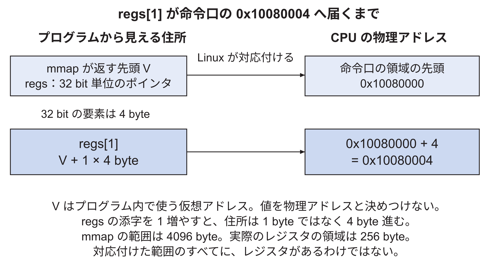

ここで添字の1は、先頭から1 byteの意味ではない。regsは32 bitを一要素とするため、要素一個分の4 byteだけ進む。この計算により、regs[1]への書き込みがCMD_LASTの物理アドレス0x10080004に対応する。

<a id="s_6_7"></a>
### 6.7 書き込みと描画と表示の完了を区別する

`writeData`が命令列を送り終えたとき、各語は受信側のFIFOへ渡っている。しかし、RasterIXがまだFIFOの語を実行していない場合がある。一語が渡っただけでは後続の語が足りず、図形を描き始められない場合もある。APBのPREADYはその転送の返事であり、一画面の完成を表すFrameDoneではない。

`blockUntilTransferIsComplete`も、この実装ではMMIO転送の区切りを扱う関数である。volatileやfenceも、画素を何個処理し終えたかを数える機能ではない。命令の準備、転送、画素の保存、表示先の切り替えは、それぞれ完了条件を持つ。

特に古い表示領域へ次の画像を描くには、表示側がその領域を使い終えたことを確かめる必要がある。本実装では`frameCount`と`waitForFrame`を使い、切り替え完了回数が前の値から変わるまで待つ。[第9章](#ch_9)では、その回数を増やしてよい条件を、メモリの要求と返事から説明する。

図6.13は、完了という言葉の対象を三つに分けたものである。左の箱で何が終わったのかを読み、右の箱でそれを確かめる条件を見る。三行を等しい長さの時間として読まない。

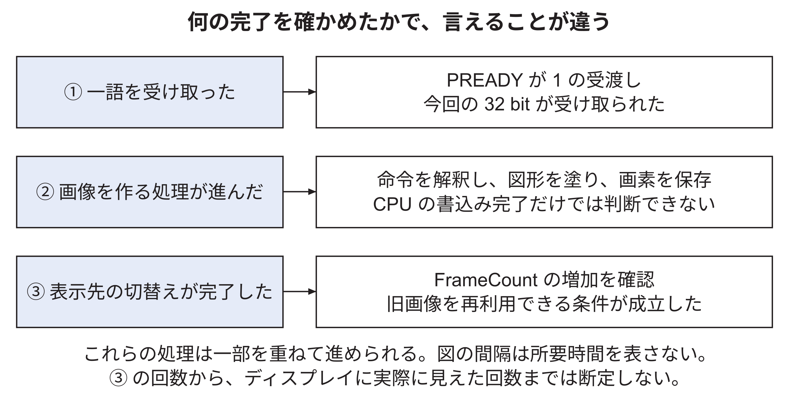

一語を受け取る条件を満たしても、画像全体ができたとは限らない。また、FrameCountの増加は、本実装が定めた表示切り替えの完了条件を確認した結果である。実際の映像を確かめる試験は、それとは別に必要になる。

<a id="ch_7"></a>
## 第7章 公式RasterIXを組み込む

[第6章](#ch_6)で示した命令の経路に加え、RasterIXが画像を保存するメモリ接続と、ソフトウェアの設定を用意する。本章では、ゲーム機の標準構成で利用する公式設計と、本研究でその外側へ設ける接続部分を対応付ける。

<a id="s_7_1"></a>
### 7.1 サブモジュールで版を固定する

RasterIXはaddins/rasterixにGitサブモジュールとして置く。サブモジュールは、別のリポジトリを特定の版で参照する仕組みである。ここでは公式のToNi3141/RasterIXを参照し、その内部に本研究用の変更を加えない。親のリポジトリには、どの版を使うかという記録を残す。

参照する版は[4.2節](#s_4_2)の基準版と動作確認版で区別する。サブモジュールに記録したコミットを取得すれば、公式リポジトリの開発が進んでも同じ入力ソースを用意できる。設定や結果は、その固定した版に対応付ける。

<a id="s_7_2"></a>
### 7.2 描画途中の保存場所を持つ構成を使う

本研究では公式RasterIXのRasterIX_IFという構成を使う。これは、図形を塗る途中の画素を、FPGA内のメモリに保存しながら処理する構成である。完成画像を表示のために置くDDR3とは、保存場所の役割が異なる。

内部の作業領域には画面全体が入らないため、公式ライブラリと回路が画面を横長の帯に分けて処理し、その結果をDDR3上の一枚の画像へ保存する。ゲーム側はボールやブロックの位置を指定し、帯ごとの命令を作る処理には既存のライブラリを使う。画面を分ける計算や配列の対応は[技術付録第43章](appendix/04-rasterix/configuration-calculations.md#ch_h)に示す。

IFは本研究で動作を確認した構成である。別の構成であるEFとの優劣を評価したものではない。本文では、図形を渡す入口と、出来上がった画像の保存先を追う。

<a id="s_7_3"></a>
### 7.3 回路とソフトウェアの設定を合わせる

回路とソフトウェアは、同じ画面やメモリを別々の設定ファイルで扱う。例えばソフトウェアが横幅800画素として画像を作り、表示回路が横幅640画素として読むと、次の行が始まる場所が一致しない。そこで両側で同じ値を使う。

| 合わせる内容 | 本構成の設定 | 合わせる相手 |
|---|---|---|
| 画像の大きさ | 横640画素、縦480画素 | ゲーム、描画ライブラリ、表示回路 |
| 一画素の色の保存方法 | RGB565、2 byte | 描画回路、表示回路、画像確認プログラム |
| 画像を置く領域 | DDR3の末尾32 MiB内 | Linuxの予約設定、描画・表示のアドレス |
| 描画途中の作業領域 | 65,536画素分 | RasterIXの回路設定、ライブラリの設定 |

RGB565の意味は[9.1節](#s_9_1)、Linuxへ予約を知らせる方法は[9.8節](#s_9_8)で説明する。画像データを分けて転送する単位も両側でそろえる。具体的なパラメータ名と設定ファイルは技術付録第42・43章に対応付けた。

この作業で変更しているのは、公開回路に用意された設定と、その回路を使う側である。RasterIX内部の描画計算を作り直す作業ではない。

<a id="s_7_4"></a>
### 7.4 Wallyのバスを命令口へつなぐ

[第6章](#ch_6)の命令口を使うには、CPUが指定した番地をその回路へ届ける必要がある。Wally側に外部I/Oの番地範囲を設定し、その範囲への要求をAPB側へ通す。要求と値だけでなく、「受け取った」「まだ待ってほしい」という返事もCPU側へ戻す。

例えばCPUが命令口へ一語を書いたとする。番地を判定する部分が行き先を選び、接続回路が値を受け、FIFOへ保存できたときに書き込み完了を返す。保存できなければ、CPU側は同じ語を保って待つ。番地の設定、信号の配線、完了の返送がそろって、一回の書き込みになる。

本研究では、既存のWallyで使われる外部メモリなどの設定方法に合わせ、外部I/Oの有効・無効、先頭番地、範囲を指定する項目を追加した。各ファイルの変更は[技術付録第42章](appendix/04-rasterix/rasterix-integration.md#ch_g)に示す。

<a id="s_7_5"></a>
### 7.5 CPUと描画と表示がDDR3を使う

CPUはプログラムやデータを、描画回路は作成する画像を、表示回路は画面へ送る画像をDDR3に読み書きする。三つの回路からの要求を、既存IPのSmartConnectでDDR3制御回路へ取り次ぐ。

三つの回路では、扱うデータの幅やクロックが異なる。その違いを接続IPで合わせ、返ってきたデータが要求を出した回路へ戻るようにする。描画回路側には、まとまったメモリ転送を一時保存する既存のAXI Data FIFOも置いた。[第6章](#ch_6)の命令FIFOはCPUからの描画命令を預かる回路であり、ここで扱う画像メモリの転送とは場所が異なる。

[5.3節](#s_5_3)で説明したように、要求を取り次ぐ回路だけでは、Linuxと描画回路が同じ番地を上書きする問題は防げない。画像の保存先も決め、Linuxが通常のデータ用に割り当てない範囲と一致させる。具体的なポート、信号幅、転送を一時保存する理由は[技術付録第42章](appendix/04-rasterix/rasterix-integration.md#ch_g)に示す。

<a id="s_7_6"></a>
### 7.6 回路とソフトウェアを生成対象に加える

接続する回路のファイルを用意した後は、Vivadoの生成手順にもそのファイルと使用IPを加える。ゲーム用には、公式ライブラリとWally側の接続処理を組み合わせて実行ファイルを作る。FPGAへ設定するファイルと、CPUが実行するファイルは[第4章](#ch_4)で示した別々の経路で生成する。

このように、バスの接続だけでなく、回路の生成、画像メモリの予約、ソフトウェアの設定までそろえることで、同じ構成を作り直せる。変更ファイルの一覧と生成手順は技術付録第60・62章に示す。

<a id="s_7_7"></a>
### 7.7 CPUの命令ポートとGPUのメモリポートを混同しない

RasterIXへ入る命令の経路と、RasterIXが画像を保存する経路は別である。命令の経路ではCPUが送り手であり、APB、命令FIFO、RasterIXの順に進む。画像メモリの経路ではRasterIX自身が要求を出し、共有接続回路を通じてDDR3を読み書きする。表示回路も、自分でDDR3へ画像の読み出しを要求する。

例えばCPUが「長方形を塗る」という指定を送った後、長方形の中の各画素を書き込む要求を出すのは描画回路である。CPUが各画素の書き込みを一回ずつ代行しているわけではない。

この違いは、接続先の番地でも確認できる。CPUが描画命令を送るときの行き先は、[6.1節](#s_6_1)の命令口0x10080000などである。描画回路が完成した画素を保存する行き先は、[9.3節](#s_9_3)の画像用メモリ0x9fe00000などである。命令口の番地は「何をしてほしいかを伝える入口」、画像の番地は「結果の色を置く場所」を選ぶ。同じ描画に関係していても、別の書き込みである。図7.1は、命令と画像を別の矢印で示す。[Console26](#ref_Console26)

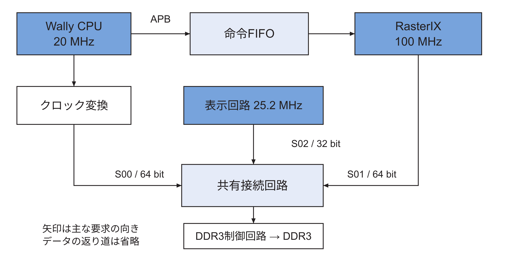

CPUが図形を依頼する接続と、描画回路が画素を保存する接続を分けておくと、命令は届くが画像は保存されない場合にも、調べる経路を切り分けられる。

<a id="s_7_8"></a>
### 7.8 元のRasterIXを書き換えずに組み込む境界

公式RasterIXの外側に、回路側では`rasterix_apb.sv`によるAPBと命令ストリームの変換、および`rasterixdisplay.sv`による画面切り替えの変換を置く。ソフトウェア側は`WallyBusConnector`が公式の`IBusConnector`を実装する。[RasterIX](#ref_RasterIX)[Console26](#ref_Console26)

IBusConnectorは、公式ライブラリへ「送る」「読む」「送信用の領域を借りる」という操作を提供し、転送方法を実装側へ任せる。本研究ではWallyのAPBへ32 bitずつ書くため、公式内部へWally専用の番地を埋め込まずに済む。`RasterIX_IF #(...)`による設定も公式の入口である。公式版を更新するときは、接続の約束や既定値の変更を確認する。

図7.2は、描画命令がソフトウェアから回路へ渡る経路に絞った図である。上段では左から右へ進み、MMIOの書き込みを経て下段へ入り、下段では左側のRasterIX_IFへ命令が届く。

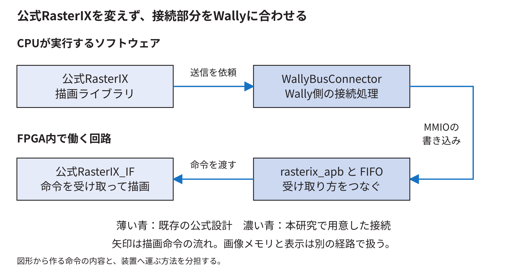

公式ライブラリが要求する接続の仕事をWallyBusConnectorが引き受け、Wallyのバス要求をrasterix_apbとFIFOが描画回路の受け取れる形へ渡す。公式部分と接続部分を分けることで、何を本研究で設計したかを確認できる。この図には、応答、画像メモリ、表示の全配線を詰め込んでいない。それらは[第6章](#ch_6)および[第9章](#ch_9)の図と対応させる。

例えばライブラリから64 byteの送信を頼まれた場合、接続クラスは32 bitの16語に分け、順番と終端の印を保って命令口へ書く。64 byteは役割を示す説明値である。公式側が作る命令の内容と、接続側が担う運び方を分けている。受け取り順や転送完了の意味は、公式側が必要とする約束に合わせる。

<a id="ch_8"></a>
## 第8章 既存の描画機能をゲームから使う

第6・7章では、CPUと描画回路の接続を説明した。本章では、その接続をゲームプログラムから使う流れを説明する。ゲームが図形を指定し、既存ライブラリが命令を作り、RasterIXが画像を作るという分担を追う。

<a id="s_8_1"></a>
### 8.1 図形の位置と色をライブラリへ渡す

本ゲームは、RasterIXに付属するOpenGL互換の描画ライブラリを使う。ライブラリとは、プログラムから呼び出して使える処理をまとめたものである。ゲーム側は、図形の位置や色を指定する関数を呼ぶ。この呼び出し方を定めた入口をAPIと呼ぶ。

例えば横位置100、縦位置200に、幅20、高さ10の赤い四角形を置くとする。ゲーム側が用意するのは、この位置、大きさ、色である。横位置だけを103へ変えれば、次は3画素右へずれた四角形を描く指定になる。画面のすべての点の色をゲーム側で列挙する必要はない。

実際には四角形の角の位置と色を関数へ渡す。関数名や内部の座標計算は公式ライブラリの仕様に従う。本研究ではこの描画機能を利用し、その出力する命令をWallyから回路へ渡せるようにした。個々の関数、頂点、画素の判定の詳細は技術付録第37〜39章に示す。

<a id="s_8_2"></a>
### 8.2 関数の呼び出しを描画命令へつなぐ

図形を指定する関数は、WallyのCPU上で実行される。その関数を呼んだ瞬間に、FPGA内の描画回路へC++の文章が届くわけではない。ライブラリが位置や色を処理し、RasterIXの回路が読める数値の列を用意する。これが描画命令である。

作った命令は、CPUが使うメモリ上のコマンドバッファへ保存する。コマンドバッファとは、転送するまで命令を置いておく場所である。本研究で用意したWallyBusConnectorが、その列を32 bitずつ取り出して命令口へ書き、[第6章](#ch_6)の接続回路とFIFOを通してRasterIXへ渡す。

ここで二つの保存場所を区別する。コマンドバッファはCPUのプログラムが使うDDR3上の領域、FIFOはFPGA内で受け渡しを行う途中の回路である。どちらにも命令が入るが、場所と扱う側が違う。ゲームの指定から公式ライブラリ、本研究の接続処理、RasterIXへ進む関係は図7.2のとおりである。

RasterIXは受け取った命令に従って画素の色を作る。したがって、位置を指定する関数の終了、命令口への書き込み完了、画像の完成は別々の出来事である。画像が表示されるまでの完了の確認は、[第9章](#ch_9)につながる。

<a id="s_8_3"></a>
### 8.3 ブロックと文字を同じ画面に描く

ブロック、パドル、ボールは四角形として描く。得点などの文字には、小さな文字の模様を並べた画像を使う。図形へ貼る模様の画像をテクスチャと呼ぶ。必要な文字の模様を選び、画面の指定した位置へ描く機能も、既存ライブラリとRasterIXを利用する。

例えば得点が100から110へ変わった場合、ゲーム側は新しい数字を描く指定を用意する。ライブラリと描画回路は、その指定から文字の色の点を作る。数字の意味や得点を増やす規則を判断するのはゲームプログラムであり、描画回路ではない。

これらを重ねると、背景、壁、ブロック、ボール、得点のある一枚のゲーム画面になる。文字画像の作り方や模様を選ぶ座標は[技術付録第52章](appendix/04-rasterix/textures-pixel-pipeline.md#ch_t)に示す。

<a id="s_8_4"></a>
### 8.4 動作確認に用いたゲームの条件

[第12章](#ch_12)で動作を確認したのは、描画処理を軽くする実装を含む完成版のブロック崩しである。「OpenGL互換の関数を使った」という事実だけで、このゲームの処理時間が決まるわけではない。指定する図形や呼び出し方も実行内容に含まれる。

本稿では、その完成版を試験対象として、接続した回路で画像が作られ、映像として動作することを示す。描画方法を変える前後の速度差を本稿の成果とはしない。再現時に同じ実装を使えるよう、ソースと起動条件を残した。描画処理の工夫と比較結果は技術付録第33・66章で説明する。

<a id="ch_9"></a>
## 第9章 画像メモリと画面の切り替え

前章までで、図形の指定から画素を作るところまで進んだ。本章では、出来た色をどの番地へ置き、表示回路がいつからその場所を読むかを説明する。最初に一画素の保存を確認し、その後で一枚の画像、二枚の切り替えへ広げる。画面が崩れない条件は、描く色だけでなく、古い保存場所をいつ再利用するかにも関係する。

<a id="s_9_1"></a>
### 9.1 一画素の色を数値として保存する

画素は、画像を構成する一つ一つの色の点である。本構成では一画素の色を2 byteの数値として保存する。赤・緑・青の強さを一つの数値へまとめるRGB565という形式を、描画側と表示側で共通に使う。

横640、縦480の画像には307,200画素がある。一枚分の保存場所は640×480×2=614,400 byte、二枚分は1,228,800 byteになる。この大きさを確保しておくことで、画素を書き込む場所が他のデータと重ならないようにできる。

RGB565のビットの割り当てや数値例は[技術付録第40章](appendix/04-rasterix/framebuffer-display.md#ch_g_framebuffer_display)に示す。ここでは、位置を表す数値と、そこへ保存する色の数値が別であることに注目する。

<a id="s_9_2"></a>
### 9.2 画像の位置をメモリの場所へ対応させる

メモリには、画面のような物理的な縦横の並びはない。画素を一列のデータとして、左から右、次の行の左から右という順番で保存する。表示回路も、同じ順番で読み出す。

説明用に横4画素、縦3画素へ小さくした画像を考える。各画素が2 byteなら、右隣の画素は2 byte先にあり、次の行の左端は4×2=8 byte先にある。図9.1の数字は色ではなく、画像の先頭から何byte先かを示している。

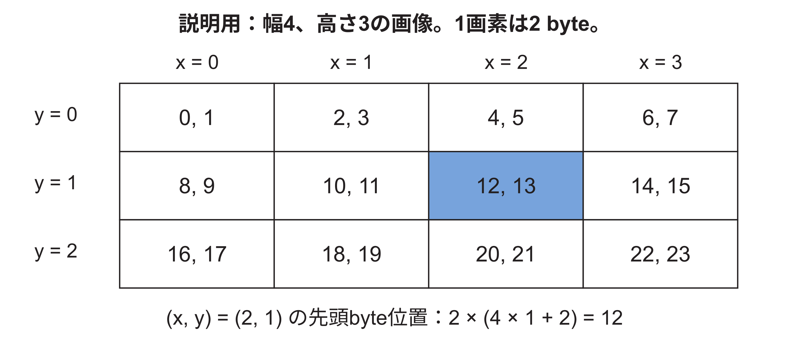

本構成では横幅が640画素なので、一行は1,280 byteになる。描画回路と表示回路で、画像の先頭、横幅、一画素の大きさを合わせると、描いた場所と読んだ場所が対応する。具体的なアドレスの計算は[技術付録第40章](appendix/04-rasterix/framebuffer-display.md#ch_g_framebuffer_display)に示す。

<a id="s_9_3"></a>
### 9.3 二枚の画像を使う理由

表示回路は、一枚の画像を左上から順に読む。この途中で同じ画像を描き換え始めると、すでに読んだ上側は古い画像、これから読む下側は新しい画像になることがある。例えばボールが上側から下側へ移った途中の画像が混ざると、その一枚だけボールが二つ見えたり、欠けたりする可能性がある。そこで、表示回路が読む画像と、描画回路が作る次の画像を分ける。

表示用の保存場所をAとBの二つ用意する。Aを表示回路が読んでいる間、描画回路はBへ次の画像を作る。Aの画素を変えないので、その間の表示は保てる。Bができたら、表示回路へ「次はBから読んでほしい」と知らせる。切り替えが安全な段階まで進めば、今度はAを次の描画先へ使える。

表示に使っている側をフロントバッファ、次の画像を作る側をバックバッファと呼ぶ。AとBという二つの物理的な保存場所に対して、役割の名前が入れ替わる。「Aの全画素をBへコピーする」という意味での切り替えではない。表示回路が読む先頭番地を切り替える。

本構成の二枚の保存先は0x9fe00000と0x9fc00000である。どちらも予約した画像用領域に置く。ソフトウェアの設定では、この領域の先頭0x9e000000からの差を使う。例えば0x01e00000という差を足せば、0x9e000000+0x01e00000=0x9fe00000となる。

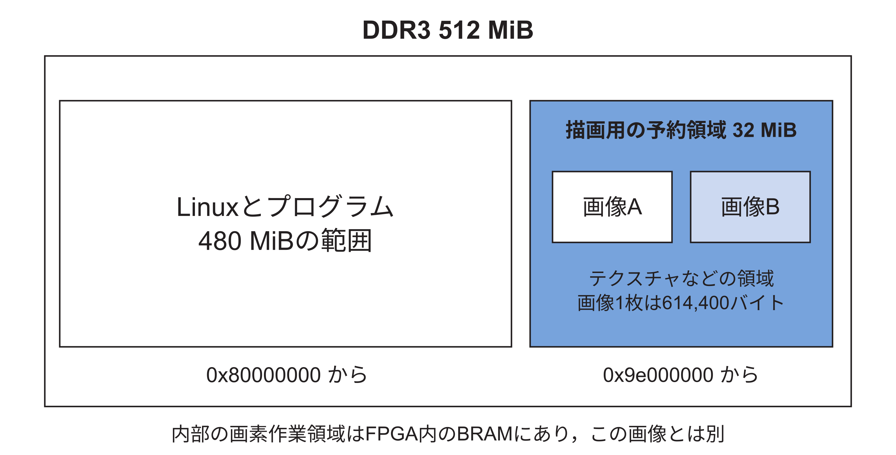

<a id="h0389"></a>
#### フロントとバックは役割であり名前札を貼り替える

最初にAを表示しながらBへ次の画像を描いたとする。その間、Aはフロント、Bはバックである。切り替えが完了してBを表示し始めると、Bがフロントになり、次に描くために使えるAがバックになる。AとBの物理番地が互いに移動するわけではない。

| 時点 | Aに対して行うこと | Bに対して行うこと |
|---|---|---|
| 次の画像を準備中 | 表示回路が読む | 描画回路が書く |
| 切り替えを依頼した直後 | 古い読み出しが残る可能性がある | 新しい表示先として依頼する |
| 切り替え完了を確認した後 | 次の描画先として再利用できる | 表示回路が読む |

二行目を省いて「アドレスを書いたからすぐAへ描く」とすると、Aの古い読み出しに新しい色が混ざる可能性がある。[9.5節](#s_9_5)の完了待ちは、この境目を回路の応答で決めるためにある。

<a id="s_9_4"></a>
### 9.4 内部作業領域は第三の役割を持つ

ここまでのフロントとバックは、DDR3に保存する二枚の表示用画像である。一方、RasterIX_IFが図形を塗る途中で使うBRAMの領域は、別にある。この領域には一帯分の画素を扱わせ、結果をDDR3へ保存する。したがって内部作業領域は、二枚の画像のどちらか一方の別名ではない。

保存場所を、その中身で区別する。CPU側のコマンドバッファには、描くための命令が入る。BRAMの作業領域には、いま処理している帯の画素が入る。DDR3の画像A・Bには、表示用の一枚の画像を構成する画素が入る。表示回路が読み続けるのは、このA・Bのうち表示先に選ばれた側である。

起動時には、内部作業領域と表示用の二枚を初期化する。ゲームの変数を初期値へ戻すことと、回路が使う画像を消すことは別の処理である。呼び出し順と起動し直した場合の確認は技術付録第33・40章に示す。

図9.3は、命令、途中の画素、表示用画素の三つの保存場所を並べた図である。それぞれの中身と、読み書きする回路を対応させて読む。

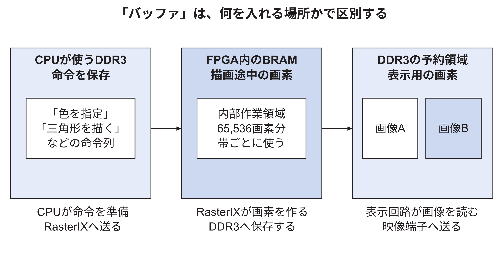

左に入るのは「どの図形を描くか」という命令、中央と右に入るのは色の点である画素である。中央はFPGA内のBRAM、左右は基板上のDDR3を使う。箱の大きさは容量の比ではない。右側の白いAと淡い青のBは、別々の番地に置く二枚の画像を表す。命令用のバッファ、内部作業領域、フロント・バックの画像を同じものと考えないよう、入る内容と置き場所を対応させて読む。

<a id="s_9_5"></a>
### 9.5 切り替えの依頼と完了は違う

「次はBを表示してほしい」と伝えることと、「Aをもう使っていない」と分かることは別である。例えば表示回路がAの読出しをメモリへ依頼済みで、その返事を待っている場合を考える。この時点でAを次の描画に使うと、まだ必要なAの画素を変更してしまう可能性がある。そのため完了の返事を出す条件まで決める。

本実装では、切り替えを依頼した後、表示回路が新しい画像の先頭を読む要求を出し、その要求がメモリ側に受け付けられたことを確認する。さらに、先に出ていた読み出しの返事と、新しい画像の最初のまとまった読み出しの返事が戻るまで待つ。その後、完了を返す。古い画像を次の描画で再利用するための条件を、メモリのやり取りまで含めて定めた。

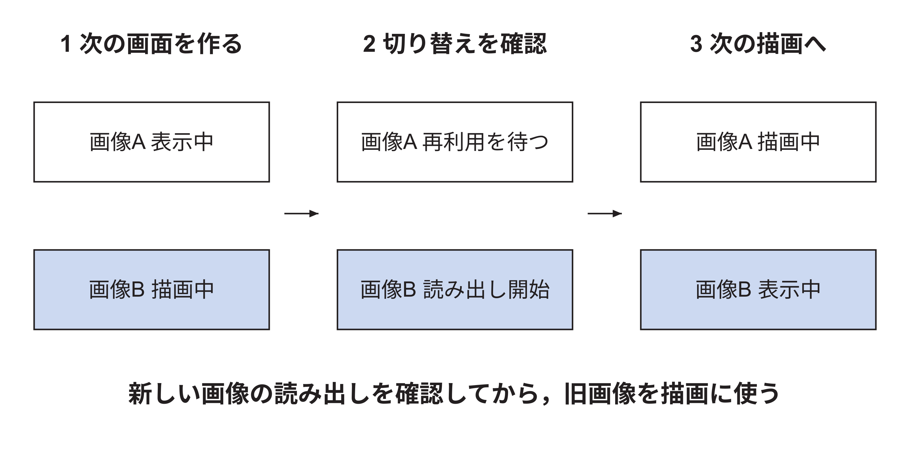

<a id="h0404"></a>
#### なぜ「Aをもう読まない設定にした」だけでは足りないか

読む先をBへ変える設定は、これから出す要求を変える操作である。変更前に出して、まだ返事を受け取っていないAの要求を消す操作ではない。例えば表示回路がAの一部を読みたいと依頼し、その要求がメモリ側で待っている間に、CPUが「次はB」と設定した場合を考える。

この直後にAを描き直してしまうと、まだ残っているAの読み出しが新しい値を拾う可能性がある。表示側が古い画像の続きとして使いたいデータを、描画側が次の画像の色で変えてしまうのである。そこで、Bへの切り替え依頼だけで完了を返さず、旧画像について受け付けられた要求の返事も待つ。

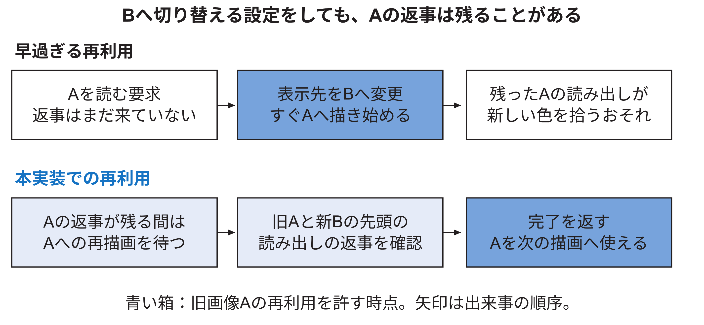

図9.5の上段は、Aの返事が残っているのに再描画を許す場合、下段は返事がそろうまで再利用を待つ場合を示す。青い箱は再利用を許す時点である。本実装ではさらにBの最初の読み出しの返事も確認して完了を返す。これはメモリ側の受け渡しの確認であり、その瞬間にディスプレイ全体の光が新しくなったという意味ではない。

実装では、受け付けた読み出し要求と返ってきた応答を数える。単に一定時間待つ方法とは異なり、必要な返事がそろったかを条件にする。具体的な信号と数え方は[技術付録第40章](appendix/04-rasterix/framebuffer-display.md#ch_g_framebuffer_display)に示す。

<a id="s_9_6"></a>
### 9.6 切り替え完了をゲームへ知らせる

表示する画像を切り替えた後、接続回路は完了したことをCPU側へ知らせる。ゲームの接続処理はその知らせを確認してから、以前の表示画像を次の描画に再利用する。表示側とCPU側のクロックが異なるため、通知も相手側で取りこぼさない形にして渡す。

この完了通知が表すのは、古い画像を再利用してよいという回路内の条件である。液晶画面のすべての点が新しい色に変わった瞬間を測ったものではない。そのため、回路内の完了記録と実際の映像は別々に確認する。

画像のアドレスをいつ保持し、要求と返事をどのように伝えるかは、技術付録第40・45章で信号と状態図を用いて説明する。

<a id="s_9_7"></a>
### 9.7 HDMI端子へ映像を送る

表示回路は、選ばれた画像を読み続け、映像の時間規則に従って色を送り出す。ゲーム側が次の画像をまだ用意していなければ、同じ画像を再び読む。新しい絵を作る仕事と、映像信号を送り続ける仕事は分かれている。

本構成はRasterIXに含まれる表示回路を使い、Nexys VideoのHDMI OUT端子から640×480画素のDVI形式の映像を送る。HDMI OUTは基板上の端子の名前、DVIはここで使う映像の形式の名前である。音声は出力しない。

端子から信号を出すことと、受信機器がその信号を認識することは別の確認となる。[第12章](#ch_12)では、ゲームの画像メモリと、実際に保存した映像を分けて示す。信号の周期や取り込み条件の詳細は[技術付録第40章](appendix/04-rasterix/framebuffer-display.md#ch_g_framebuffer_display)に収録した。

<a id="s_9_8"></a>
### 9.8 Linux用の領域と画像用の領域を分ける

DDR3全体は0x80000000から512 MiBで、その末尾32 MiBが0x9e000000からの領域になる。最初の480 MiBをLinux等が使い、末尾を描画用に確保する。画像Aの0x9fe00000も画像Bの0x9fc00000も、この末尾32 MiBに含まれる。

図9.6は、左でDDR3全体を見て、右で末尾32 MiBの内側を拡大したものである。画像Aと画像Bは、その予約領域内の別々の番地に置かれる。図では位置関係を読みやすくするため、容量の比率は実寸にしていない。

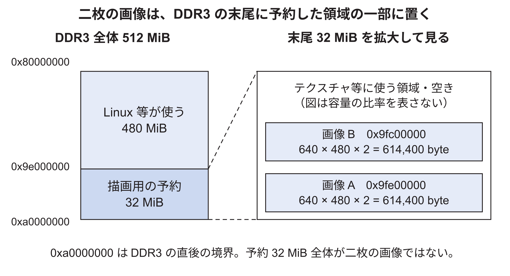

画像一枚は640×480×2で614,400 byteなので、二枚を合わせても予約領域の32 MiB全体にはならない。また、二枚の先頭は隣り合う画素のように連続しているわけではない。Linuxへ予約を知らせる範囲と、表示回路へ渡す画像一枚の先頭アドレスを区別して設定する。

デバイスツリーのreserved-memoryは、その領域をLinuxの普通の割り当て先から外すための説明である。例えばLinuxが同じ場所を別のプログラムの配列として割り当てると、描画回路が色を書いたときにその配列を壊す。予約によって、この使い道の衝突を避ける。

| 決める場所 | 決めていること | 互いにそろえる理由 |
|---|---|---|
| DDR3制御とWally設定 | 物理的にアクセスできる容量 | 存在しないメモリを使わないため |
| デバイスツリー | Linuxが普通の用途に使わない範囲 | 描画とOSの上書き競合を避けるため |
| RasterIX側のソフトウェア設定 | テクスチャや画像の置き場所 | 回路に正しい物理アドレスを渡すため |
| 表示切り替え回路 | 次に読み始める画像の先頭 | 描いた画像と表示する画像を一致させるため |

この予約によって、Linuxはその領域を別のプログラムへ割り当てなくなる。ただし、すでに入っている画素が消えるわけではないので、起動時の消去は[9.4節](#s_9_4)の処理で行う。また、予約は表示回路の読み出しを待つ操作でもないので、画像を再利用するときは[9.5節](#s_9_5)の完了を確認する。CPUのキャッシュや読み書きの順序の扱いは、[技術付録第31章](appendix/03-linux/mmio-ordering.md#ch_24)に示す。このように、領域を確保した後も、そこへ何を書くか、いつ書き換えるかを決める処理が残る。

仮想番地と物理番地の対応、およびCPUがコピーする方式とDMAへ転送を任せる方式の違いは、[技術付録45.3節](appendix/04-rasterix/design-change-reasoning.md#s_j_3)〜45.4に示す。

<a id="ch_10"></a>
## 第10章 ブロック崩しを動かすソフトウェア

<a id="s_10_1"></a>
### 10.1 ゲームの状態と描画を分ける

この章では、[第2章](#ch_2)で追ったボールの動きを、実際のプログラムへ対応させる。まず役割の異なる三つのデータを分ける。Gameが持つのはボールの位置や得点などの状態、sceneが返すのは四角形や文字として描く内容、Rendererが用意するのは描画回路へ渡す命令である。

例えば「ブロックに当たった」という一回の出来事を考える。Game::stepがボールとブロックの重なりを調べ、そのブロックを消す状態にし、得点を増やす。次にsceneは、消えたブロックを含めず、新しい得点の文字を含めた描画一覧を作る。Rendererは、その一覧の図形と文字を描く関数を呼ぶ。三つは同じCPUで実行されるが、変えるデータが違う。

Game、Scene、Rendererはプログラム中の型や処理の名前である。例えばSceneには「ここに幅20の赤い四角形」「ここに得点の文字」という指定を並べる。そこには640×480個の画素の色はまだ入っていない。Rendererがその指定をライブラリへ渡し、回路向けの命令を用意するのである。

この分け方なら、ボールの位置が変わらないときはGameを、位置は変わるのに画像が変わらないときはSceneやRenderer以降を調べられる。ゲームの規則と描画の指定を分けることで、不具合を調べる境界が明確になる。

表のファイルはすべて`examples/rasterix/`にある。何を変えたいかに応じて、対応する役割のファイルから読み始める。

| ファイル | 担当すること | 変更を考えるときの例 |
|---|---|---|
| Breakout.hpp | 状態更新、当たり判定、図形一覧 | ボールの速さやブロック配置を変える |
| BreakoutRenderer.hpp | 四角形と文字の描画 | 図形の渡し方、文字画像を変える |
| WallyBusConnector.hpp | 命令転送と完了待ち | バス操作やタイムアウトを調べる |
| breakout.cpp | 起動、入力、時間管理、ループ | 手動・自動操作や終了条件を変える |

<a id="h0435"></a>
#### UARTの文字をゲームの入力へ変える

ゲームへの入力にはUARTの文字端末を用いる。`Terminal::poll`が文字を読み、Aなら`move=-1`、Dなら`move=1`、Sなら`move=0`を保存する。Aを一回送ると、SやDを送るまで左移動が継続する。端末は通常のゲームパッドのような「ボタンを離した」という情報を送っていないためである。[Console26](#ref_Console26)

Spaceを受けたときの`start=true`は、`takeInput`で一度取り出すとfalseへ戻す。この違いにより、方向は継続し、開始は一回の合図として扱える。後からWiiコントローラーを付ける場合も、ゲームの規則そのものを書き換える前に、この`Input`の値をどう作るかを決めればよい。ただし実機接続と電気的な条件の検証は、別途必要である。

`Game::step`は、受け取ったInputから次のゲーム状態を計算する。例えばパドル中央が320画素、右入力が1なら、一回の更新で6画素右へ進む。ただし右端を越えないように上限を設ける。位置の数値の持ち方は[技術付録第33章](appendix/03-linux/game-loop.md#ch_26)に示す。

図10.1は、ボールがブロックに当たった一回を例にしている。①ではゲームの規則に従って状態を変え、②で次に見せる対象を取り出し、③でその対象を描く命令を準備する。

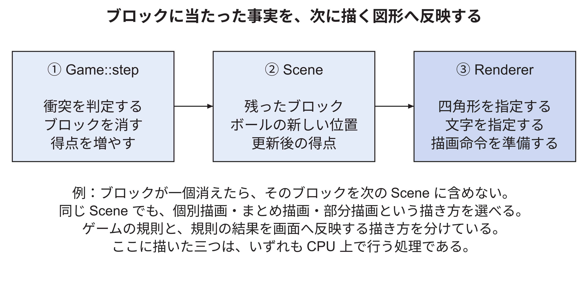

ここでSceneは専用チップではなく、CPU上のプログラムが作るデータである。Gameが計算した結果を、位置、大きさ、色などの描画指定へ置き換える役割を持つ。

同じ「右へ動かす」操作でも、入力を受け取った直後に画素を塗る構成にはしていない。まずInputが右向きの操作を表し、Gameがパドルの次の位置を求め、Sceneへ描く位置と形を渡し、Rendererがその図形を描く。この順に分けておけば、どの段階まで正しい値が届いたかを順に確認できる。

例えば入力の受信は成功しているのにパドルが動かない場合、Gameの位置が変わっているかを先に調べられる。位置は変わっているが画像だけ変わらないなら、Scene以降を調べる。入力、ゲームの規則、描画を一つの処理に混ぜないことは、実装を分けるだけでなく、動かなかった場所を探す助けにもなる。

<a id="s_10_2"></a>
### 10.2 入力と自動操作

ゲームの状態更新には、「左へ動かす」「右へ動かす」「開始する」といった入力を渡す。現在の実装は、UARTで受け取った文字をこの入力へ変換する方法と、プログラムが一定の規則で入力を選ぶ自動操作を持つ。

自動操作でも、ゲームの計算と描画を行うのはFPGA内のWallyとRasterIXである。パソコンがゲーム画像を生成して送り込むものではない。[第12章](#ch_12)の継続動作は、この自動操作を使った記録である。

Wii Classic Controller Proからボタン状態を読み取る機能は、ここでの実装・検証に含めない。追加時には、ボタンの押下・解放を同じ入力の形式へ対応付ける。

<a id="s_10_3"></a>
### 10.3 状態の更新と画像の更新を分ける

ゲームの規則を進めることと、画面を一枚作ることは別の処理である。例えば描画に時間がかかった場合、経過した時間に応じてボールの位置計算を進め、その最新の状態を一枚の画像にする。

本実装は、一秒60回を目標にゲーム状態を更新する。この値はゲームの時間を進めるための設定であり、一秒に60枚の新しい画像が実際に表示されたという測定結果ではない。描画と表示切り替えが完了した回数は別に記録する。

これにより、実行記録の「状態を何回進めたか」と「画像の切り替えが何回終わったか」を区別できる。経過時間の整数計算や衝突判定の細分化は[技術付録第33章](appendix/03-linux/game-loop.md#ch_26)に示す。

<a id="s_10_4"></a>
### 10.4 起動と再起動で確認すること

ゲームを起動するときは、ゲームの状態を初期値に戻し、描画・表示に使うメモリも初期化する。ゲームプログラムを一度終了しても、FPGA内の回路や画像メモリまで自動で初期化されるとは限らないためである。

そこで実機試験では、FPGAを設定した後の起動に加え、画像確認用プログラムを起動し直した条件でも画素を確認した。結果は[12.4節](#s_12_4)に示す。初期化する対象と呼び出し順の詳細は技術付録第33・40章に収録する。

<a id="ch_11"></a>
## 第11章 何を確かめるために実験するか

<a id="s_11_1"></a>
### 11.1 完成した画像だけでは分からないこと

ゲーム画面が一枚出たことからは、命令が失われないか、同じ処理を繰り返しても動くか、画像を切り替える際に古いデータが混ざらないかまでは分からない。この章では、確かめたい性質ごとに試験を分ける。接続の信号、ゲームの状態、保存された画素、実際の映像を、それぞれ観察する。

例えば一枚の画像が正しく見えても、そのときFIFOに十分な空きがあっただけかもしれない。満杯のときの接続を確認したいなら、受け取りをわざと止め、CPU側が同じ語を保って待ち、再開後に一度だけ渡す場面を作る必要がある。画面を長く眺める試験と、待ち条件を狙って作る試験では、調べられる問題が違う。

また、ゲームの実行記録が最後まで残っていても、表示先を取り違えていれば、映像は古いままかもしれない。そこで、メモリに作られた画像と、映像として出た結果を別々に確かめる。

<a id="s_11_2"></a>
### 11.2 四つの確認を使い分ける

| 確認 | 具体的に行うこと | 分かること |
|---|---|---|
| 回路シミュレーション | 受信やメモリ応答を意図的に遅らせる | 待ちがある場合のデータと制御の動き |
| 配置配線後の解析 | 部品使用量と信号の到着時間を調べる | 選んだFPGAとクロックで実装できるか |
| 実機の読み戻し | 実際の画像メモリを期待値と比べる | 描画された画素が合っているか |
| 映像・ゲーム実行 | 動画を取得し、ゲーム終了記録も見る | 実際の映像経路とゲームの継続動作 |

これらは互いの代わりにはならない。画像メモリが正しくても映像端子へ届かない場合がある。映像が見えても、まれな待ち条件で命令を失う場合がある。確認したい設計上の問題に対応する試験を選ぶ。

<a id="h0463"></a>
#### 実験の入口と観察する場所を先に決める

回路シミュレーションでは、パソコン上で回路の時間変化を計算する。CPUの代わりに要求を出す部分や、メモリの代わりに返事を出す部分を試験用に用意できるので、「七クロック受け取らない」「返事を遅らせる」といった条件を繰り返せる。試験用の回路を含めたものをテストベンチと呼ぶ。実物のボードへ七回ボタンを押す操作ではない。

実機の画素比較では、動作している描画回路がDDR3へ保存した色を読み戻す。一方、映像確認では、その色を映像信号へ変換して外へ送り、取り込んだ動画を見る。読み戻した色が正しくても映像の配線が誤っていれば画面は出ないので、二つを別々に確認する。

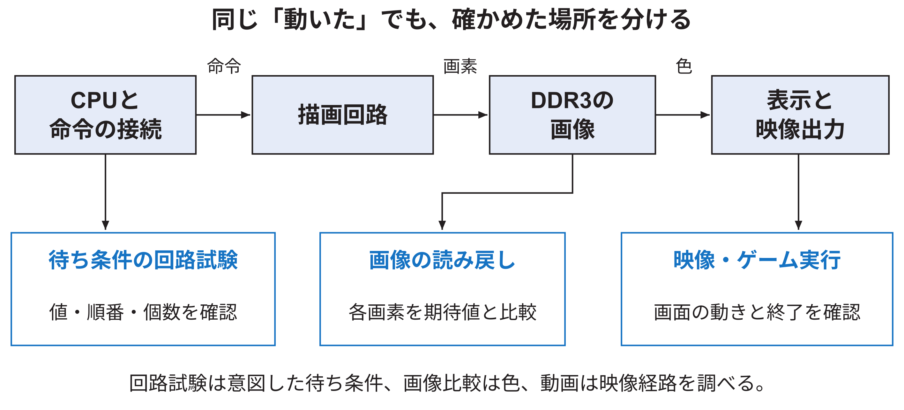

図11.1の上段は製作したゲーム機の経路、下段は試験で調べる場所である。例えば「307,200画素が一致」は画像メモリでの比較、「動画でボールが移動」は映像経路での確認に対応する。観察する場所が異なるため、それぞれの結果から確認できる範囲も異なる。

例えば映像に古いボールが残る場合、すぐに「描画回路が遅い」とは決められない。描画先の画像メモリにも古いボールが残るなら、ゲームが渡した位置、消去や描画の指定、命令の転送を順に調べる。画像メモリは新しい位置なのに映像だけ古いなら、表示先の選択や読み出しを調べる。図11.1で観察場所を分けるのは、このように一つの症状を、確かめられる中間結果へ分解するためである。

<a id="s_11_3"></a>
### 11.3 命令を待たせる試験

調べるのは「受け側が受け取りを保留している間、CPUから来た一語を失わず、受け取り再開後に一度だけ渡せるか」である。そこでテストベンチの受け側を一定期間受け取り不可にし、CPU役から書き込みを出す。待つ間は番地とデータを保ち、転送が完了してしまわないことを確認する。

再開後は値、順番、個数を照合する。A、B、Cを送ったのにA、Cなら欠落、A、B、B、Cなら重複である。一語の値だけを確認しても、この二つは分からない。保存したAPB試験は七クロック待たせる条件を含み、二回の書き込みに対して二語が正しく届くことを確認した。[E1](#ref_E1)

32 bitの上下のデータ位置、応答待ち、識別値、完了回数も検査した。結果が示すのは、試験で与えた条件における値と制御の一致であり、全信号列の数学的証明ではない。ゲーム映像が見えたという確認とも範囲が異なる。

<a id="s_11_4"></a>
### 11.4 表示先を早く再利用しない試験

表示の試験では、GPU側と表示側のクロックを異なる周期にし、メモリからの返事も遅らせる。新しい画像への読み出しが始まる前、または必要な返事が戻る前に、完了信号が出ないことを確認する。

もし返事を常に即座に返す試験だけなら、古い読み出しが残る問題を見逃す。実際のメモリでは他の要求により待たされるので、試験でもその場面を作る。保存した記録では四回の切り替えと、別のリセット試験を確認した。[E1](#ref_E1)

<a id="s_11_5"></a>
### 11.5 正しい画像をどう決めるか

期待画像は、ゲーム状態から作った図形と文字を、別のCPU側の塗りつぶし処理で画像へ変換して用意する。RasterIXで作った画像を基準にコピーするだけでは、同じ誤りを正解にしてしまうためである。

実機の画像はRGB565として読み出し、640×480の全307,200画素を比較する。例えば赤であるべき場所が青なら、その画素を不一致として数える。読み出したファイルの大きさは614,400 byteでなければならない。

図11.2では、同じゲーム状態から二通りの経路で画像を用意する。

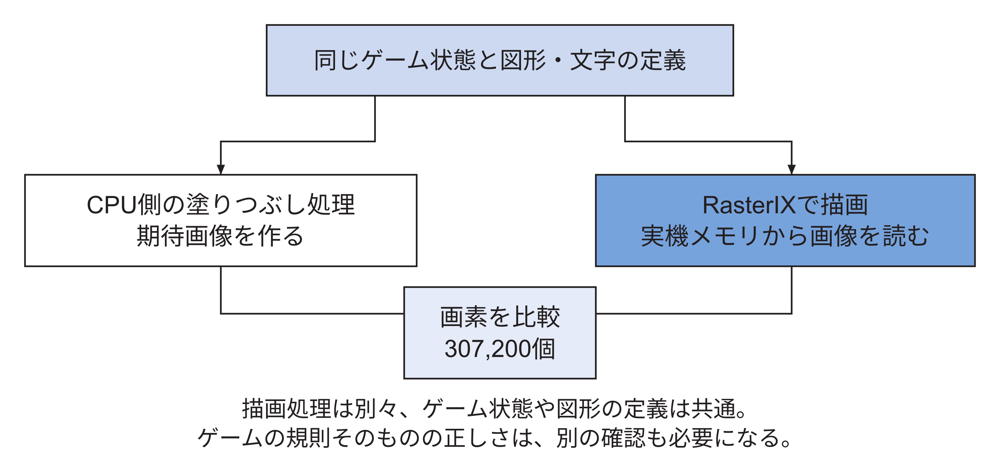

左はCPU側の比較用描画処理、右の青い箱は調べたいRasterIX側の描画と読み出しである。同じ位置同士を比較する手順を、次の小さな画像で確かめる。

<a id="h0482"></a>
#### 画素を比べる試験で何を数えているか

説明用に、横3画素・縦2画素の画像を比べる。期待画像の右上が白、実機画像の右上が黒なら、その一画素を不一致として数える。ほかの五画素が同じなら不一致数は1である。画像全体の平均の明るさや、ファイルの大きさが同じだけでは、この一画素の間違いは見つからない。

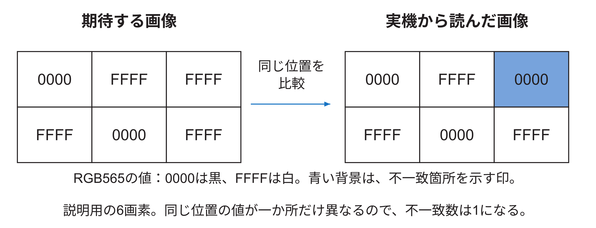

図11.3は比較の手順を示す説明用の画像である。実機ではこれを640×480=307,200画素について行う。不一致が0なら、比較したその画像の全画素が、比較に用いた期待画像と一致したことになる。

期待画像を作るCPU処理にも間違いがある可能性はある。そのため、実機と同じ描画回路で作った画像をそのまま正解にすることは避け、別の塗りつぶし処理を使った。ただし、ゲーム状態や図形の定義は共通なので、ゲームの規則そのものの誤りまで、この比較一つで発見できるとは限らない。例えば両方へ誤った得点を渡せば、同じ誤った数字が描かれて一致することはあり得る。

この理由から、ゲームの終了状態や得点、メモリの画素、実際の映像を別々に確かめる。それぞれが違う範囲の誤りを見つけるための確認である。

<a id="s_11_6"></a>
### 11.6 継続動作と映像を確認する

自動操作でゲームを一定時間動かし、処理が止まらずに実行記録を残すことを確かめる。これは、一枚だけ描いて終了する試験では分からない、繰り返し動作の確認である。確認した時間を記録し、その時間を超えた動作まで検証済みとはしない。

別に、HDMI OUTからの映像を取り込み、保存した動画が復号でき、ゲーム画面と移動するボールを含むことを調べる。ゲームの処理が完了した記録だけでは、映像が受信側へ届いた証拠にならないためである。

一方、録画の形式が毎秒60枚であっても、その60枚すべてが異なるゲーム画像とは限らない。同じ画像を繰り返し記録する場合もある。本稿では、録画形式をゲームのFPSとして読み替えず、動作確認に使った時間と映像の内容を示す。

<a id="ch_12"></a>
## 第12章 実機での動作確認と考察

<a id="s_12_1"></a>
### 12.1 確認に用いた構成

[第11章](#ch_11)の方法を用い、接続回路、FPGAへの実装、画像、ゲームの継続動作、映像を確かめた。表の記録番号は保存済みデータと対応する識別子である。異なる版の結果は区別し、全試験を一つのソースで同時に行ったとは扱わない。

| 記録 | 使用した構成 | 本章で示す確認 |
|---|---|---|
| E1 | [4.2節](#s_4_2)の基準版、標準DVI構成 | 命令接続と表示切り替えの回路試験、Linux起動、転送・画像の確認 |
| E6 | [4.2節](#s_4_2)の動作確認版、計測回路を含まない通常のゲーム構成 | 回路の生成、資源と時間条件、画像、5分間の自動プレイ、30秒間の映像 |

E6の通常構成は、CPU 20 MHz、RasterIX 100 MHz、512語の命令FIFO、640×480画素の表示を用いる。公式RasterIXの内部は変更していない。ゲームには描画処理を軽くする実装を含む完成版を使い、端末入力の代わりに自動操作で試験した。個々の高速化の効果をこの動作結果から求めることはしない。

以下の結果は、保存した実験記録のうち、この通常構成の動作に関する部分である。実験用の計測回路や別方式を使った性能比較は、技術付録第66・71・72章で条件とともに示す。

<a id="s_12_2"></a>
### 12.2 命令接続と表示切り替えの確認

基準版のAPB試験では、受け取りを七クロック待たせる条件を含め、二回の書き込みに対して二語が正しく届くことを確認した。応答待ち、識別値、完了回数も検査した。表示切り替えの試験では、異なるクロックと遅れたメモリ応答を与え、四回の切り替えと、別のリセット試験を通過した。[E1](#ref_E1)

これらは、相手を待たせても接続の値や制御が意図した順番で進むかを調べた結果である。描画回路の性能がCPUより低いことを示す実験ではない。[第6章](#ch_6)の「受け取ったときだけ一回と数える」、[第9章](#ch_9)の「古い画像を読む処理が残る間は再利用を許さない」という条件を、試験で与えた状況について確認した。

実機ではLinuxの起動、4 MiBのメモリ試験、64〜65,536 byteの四つのサイズの転送、赤・緑・青の各画像307,200画素の一致を確認した。4 MiBの試験を、DDR3全512 MiBの検査結果とは扱わない。

<a id="s_12_3"></a>
### 12.3 FPGAへ実装できたことの確認

動作確認版の通常構成を、生成済みIPを使い回さずに生成し、配置・配線まで実行した。表は回路全体の資源使用量であり、RasterIXを追加した分だけの増加量ではない。[E6](#ref_E6)

| 資源 | 使用量 | FPGA全体 | 使用率 |
|---|---:|---:|---:|
| LUT | 67,166 | 134,600 | 49.90% |
| レジスタ | 50,890 | 269,200 | 18.90% |
| Block RAM | 215 | 365 | 58.90% |
| DSP | 61 | 740 | 8.24% |

LUTは小さな論理計算、レジスタは値の記憶、Block RAMはまとまったデータの保存、DSPは乗算などに使う専用資源である。Block RAMは36 Kbit分を1個として数えた。例えば使用率58.90%は、215を365で割り100を掛けた値である。

資源が収まるだけでなく、信号が所定の時刻に届くかも調べた。配置・配線後の最小setup余裕は+0.018 ns、最小hold余裕は+0.014 nsであった。setupは受け取る時刻までに値が安定すること、holdは受け取った直後にも必要な間だけ値が保たれることの条件である。正の余裕は、指定した時間条件に収まったことを示す。

配線エラー、DRCエラー、内部の未制約端点は0であった。DRCは回路の接続や配置などの規則検査を指す。クロックをまたぐ接続の解析には警告が残り、既存のリセット回路や、通知まで値を保持する接続などとして内容を確認した。警告がすべて消えたという結果ではない。

この結果から示せるのは、選んだFPGAとクロックの条件で、対象構成を配置・配線できたことである。より高い周波数、別の回路構成、あらゆる動作条件に対する保証へは広げない。詳細レポートは[技術付録71.15節](appendix/05-integration/fifo-comparison.md#s_29_15)と[E6](#ref_E6)に示す。

<a id="s_12_4"></a>
### 12.4 ゲームの画像が指定どおりに作られたか

通常構成を再生成してFPGAへ設定した後、ゲームの開始状態と描画方法を指定した確認用プログラムの三条件で、画像メモリを読み戻した。そのプログラムを終了して起動し直した一条件も同様に調べた。各画像で、640×480=307,200画素すべてが、別のCPU側描画処理で作った期待画像と一致した。[E6](#ref_E6)

| 確認条件 | 比較した画像 | 結果 |
|---|---:|---|
| 画像確認用プログラムの三条件 | 各条件の保存画像、計3枚 | 各307,200画素が一致 |
| 確認用プログラムを再起動した条件 | 保存画像1枚 | 307,200画素が一致 |

この比較は、指定したゲーム状態から画像を作る経路の確認である。例えば期待画像にある白いボールが実機画像では欠けていれば、一致しない画素として検出できる。一方、ゲーム規則そのものは両方の描画に共通するため、規則の誤りまでこの比較だけで検証できるわけではない。

対象は保存した画像であり、実行途中のすべての画像を一枚ずつ照合した結果ではない。確認に使った状態、描画方法、起動条件は[E6](#ref_E6)に保存した。三条件は開始状態だけを変えた比較ではなく、それぞれの指定で期待画像が得られるかを調べた動作確認である。具体的な条件は[技術付録71.24節](appendix/05-integration/fifo-comparison.md#s_app_71_24)に示す。

<a id="s_12_5"></a>
### 12.5 自動操作による継続動作

通常構成で300.011秒間、自動操作によるブロック崩しを実行した。実行記録では、その間に17,853回の画面更新処理が完了した。約5分間、ゲームの計算、命令送信、画像の更新を繰り返せたことを、この記録で確認した。[E6](#ref_E6)

この回数はプログラムと回路内の完了記録であり、外部ディスプレイに表示された異なる画像を数えたFPSではない。また、完成版に含まれる複数の処理をまとめて動かした結果なので、一つの接続回路だけの高速化効果とも扱わない。

同じソースから再生成したbitstreamについては、生成日時などを含むヘッダーを除いた設定データが、5分間の試験に用いたものと完全に一致した。再生成したファイルを設定した後、[12.4節](#s_12_4)の画像確認と、次節の映像確認を行った。再生成後に別の5分間試験を繰り返したという記録ではなく、設定データの照合で試験間の回路の同一性を確かめている。照合対象と手順は[技術付録71.15節](appendix/05-integration/fifo-comparison.md#s_29_15)に示す。

<a id="s_12_6"></a>
### 12.6 実際の映像の確認

5分間の試験とは別に、75.003秒間の実行中から30秒間の映像を保存した。動画に含まれる1,801フレームを復号し、全フレームでゲーム画面の壁とボールを検出して、ボールの移動が続くことを確認した。[E6](#ref_E6)

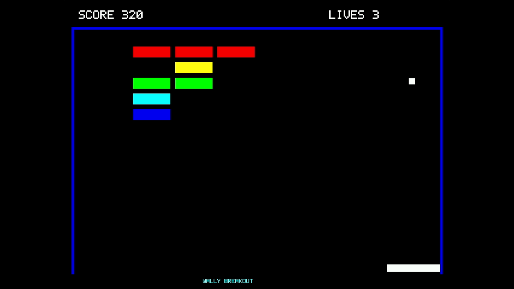

図12.1は録画の15秒時点の画像である。ゲームの計算と描画はNexys Video上で行い、パソコンはHDMI OUTからの映像を記録した。録画が毎秒60枚の形式であることを、ゲームが毎秒60枚の異なる画像を生成した証拠とはしない。

ただし、同じ回路設定でも映像の形式を認識できない場合があった。成功と失敗を分ける原因は特定できていない。このため、本結果は保存した条件で30秒間の映像を取得できたという確認であり、常に安定して受信できることの確認は残っている。

<a id="s_12_7"></a>
### 12.7 動作結果から示せること

回路試験、画像の読み戻し、継続実行、映像の記録を合わせることで、Wallyが計算した二次元ゲームの状態をRasterIXで画像へ変え、実機の映像として出せる構成を確認した。FPGAの設定生成と、確認した生成物の対応も残した。

評価対象は640×480画素のブロック崩しと、ここで示した試験条件である。専用コントローラー、音声、三次元ゲームは今回の確認範囲に含まない。映像受信の安定性も未解決である。これらの範囲を明示した上で、命令、メモリ、表示を接続する設計例として提示する。

<a id="ch_13"></a>
## 第13章 再現作業の進め方

<a id="s_13_1"></a>
### 13.1 再現の段階を分ける

再現には、同じソースをそろえること、そこから同じ条件の回路とプログラムを生成すること、その生成物を実機に入れて動かすことが含まれる。例えばソースの差分が一致しても、FPGAに古いbitstreamが残っていれば、そのソースの動作確認にはならない。[技術付録第63章](appendix/05-integration/console-reproduction.md#ch_m)の手順では、操作の対象と生成物を段階ごとに示す。

同じゲーム機を作り直すには、固定版の取得、FPGA回路の生成と設定、Linuxの起動、ゲームの生成と動作確認を順に行う。ソースの差分が一致すること、bitstreamを作れること、実機で動くことは、それぞれ別の確認である。


対応する詳しい手順は[技術付録63.1節](appendix/05-integration/console-reproduction.md#s_m_1)〜63.17にある。各手順には実行する機械、入力、生成物、成功の判断を示す。最初に[技術付録63.2節](appendix/05-integration/console-reproduction.md#s_m_2)で機器を確認し、63.3以降を順に進める。既存の作業場所やSDカードを上書きする前に、操作対象と保存データを確かめる。

例えばゲームの画像が出ない場合は、最初から描画回路だけを疑わず、直前まで成立している段階を確かめる。Linuxの起動メッセージが出ていないなら、CPU・メモリ・起動の経路を先に調べる。Linuxは起動するが[6.5節](#s_6_5)のIDレジスタの識別値を読めないなら、命令口の番地と接続を調べる。識別値が読め、画像メモリも正しいのに映像が出ないなら、表示と映像受信の経路を調べる。このように確認の場所を分けると、どのファイルを修正すべきか判断しやすい。

<a id="h0533"></a>
#### どの段階まで再現できたかを記録する

同じ画面が一度出たという情報だけでは、後で設定を変えたときに比較する基準が残らない。次のように、その段階の入力、出力、確認結果をそろえて残す。

| 段階 | そろえる入力 | 得られるもの・確認すること |
|---|---|---|
| ソース取得 | 親リポジトリとサブモジュールのコミット | 指定版の回路・ソフトウェアと、必要な実験差分 |
| 回路の生成 | 基板、クロック、機能を選ぶ設定 | bitstream、使用量、時間条件のレポート |
| FPGAへの設定と起動 | 生成したbitstreamと対応する起動媒体 | 書き込んだファイルの記録、Linuxの起動ログ |
| ソフトウェア実行 | 対応する実行ファイルと引数 | 終了状態、時間記録、画像の読み戻し |
| 映像の確認 | 同じ回路のHDMI OUTからの信号 | 実際に受信した映像と、その確認範囲 |

例えば時間レポートが合格でも、その後に古いbitstreamを書けば、解析した回路と動かした回路が違う。実行ファイルも同様に、生成したものと実機で起動したものを対応付ける。[12.5節](#s_12_5)で再生成した設定データを照合したのは、生成時刻の異なるファイルでも、実機を構成する内容が同じかを確かめるためである。

不一致が出たときは、まず比較している版と生成物を確認する。その後、位置・命令・画素・映像のどの段階から違うかを調べる。この順序なら、ソースが違うための変化と、同じ設計が正しく動かない問題を混ぜずに調査できる。

<a id="s_13_2"></a>
### 13.2 設計を自分で作り直す

完成版を動かした後、別の作業場所でRasterIXの接続を組み立てる。[技術付録第42章](appendix/04-rasterix/rasterix-integration.md#ch_g)のファイルと接続図を使い、CPU側のレジスタ、命令と応答の受け渡し、メモリへの要求、表示切り替えを順に対応付ける。各ファイルの変更理由を読んでから編集し、保存した差分と照合する。この順序なら、動く基準と自分の変更を比べられる。

資料一式の`再現資料`には、ソース、パッチ、試験、実機記録を収録している。基準版の再現は[技術付録第63章](appendix/05-integration/console-reproduction.md#ch_m)、動作確認版の取得は71.17節、通常構成の生成と確認は71.15節を参照する。各手順で指定した版と生成条件を使い、得られた結果を対応する実験記録と照合する。

<a id="ch_14"></a>
## 第14章 設計の意味と残る課題

<a id="s_14_1"></a>
### 14.1 誰がどの部分を使えるか

例えば、Wallyへ別の画像処理回路を接続したい学習者は、[第6章](#ch_6)の「CPUの書き込みがどこへ届くか」を出発点にできる。相手の回路が受け取れる条件を調べ、自分の回路のREADYと、CPU側へ返す完了の条件を対応させる。[第9章](#ch_9)からは、複数の回路が同じ画像を使うとき、何が終わればその場所を上書きできるかという考え方を参照できる。

本研究は、Wallyの学習者がCPUを基板上の周辺機器へ拡張するときの参照例を提供する。異なるクロック間で命令を渡す方法、OSと描画回路のメモリ使用範囲を分ける方法、表示先を再利用できる時点の決め方を、ソース、設定値、確認条件とともに示した。

これらは本構成でゲームを動かすために必要だった接続であり、読者は同じ条件で試し、自分の変更と比較できる。

参照できる内容は、部品の名前だけではない。例えば別の描画回路へ交換したい人は、まず命令の受け取り規則を確認し、CPU側の書き込み完了をどの時点で返すか決められる。画像を保存する領域を変えたい人は、OSへの予約と回路側の番地の対応を確認できる。これが、本研究の設計説明を他の作業で利用する具体的な場面である。一方、利用者を対象とする実験は行っていないため、教材として学習成績を向上させる効果は未検証である。

例えば画像の解像度を変える場合、命令を一語ずつ受け渡す規則は参照できるが、一枚分に必要なメモリ量や、表示回路の読み出し範囲は見直す必要がある。「そのまま参照できる部分」と「新しい条件で決め直す部分」を区別できることが、接続例を読む利点である。

ただし、変更後の構成で時間条件を満たすことや、映像が表示されることまで、本研究の結果から保証することはできない。読者は同じ確認項目を使って自分の構成を調べられる。このように、結果を無条件に他の装置へ移すのではなく、設計と検証を進める際の参照先として提供する。

<a id="s_14_2"></a>
### 14.2 接続の条件と検証結果を示す意義

部品の一覧だけでは、同じ部品を使う人が接続の正しさを判断しにくい。本稿は、命令FIFOが満杯の間は書き込みを完了しないこと、画像領域をOSへ割り当てないこと、古い表示先の読み出しが残る間は再利用しないことを設計条件として示した。さらに、それぞれを調べる回路試験、メモリ設定、画像と映像の確認結果を対応付けた。

固定した公開部品の組合せについて、実装と動作確認の条件を追える点が本成果の特徴となる。既存部品の名前に加え、その間で何を合わせる必要があったかを説明できる。WallyとRasterIXの組合せが世界初かどうかは、網羅的な先行例調査を行っていないため断定しない。

<a id="s_14_3"></a>
### 14.3 CPUだけで描く案との違い

四角形だけなら、CPUがフレームバッファへ直接色を書いて描く案もある。その場合、画素を塗る処理、文字の模様、画像の切り替えなどをCPU側で用意する。小さな二次元ゲームでは有力な選択肢になり得る。

本研究は、Wallyに描画回路を接続する拡張例を示すため、既存のRasterIXを使った。図形や模様を指定するAPIと、その処理を行う回路を利用できる。一方、命令の準備と転送にも負担があり、CPU直描きより必ず速い、必ず実装が簡単とする比較は行っていない。

<a id="s_14_4"></a>
### 14.4 FPGAを使う理由

FPGAを使うと、CPUと周辺回路を実際の論理回路として組み合わせ、接続や待ち制御を変更できる。本研究の対象は、既製CPU上でゲームソフトだけを動かすことではなく、公開CPUに回路を接続してゲーム機として成立させる設計である。そのため、回路構成を変更できるFPGAが目的に合う。

本研究でFPGAを使う利点は、回路とソフトウェアの境界を公開設計で追い、接続を変更して実機で確かめられる点にある。既製のゲーム機との速度、価格、消費電力の比較は評価範囲に含めていない。

<a id="s_14_5"></a>
### 14.5 Wiiコントローラーを追加する場合

現在の検証済み入力はUART経由の操作と自動操作である。Wii Classic Controller Proの接続は、専用コントローラーによるゲーム操作を実現するための今後の作業として位置付ける。

接続には、コントローラーの通信と電気的条件を確認し、読み出したボタン状態をゲームのInputへ対応付ける処理が必要になる。まず個々のボタンを正しく読み取れることを確かめ、その後、押下・解放に応じたゲーム操作を検証する。通信回路の動作と、入力からゲーム状態までの対応を段階的に確認することが課題である。

<a id="s_14_6"></a>
### 14.6 利用できる条件を広げるための課題

今後は、同じ回路設定で映像を認識できる場合とできない場合の条件を調べる。記録済みのゲーム映像があることと、どの接続状態でも安定して利用できることは別である。

専用コントローラーについては、[14.5節](#s_14_5)で述べたボタン状態の読み取りと、ゲーム操作への対応を順に検証する。自動操作で動く構成を基準として残すことで、入力機器を追加した後も、ゲームの計算や画像が同じように動くかを確認できる。

また、他の利用者が公開資料に従って同じ構成を動かせるかは、今後の検証になる。本研究ではソースと生成手順、確認結果をそろえたが、第三者による再現や、授業での学習効果を測定したものではない。

<a id="ch_15"></a>
## 第15章 結論

<a id="s_15_1"></a>
### 15.1 CPUと描画と表示を接続した

本研究では、公開CPUのWallyに公式RasterIXの描画・表示機能を加え、Nexys Video上で二次元ブロック崩しを動かす構成を実装した。公式RasterIXの内部を変更せず、CPUのバスから描画命令を渡す接続、Linuxと画像のメモリの使い分け、表示画像を切り替えて再利用する制御を用意した。

ゲームプログラムは、RasterIX付属のOpenGL互換ライブラリへ図形を指定する。ライブラリと描画回路には既存の機能を使い、それをWallyから利用するための接続と設定を本研究の対象とした。

<a id="s_15_2"></a>
### 15.2 ブロック崩しの動作を実機で確認した

接続回路の試験では、受け取りやメモリ応答を遅らせ、データの保持と表示切り替えを確認した。通常構成については、FPGAへの配置・配線後の時間条件と資源使用量を調べた。

実機では640×480画素のブロック崩しを動かし、画像確認用プログラムの三条件と再起動後の一条件で、各307,200画素が期待画像と一致した。5分間の自動プレイの実行記録と、別の実行で取得した30秒間の映像から、画像の更新とボールの移動が続くことを確認した。動作確認には、描画処理を軽くする実装を含む完成版を用いた。

この結果は、示した構成と条件でゲームが動作したという確認である。ライブラリ内部の描画方式や個別の高速化効果を新たに立証したという主張ではない。

<a id="s_15_3"></a>
### 15.3 Wallyを拡張するための参照例を示した

接続の設計、ソース、設定、試験条件を対応付けて公開し、Wallyに周辺機能を加えたい学習者が参照できる形にまとめた。命令を受け取る条件、画像を置く場所、古い画像を再利用できる時点を、一台のゲーム機の中で確認できることが本成果の内容である。

専用コントローラーの接続と操作の検証、映像受信が安定しない条件の解明が残る。教育効果や第三者による再現性の評価も未実施であり、公開した実装と確認記録を基に今後調べる課題とする。

<a id="h0576"></a>
## 参考文献と実験記録

本文では、著者名や資料の略称と年などからなる参照記号を角括弧で示す。例えば[Harris26](#ref_Harris26)はHarrisらの2026年の書籍を指す。刊行年を確認できない継続更新の資料では、年を推測して記号へ付けず、資料名と版の識別情報を示した。ソースの版は記載したコミットを基準とし、Webページの将来の更新とは区別する。

<a id="h0578"></a>
### 外部資料と公開ソース

<a id="ref_Console26"></a>
[Console26] 研究者（非公開）, wally-game-console, 公開ソースコード, 2026. 基準版: d3e181ac434a01a1f174549b5fbc7ee03a8875b4. https://github.com/SoshiroFujimori/wally-game-console/tree/d3e181ac434a01a1f174549b5fbc7ee03a8875b4

<a id="ref_Harris26"></a>
[Harris26] D. Harris, J. Stine, R. Thompson, S. Harris, RISC-V System-on-Chip Design, Morgan Kaufmann, 2026. ISBN 9780323994989. https://shop.elsevier.com/books/risc-v-system-on-chip-design/harris/978-0-323-99498-9

<a id="ref_NexysVideo"></a>
[NexysVideo] Digilent, Nexys Video FPGA Board Reference Manual, ボード仕様・端子・クロック・DDR3の説明. https://digilent.com/reference/_media/reference/programmable-logic/nexys-video/nexys-video_rm.pdf

<a id="ref_RasterIX"></a>
[RasterIX] ToNi3141, RasterIX, ソースコードとREADME. 固定版: 9fdcf97a31b2e4247594e06d605871980cd5e9e1. RasterIX_IF.v、RenderConfigs.hpp、DisplayListDispatcher.hppなどを参照. https://github.com/ToNi3141/RasterIX/tree/9fdcf97a31b2e4247594e06d605871980cd5e9e1

<a id="ref_Thompson25"></a>
[Thompson25] R. Thompson, D. Harris, J. E. Stine, S. L. Harris, “RISC-V System-on-Chip Design Textbook and Course,” 2025 ASEE Annual Conference & Exposition, 2025. DOI: 10.18260/1-2--57147. https://peer.asee.org/57147

<a id="ref_Wally"></a>
[Wally] OpenHW Foundation, CORE-V Wally, ソースコードとREADME. 本研究の出発点: 2345ec2ad68d9a9073b2dfec0929ce87c90cb0ce. https://github.com/openhwfoundation/cvw/tree/2345ec2ad68d9a9073b2dfec0929ce87c90cb0ce

<a id="ref_ArmAPB23"></a>
[ArmAPB23] Arm, AMBA APB Protocol Specification, ARM IHI 0024E, 2023, section 3.1.2 “With wait states,” p.3-21. https://documentation-service.arm.com/static/63fe2c1356ea36189d4e79f3

<a id="ref_AMD085"></a>
[AMD085] AMD, AXI4-Stream Infrastructure IP Suite LogiCORE IP Product Guide, PG085, version 3.0, 2025, Clocking. https://docs.amd.com/r/en-US/pg085-axi4stream-infrastructure/Clocking

<a id="h0587"></a>
### 本研究で保存した実験記録

E1やE6は保存した実験資料を区別する識別子であり、外部文献の著者・年を表す記号ではない。本稿で参照する動作確認の記録を以下に示す。その他の比較実験の資料は技術付録の参考文献・実験記録一覧から参照できる。

<a id="ref_E1"></a>
[E1] Wally / official RasterIX integration current qualified results、2026年9月9日。再現資料/実験記録/E1/RESULTS.md。対応するtest-apb.log、test-display.log、reset-test.log、hardware-results.json、timing_summary.rpt。

<a id="ref_E6"></a>
[E6] 通常構成の生成と実機確認を含む実験記録、2026年10月8日。再現資料/実験記録/E6。本文では通常構成の資源・時間条件、保存画像、5分間の自動プレイ、30秒間の映像を参照する。fresh-product/qualification/qualification.json、report/results/video/validation.json。各試験と記録の対応は技術付録71.15節に示す。
