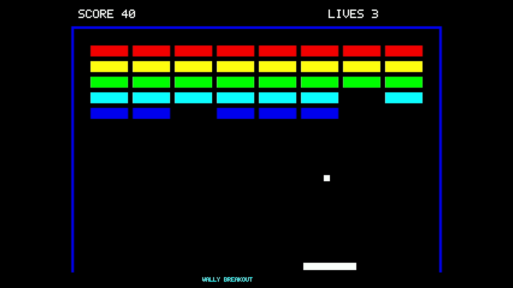
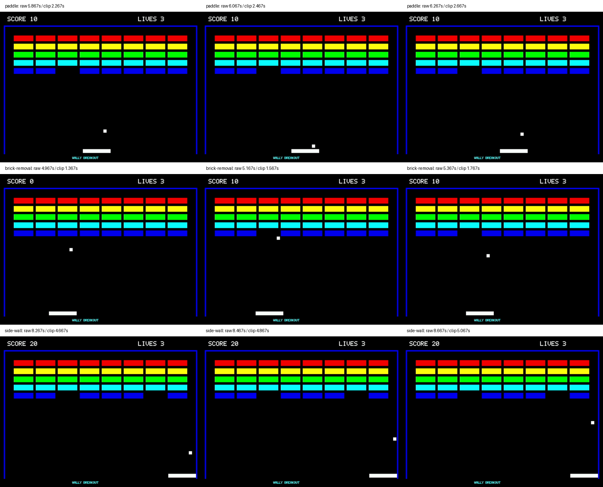

# E8：映像で確かめるブロック崩しの基本動作

**FPGAの設定から起動する手順を3回繰り返し、各30秒の映像で、ボールの移動、パドル・壁での反射、ブロックの消去を確認した。** その後、同じ回路で300秒の実行と録画も確認した。確認日は2026年11月8日である。

[30秒の動画を開く](video/breakout-30s.mp4) / [構成と結果のJSON](results.json) / [表示回路の差分と再生成](hdmi/README.md)

## 何を見ればよいか

動画は1回目の実機録画から、ゲームが始まった後の30秒を取り出したものである。ゲームはNexys Video上で動き、パソコンはHDMI端子から届く映像を記録している。パドルはプログラムによる自動操作であり、ゲームコントローラは使っていない。

| 確認すること | 公開動画の時刻 | 前後で比べるところ |
|---|---|---|
| ボールが動き、パドルで跳ね返る | 2.27〜2.67秒 | ボールが下へ進み、パドル付近から上へ戻る |
| 当たったブロックが消える | 1.37〜1.77秒 | 青いブロックがなくなり、得点が0から10へ変わる |
| 壁で跳ね返る | 4.67〜5.07秒 | 右へ進んだボールが、右の壁付近から左へ戻る |

次の図は、各場面を左から時間順に並べたものである。上から順にパドル、ブロック、右の壁での変化を示す。`raw`は編集前の録画、`clip`は上の公開動画の時刻である。

元録画と公開動画のハッシュ、切り出し位置は[対応記録](video/derivation.json)に保存した。ゲームの動きや表示内容は編集していない。公開用に音声とファイルの付加情報を取り除いている。

保存ファイルのハッシュと、端末ログに書かれた値との一致は、`python3 experiments/basic-operation-20261108/validate_records.py`で検査できる。これは記録の整合性を調べる処理であり、実機試験を代わりに行うものではない。

## 起動を繰り返した結果

各回で同じ設定ファイルをFPGAへ書き込み、OSを起動した。SDカードを読み取り専用で開いてゲーム実行ファイルを読み出し、ハッシュを照合してから実行した。読み出し後はSDカードのマウントを解除した。FPGA本体の電源は入れたままであり、電源投入を3回試したものではない。

| 回 | 開始条件 | ゲームが報告した実行時間 | 各録画の目視確認 | 画面出現後の枠・見出し検査 |
|---|---|---:|---|---:|
| 1 | FPGAの設定からOSを起動 | 30.000秒 | 移動・反射・ブロック消去を確認 | 1,979枚すべて |
| 2 | FPGAの設定からOSを起動 | 30.000秒 | 移動・反射・ブロック消去を確認 | 1,979枚すべて |
| 3 | FPGAの設定からOSを起動 | 30.000秒 | 移動・反射・ブロック消去を確認 | 1,977枚すべて |

3回とも終了コードは0だった。3回の間に取り込み機器の再起動やテスト映像の挿入は行っていない。各回の設定、起動、SD読み出し、ゲームのログは[results](results/)に保存した。実機を特定する情報は伏せており、原本と公開コピーのハッシュを別々に記録している。

開始前と終了後を含む全録画も参照できる：[1回目](video/complete-boot-01.mp4)、[2回目](video/complete-boot-02.mp4)、[3回目](video/complete-boot-03.mp4)。公開コピーでは音声と付加情報を除いたが、圧縮された映像データが原本と一致することを確認した。

録画の検査では、復号した画像を一枚ずつ読み、ゲーム画面の左右の壁と、得点・残機の見出しが映っているか調べた。ゲーム画面が現れてから録画終了まで、検査に外れる画像はなかった。[check_recording.py](check_recording.py)がこの検査を行う。ボールの反射やブロック消去は、この検査だけでは判断できないため、[locate_events.py](locate_events.py)で候補場面を探し、前後の画像を目視で確かめた。

## 300秒の継続実行

3回目の起動後に、同じゲームを300秒実行した。正常終了と、録画の枠・見出しの連続性を確認した。映像には、すべてのブロックを消した後のCLEAR画面も含む。[実行ログ](results/continuous-300s/game.raw)と[録画の検査結果](results/continuous-300s/frame-check.json)を保存している。

[300秒の実行を含む全録画](video/complete-300s.mp4)も保存した。開始前と終了後を含むため、動画ファイルの長さは300秒より長い。

この全録画は、GitHubに保存できる大きさにするため、H.264の可逆圧縮で保存した。元録画から復号した18,385枚すべてについて、画素と表示時刻・表示時間が一致することを検査した。[比較方法と結果](video/complete-300s-lossless.json)を残している。元録画は別途保存しており、場面の削除や置き換えはしていない。保存用の形式のため、ブラウザで再生できない場合はダウンロードして対応する動画プレーヤーで開く。

この検査は映像の欠落を調べるものであり、すべての衝突や画素の正しさを証明するものではない。録画は毎秒60枚の形式だが、それをゲームの描画FPSとして用いていない。

## 使用した構成

| 項目 | 使用したもの |
|---|---|
| ボード | Nexys Video、Artix-7 XC7A200T |
| CPU・描画回路 | Wally 20 MHz、公式RasterIX 100 MHz |
| ゲーム画像 | 640×480画素、RGB565 |
| 映像出力 | 研究用HDMI表示構成、1280×720、画像を960×720へ拡大 |
| 記録 | Windows上のOBS、映像入力のみ、1920×1080・60 Hz |
| ゲーム操作 | プログラムによる自動操作 |
| 実行 | `/tmp/fifo-game --demo --seconds 30`、継続試験は`300` |

CPU、公式RasterIX、ゲームは従来と同じ版を使い、DDR3から画像を読み出す表示回路と映像送出部分を変更した。公式RasterIXは変更していない。この表示構成は研究用の差分であり、`console/`が参照する製品の標準構成には組み込んでいない。

固定したソースと差分は[hdmi/](hdmi/README.md)、bitstreamと実行ファイルのハッシュは[results.json](results.json)にある。回路生成後に、セットアップ・ホールド・パルス幅、配線、DRC、クロック間の経路を確認した。[検査結果](results/implementation.json)と[レポート](results/implementation/)を保存している。警告の確認内容も同じJSONに記録した。

表示回路のシミュレーションでは、メモリ応答の遅延、画像切り替え、リセット、読み出しエラーを含む3条件を実行した。[結果](results/simulation.json)を示す。この試験はHDMIコアへ渡す画素までが対象であり、物理的な映像受信は上の実機録画で確認した。

## 同じ確認を行う手順

1. [ソース準備・回路生成・検査](hdmi/README.md)を行い、使用するファイルのハッシュを記録する。
2. 対象ボードを指定してFPGAへ設定し、OSの起動を確認する。
3. SDカードからゲームを読み込み、実行ファイルのハッシュを照合する。読み取り専用で開いたカードは読み込み後にマウントを解除する。
4. HDMI映像の録画を開始し、`/tmp/fifo-game --demo --seconds 30`を実行する。
5. 終了状態と録画を保存し、上の三つの動作を確認する。FPGAの設定から同じ手順を計3回行う。
6. 同じ構成で300秒実行し、録画が途切れないか確認する。

[record.py](record.py)はOBSのWebSocket APIとUARTを使い、デスクトップを操作せずに試験する。実行時にUARTポートと、非公開のOBS設定ファイルを明示する。録画中のソフトや配信がある場合には開始しない。記録先、表示倍率、音声のミュートは終了時に元へ戻す。生成されるローカル記録には機器やパスの情報があるため、そのまま公開せず、必要なファイルを匿名化して取り込む。

## 変更前の試行との対応

標準表示構成で受信できなかった試行を含め、[調査の履歴](history/README.md)に分けて残した。変更前の成功例だけを選んで、3回の確認結果に数えてはいない。ここで示した3回と300秒は、新たに生成・検査した同じHDMI構成で取得した記録である。
