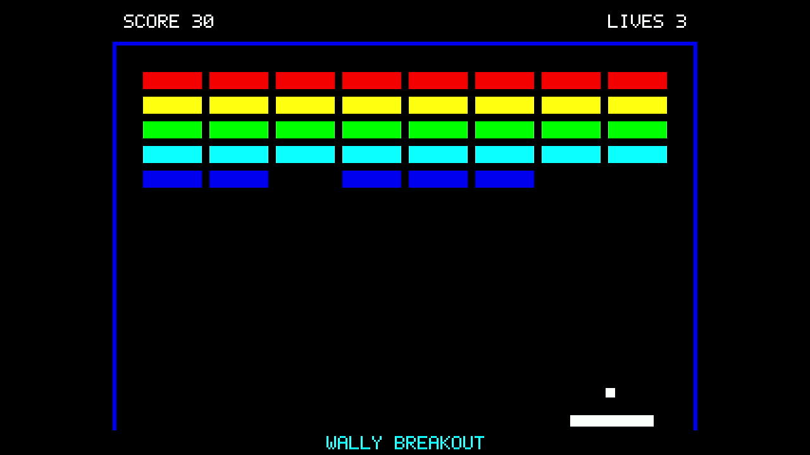
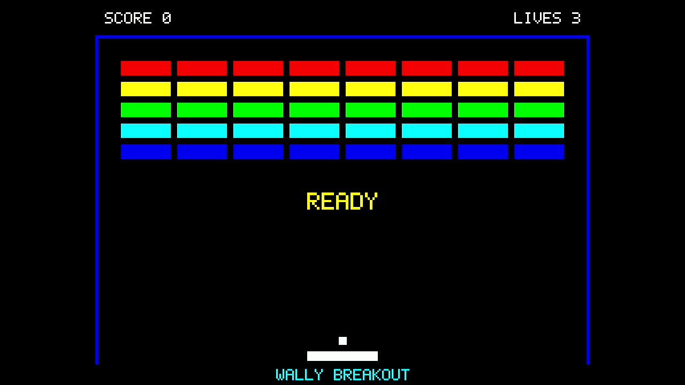
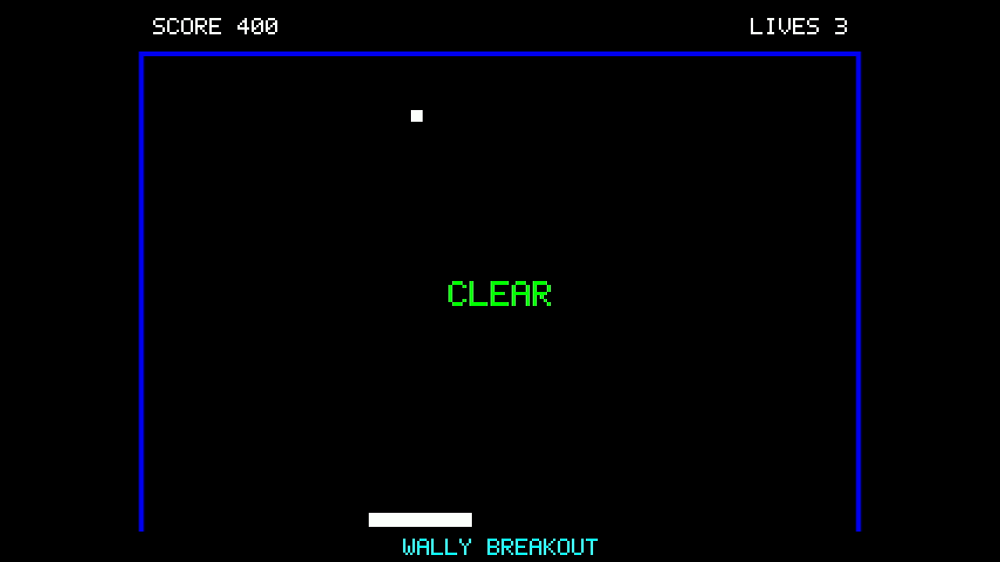
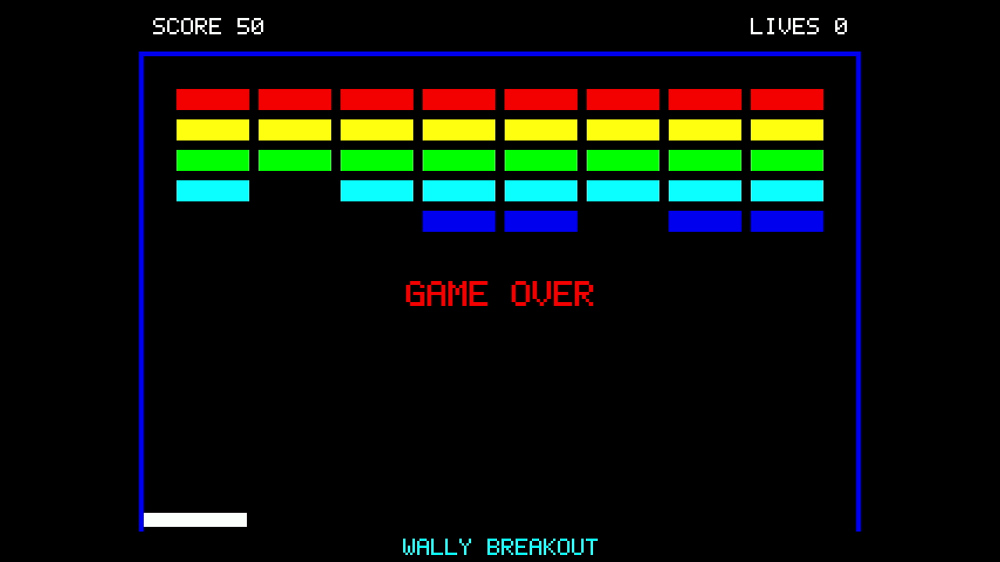

# ブロック崩しの文字配置の見直し

ゲーム画面の見出し・タイトル・状態表示について、配置の基準をそろえた。変更したのはゲーム側の [`Breakout.hpp`](../../console/examples/rasterix/Breakout.hpp) だけであり、ボールの動き、描画の転送処理、FPGA回路、公式RasterIXは変更していない。

[](video/breakout-30s.mp4)

[30秒のプレイ動画](video/breakout-30s.mp4) · [90秒の実行を含む全録画](video/complete-90s.mp4) · [使用版と実行結果](results.json)

## 配置の基準

640×480画素のゲーム画像を基準に、文字の実際の幅から位置を計算する。文字の間隔は含め、最後の文字の後ろの空白は幅に含めない。

| 表示 | 配置 |
|---|---|
| SCORE | 画面の左から24画素。上部の見出し領域で上下中央 |
| LIVES | 文字列の右端を画面の右から24画素にそろえる。SCOREと同じ高さ |
| WALLY BREAKOUT | 下部中央。文字を縦横2倍の大きさにして読みやすくする |
| READY・CLEAR・GAME OVER | 壁に囲まれたプレイ領域の中央。従来より44画素上へ移動 |

状態によって文字数が違っても、同じ計算で中央に置く。幅や高さが奇数の場合は、整数の画素位置への丸めによって中央から最大0.5画素ずれる。

| 開始待ち | クリア | ゲームオーバー |
|---|---|---|
|  |  |  |

これらは実機から取得した画像である。位置や文字を画像編集で修正したものではない。取得画像で測った文字の範囲は [capture-layout.json](results/capture-layout.json) に保存した。

## 実機で確認したこと

Nexys Video上で、変更後のゲームをSDカードから読み込んだ。実行ファイルのSHA-256がビルドしたファイルと一致することを [読み込みログ](results/load.raw) で確認してから実行した。表示回路には、[E8の研究用HDMI構成](../basic-operation-20261108/hdmi/README.md)をそのまま使用した。製品の標準表示構成による新たな試験ではない。

- **自動プレイ：** 90.017秒実行し、得点400・残機3でCLEARに到達した。終了コードは0だった。[実行ログ](results/autoplay.raw)
- **開始待ちとゲームオーバー：** 通常のUART操作で開始・移動を行い、残機0のGAME OVERを確認した。その後、終了キーで正常終了した。[実行ログ](results/manual.raw)・[送信した操作](results/manual-controls.json)
- **文字の保持：** 全録画を復号し、ゲーム画像が現れてから最後まで、SCORE、LIVES、WALLY BREAKOUTと左右の壁を検査した。[検査結果](results/frame-check/results.json)・[各画像の結果](results/frame-check/frame-observations.csv)

文字の検査では、プログラム内の5×7のフォントから、点がある場所とない場所を取り出した。23文字について、各文字35か所、合計805か所を各画像で検査した。圧縮映像では文字の輪郭付近の色が変化するため、縦横2倍に描いた各点の中央を判定位置とした。今回の録画では、ゲーム画像出現後の全画像で、この805か所が期待する文字と一致した。

この検査で確認したのは、記録された映像における固定の文字と枠の保持である。すべてのゲーム画素や衝突判定の正しさを証明するものではない。録画の60 Hzをゲームの描画FPSとして用いていない。

また、変更領域だけを描く処理について、2枚の画像を交互に更新するホスト側のモデルを6,000画面分実行し、毎回全体を描いた画像との一致を確認した。[検査コード](check_damage.cpp)・[結果](results/host-damage.txt)。このモデルの検査と実機映像の検査は別々のものである。

## 記録と再確認

製品側の変更はコミット `69a3ca21dc6960011bd8dbeef3a8daeef434dd3c` である。使用したソース、実行ファイル、ビットストリームのハッシュは [results.json](results.json) にある。以前のE6・E8の測定記録は当時のソフトウェアに対応し、今回の配置で測り直した結果には置き換えていない。

全録画の公開コピーは音声と付加情報を除いたもので、圧縮された映像データは原本と一致する。30秒版は見やすい容量に再圧縮している。[元録画との対応](video/derivation.json)と[匿名化したファイルのハッシュ](results/imports.json)を保存した。

保存した映像の文字を再確認するには、リポジトリ直下で次を実行する。`g++`、Pythonの`numpy`、`ffmpeg`、`ffprobe`が必要になる。実機操作は行わない。

```bash
mkdir -p build/breakout-layout
c++ -std=c++17 -Iconsole/examples/rasterix \
  experiments/breakout-layout-20261108/export_labels.cpp \
  -o build/breakout-layout/export-labels
build/breakout-layout/export-labels > build/breakout-layout/expected-labels.json
python3 experiments/breakout-layout-20261108/check_recording.py \
  experiments/breakout-layout-20261108/video/complete-90s.mp4 \
  build/breakout-layout/video-check \
  --labels build/breakout-layout/expected-labels.json
```

出力先は未作成のディレクトリを指定する。ゲーム本体のビルド手順は [製品のFPGA README](../../console/fpga/README.md)を参照する。
