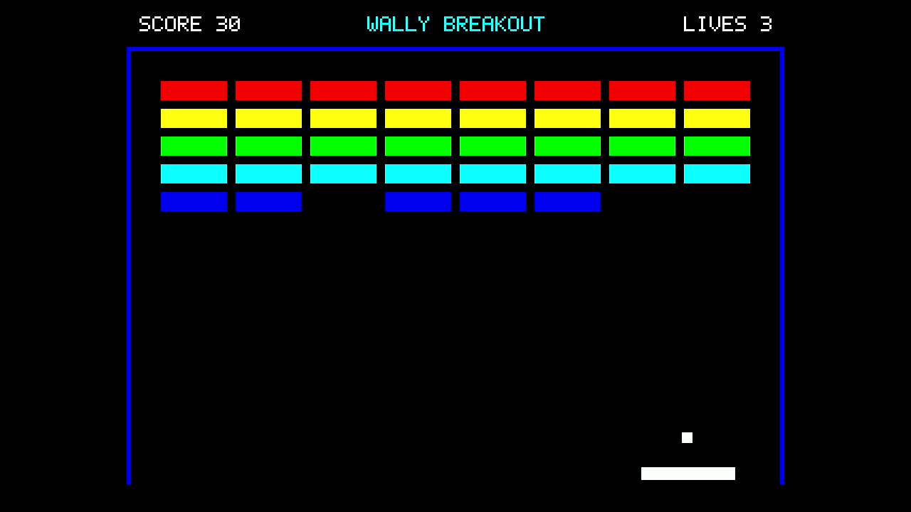

# タイトルを画面上部へ移動

**WALLY BREAKOUTを、画面上部中央のSCOREとLIVESの間に配置した。** 三つの表示は同じ高さでそろえ、下部のタイトル表示はなくした。文字の大きさは前回と同じである。

[30秒のプレイ動画](video/breakout-30s.mp4) · [起動前後を含む全録画](video/complete-30s.mp4) · [使用版と検査結果](results.json)

640×480画素のゲーム画像で、タイトルの左端は237画素、上端は15画素である。幅166画素の中央が画面の中央と一致する。SCOREは左寄せ、LIVESは右寄せを維持している。

Nexys Videoで30.000秒の自動プレイを実行し、正常終了を確認した。実機映像でも三つの表示が重ならないことを確認した。録画中のゲーム画像について、左右の壁と、三つの固定文字列の全805か所のフォント点を検査し、不一致はなかった。[実行ログ](results/game.raw)・[録画の検査結果](results/frame-check/results.json)

変更した製品ファイルは [`Breakout.hpp`](../../console/examples/rasterix/Breakout.hpp) だけである。ゲームの動作と回路構成は変更していない。今回も[E8の研究用HDMI構成](../basic-operation-20261108/hdmi/README.md)で実機確認した。以前の[下部中央の配置の記録](../breakout-layout-20261108/README.md)は、その時点の記録として残している。

実行ファイルはSDカードから読み込み、[読み込みログ](results/load.raw)でハッシュを照合した。公開画像は実機画像の付加情報だけを除き、画素は同じである。全録画は原本と圧縮された映像データが一致する。30秒版は閲覧用に再圧縮している。[元データとの対応](video/derivation.json)・[ファイルのハッシュ](results/imports.json)

固定文字の検査方法は[前回の説明](../breakout-layout-20261108/README.md#実機で確認したこと)と同じであり、タイトルの検査位置を上部へ変えた。[check_recording.py](check_recording.py)と[期待する文字データ](expected-labels.json)を保存している。この検査は全画素やすべてのゲーム動作の正しさを証明するものではない。
